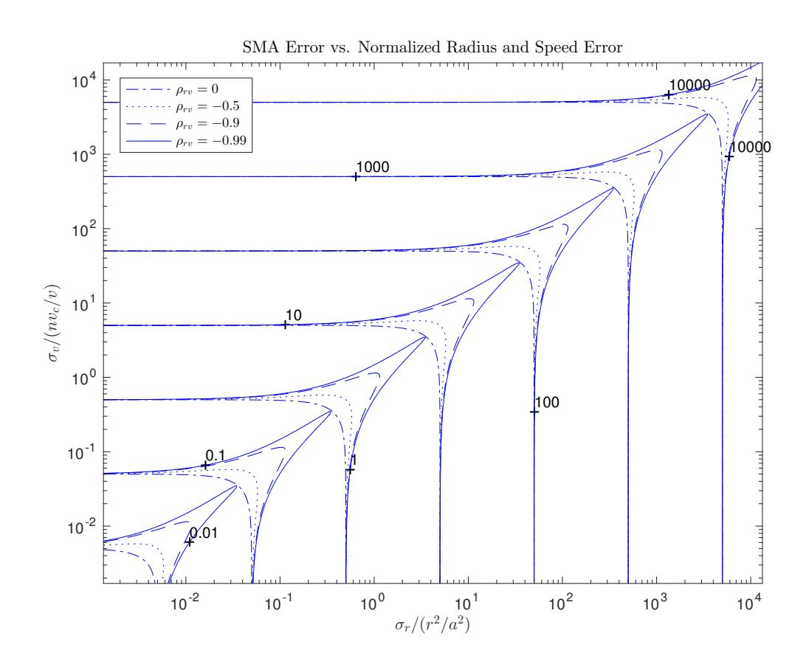
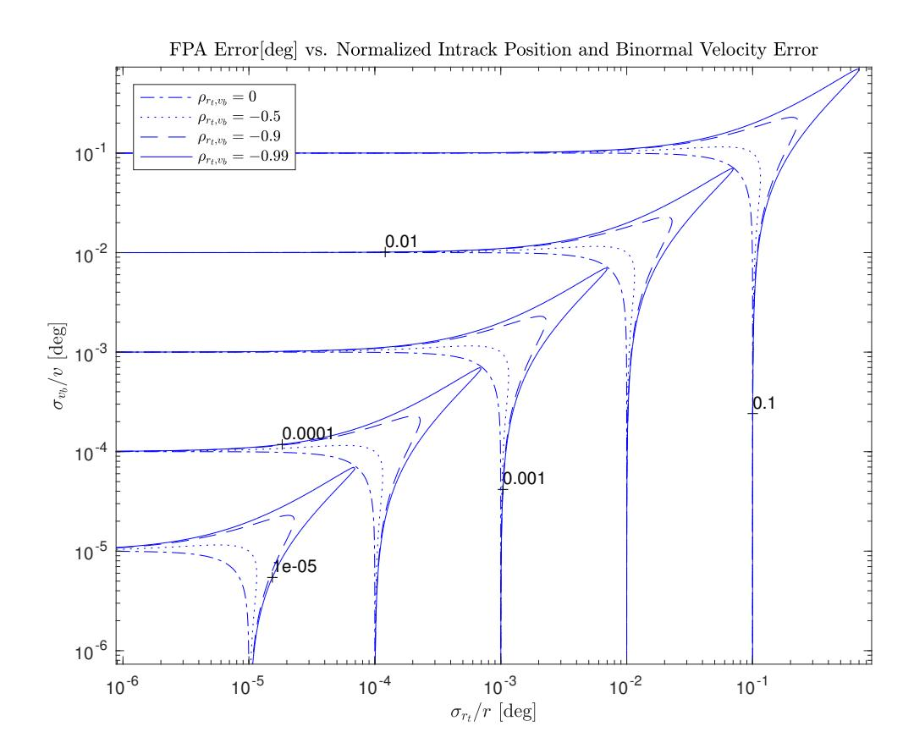
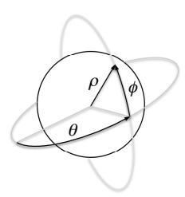
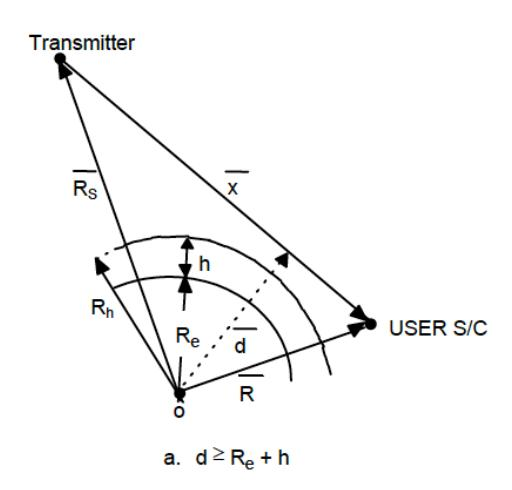
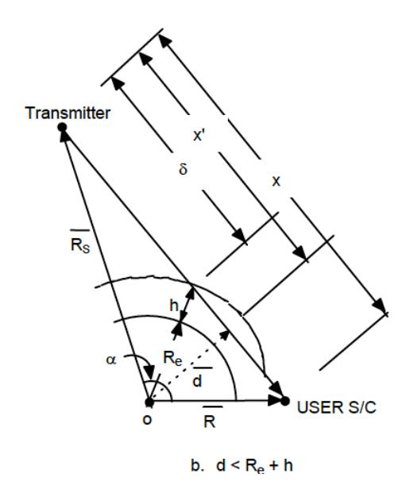
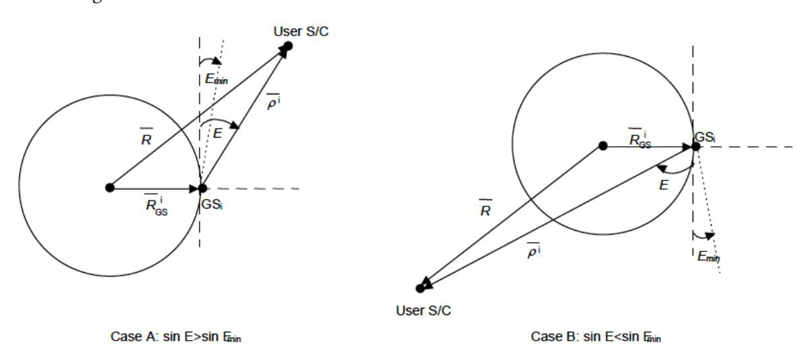
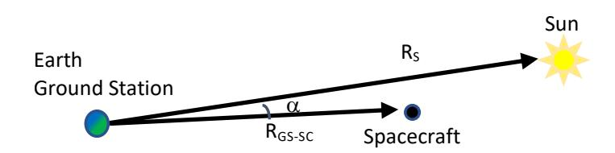
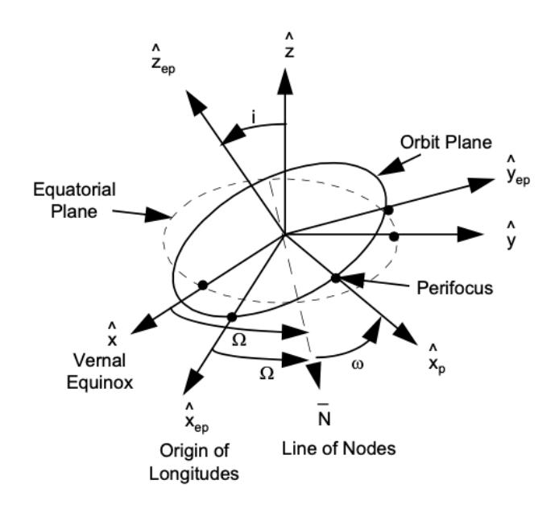

NASA/TP–2018–219822/Revision

# Navigation Filter Best Practices

*Edited By*

*J. Russell Carpenter*  
*Goddard Space Flight Center, Greenbelt, Maryland*

*Christopher N. D'Souza*  
*Johnson Space Center, Houston, Texas*

National Aeronautics and Space Administration  
NASA Engineering and Safety Center  
Hampton, Virginia 23681

March 2025

## NASA STI Program Report Series

Since its founding, NASA has been dedicated to the advancement of aeronautics and space science. The NASA scientific and technical information (STI) program plays a key part in helping NASA maintain this important role.

The NASA STI Program operates under the auspices of the Agency Chief Information Officer. It collects, organizes, provides for archiving, and disseminates NASA's STI. The NASA STI Program provides access to the NTRS Registered and its public interface, the NASA Technical Report Server, thus providing one of the largest collections of aeronautical and space science STI in the world. Results are published in both non-NASA channels and by NASA in the NASA STI Report Series, which includes the following report types:

- TECHNICAL PUBLICATION. Reports of completed research or a major significant phase of research that present the results of NASA programs and include extensive data or theoretical analysis. Includes compilations of significant scientific and technical data and information deemed to be of continuing reference value. NASA counterpart of peer-reviewed formal professional papers, but having less stringent limitations on manuscript length and extent of graphic presentations.
- TECHNICAL MEMORANDUM. Scientific and technical findings that are preliminary or of specialized interest, e.g., quick release reports, working papers, and bibliographies that contain minimal annotation. Does not contain extensive analysis.
- CONTRACTOR REPORT. Scientific and technical findings by NASA-sponsored contractors and grantees.
- CONFERENCE PUBLICATION. Collected papers from scientific and technical conferences, symposia, seminars, or other meetings sponsored or co-sponsored by NASA.
- SPECIAL PUBLICATION. Scientific, technical, or historical information from NASA programs, projects, and missions, often concerned with subjects having substantial public interest.
- TECHNICAL TRANSLATION. English-language translations of foreign scientific and technical material pertinent to NASA's mission.

Specialized services also include organizing and publishing research results, distributing specialized research announcements and feeds, providing information desk and personal search support, and enabling data exchange services.

For more information about the NASA STI Program, see the following:

- Access the NASA STI program home page at http://www.sti.nasa.gov
- Help desk contact information: https://www.sti.nasa.gov/sti-contact-form/ and select the "General" help request type.

---

The use of trademarks or names of manufacturers in this report is for accurate reporting and does not constitute an official endorsement, either expressed or implied, of such products or manufacturers by the National Aeronautics and Space Administration.

Available from:

NASA STI Program / Mail Stop 150  
NASA Langley Research Center  
Hampton, VA 23681-2199

---

NASA Engineering and Safety Center

**Navigation Filter Best Practices**

Second Edition

*J. Russell Carpenter and Christopher N. D'Souza, Editors*

with contributions from

Shyam Bhaskaran, J. Russell Carpenter, Christopher N. D'Souza, Cheryl J. Gramling, F. Landis Markley, James McCabe, Timothy McElrath, Lincoln Wood, Renato Zanetti

January 29, 2025

This material is declared a work of the US Government and is not subject to copyright protection in the United States, but may be subject to US Government copyright in other countries.

---

> If there be two subsequent events, the probability of the second $b/N$ and the probability of both together $P/N$, and it being first discovered that the second event has also happened, from hence I guess that the first event has also happened, the probability I am right is $P/b$.
>
> — Thomas Bayes, c. 1760

> The explicit calculation of the optimal estimate as a function of the observed variables is, in general, impossible.
>
> — Rudolph Kalman, 1960.

> The use of Kalman Filtering techniques in the on-board navigation systems for the Apollo Command Module and the Apollo Lunar Excursion Module was an important factor in the overwhelming success of the Lunar Landing Program.
>
> — Peter Kachmar, 2002.

*Dedicated to the memory of Landis Markley, Gene Muller, Emil Schiesser, and Bill Lear.*

# Contents

| Section | Page |
|---|---|
| Foreword to the Second Edition | v |
| Foreword to the First Edition | vii |
| Editors' Preface to the Second Edition | ix |
| Editors' Preface to the First Edition | xi |
| Notational Conventions | xv |
| **Chapter 1. The Extended Kalman Filter** | 1 |
| &emsp;1.1. The Additive Extended Kalman Filter | 1 |
| &emsp;1.2. The Multiplicative Extended Kalman Filter | 6 |
| **Chapter 2. Batch-Sequential Filters** | 9 |
| &emsp;2.1. Batch and Batch-Sequential Filters | 9 |
| &emsp;2.2. Onboard Navigation Using Batch-Sequential Filters | 10 |
| **Chapter 3. The Covariance Matrix** | 15 |
| &emsp;3.1. Metrics for Orbit State Covariances | 15 |
| &emsp;3.2. Covariance Propagation | 21 |
| &emsp;3.3. Covariance Measurement Update | 31 |
| &emsp;3.4. Sigma-Point Methods | 33 |
| **Chapter 4. Processing Measurements** | 35 |
| &emsp;4.1. Measurement Latency | 35 |
| &emsp;4.2. Invariance to the Order of Measurement Processing | 36 |
| &emsp;4.3. Processing Vector Measurements | 37 |
| &emsp;4.4. Filter Cascades | 38 |
| &emsp;4.5. Use of Data from Inertial Sensors | 38 |
| **Chapter 5. Measurement Underweighting** | 41 |
| &emsp;5.1. Introduction | 41 |
| &emsp;5.2. Nonlinear Effects and the Need for Underweighting | 42 |
| &emsp;5.3. Underweighting Measurements | 46 |
| &emsp;5.4. Pre-Flight Tuning Aids | 47 |
| **Chapter 6. Bias Modeling** | 49 |
| &emsp;6.1. Zero-Input Bias State Models | 49 |
| &emsp;6.2. Single-Input Bias State Models | 51 |
| &emsp;6.3. Multi-Input Bias State Models | 56 |
| **Chapter 7. State Representations** | 61 |
| &emsp;7.1. Selection of Solve-For State Variables for Estimation | 61 |
| &emsp;7.2. Units and Precision | 61 |
| &emsp;7.3. Coordinate and Time Systems | 61 |
| &emsp;7.4. Orbit Parameterizations | 62 |
| &emsp;7.5. Relative State Representations | 62 |
| &emsp;7.6. Modeling Inertial Components | 66 |
| **Chapter 8. Factorization Methods** | 71 |
| &emsp;8.1. Why Use the UDU Factorization? | 71 |
| &emsp;8.2. Preliminaries | 72 |
| &emsp;8.3. The Time Update of the Covariance | 73 |
| &emsp;8.4. The Measurement Update | 80 |
| &emsp;8.5. Conclusions | 84 |
| **Chapter 9. Attitude Estimation** | 85 |
| &emsp;9.1. Attitude Matrix Representation | 85 |
| &emsp;9.2. Euler Axis/Angle Representation | 87 |
| &emsp;9.3. Quaternion Representation | 88 |
| &emsp;9.4. Rodrigues Parameter Representation | 91 |
| &emsp;9.5. Modified Rodrigues Parameters | 92 |
| &emsp;9.6. Rotation Vector Representation | 93 |
| &emsp;9.7. Euler Angles | 94 |
| &emsp;9.8. Additive EKF (AEKF) | 95 |
| &emsp;9.9. Multiplicative EKF (MEKF) | 96 |
| **Chapter 10. Usability Considerations** | 101 |
| &emsp;10.1. Editing | 101 |
| &emsp;10.2. Reinitialization and Restarts | 106 |
| &emsp;10.3. Backup Ephemeris | 106 |
| &emsp;10.4. Ground System Considerations | 110 |
| **Chapter 11. Smoothing** | 113 |
| **Chapter 12. Advanced Estimation Algorithms** | 117 |
| &emsp;The Sigma-Point Estimator | 117 |
| **Appendix A. Models and Realizations of Random Variables** | 123 |
| **Appendix B. The Mathematics Behind the UDU Factorization** | 125 |
| &emsp;B.1. The Partitioning into Two Subproblems | 125 |
| &emsp;B.2. The Mathematics Behind the Second Subproblem | 125 |
| &emsp;B.3. The Agee-Turner Rank-One Update | 127 |
| &emsp;B.4. Decorrelating Measurements | 130 |
| &emsp;B.5. The Carlson Rank-One Update | 130 |
| **Appendix C. An Analysis of Dual Inertial-Absolute and Inertial-Relative Navigation Filters** | 137 |
| &emsp;C.1. Introduction | 137 |
| &emsp;C.2. The Filter Dynamics | 137 |
| &emsp;C.3. Incorporation of Measurements | 140 |
| &emsp;C.4. Analysis of the Merits of the Inertial-Absolute and Inertial-Relative Filters | 143 |
| &emsp;C.5. Conclusions | 144 |
| **Bibliography** | 147 |
| **Index of Best Practices** | 151 |

# Foreword to the Second Edition

Many engineers have heard of Kalman filtering and many use Kalman filters in their state estimation work, especially those of us involved in navigation. The Kalman filter is a powerful tool in spacecraft navigation. Yet my experience is that many (if not most) of these same engineers do not fully understand the underlying mathematics, the basic assumptions, nor how to expertly analyze the estimation accuracies produced by the Kalman filter algorithms. This is especially true when the Kalman filter (which is based on linear system theory) is utilized in the more realistic stochastic non-linear setting. Its full potential and limitations are not always well understood especially when transitioning from its traditional linear formulation to non-linear systems, which is where the extended Kalman filter (EKF) comes into play. The extended Kalman filter is known to be an *ad hoc* algorithm and requires skill to properly tune to obtain realistic state estimation accuracies.

In practical scenarios, most systems are nonlinear, and we often linearize the system around the current state estimate using Jacobian matrices, but this linearization can introduce inaccuracies, especially when the underlying system is highly nonlinear. Because of this, the nonlinear filters can be unstable or inaccurate if the assumptions of small nonlinearities or well-behaved systems are violated. Tuning the filter becomes more complex, requiring an understanding of both the system dynamics and the noise characteristics. This is largely an art form.

What is critically important in applications utilizing EKFs and various variants of the Kalman filter based on linearization assumptions (such as Taylor series approximations) is that the state estimation error covariance matrix (which is an approximation due to the linearizations inherent in the algorithm) reflect reality as closely as possible. For example, during a spacecraft rendezvous where the state estimation accuracy is a key to the mission success, the state estimation error covariance provides insight into how the filter is performing. Sometimes engineers apply the filter without thoroughly analyzing the state estimation error covariances beforehand (typically employing high-fidelity computer simulations) potentially leading to overconfidence in the estimated states during actual operations.

Many of the tools the Apollo and Shuttle era navigators employed to analyze and tune the EKF have seemingly been lost in time. These include Monte Carlo analysis, error budgets, and sensitivity analysis and the development of suboptimal filters utilizing these tools. Additionally, questions around measurement underweighting and measurement editing and the role of measurement residuals in keeping the EKF stable are often overlooked.

Dr. Carpenter and Dr. D'Souza have assembled a text exploiting the wisdom of many experts in the field. Indeed, this book will guide you through a more clearly developed understanding of Kalman filters in practical applications. The material is presented from an engineering perspective – it is not a mathematics treatise. In that sense, it is a treasure for practitioners and will remain a key resource for engineers to truly understand how to create and tune nonlinear filters in state estimation applications. Also the authors present outstanding material for highly nonlinear systems employing other approaches like Unscented Kalman Filters (UKF) and Particle Filters (PF), which might provide more robust solutions.

In essence, while the Kalman filter and its variants are widely used, their correct application, particularly in nonlinear settings requires deep expertise and curiosity when the estimation errors don't meet expectations.

Robert H. Bishop, PhD, PE  
Vice Chancellor for Engineering, The Texas A&M University System  
Dean of Engineering, Texas A&M University  
Director, Texas A&M Engineering Experiment Station  
Harold J. Haynes Dean's Chair in Engineering  
October 2024

# Foreword to the First Edition

It certainly should not come as a surprise to the reader that navigation systems are at the heart of almost all of NASA's missions, either on our launch vehicles, on robotic science spacecraft, or on our crewed human exploration vehicles. Clearly navigation is absolutely fundamental to operating our space systems across the wide spectrum of mission regimes. Safe and reliably performing navigation systems are essential elements needed for routine low Earth orbiting science missions, for rendezvous and proximity operation missions or precision formation flying missions (where relative navigation is a necessity), for navigation through the outer planets of the solar system, and for accomplishing pinpoint landing on planets/small bodies, and many more mission types.

I believe the reader will find that the navigation filter best practices the team has collected, documented, and shared in this first edition book will be of practical value in your work designing, developing, and operating modern navigation systems for NASA's challenging future missions. I want to thank the entire team that has diligently worked to create this NASA Engineering and Safety Center (NESC) GN&C knowledge capture report. I especially want to acknowledge the dedication, care, and attention to detail as well as the energy that both Russell Carpenter and Chris D'Souza, the report editors, have invested in producing this significant product for the GN&C community of practice. It was Russell and Chris who had the inspiration to create this report and they have done a masterful job in not only directly technically contributing to the report but also coordinating its overall development. It should be mentioned that some high-level limited work was previously performed under NESC sponsorship to capture the lessons learned over the course of the several decades NASA has been navigating space vehicles. This report however fills a unique gap by providing extensive technical details and, perhaps more importantly, providing the underlying rationale for each of the navigation filter best practices presented here. Capturing these rationales has proven to be a greatly needed but very challenging task. I congratulate the team for taking this challenge on.

The creation, and the wide dissemination of this report, is absolutely consistent with the NESC's commitment to engineering excellence by capturing and passing along, to NASA's next generation of engineers, the lessons learned emerging from the collective professional experiences of NASA's navigation system subject matter experts. I believe this book will not only provide relevant tutorial-type guidance for early career GN&C engineers that have limited real-world on the job experience but it should also serve as a very useful memory aid for more experienced GN&C engineers, especially as a handy reference to employ for technical peer reviews of navigation systems under development.

As the NASA Technical Fellow for GN&C I urge the reader (especially the "navigators" among you obviously) to invest the time to digest and consider how the best practices provided in this report should influence your own work developing navigation systems for the Agency's future missions. The editors and I recognize this will be a living document and we sincerely welcome your feedback on this first edition of the report, especially your constructive recommendations on ways to improve and/or augment this set of best practices.

Cornelius J. Dennehy  
NASA Technical Fellow for GN&C  
January 2018

# Editors' Preface to the Second Edition

This second edition welcomes several new contributors, and features a new chapter on batch filtering for onboard applications, major augmentations to the chapters on factorization and usability, and numerous minor corrections. An index of best practices has also been added.

The Editors wish to thank the many readers whose feedback has resulted in the improvements to the present edition; in particular: Nathan Stacey, John Christian, Terry Sabaka, and Francesco Capolupo.

Among the main topics of feedback we received for the first edition concerned our failure to explicitly mention that the primary target application for these best practices is onboard, rather than ground-based navigation, although many of the best practices described here have mutual applicability to both domains. It is not our purpose here to recapitulate the pros and cons of onboard vs. ground-based navigation, or to discuss when one or the other approach is either necessary and/or desirable. For those interested in such topics, a number of standard texts [[5](#page-170-1), [62](#page-172-0)] discuss this trade space. Rather, herein we proceed from the notion that for a given application, the trade has resulted in a decision to implement onboard navigation. Thus, the best practices offered here pertain primarily to this context.

# Editors' Preface to the First Edition

As the era of commercial spaceflight begins, NASA must ensure that lessons the US has learned over the first 50 years of the Space Age will continue to positively influence the continuing exploration and development of space. Of the many successful strands of this legacy, onboard navigation stands out as an early triumph of technology whose continuous development and improvement remains as important to future exploration and commercial development as it was in the era of *Gemini* and *Apollo*. The key that opened the door to practical and reliable onboard navigation was the discovery and development of the extended Kalman filter (EKF) in the 1960s, a story that has been well-chronicled by Stanley Schmidt [[76](#page-173-0)], and Kalman filtering has far outgrown NASA's applications over the intervening decades. What are less well-documented are the accumulated art and lore, tips and tricks, and other institutional knowledge that NASA navigators have employed to design and operate EKFs in support of dozens of missions in the *Gemini/Apollo* era, well over one hundred Space Shuttle missions, and numerous robotic missions, without a failure ever attributed to an EKF. To document the best of these practices is the purpose that motivates the contributors of the present document.

Kernels of such best practices have appeared, scattered throughout the open technical literature, but such contributions are limited by organizational publication policies, and in some cases by technology export considerations. Even within NASA, there has heretofore not been any attempt to codify this knowledge into a readily available design handbook that could continue to evolve along with the navigation community of practice. As a result, even within the Agency, it is possible for isolated practitioners "not to know any better:" to fail to appreciate the subtleties of successful and robust navigation filter design, and to lack an understanding of the motivations for, and the implied cost/benefit trades, of many of the tried and true approaches to filter design.

Some limited progress toward filling this void has been made at a summary level in reports and briefings prepared for the NASA Engineering and Safety Center (NESC) [[20](#page-170-2)]. In particular, one of a series of recommendations in Reference [20](#page-170-2) "…directed towards the development of future non-human rated [rendezvous] missions…" included as its fourteenth recommendation the admonishment to "[u]tilize best practices for rendezvous navigation filter design." This recommendation listed eight such practices, as follows:

- a. **Maintain an accurate representation of the target-chaser relative state estimation errors, including an accurate variance-covariance matrix.** This allows the filter to compute an appropriate gain matrix. It also aids the filter in appropriately editing unsuitable measurements.
- b. **Provide a capability for measurement underweighting that adapts to the current uncertainty in the filter's state estimation error, as required to be consistent with the suboptimality of the navigation filter's measurement update.** Effective means for accomplishing this have been found to include:
  - i. Modified second-order Gaussian state update method [[38](#page-171-0)];
  - ii. Multiplicative adjustment of the mapping of the state error covariance matrix into the measurement subspace, which occurs within the computation of the residual covariance [[91](#page-173-1)]; and
  - iii. Schmidt-Kalman state update [[7](#page-170-3)] that utilizes the covariance matrix of "consider" parameters (i.e., states that the filter does not update, but for which it maintains a covariance).

  Multiplicative adjustment of the measurement noise covariance matrix within the computation of the residual covariance (the "bump up R" method [[7](#page-170-3)]) has been found to be less effective, and is not recommended unless other methods are not feasible.
- c. **Estimate states that model biases in sensor measurements and account for unmodeled accelerations.** Gauss-Markov models for these biases have been found to be more effective than random constant or random walk models. Random constant models can become stale, and random walk models can overflow during long periods without measurement updates.
- d. **Provide commands that allow for selective processing of individual measurement types.** If the filter utilizes an automated residual edit process, then the recommended command capability should be able to override the residual edit test.
- e. **Maintain a backup ephemeris, unaltered by measurement updates since initialization, which can be used to restart the filter without uplink of a new state vector.**
- f. **Provide a capability for reinitializing the covariance matrix without altering the current state estimate.**
- g. **Ensure tuning parameters are uplinkable to the spacecraft, and capable of being introduced to the filter without loss of onboard navigation data.**
- h. **Provide flexibility to take advantage of sensors' and sensor suites' full capability over all operating ranges.**

A subsequent briefing given for an NESC webinar listed these as well as the following "additional considerations:"

- State Representation
  - Translational states
    - Dual inertial
    - Inertial/relative
    - Relative-only
  - Attitude states, as required
    - 3-parameter vs. 4-parameter
    - Multiplicative vs. additive update
- Covariance Factorization (or not)
  - U-D
  - "Square Root" Methods
- Measurement Correlation
- Non-simultaneous Measurements
- Backward smoothing (for [Best Estimated Trajectories/Reconstructions])
- Error Budgets
- Sensitivity Analysis
- [Inertial Measurement Unit]/Accelerometer Processing
- Observability

While these summary-level lists give the community a place to start, they are lacking in some respects. They lack sufficient rationale that would motivate a designer to adopt them. Even if so motivated, a designer needs much more detailed information concerning how to implement the recommendations.

The present work is an attempt to address these shortcomings. Each contributor has selected one aspect of navigation filter design, or several closely related ones, as the basis of a chapter. Each chapter clearly identifies best practices, where a consensus of the community of practice exists. While it is sometimes difficult to cast aside one's opinions and express such a consensus, each contributor has made a best effort in this regard. Where a diversity of opinion exists, the chapter will summarize the arguments for and against each approach. Also, if promising new developments are currently afoot, the chapter will assess their prospects.

While the contributors strive for consistency of convention and notation, each has his own preferences, and readers may need to accommodate subtle differences along these lines as they traverse the book. The first chapter, which summarizes the EKF, sets the stage, and should be briefly perused by even seasoned navigators in order to become familiar with the conventions adopted for this work. Subsequent chapters should stand on their own, and may be consulted in any order.

While this is a NASA document concerned with space navigation, it is likely that many of the principles would apply equally to the wider navigation community. That said, readers should keep in mind that hard-earned best practices of a particular discipline do not always carry over to others, even though they may be seemingly similar. To assume so is a classic example of the logical fallacy *argumentum ad verecundiam*, or the argument from [false] authority.

Finally, the contributors intend for this work to be a living document, which will continue to evolve with the state of the practice.

# Notational Conventions

| Symbol | Meaning |
|---|---|
| $\mathbb{A}$ | A set |
| $a, \alpha, A$ | Scalars |
| $\mathbf{q}, \mathbf{M}$ | An array of scalars, e.g. column, row, matrix |
| $\boldsymbol{x}$ | A point in an abstract vector space |
| $\vec{\boldsymbol{r}}$ | A physical vector, i.e. an arrow in 3-D space |
| $\mathcal{F}$ | A coordinate frame |
| $\mathbf{M}^{\mathsf{T}}$ | The transpose of the array $\mathbf{M}$ |
| $\lVert \boldsymbol{x} \rVert$ | The (2-)norm of the vector $\boldsymbol{x}$ |
| $\mathsf{y}$ | A random variable |
| $\boldsymbol{\mathsf{z}}$ | A random vector |
| $\mathrm{p}_{\mathsf{x}}(x)$ | The probability density function of the random variable $\mathsf{x}$ evaluated at the realization $x$ |
| $\Pr(\mathsf{y} < Y)$ | The probability that $\mathsf{y} < Y$ |
| $\mathrm{E}[\boldsymbol{\mathsf{z}}]$ | The expectation of the random vector $\boldsymbol{\mathsf{z}}$ |
| $\exp(t)$ | The exponential function of $t$ |
| $\mathrm{e}^{t}$ | $\exp(t)$ written as Euler's number raised to the $t$ power |
| $\mathrm{d}x$ | Leibniz' (total) differential of $x$ |
| $\dfrac{\mathrm{d}y}{\mathrm{d}x}$ | (First) (total) derivative of $y$ with respect to $x$ |
| $\dfrac{\mathrm{d}^{n}y}{\mathrm{d}x^{n}} = \dfrac{\mathrm{d}^{n}}{\mathrm{d}x^{n}}\,y$ | $n$th (total) derivative of $y$ with respect to $x$ |
| $\dfrac{{}^{\mathcal{F}}\mathrm{d}^{n}}{\mathrm{d}t^{n}}\,\vec{\boldsymbol{r}}$ | $n$th (total) derivative of $\vec{\boldsymbol{r}}$ with respect to $t$ in frame $\mathcal{F}$ |
| $\dfrac{\partial \mathbf{M}}{\partial \boldsymbol{x}}$ | (First) partial derivative of $\mathbf{M}$ with respect to $\boldsymbol{x}$ |
| $\left.\dfrac{\partial M}{\partial x}\right\rvert_{x_o}$ | (First) partial of $M$ with respect to $x$, evaluated at $x_o$ |
| $\dot{x}, \ddot{x}$, etc. | Overdots may be used as a shorthand for time derivatives |

# Chapter 1. The Extended Kalman Filter

*Contributed by J. Russell Carpenter*

As described in the preface, use of the Extended Kalman Filter (EKF) for navigation has a long history of flight-proven success. The EKF thus forms the foundational best practice advocated by this work, and it forms the basis for many of the best practices later chapters describe. The purpose of the present chapter is not to derive the EKF and its relations, but rather to present them in a basic form, as a jumping off point for the rest of the material we shall present. As we shall show, while the EKF is a powerful and robust algorithm, it is based on a few *ad hoc* assumptions, which can lead to misuses and misunderstandings. Many of the best practices we shall describe are tricks of the trade that address such issues.

## 1.1. The Additive Extended Kalman Filter

The *additive* EKF is distinguished from the *multiplicative* EKF (MEKF) by the form of its measurement update. The additive EKF is the usual and original form of the EKF, and when we refer to the EKF without a modifier, one may assume we mean the additive form.

### 1.1.1. The Dynamics Model

Suppose we have a list of $n$ real quantities that we need to know in order to perform navigation, and we have a differential equation that tells us how these quantities evolve through time, such as

$$
\dot{\boldsymbol{X}}(t) = \boldsymbol{f}(\boldsymbol{X}(t), t) \tag{1.1}
$$

where $\boldsymbol{X} \in \mathbb{R}^n$, which we call the *state vector*, contains the quantities of interest; we shall call $\boldsymbol{f}(\boldsymbol{X}, t)$ the *dynamics function*. If we knew these quantities perfectly at any time, [\(1.1\)](#page-24-2) would allow us to know them at any other time. For a variety of reasons, this is not the case however; both the initial conditions and the dynamics function are corrupted by uncertainty.

Suppose instead that the quantities of interest are realizations of a random process, $\boldsymbol{\mathsf{X}}(t)$, whose distribution at some initial time $t_o$ is known to us, and whose evolution (forward) in time follows the stochastic differential equation given by

$$
\mathrm{d}\boldsymbol{\mathsf{X}}(t) = \boldsymbol{f}(\boldsymbol{\mathsf{X}}(t), t)\,\mathrm{d}t + \mathbf{B}(t)\,\mathrm{d}\boldsymbol{\mathsf{w}}(t) \tag{1.2}
$$

where the presence of the *process noise* $\mathrm{d}\boldsymbol{\mathsf{w}}(t)$ reflects uncertainty in the dynamics. To interpret [\(1.2\)](#page-24-3), imagine $\mathrm{d}\boldsymbol{\mathsf{w}}(t)$ as the limit of a discrete sequence of random increments, as the time between increments goes to zero. The result will be a continuous but non-differentiable process; hence the notation $\dot{\boldsymbol{\mathsf{X}}}(t)$ has ambiguous meaning. Henceforth, we shall define our notation such that when we write

$$
\dot{\boldsymbol{\mathsf{X}}}(t) = \boldsymbol{f}(\boldsymbol{\mathsf{X}}(t), t) + \mathbf{B}(t)\boldsymbol{\mathsf{w}}(t) \tag{1.3}
$$

what we mean is really [\(1.2\)](#page-24-3).

Finally, suppose that at some earliest time, $t_o$, the initial distribution of $\boldsymbol{\mathsf{X}}(t_o)$ is Gaussian, with mean and covariance given by

$$
\mathrm{E}[\boldsymbol{\mathsf{X}}(t_o)] = \bar{\boldsymbol{X}}_o \quad \text{and} \quad \mathrm{E}\big[(\boldsymbol{\mathsf{X}}(t_o) - \bar{\boldsymbol{X}}_o)(\boldsymbol{\mathsf{X}}(t_o) - \bar{\boldsymbol{X}}_o)^{\mathsf{T}}\big] = \mathbf{P}_o \tag{1.4}
$$

and suppose that infinitesimal increments of $\boldsymbol{\mathsf{w}}(t)$ are Gaussian, with

$$
\mathrm{E}[\boldsymbol{\mathsf{w}}(t)] = \mathbf{0} \quad \text{and} \quad \mathrm{E}[\boldsymbol{\mathsf{w}}(t)\boldsymbol{\mathsf{w}}^{\mathsf{T}}(\tau)] = \mathbf{Q}(t)\delta(t - \tau) \tag{1.5}
$$

where $\mathbf{Q}(t)$ is the power spectral density function of $\boldsymbol{\mathsf{w}}(t)$, and $\delta(t - \tau)$ is the Dirac delta, a generalized function. We shall also assume that

$$
\mathrm{E}\big[\boldsymbol{\mathsf{w}}(t)(\boldsymbol{\mathsf{X}}(t_o) - \bar{\boldsymbol{X}}_o)^{\mathsf{T}}\big] = \mathbf{0},\ \forall\, t \tag{1.6}
$$

We shall take [\(1.3\)](#page-24-4) – [\(1.6\)](#page-25-0) to define the *dynamics model* for the additive EKF. Note that even though we have assumed $\boldsymbol{\mathsf{X}}(t_o)$ and $\boldsymbol{\mathsf{w}}(t)$ are Gaussian, we cannot assume that $\boldsymbol{\mathsf{X}}(t)$ remains Gaussian for $t > t_o$, because $\boldsymbol{f}$ may be a nonlinear function.

### 1.1.2. The Measurement Model

In an ideal world, we might have devices for measuring all of the state vector components directly; then state determination would be simply a matter of collecting enough such observations to reduce the state uncertainty to sufficient levels. Unfortunately, this is almost never the case. Instead, like Socrates' prisoners, we can usually only perceive noisy projections of the state elements, at discrete times, $t_i$, in the form of *measurements*:

$$
\boldsymbol{\mathsf{Y}}(t_i) = \boldsymbol{h}(\boldsymbol{\mathsf{X}}(t_i), t_i) + \boldsymbol{\mathsf{v}}(t_i) \tag{1.7}
$$

where $\boldsymbol{h}$ is a surjection from $\mathbb{R}^n$ to $\mathbb{R}^m$. We shall assume that $\boldsymbol{\mathsf{v}}(t_i)$, which we call the *measurement noise*, is a Gaussian sequence, with mean and covariance given by

$$
\mathrm{E}[\boldsymbol{\mathsf{v}}(t_i)] = \mathbf{0} \quad \text{and} \quad \mathrm{E}[\boldsymbol{\mathsf{v}}(t_i)\boldsymbol{\mathsf{v}}(t_j)^{\mathsf{T}}] = \mathbf{R}(t_i)\delta_{ij} \tag{1.8}
$$

where $\delta_{ij}$ is the Kronecker delta function. We shall also assume that

$$
\mathrm{E}\big[\boldsymbol{\mathsf{v}}(t_i)(\boldsymbol{\mathsf{X}}(t_o) - \bar{\boldsymbol{X}}_o)^{\mathsf{T}}\big] = \mathbf{0} \quad \text{and} \quad \mathrm{E}[\boldsymbol{\mathsf{w}}(t)\boldsymbol{\mathsf{v}}(t_i)^{\mathsf{T}}] = \mathbf{0},\ \forall\, i, t \tag{1.9}
$$

We shall take [\(1.7\)](#page-25-1) – [\(1.9\)](#page-25-2) to define the *measurement model* for the additive EKF. Note that we cannot assume that $\boldsymbol{\mathsf{Y}}(t_i)$ is Gaussian, because $\boldsymbol{h}$ may be a nonlinear function. For compactness of notation, we shall often suppress the time argument and write [\(1.7\)](#page-25-1) as

$$
\boldsymbol{\mathsf{Y}}_i = \boldsymbol{h}_i(\boldsymbol{\mathsf{X}}_i) + \boldsymbol{\mathsf{v}}_i \tag{1.10}
$$

### Bayes' Law, the Markov Property, and Observability

Bayes' Law tells us how to update the conditional probability density function (PDF) of $\boldsymbol{\mathsf{X}}(t_i)$, given a realization $\boldsymbol{Y}(t_i)$ of the random process $\boldsymbol{\mathsf{Y}}(t_i)$:

$$
\mathrm{p}_{\boldsymbol{\mathsf{X}}_i|\boldsymbol{\mathsf{Y}}_i}(\boldsymbol{X}_i|\boldsymbol{Y}_i) = \mathrm{p}_{\boldsymbol{\mathsf{Y}}_i|\boldsymbol{\mathsf{X}}_i}(\boldsymbol{Y}_i|\boldsymbol{X}_i)\,\frac{\mathrm{p}_{\boldsymbol{\mathsf{X}}_i}(\boldsymbol{X}_i)}{\mathrm{p}_{\boldsymbol{\mathsf{Y}}_i}(\boldsymbol{Y}_i)} \tag{1.11}
$$

If all the PDFs in [\(1.11\)](#page-25-3) were known, it would be relatively simple to use [\(1.11\)](#page-25-3) to estimate the state vector from a single measurement; our best estimate of the state would simply be the mean of $\mathrm{p}_{\boldsymbol{\mathsf{X}}_i|\boldsymbol{\mathsf{Y}}_i}(\boldsymbol{X}_i|\boldsymbol{Y}_i)$. But to apply [\(1.11\)](#page-25-3) to the navigation problem, where we have a time sequence of measurements, $\mathbb{Y}_i = \{\boldsymbol{Y}_i, \boldsymbol{Y}_{i-1}, \ldots, \boldsymbol{Y}_1\}$, we need to consider how the state dynamics evolve.

Unlike [\(1.1\)](#page-24-2), our dynamics model, given by [\(1.3\)](#page-24-4), only runs forward in time. Hence, the state at any future time depends only on its history. Also, because the non-homogeneous inputs to [\(1.3\)](#page-24-4) are uncorrelated by the Dirac delta in [\(1.5\)](#page-25-4), the value of the state at any particular time in the future depends only on its present value, and its accumulated diffusion due to the process noise over the interval between now and the future time of interest. Random processes such as this are said to possess the *Markov Property*. Using this property, we can write [\(1.11\)](#page-25-3) in terms of the measurement history as follows:

$$
\mathrm{p}_{\boldsymbol{\mathsf{X}}_i|\mathbb{Y}_i}(\boldsymbol{X}_i|\mathbb{Y}_i) = \mathrm{p}_{\boldsymbol{\mathsf{Y}}_i|\boldsymbol{\mathsf{X}}_i}(\boldsymbol{Y}_i|\boldsymbol{X}_i)\,\frac{\mathrm{p}_{\boldsymbol{\mathsf{X}}_i|\mathbb{Y}_{i-1}}(\boldsymbol{X}_i|\mathbb{Y}_{i-1})}{\mathrm{p}_{\boldsymbol{\mathsf{Y}}_i|\mathbb{Y}_{i-1}}(\boldsymbol{Y}_i|\mathbb{Y}_{i-1})} \tag{1.12}
$$

Even if we could compute all of the PDFs in [\(1.12\)](#page-26-0), we are not guaranteed that the sequence of measurements provide sufficient information to reduce the initial uncertainty of all the modes of [\(1.1\)](#page-24-2). If the system given by [\(1.1\)](#page-24-2) and [\(1.10\)](#page-25-5) is such that use of [\(1.12\)](#page-26-0) results in uncertainty in all the modes going asymptotically to zero in finite time, from any initial condition, then we say the system is *globally asymptotically observable*. If at least all of the unstable modes are observable, then we say the system is *detectable*. Unfortunately, for nonlinear systems, there is no known way to compute global observability. At best, under certain restrictions on [\(1.1\)](#page-24-2) and [\(1.10\)](#page-25-5), we can in principle establish local observability, in the neighborhood of a particular initial condition. However, this is a laborious calculation, often numerically unstable to evaluate. Also, note that observability is a property of the structure of [\(1.1\)](#page-24-2) and [\(1.10\)](#page-25-5), and hence is dependent on how one chooses to represent the navigation problem. Hence, a system that is observable with one representation may be unobservable with a different representation.

Kalman's original filter, which we now usually call the *linear Kalman filter* (LKF), is the result when the dynamics and measurement models are linear, Markov, Gaussian, and observable. An appreciation of the linear Kalman filter is essential to understanding the strengths and weaknesses of the EKF, although it is almost never the case that such assumptions are valid for real-world navigation problems.

### 1.1.3. The Linear Kalman Filter

Suppose the dynamics and measurements are given by the following discrete-time linear models:

$$
\boldsymbol{\mathsf{x}}_i = \boldsymbol{\Phi}_{i,i-1}\boldsymbol{\mathsf{x}}_{i-1} + \boldsymbol{\Gamma}_i\boldsymbol{\mathsf{u}}_i \tag{1.13}
$$

$$
\boldsymbol{\mathsf{y}}_i = \mathbf{H}_i\boldsymbol{\mathsf{x}}_i + \boldsymbol{\mathsf{v}}_i \tag{1.14}
$$

with

$$
\mathrm{E}[\boldsymbol{\mathsf{x}}_o] = \bar{\boldsymbol{x}}_o \quad \text{and} \quad \mathrm{E}[(\boldsymbol{\mathsf{x}}_o - \bar{\boldsymbol{x}}_o)(\boldsymbol{\mathsf{x}}_o - \bar{\boldsymbol{x}}_o)]^{\mathsf{T}}] = \mathbf{P}_o \tag{1.15}
$$

$$
\mathrm{E}[\boldsymbol{\mathsf{u}}_i] = \mathbf{0} \quad \text{and} \quad \mathrm{E}\big[\boldsymbol{\Gamma}_i\boldsymbol{\mathsf{u}}_i\boldsymbol{\mathsf{u}}_j^{\mathsf{T}}\boldsymbol{\Gamma}_i^{\mathsf{T}}\big] = \mathbf{S}_i\delta_{ij} \tag{1.16}
$$

and the moments of $\boldsymbol{\mathsf{v}}_i$ as given by [\(1.8\)](#page-25-6). This system will be globally observable if the *observability Gramian* is strictly positive definite,

$$
\mathbf{W}_k = \sum_{i=1}^{k} \boldsymbol{\Phi}_{i,1}^{\mathsf{T}}\mathbf{H}_i^{\mathsf{T}}\mathbf{H}_i\boldsymbol{\Phi}_{i,1} > 0 \tag{1.17}
$$

i.e. it has full rank.

With such assumptions, Kalman showed [[44](#page-171-1)] that Algorithm [1.1](#page-27-0) provides an optimal (both minimum variance and maximum likelihood) estimate of the moments of the PDFs appearing in [\(1.11\)](#page-25-3). Note that in Algorithm [1.1,](#page-27-0) the covariance recursion given by [\(1.19\)](#page-27-1) and [\(1.22\)](#page-27-2) does not depend on the measurement history, and hence one may compute the gain sequence, $\mathbf{K}_i$, off-line and store it as a time-indexed table or *schedule*, along with $\boldsymbol{\Phi}_{i,i-1}$ and $\mathbf{H}_i$. Also note that because the system is globally observable, there is no chance that it will fail to converge from any initial condition, except perhaps due to build up of numerical truncation and/or roundoff error.

If we further suppose the dynamics and measurements are given by linear time-invariant (LTI) models,

$$
\boldsymbol{\mathsf{x}}_i = \boldsymbol{\Phi}\boldsymbol{\mathsf{x}}_{i-1} + \boldsymbol{\Gamma}\boldsymbol{\mathsf{u}}_i \tag{1.23}
$$

$$
\boldsymbol{\mathsf{y}}_i = \mathbf{H}\boldsymbol{\mathsf{x}}_i + \boldsymbol{\mathsf{v}}_i \tag{1.24}
$$

then we may test its global observability using a somewhat simpler calculation than [\(1.17\)](#page-26-1), as follows:

$$
\mathbf{W} = \begin{bmatrix} \mathbf{H} \\ \mathbf{H}\boldsymbol{\Phi} \\ \mathbf{H}\boldsymbol{\Phi}^2 \\ \vdots \\ \mathbf{H}\boldsymbol{\Phi}^{n-1} \end{bmatrix} > 0 \tag{1.25}
$$

If the system is detectable, then it turns out that the covariance recursion given by [\(1.19\)](#page-27-1) and [\(1.22\)](#page-27-2) reaches a steady-state, which we denote $\mathbf{P}_\infty$. The corresponding gain is $\mathbf{K}_\infty = \mathbf{P}_\infty\mathbf{H}^{\mathsf{T}}\mathbf{R}^{-1}$. There exist numerous software packages that will compute such quantities, e.g. the *Matlab Control Systems Toolbox*, which may unfortunately lead to their misuse in inappropriate contexts. Perhaps worse, experts from other domains, who are familiar with techniques such as pole placement for control of LTI systems, may recognize that the steady-state linear Kalman filter is "just a pole placement algorithm," and may infer that the EKF is not much more than a clever pole placement algorithm as well. As we shall show below, this is far from being the case; the EKF operates directly on the nonlinear system of interest, for which such LTI concepts have dubious applicability.

> **Algorithm 1.1** The Linear Kalman Filter
>
> 
>
> $$ \hat{\boldsymbol{x}}_i^- = \boldsymbol{\Phi}_{i,i-1}\hat{\boldsymbol{x}}_{i-1}^+, \quad \hat{\boldsymbol{x}}_0^+ = \bar{\boldsymbol{x}}_o \tag{1.18} $$
>
> 
>
> $$ \mathbf{P}_i^- = \boldsymbol{\Phi}_{i,i-1}\mathbf{P}_{i-1}^+\boldsymbol{\Phi}_{i,i-1}^{\mathsf{T}} + \mathbf{S}_i, \quad \mathbf{P}_0^+ = \mathbf{P}_o \tag{1.19} $$
>
> $$ \mathbf{K}_i = \mathbf{P}_i^-\mathbf{H}_i^{\mathsf{T}}\left(\mathbf{H}_i\mathbf{P}_i^-\mathbf{H}_i^{\mathsf{T}} + \mathbf{R}_i\right)^{-1} \tag{1.20} $$
>
> $$ \hat{\boldsymbol{x}}_i^+ = \hat{\boldsymbol{x}}_i^- + \mathbf{K}_i\left(\boldsymbol{y}_i - \mathbf{H}_i\hat{\boldsymbol{x}}_i^-\right) \tag{1.21} $$
>
> 
>
> $$ \mathbf{P}_i^+ = \mathbf{P}_i^- - \mathbf{K}_i\mathbf{H}_i\mathbf{P}_i^- \tag{1.22} $$

### 1.1.4. The Linearized Kalman Filter

An immediately apparent generalization of the linear Kalman Filter is to use it to solve for small corrections to a nonlinearly propagated *fixed* reference trajectory. While such an approach may have certain applications over limited time horizons, and/or for ground-based applications where an operator can periodically intervene, experience with onboard navigation systems has shown that such corrections can fail to remain small enough to justify the required approximations.

### 1.1.5. The Extended Kalman Filter

There are a number of ways to proceed from Algorithm [1.1](#page-27-0) to "derive" the EKF, but all contain a variety of *ad hoc* assumptions that are not guaranteed to hold in all circumstances. Most weaknesses and criticisms of the EKF arise from such assumptions. Rather than reproduce one or more of such derivations, we will simply point out that if one replaces [\(1.18\)](#page-27-3) with an integral of [\(1.1\)](#page-24-2) over the time between measurements, and computes the coefficient matrices appearing in [\(1.13\)](#page-26-2) and [\(1.14\)](#page-26-3) as Jacobians evaluated at the current solution of [\(1.1\)](#page-24-2), then the result is Algorithm [1.2,](#page-28-0) which bears more than a passing resemblance to the Kalman filter.

Several observations are in order regarding Algorithm [1.2.](#page-28-0)

> **Algorithm 1.2** A Naive Extension of the Kalman Filter
>
> 
>
> $$ \hat{\boldsymbol{X}}_i^- = \hat{\boldsymbol{X}}_{i-1}^+ + \int_{t_{i-1}}^{t_i} \boldsymbol{f}(\boldsymbol{X}(\tau), \tau)\,\mathrm{d}\tau, \quad \hat{\boldsymbol{X}}_0^+ = \bar{\boldsymbol{X}}_o \tag{1.26} $$
>
> $$ \mathbf{A}(t) = \left.\frac{\partial \boldsymbol{f}}{\partial \boldsymbol{X}}\right|_{\hat{\boldsymbol{X}}(t)}, \quad \mathbf{H}_i = \left.\frac{\partial \boldsymbol{h}_i}{\partial \boldsymbol{X}}\right|_{\hat{\boldsymbol{X}}_i^-} \tag{1.27} $$
>
> 
>
> $$ \boldsymbol{\Phi}(t_i, t_{i-1}) = \mathbf{I} + \int_{t_{i-1}}^{t_i} \mathbf{A}(\tau)\boldsymbol{\Phi}(t_i, \tau)\,\mathrm{d}\tau \tag{1.28} $$
>
> 
>
> $$ \mathbf{S}_i = \int_{t_{i-1}}^{t_i}\int_{t_{i-1}}^{t_i} \boldsymbol{\Phi}(t_i, \tau)\mathbf{B}(\tau)\,\mathrm{E}[\boldsymbol{\mathsf{w}}(\tau)\boldsymbol{\mathsf{w}}^{\mathsf{T}}(\sigma)]\,\mathbf{B}^{\mathsf{T}}(\sigma)\boldsymbol{\Phi}^{\mathsf{T}}(t_i, \sigma)\,\mathrm{d}\tau\,\mathrm{d}\sigma \tag{1.29} $$
>
> 
>
> $$ \mathbf{P}_i^- = \boldsymbol{\Phi}(t_i, t_{i-1})\mathbf{P}_{i-1}^+\boldsymbol{\Phi}^{\mathsf{T}}(t_i, t_{i-1}) + \mathbf{S}_i, \quad \mathbf{P}_0^+ = \mathbf{P}_o \tag{1.30} $$
>
> 
>
> $$ \mathbf{K}_i = \mathbf{P}_i^-\mathbf{H}_i^{\mathsf{T}}\left(\mathbf{H}_i\mathbf{P}_i^-\mathbf{H}_i^{\mathsf{T}} + \mathbf{R}_i\right)^{-1} \tag{1.31} $$
>
> 
>
> $$ \hat{\boldsymbol{X}}_i^+ = \hat{\boldsymbol{X}}_i^- + \mathbf{K}_i\Big(\boldsymbol{Y}_i - \boldsymbol{h}_i(\hat{\boldsymbol{X}}_i^-)\Big) \tag{1.32} $$
>
> 
>
> $$ \mathbf{P}_i^+ = \mathbf{P}_i^- - \mathbf{K}_i\mathbf{H}_i\mathbf{P}_i^- \tag{1.33} $$

- One might infer from [\(1.26\)](#page-28-1) that $\hat{\boldsymbol{X}}_i^- = \mathrm{E}[\boldsymbol{\mathsf{X}}|\mathbb{Y}_{i-1}]$. This would be a somewhat problematic inference however, since in general

  $$
  \int_{t_{i-1}}^{t_i} \boldsymbol{f}(\mathrm{E}[\boldsymbol{X}(\tau)], \tau)\,\mathrm{d}\tau \neq \mathrm{E}\left[\int_{t_{i-1}}^{t_i} \boldsymbol{f}(\boldsymbol{X}(\tau), \tau)\,\mathrm{d}\tau\right] \tag{1.34}
  $$

  This implies that an initially Gaussian distribution for the state cannot in general remain Gaussian. At best, all we can hope is that $\hat{\boldsymbol{X}}_i^- \approx \mathrm{E}[\boldsymbol{\mathsf{X}}|\mathbb{Y}_{i-1}]$.

- Let us define the *estimation error* as $\boldsymbol{\mathsf{e}}(t) = \boldsymbol{\mathsf{X}}(t) - \hat{\boldsymbol{X}}(t)$. Then since $\hat{\boldsymbol{X}}(t) \neq \mathrm{E}[\boldsymbol{\mathsf{X}}(t)|\mathbb{Y}_{i-1}]$,

  $$
  \mathbf{P}(t) \neq \mathrm{E}[\boldsymbol{\mathsf{e}}(t)\boldsymbol{\mathsf{e}}^{\mathsf{T}}(t)|\mathbb{Y}_{i-1}] \tag{1.35}
  $$

  At best, all we can hope is that $\mathbf{P}(t) \approx \mathrm{E}[\boldsymbol{\mathsf{e}}(t)\boldsymbol{\mathsf{e}}^{\mathsf{T}}(t)|\mathbb{Y}_{i-1}]$.

- Let us define the *innovation* as $\boldsymbol{\mathsf{r}}_i = \boldsymbol{\mathsf{Y}}_i - \mathbf{h}(\hat{\boldsymbol{X}}_i^-)$. Then since $\mathbf{h}(\hat{\boldsymbol{X}}_i^-) \neq \mathrm{E}[\boldsymbol{\mathsf{Y}}]$,

  $$
  \mathbf{H}_i\mathbf{P}_i^-\mathbf{H}_i^{\mathsf{T}} + \mathbf{R}_i \neq \mathrm{E}[\boldsymbol{\mathsf{r}}_i\boldsymbol{\mathsf{r}}_i^{\mathsf{T}}] \tag{1.36}
  $$

  At best, all we can hope is that the above will hold approximately.

- Taken together, the approximations listed above imply that [\(1.32\)](#page-28-2) and [\(1.33\)](#page-28-3) can at best satisfy [\(1.12\)](#page-26-0) only approximately, not only because the mean and covariance are approximations, but also because the PDFs fail to remain Gaussian, and hence fail to be characterized completely by only their first two moments.

- Even if all of the above are reasonable approximations, there is a problem with [\(1.33\)](#page-28-3). The *posterior covariance* should be approximated by

  $$
  \mathbf{P}_i^+ \approx \mathrm{E}\big[\boldsymbol{\mathsf{e}}_i^+(\boldsymbol{\mathsf{e}}_i^+)^{\mathsf{T}}|\mathbb{Y}_i\big] \tag{1.37}
  $$

  Let us assume that

  $$
  \boldsymbol{\mathsf{Y}}_i - \boldsymbol{h}_i(\hat{\boldsymbol{X}}_i^-) \approx \mathbf{H}_i\boldsymbol{\mathsf{e}}_i^- + \boldsymbol{\mathsf{v}}_i \tag{1.38}
  $$

  Then [\(1.32\)](#page-28-2) implies that

  $$
  \boldsymbol{\mathsf{e}}_i^+ = \boldsymbol{\mathsf{e}}_i^- - \mathbf{K}_i\mathbf{H}_i\boldsymbol{\mathsf{e}}_i^- - \mathbf{K}_i\boldsymbol{\mathsf{v}}_i \tag{1.39}
  $$

  and by our prior assumption that $\mathrm{E}\big[\boldsymbol{\mathsf{e}}_i^-\boldsymbol{\mathsf{v}}_i^{\mathsf{T}}\big] = \mathbf{0}$,

  $$
  \mathbf{P}_i^+ \approx \mathrm{E}\big[\boldsymbol{\mathsf{e}}_i^+(\boldsymbol{\mathsf{e}}_i^+)^{\mathsf{T}}|\mathbb{Y}_i\big] \tag{1.40}
  $$

  

  $$
  = (\mathbf{I} - \mathbf{K}_i\mathbf{H}_i)\,\mathbf{P}_i^-\,(\mathbf{I} - \mathbf{K}_i\mathbf{H}_i)^{\mathsf{T}} + \mathbf{K}_i\mathbf{R}_i\mathbf{K}_i^{\mathsf{T}} \tag{1.41}
  $$

  Equation [\(1.41\)](#page-29-1) is *Joseph's Formula*, and it holds for any gain $\mathbf{K}_i$. Only for the optimal gain and true covariance does [\(1.41\)](#page-29-1) reduce to [\(1.33\)](#page-28-3). Since [\(1.31\)](#page-28-4) was computed with only an approximate covariance, and due to the various other approximations listed above as well, $\mathbf{K}_i$ cannot be the optimal gain, so at best, [\(1.33\)](#page-28-3) will only hold approximately. At worst, such approximations may lead to $\mathbf{P}_i^+$ becoming non-positive definite, which is a significant issue. Because of its symmetric and additive form, [\(1.41\)](#page-29-1) is much less likely (but not impossible!) to produce a non-positive definite $\mathbf{P}_i^+$.

- By our assumption that $\mathrm{E}[\boldsymbol{\mathsf{w}}(t)\boldsymbol{\mathsf{w}}^{\mathsf{T}}(\tau)] = \mathbf{Q}(t)\delta(t-\tau)$, one of the integrals in [\(1.29\)](#page-28-5) should be annihilated by the Dirac delta, resulting in

  

  $$
  \mathbf{S}_i = \int_{t_{i-1}}^{t_i} \boldsymbol{\Phi}(t_i, \tau)\mathbf{B}(\tau)\mathbf{Q}(\tau)\mathbf{B}^{\mathsf{T}}(\tau)\boldsymbol{\Phi}^{\mathsf{T}}(t_i, \tau)\,\mathrm{d}\tau \tag{1.42}
  $$

  In any case, unlike for a discrete time dynamics model,

  $$
  \begin{aligned}
  &\mathrm{E}\left[\int_{t_{i-1}}^{t_i}\int_{t_{i-1}}^{t_i} \boldsymbol{\Phi}(t_i, \tau)\mathbf{B}(\tau)\boldsymbol{\mathsf{w}}(\tau)\boldsymbol{\mathsf{w}}^{\mathsf{T}}(\sigma)\mathbf{B}^{\mathsf{T}}(\sigma)\boldsymbol{\Phi}^{\mathsf{T}}(t_i, \sigma)\,\mathrm{d}\tau\,\mathrm{d}\sigma\right] \\
  &\qquad \neq \mathrm{E}\left[\int_{t_{i-1}}^{t_i} \boldsymbol{\Phi}(t_i, \tau)\mathbf{B}(\tau)\boldsymbol{\mathsf{w}}(\tau)\,\mathrm{d}\tau \int_{t_{i-1}}^{t_i} \boldsymbol{\mathsf{w}}^{\mathsf{T}}(\tau)\mathbf{B}^{\mathsf{T}}(\tau)\boldsymbol{\Phi}^{\mathsf{T}}(t_i, \tau)\,\mathrm{d}\tau\right]
  \end{aligned} \tag{1.43}
  $$

- In general, one would need to simultaneously integrate [\(1.26\)](#page-28-1) and [\(1.28\)](#page-28-6) due to their interdependence via the Jacobian $\mathbf{A}$. If the time between measurements is small enough, then if one were to employ a suitable approximation for [\(1.28\)](#page-28-6), perhaps as simple as

  $$
  \boldsymbol{\Phi}(t_i, t_{i-1}) \approx \mathbf{I} + \mathbf{A}(t_i)\,(t_i - t_{i-1}) \tag{1.44}
  $$

  then one may reasonably expect that a carefully chosen approximation would be no worse than the many other approximations inherent in the EKF. One may also consider the same or simpler approximations when considering approximations to [\(1.42\)](#page-29-2).

- Because there is no way to prove global observability for a nonlinear system, the EKF may fail to converge from some initial conditions, even if the system is locally observable in particular neighborhoods.

In light of the above observations, we conclude this section by presenting a slightly improved version of the EKF as Algorithm [1.3.](#page-30-0) In subsequent chapters, we shall describe additional improvements to the EKF.

## 1.2. The Multiplicative Extended Kalman Filter

An interesting variation on the EKF is possible in the context of estimating attitude parameters. An attitude correction may be viewed as a small-angle rotation from a frame associated with the previous estimate to a frame associated with a current estimate. In this context, one may use the previous attitude estimate as a linearization reference for a linearized Kalman Filter's Jacobian matrices, and estimate the small-angle correction as the filter state. After each state update, one performs a rectification of the attitude reference by applying the small-angle correction. Since for many attitude representations, a frame rotation is multiplicative operation, this procedure has become known as the multiplicative EKF. Chapter [9](#page-108-0) covers this subject.

> **Algorithm 1.3** A Slightly Improved Extension of the Kalman Filter
>
> 
>
> $$ \hat{\boldsymbol{X}}_i^- = \hat{\boldsymbol{X}}_{i-1}^+ + \int_{t_{i-1}}^{t_i} \boldsymbol{f}(\boldsymbol{X}(\tau), \tau)\,\mathrm{d}\tau, \quad \hat{\boldsymbol{X}}_0^+ = \bar{\boldsymbol{X}}_o \tag{1.45} $$
>
> $$ \mathbf{A}(t) = \left.\frac{\partial \boldsymbol{f}}{\partial \boldsymbol{X}}\right|_{\hat{\boldsymbol{X}}(t)}, \quad \mathbf{H}_i = \left.\frac{\partial \boldsymbol{h}_i}{\partial \boldsymbol{X}}\right|_{\hat{\boldsymbol{X}}_i^-} \tag{1.46} $$
>
> $$ \boldsymbol{\Phi}(t_i, t_{i-1}) = \text{a suitable approximation to (1.28)} \tag{1.47} $$
>
> $$ \mathbf{S}_i = \text{a suitable approximation to (1.42)} \tag{1.48} $$
>
> 
>
> $$ \mathbf{P}_i^- = \boldsymbol{\Phi}(t_i, t_{i-1})\mathbf{P}_{i-1}^+\boldsymbol{\Phi}^{\mathsf{T}}(t_i, t_{i-1}) + \mathbf{S}_i, \quad \mathbf{P}_0^+ = \mathbf{P}_o \tag{1.49} $$
>
> $$ \mathbf{K}_i = \mathbf{P}_i^-\mathbf{H}_i^{\mathsf{T}}\left(\mathbf{H}_i\mathbf{P}_i^-\mathbf{H}_i^{\mathsf{T}} + \mathbf{R}_i\right)^{-1} \tag{1.50} $$
>
> $$ \hat{\boldsymbol{X}}_i^+ = \hat{\boldsymbol{X}}_i^- + \mathbf{K}_i\Big(\boldsymbol{Y}_i - \boldsymbol{h}_i(\hat{\boldsymbol{X}}_i^-)\Big) \tag{1.51} $$
>
> $$ \mathbf{P}_i^+ = (\mathbf{I} - \mathbf{K}_i\mathbf{H}_i)\,\mathbf{P}_i^-\,(\mathbf{I} - \mathbf{K}_i\mathbf{H}_i)^{\mathsf{T}} + \mathbf{K}_i\mathbf{R}_i\mathbf{K}_i^{\mathsf{T}} \tag{1.52} $$

# Chapter 2. Batch-Sequential Filters

*Contributed by Lincoln Wood, Shyam Bhaskaran, and Timothy McElrath*

Most of this document discusses on-board navigation filter best practices in the context of continuously running filters, with measurements processed upon becoming available. In some space applications, however, it may be advantageous to accumulate a batch of measurements taken over a range of times, before processing the accumulated collection all at once. This may lead to improved computational efficiency if the time interval between measurements is short compared to the characteristic times associated with spacecraft translational dynamics, for example. It may also provide decreased solution sensitivity to bad measurement data, since bad data may be more readily identified when processing many data points simultaneously, rather than one at a time.

## 2.1. Batch and Batch-Sequential Filters

In the context of earlier sections of this document, consider an $m$-dimensional measurement vector $\boldsymbol{\mathsf{y}}$, which is linearly related to the $n$-dimensional vector $\boldsymbol{\mathsf{x}}$ and corrupted by measurement noise $\boldsymbol{\mathsf{v}}$:

$$
\boldsymbol{\mathsf{y}} = \mathbf{H}\boldsymbol{\mathsf{x}} + \boldsymbol{\mathsf{v}} \tag{2.1}
$$

where $\mathbf{H}$ is an $m \times n$ matrix and

$$
\mathrm{E}[\boldsymbol{\mathsf{v}}] = 0 \tag{2.2}
$$

$$
\mathrm{E}[\boldsymbol{\mathsf{v}}\boldsymbol{\mathsf{v}}^{\mathsf{T}}] = \mathbf{R} \tag{2.3}
$$

with $\mathbf{R}$ an $m \times m$ positive-definite matrix. Then if we choose $\boldsymbol{\mathsf{x}}$ to minimize the least-squares performance function

$$
J(\boldsymbol{\mathsf{x}}) = (\boldsymbol{\mathsf{y}} - \mathbf{H}\boldsymbol{\mathsf{x}})^{\mathsf{T}}\mathbf{R}^{-1}(\boldsymbol{\mathsf{y}} - \mathbf{H}\boldsymbol{\mathsf{x}}) \tag{2.4}
$$

we find that the minimizing value $\hat{\boldsymbol{\mathsf{x}}}^+$ satisfies the *normal equation*

$$
\mathbf{H}^{\mathsf{T}}\mathbf{R}^{-1}\mathbf{H}\hat{\boldsymbol{\mathsf{x}}}^+ = \mathbf{H}^{\mathsf{T}}\mathbf{R}^{-1}\boldsymbol{\mathsf{y}}. \tag{2.5}
$$

This equation can be solved uniquely for $\hat{\boldsymbol{\mathsf{x}}}^+$ if $\mathbf{H}^{\mathsf{T}}\mathbf{R}^{-1}\mathbf{H}$ is nonsingular. (Of course, there are potential numerical problems associated with these mathematical operations.) In addition, the error covariance matrix associated with $\hat{\boldsymbol{\mathsf{x}}}^+$ is the inverse of the information matrix $\mathbf{H}^{\mathsf{T}}\mathbf{R}^{-1}\mathbf{H}$. This is, so far, a simpler estimation problem than was considered in the previous chapter in that we have said nothing yet about dynamics – we are dealing with a static estimation problem.

Now let us suppose that some *a priori* information was available about $\boldsymbol{\mathsf{x}}$ before the processing of the measurements $\boldsymbol{\mathsf{y}}$ in the form of an estimate $\hat{\boldsymbol{\mathsf{x}}}^-$ and an $n \times n$ weighting matrix $\boldsymbol{\Lambda}^-$ characterizing the accuracy of the estimate (with large eigenvalues of $\boldsymbol{\Lambda}^-$ indicating good knowledge of certain linear combinations of components of $\boldsymbol{\mathsf{x}}$ and small eigenvalues indicating poor knowledge). We shall assume that

$$
\mathrm{E}\big[(\boldsymbol{\mathsf{x}} - \hat{\boldsymbol{\mathsf{x}}}^-)\boldsymbol{\mathsf{v}}^{\mathsf{T}}\big] = 0. \tag{2.6}
$$

Then the least-squares performance function that was minimized above to provide an estimate of $\boldsymbol{\mathsf{x}}$ after the processing of the measurements can now be generalized to

$$
J(\boldsymbol{\mathsf{x}}) = (\boldsymbol{\mathsf{x}} - \hat{\boldsymbol{\mathsf{x}}}^-)^{\mathsf{T}}\boldsymbol{\Lambda}^-(\boldsymbol{\mathsf{x}} - \hat{\boldsymbol{\mathsf{x}}}^-) + (\boldsymbol{\mathsf{y}} - \mathbf{H}\boldsymbol{\mathsf{x}})^{\mathsf{T}}\mathbf{R}^{-1}(\boldsymbol{\mathsf{y}} - \mathbf{H}\boldsymbol{\mathsf{x}}). \tag{2.7}
$$

Minimization of this quantity with respect to $\boldsymbol{\mathsf{x}}$ yields the quantity $\hat{\boldsymbol{\mathsf{x}}}^+$, which satisfies the modified normal equation

$$
(\boldsymbol{\Lambda}^- + \mathbf{H}^{\mathsf{T}}\mathbf{R}^{-1}\mathbf{H})\hat{\boldsymbol{\mathsf{x}}}^+ = \boldsymbol{\Lambda}^-\hat{\boldsymbol{\mathsf{x}}}^- + \mathbf{H}^{\mathsf{T}}\mathbf{R}^{-1}\boldsymbol{\mathsf{y}} \tag{2.8}
$$

or

$$
(\boldsymbol{\Lambda}^- + \mathbf{H}^{\mathsf{T}}\mathbf{R}^{-1}\mathbf{H})(\hat{\boldsymbol{\mathsf{x}}}^+ - \hat{\boldsymbol{\mathsf{x}}}^-) = \mathbf{H}^{\mathsf{T}}\mathbf{R}^{-1}(\boldsymbol{\mathsf{y}} - \mathbf{H}\hat{\boldsymbol{\mathsf{x}}}^-). \tag{2.9}
$$

Assuming that $\boldsymbol{\Lambda}^-$ has full rank, it can be inverted, with its inverse being the error covariance matrix associated with the *a priori* estimate $\hat{\boldsymbol{\mathsf{x}}}^-$. If the updated information matrix, $\boldsymbol{\Lambda}^- + \mathbf{H}^{\mathsf{T}}\mathbf{R}^{-1}\mathbf{H}$, is invertible, Eq. [2.9](#page-33-1) may be solved for $\hat{\boldsymbol{\mathsf{x}}}^+$. The error covariance matrix associated with the solution $\hat{\boldsymbol{\mathsf{x}}}^+$ is the inverse of the updated information matrix. This updated error covariance matrix is mathematically (though not numerically) equivalent to equations for the covariance update in earlier chapters, such as Eqs. [\(1.31\)](#page-28-4) and [\(1.33\)](#page-28-3), although if there is process noise, $\boldsymbol{\Lambda}^-$ could be different.

The equations above can be extended to accommodate parameters that are not estimated, but whose uncertainties are considered by the estimator. This topic is covered in the context of batch-sequential estimators in many textbooks, including Bierman's Section VIII.2 [[5](#page-170-1)].

In real spacecraft navigation problems, of course, the available measurements are unlikely to be simple linear functions of the quantities to be estimated and may be time dependent as well. Thus, given measurements of the form

$$
\boldsymbol{\mathsf{y}}(t_i) = \boldsymbol{\mathsf{h}}(\boldsymbol{\mathsf{x}}(t_i), t_i) + \boldsymbol{\mathsf{v}}(t_i) \tag{2.10}
$$

quantities of the form $\mathbf{H}\boldsymbol{\mathsf{x}}$ above would be more generally replaced by $\boldsymbol{\mathsf{h}}(\boldsymbol{\mathsf{x}}(t_i), t_i)$ with the matrix $\mathbf{H}$ replaced elsewhere by the partial derivative matrix $\frac{\partial \boldsymbol{\mathsf{h}}(\boldsymbol{\mathsf{x}}(t_i), t_i)}{\partial \boldsymbol{x}(t_i)}$.

Measurements that are accumulated over some time interval may be referenced back to the estimated parameters at the start of that time interval. In [4.1,](#page-58-1) this document addresses the situation in which measurement time tags are not equal to the current filter epoch. The situation under discussion there is that in which some latency is associated with the measurements, so that the measurement times are earlier than the current state epoch. However, the mathematical development there is also applicable to the situation of interest here, in which the measurement times are later than the state epoch, corresponding to the state epoch being held fixed (at least temporarily) as measurements are accumulated.

If the state epoch is never advanced, the estimator is referred to as a batch filter. If the epoch is advanced periodically, the estimator is referred to as a batch-sequential filter. The use of a batch-sequential filter allows process noise effects to be treated more effectively than is the case with a simpler batch filter, as discussed in Bierman's Chapters VI and X [[5](#page-170-1)]. When all measurements within some time interval have been processed, the parameter estimates and associated error covariance may be propagated forward to a new reference time (as in [\(1.26\)](#page-28-1) and [\(1.30\)](#page-28-7) or [\(1.45\)](#page-30-1) and [\(1.49\)](#page-30-2)), which then serves as the beginning of the next batch of measurements.

## 2.2. Onboard Navigation Using Batch-Sequential Filters

While navigational computations have been performed on the ground in the great majority of NASA's missions, a few robotic planetary exploration missions have required on-board autonomous navigation over brief time intervals to achieve a satisfactory return of scientific data or to survive passage through a difficult flight regime. In these instances, mission objectives could not be fulfilled using ground-based navigation alone, due to round-trip light time delays and their effect on navigational accuracies. The first onboard navigation filter used for deep space missions was developed for the Deep Space 1 mission (DS1, launched in 1998); and versions of the software (called AutoNav) were subsequently flown on the Stardust (launched in 1999) and Deep Impact (DI, launched in 2004) missions. Other subsequent deep space missions have relied on sequential Kalman-like filtering approaches of the sort described elsewhere in this document.

For DS1, onboard navigation in the cruise phase was done autonomously by imaging "beacon" asteroids, one at a time, relative to star backgrounds. Each such measurement gave a two-dimensional position fix for the spacecraft to some level of accuracy. Subsequent measurements in different directions provided different two-dimensional position fixes. Several clusters of such sightings were incorporated into a least-squares filter to obtain an orbit determination (OD) solution. The on-board dynamical model of the spacecraft included gravitational attractions of the major bodies of the solar system, solar radiation pressure, thrust forces due to the ion propulsion system or the hydrazine attitude control thrusters, and a three-dimensional bias acceleration to account for small unmodeled forces. The propagation of the spacecraft motion was done in a heliocentric coordinate system using a 7-8th order Runge-Kutta numerical integrator. The reason for selecting this propagator was largely pragmatic: comparisons between this propagator and the one used by the Orbit Determination Program, used for all ground-based navigation of JPL's deep space missions at that time, indicated that errors when integrating a low-thrust trajectory for several months were on the order of meters, well below the sensing ability of the optical data. This integrator was readily available and could easily be coded. Orbit determination solutions were obtained by linearizing about a nominal trajectory and estimating corrections to parameters that minimized the data residuals in a weighted least-squares sense, using the U-D covariance factorization method for solving the normal equations. The accuracy of the autonomous navigation system was assessed by comparison to the results of a standard full, ground-based orbit determination process [[4](#page-170-4)], [[2](#page-170-5)].

From its initial inception, the DS1 navigation filter was designed as a batch processor. The primary reason for this was the sporadic nature of the measurements, in which a batch of 12-16 images would be taken for OD approximately once every week. In addition, the data arc for which the OD was performed spanned multiple weeks. This was needed to build up enough accumulated thrust from the ion engines such that the change in orbit could be observable in the optical data, and any trajectory deviations could then be corrected in upcoming thrusting cycles. For robust operations over these long durations, AutoNav would periodically "wake up" when the burst of images became available, perform an OD solution, update the future maneuvers, and then return to a hibernation state. The OD arcs were overlapping. The filter was only invoked after about four weeks of data were accumulated; and when an additional week of data was taken, the epoch would move forward a week, with the OD performed on the current four-week arc. Each week's OD fit was initialized with essentially an open a priori covariance; in other words, the post-fit covariance from the previous solution was effectively thrown away and the filter started anew (however, using the previous OD solution itself as the new reference). This ensured that the covariances did not end up overly constraining the solution, as early simulations indicated could easily happen. The initialization of the reference was first done from the ground; subsequently, it was obtained from the previous OD fit.

Data editing was an important step in the process, but had to be tailored for each specific scenario. For the DS1 cruise, the editing was fairly straightforward: the mean and standard deviation of the residuals between the observed measurement data and those computed from the latest, best OD solution for each batch of 12-16 images were computed, and any point above a pre-specified limit was deleted. The limit was a parameter that could be set, and typically values of 2.5 or 3 sigma were used. Once the data passed this test, the data were never removed but reprocessed in the filter for each OD arc. This way, rigorous quality checking could occur on the data by comparing the prefit residuals against the best OD from the previous fit, and this process was greatly facilitated by use of the batch filter. The overall philosophy was to never allow bad data to corrupt the filter, so that each OD update could be largely guaranteed to be accurate. Consequently, if a situation occurred where no good data were obtained, the latest successful OD could always be used as a starting point when good data were available. This document more fully addresses the topic of editing in Section [10.1.](#page-124-1)

A modified version of AutoNav was used in a more limited scenario on the DI mission. On DI, the cruise portion was navigated using standard ground practices, but the mission's goal - impacting the nucleus of comet 9P/Tempel 1 at a speed of over 10 km/s with one spacecraft, while tracking the nucleus through the impact time frame with a second, flyby spacecraft - could not have been accomplished from the ground. Thus, the DS1 AutoNav system was adapted to DI's mission needs, which maintained the basic filter functionality, changing primarily the time frame of the imaging cadence and OD updates [[47](#page-171-2)].

For the Tempel 1 encounter, AutoNav was initialized on the impactor spacecraft 2 hours prior to encounter with the best ground-based information to that point. Images were accumulated every 15 seconds; but for the first 10 minutes, no filter update was performed. Instead, the observation residuals against the reference trajectory were first checked for bad data, and any outliers removed. The editing scheme used was relatively simple: an absolute cutoff for any residual over a set number of pixels (adjustable and set in practice to about half the total camera field-of-view) was employed to protect against events such as a large, bright, comet outgassing event, or stray light in the camera. With the cleaned-up data, a batch estimate was performed. Subsequently, each image would trigger an OD update, using all accumulated data, and always checking for bad data/outliers by examining the prefit residuals against the previous OD solution. After 20 minutes, the filter epoch was moved forward to always maintain a 20-minute data arc. As was described for DS1 above, each OD would also start with an essentially open *a priori* state covariance; and the filter was never constrained by using the post-fit covariance from a previous OD run. Since the impactor's purpose was to hit the nucleus, the OD solutions were used to compute three impulsive maneuvers (at 90, 30, and 12 minutes prior to impact); after each maneuver, all previous data were thrown away and the filter re-initialized and the OD process repeated as before. The identical software was also used on the flyby spacecraft (without the maneuvers) to track the nucleus, and the impact event, as it flew by. This experience was successfully repeated in a flyby of comet 103P/Hartley 2 in 2010.

The use of the moving data arc window, starting with an open a priori covariance for each arc, and re-starting the filter after maneuvers, was in general found to be the best practice for these particular onboard scenarios, namely the relative infrequency of data (every 15 seconds at best as compared to, for example, Doppler data which are generated at 10 Hz), the slow dynamics (cruise in interplanetary space and fast encounters of small bodies with little gravitational bending), and highly unknown characteristics of the observed bodies (size, shape) which could induce unpredictable signatures in the observations. The practices and filter parameters (such as the data editing criteria) were arrived at through testing in many thousand Monte Carlo simulation runs, adjusting parameters until, heuristically, a reasonably optimal solution was found that balanced risk and probability of success. The choices were validated by the fact that the end result proved successful on multiple occasions on three different spacecraft.

In addition to the mainline filter used by DI, and by DS1 in the cruise portion of the mission, a stripped down filter was also developed specifically for flybys of small bodies, which was also part of the mission plan for DS1. This filter, dubbed Reduced State Encounter Navigation (RSEN), was intended for use during the tens of minutes surrounding the flyby to update the target-relative spacecraft state, which could then be used to improve instrument pointing to maintain lock on the target during the high speed flyby [[3](#page-170-6)]. Unlike the mainline filter, this was originally developed as a standard Kalman filter since the state update had to occur quickly, with each measurement being immediately ingested to update the state and no data editing. The assumption at the time was that the signal of the target body would be extremely bright, and so little was done to prevent bad data from being ingested into the filter; in retrospect, this was obviously a very bad assumption.

Unfortunately, in its first use during the flyby of the asteroid Braille, the software failed to track the target during the encounter. It was determined after the fact that the very first observation it received was bad data (presumably from a cosmic ray hit); this spurious signal appeared above the detection threshold level before Braille itself exceeded that level, causing the initial on-board orbit solution to shift by 30 km. The filter never recovered thereafter, always causing the imaging system to point in the wrong direction [[2](#page-170-5)] and never detecting Braille.

After the Braille experience, the RSEN code was reformulated in the same batch formulation as the mainline code. Although in principle the same Kalman filter could have been used with a front-end data editor, the familiarity, experience, and successful implementation of the batch setup warranted the change. Starting 32 minutes prior to closest approach, data were allowed to be accumulated (at a rate of once every 30 seconds) without a filter update. These data were rigorously checked for consistency, using a somewhat complicated editing scheme where residual points were checked three at a time in a moving window, rejecting points which did not match their neighbors within a threshold more than once. The reason this scheme, rather than a simpler mean and standard deviation check, was used was because the signature of the optical residuals during the flyby was not flat, but sloped considerably due to parallax as the spacecraft approached the asteroid. At 10 minutes before encounter, the batch filter was invoked to update the target-relative trajectory. Each subsequent image would trigger a new solution, starting from the previous OD, but still using all the accumulated data. This new formulation was employed in the encounter with comet 19P/Borrelly in 2001, successfully capturing high resolution images of the nucleus. The final image was shuttered 166 seconds before encounter. This same system was, with some minor modifications to the filter starting time and update point, used on the Stardust mission to track the asteroid 5535 Annefrank (2002), and the comets 81P/Wild 2 (2004) and 9P/Tempel 1 (2011) [[3](#page-170-6)].

While the three previous mission examples describe the use of autonomous navigation in small-body flyby or impacting missions, substantially different issues arise in autonomously landing on Mars, one of which will be described here. The Mars Science Laboratory (MSL) mission used data from its Terminal Descent Sensor (TDS), a multi-beam radar that provided velocity and range measurements [[16](#page-170-7)]. The parameters of interest were vertical position and all three velocity components, allowing a touchdown at a constant vertical velocity of 0.60 m/s and a horizontal velocity of 0.12 m/s. Generally speaking, the navigation system design was heavily focused on being robust and facilitating a survivable landing, rather than on accuracy *per se* or other performance measures. Rather than expecting the hardware to be perfect, the plan was to build a filter that could be made robust to a variety of measurement error modes, as well as to hardware failures in flight (e.g., losing one of the radar beams). The TDS was extensively characterized, including tests with aircraft that largely duplicated the MSL flight profile. While largely successful, the testing revealed that there was an ambiguity resolution failure that could lead to spurious 40 m/s velocity residuals for a small fraction of the measurements (compared to a residual RMS of 1 m/s or less for the good data points). The MSL navigation filter had tuning parameters that easily handled this data error and also demonstrated in testing that it could survive a complete beam failure.

The navigation filter architecture actually used three different batch filters, running in parallel. Each filter drew from a buffer of 20-some minimally checked TDS measurements. Up until rover detachment, each used a fixed-length, sliding-window mode (each filter using a different length); and afterwards, each ran in fixed-epoch, increasing-length mode. One filter's output was used for the velocity estimate, and two different filters contributed altitude estimates. The altitude estimates were stored in a buffer, and their mean was used by the control system. Each filter performed a finite number of recursive data editing steps to remove the velocity outliers mentioned above and (hopefully) any other data artifacts. After rover detachment from the descent stage (with the rover descending on a tether), concerns that the rover or debris from the approaching surface would interfere with the vertical beams limited the radar data to usage in the horizontal velocity estimate, with the vertical state proceeding on inertial measurement unit propagation. (As it turned out, the radar did generate some measurements of blowing dust near the surface, and these were ingested for MSL landing with some loss of accuracy. For the later Mars 2020 landing, the editing parameters were adjusted to reject these data, with better results.) Each stage of the landing process had the capability to use a unique set of filter parameters. All together, the heavily defensive solution approach succeeded in the actual landing and in passing many stress and failure tests during development. This focus on being highly resistant to problems (while still being good enough to land) is very appropriate for this sort of critical application.

# Chapter 3. The Covariance Matrix

*Contributed by J. Russell Carpenter*

As Chapter [1](#page-24-0) pointed out, the EKF estimate $\hat{\boldsymbol{X}}(t)$ is at best an approximation for $\mathrm{E}[\boldsymbol{\mathsf{X}}(t)|\mathbb{Y}]$, and hence the EKF symbol $\mathbf{P}(t)$ is at best an approximation for $\mathrm{E}[\boldsymbol{\mathsf{e}}(t)\boldsymbol{\mathsf{e}}^{\mathsf{T}}(t)|\mathbb{Y}]$. In the present Chapter we discuss best practices for maintaining such approximations, and henceforth we will simply refer to $\mathbf{P}(t)$ as the covariance matrix.

## 3.1. Metrics for Orbit State Covariances

To discuss what makes one covariance approximation better or worse than another, we must be able to compare matrices to one another, and hence we must adopt metrics. For matrices that serve as coefficients, there exist various matrix norms that serve as distance-like metrics for the strength of the coefficient. For covariance matrices, we are usually more interested in measures of the range of possible realizations that could be drawn from the probability distribution characterized by the covariance. The square root of the trace of the covariance is often a reasonable choice, since it is the root sum squared (RSS) formal estimation error. A drawback to the trace for orbital applications is that coordinates and their derivatives typically differ by several orders of magnitude, so that for example the RSS position error will dominate the RSS velocity error if the trace is taken over a $6 \times 6$ Cartesian position and velocity state error covariance, unless some scaling is introduced. Although arbitrary scalings are possible, we discuss several metrics herein that have been found to be especially suitable to space applications.

Orbit determination is distinguishable from other types of positioning and navigation not only by the use of dynamics suitable to orbiting bodies, but also by a fundamental need to produce states that predict accurately. This need arises because spacecraft operations require accurate predictions for acquisition by communications assets, for planning future activities such as maneuvers and observations, for predicting conjunctions with other space objects, etc. For closed, i.e. elliptical, orbits about most planetary bodies, the two-body potential dominates all other forces by several orders of magnitude. Thus, in most cases, the ability of an orbit estimate to predict accurately is dominated by semi-major axis (SMA) error, $\delta a$. This is because SMA error translates into period error through Kepler's third law, and an error in orbit period translates into a secularly increasing error in position along the orbit track. As Reference [[10](#page-170-8)] shows, the along-track drift per orbit revolution, $\delta s$, for an elliptical orbit with eccentricity $e$ is bounded by

$$
\delta s = -3\pi\sqrt{\frac{1+e}{1-e}}\,\delta a \quad \text{from periapse to periapse} \tag{3.1}
$$

$$
\delta s = -3\pi\sqrt{\frac{1-e}{1+e}}\,\delta a \quad \text{from apoapse to apoapse} \tag{3.2}
$$

This phenomenon is especially significant for rendezvous and formation flying applications, where relative positions must be precisely controlled.

For a central body whose gravitational constant is $\mu$, the SMA of a closed Keplerian orbit, $a$, may be found from the *vis viva* equation,

$$
-\frac{\mu}{2a} = -\frac{\mu}{r} + \frac{v^2}{2} \tag{3.3}
$$

from which one can see that achieving SMA accuracy requires good knowledge of both radius, $r$, and speed, $v$. What is less obvious from [\(3.3\)](#page-39-0) is that radius and speed errors must also be both well-balanced and well-correlated to maximize SMA accuracy [[10](#page-170-8),[13](#page-170-9),[35](#page-171-3)], as Figure [3.1](#page-39-1) illustrates. In this figure, radius standard deviation, or formal error, $\sigma_r$, has been normalized by the squared ratio of radius to SMA, and speed formal error, $\sigma_v$, has been normalized by $nv_c/v$, where the orbital rate is $n = \sqrt{\mu/a^3}$, and the circular speed is $v_c = \sqrt{\mu/a}$, to make the relationships illustrated be independent of any particular point in any particular closed orbit. Figure [3.1](#page-39-1)'s contours of constant SMA error, $\sigma_a$, show that $\sigma_a$ is dominated by radius error below a diagonal region, and dominated by speed error above the diagonal. When radius and speed errors are balanced, along the diagonal, SMA accuracy can be substantially improved by increasing (negative) correlation. Experience has shown that $\sigma_a$ is one of the more useful figures of merit for evaluating orbit determination performance, particularly for relative navigation applications.

*Figure 3.1. Formal error in semi-major axis depends on formal errors in radius, speed, their correlation, and their balance. All scales are in units of position.*

In fact, it is easy to show that any function of two (scalar) random variables possesses a similar correlation and balance structure, at least to first order. For example, navigation requirements for atmospheric entry are often stated in terms of flight-path angle error, $\delta\gamma$. Since $\sin\gamma = \vec{\boldsymbol{r}}/\|\vec{\boldsymbol{r}}\| \cdot \vec{\boldsymbol{v}}/\|\vec{\boldsymbol{v}}\|$, then from geometrical considerations we should expect that $\delta\gamma$ depends on the component of position error which is in the local horizontal plane, in the direction of the velocity vector, and on the component of velocity error that is normal to both velocity and angular momentum, i.e. binormal to the velocity vector. These are of course the in-plane components of position and velocity that are normal to radius and speed. Thus by using the pair $\delta a$ and $\delta\gamma$ as metrics, we can fully characterize the correlation and balance of the in-plane covariance components. The following subsections derive these relationships.

### 3.1.1. Variance of an Arbitrary Function of Two Random Variables

Suppose there exists a random variable $\mathsf{z}$ which is a possibly nonlinear function[1](#page-40-0) of two other random variables, $\mathsf{x}$ and $\mathsf{y}$, such that

$$
\mathsf{z} = f(\mathsf{x}, \mathsf{y}) \tag{3.4}
$$

and let the joint covariance of $\mathsf{x}$ and $\mathsf{y}$ be given by

$$
\mathbf{P} = \begin{bmatrix} \sigma_{\mathsf{x}}^2 & \rho_{\mathsf{xy}}\sigma_{\mathsf{x}}\sigma_{\mathsf{y}} \\ \rho_{\mathsf{xy}}\sigma_{\mathsf{x}}\sigma_{\mathsf{y}} & \sigma_{\mathsf{y}}^2 \end{bmatrix} \tag{3.5}
$$

The variance of $\mathsf{z}$ is given by

$$
\sigma_{\mathsf{z}}^2 = \mathrm{E}\big[(\mathsf{z} - \mathrm{E}[\mathsf{z}])^2\big] \tag{3.6}
$$

where

$$
\mathrm{E}[\mathsf{z}] = \int_{-\infty}^{\infty} \zeta\, \mathrm{p}_{\mathsf{z}}(\zeta)\, \mathrm{d}\zeta = \int_{-\infty}^{\infty}\int_{-\infty}^{\infty} f(\xi, \eta)\, \mathrm{p}_{\mathsf{z}}(f(\xi, \eta))\, \mathrm{d}\xi\, \mathrm{d}\eta \tag{3.7}
$$

Let $\hat{x} = \mathrm{E}[\mathsf{x}]$ and $\hat{y} = \mathrm{E}[\mathsf{y}]$. Then $\mathrm{E}[\mathsf{x} - \hat{x}] = 0$ and $\mathrm{E}[\mathsf{y} - \hat{y}] = 0$. Expanding $f(\mathsf{x}, \mathsf{y})$ around $f(\hat{x}, \hat{y})$ in a Taylor series to first order, we find that

$$
f(\mathsf{x}, \mathsf{y}) \approx f(\hat{x}, \hat{y}) + f_x \cdot (\mathsf{x} - \hat{x}) + f_y \cdot (\mathsf{y} - \hat{y}) \tag{3.8}
$$

where $f_x$ and $f_y$ are the partials of $f$ with respect to $x$ and $y$, respectively; so, to first order,

$$
\hat{z} = \mathrm{E}[\mathsf{z}] = \mathrm{E}[f(\mathsf{x}, \mathsf{y})] \approx f(\hat{x}, \hat{y}) \tag{3.9}
$$

Now let us similarly expand $(\mathsf{z} - \mathrm{E}[\mathsf{z}])^2$ to first order:

$$
(\mathsf{z} - \mathrm{E}[\mathsf{z}])^2 = (f(\mathsf{x}, \mathsf{y}) - f(\hat{x}, \hat{y}))^2 \tag{3.10}
$$

$$
\approx f_x^2 \cdot (\mathsf{x} - \hat{x})^2 + 2 f_x f_y \cdot (\mathsf{x} - \hat{x})(\mathsf{y} - \hat{y}) + f_y^2 \cdot (\mathsf{y} - \hat{y})^2 \tag{3.11}
$$

Taking expectations on both sides yields

$$
\mathrm{E}\big[(\mathsf{z} - \mathrm{E}[\mathsf{z}])^2\big] = f_x^2\, \mathrm{E}\big[(\mathsf{x} - \hat{x})^2\big] + 2 f_x f_y\, \mathrm{E}[(\mathsf{x} - \hat{x})(\mathsf{y} - \hat{y})] + f_y^2\, \mathrm{E}\big[(\mathsf{y} - \hat{y})^2\big] \tag{3.12}
$$

$$
\sigma_{\mathsf{z}}^2 = f_x^2 \sigma_{\mathsf{x}}^2 + 2 f_x f_y \rho_{\mathsf{xy}} \sigma_{\mathsf{x}} \sigma_{\mathsf{y}} + f_y^2 \sigma_{\mathsf{y}}^2 \tag{3.13}
$$

$$
= \mathbf{F}\mathbf{P}\mathbf{F}^{\mathsf{T}} \tag{3.14}
$$

where $\mathbf{F} = [f_x, f_y]$. Since $-1 < \rho_{\mathsf{xy}} < 1$, it is clear that a high negative correlation between $\mathsf{x}$ and $\mathsf{y}$ will minimize $\sigma_{\mathsf{z}}$ for given values of $\sigma_{\mathsf{x}}$ and $\sigma_{\mathsf{y}}$, but if either $f_x\sigma_{\mathsf{x}} >> f_y\sigma_{\mathsf{y}}$ or $f_x\sigma_{\mathsf{x}} << f_y\sigma_{\mathsf{y}}$, the impact of the negative correlation will be insignificant. Thus, the only way to simultaneously achieve $\sigma_{\mathsf{z}} << f_x\sigma_{\mathsf{x}}$ and $\sigma_{\mathsf{z}} << f_y\sigma_{\mathsf{y}}$ is when $\rho_{\mathsf{xy}} \approx -1$ and $f_x\sigma_{\mathsf{x}} \approx f_y\sigma_{\mathsf{y}}$, which are the correlation and balance conditions mentioned above, and which occur along the diagonal of Figure [3.1.](#page-39-1)

1 If the function is nonlinear, the variance formula here is an approximate, first-order result.

Note also that by defining new variables scaled by their respective partial derivatives, $\tilde{x} = x f_x$ and $\tilde{y} = y f_y$, and correspondingly $\tilde{\sigma}_{\mathsf{x}} = f_x\sigma_{\mathsf{x}}$ and $\tilde{\sigma}_{\mathsf{y}} = f_y\sigma_{\mathsf{y}}$, then a normalization of the fashion described above is also possible:

$$
\sigma_{\mathsf{z}} = \sqrt{\tilde{\sigma}_{\mathsf{x}}^2 + 2\rho_{\mathsf{xy}}\tilde{\sigma}_{\mathsf{x}}\tilde{\sigma}_{\mathsf{y}} + \tilde{\sigma}_{\mathsf{y}}^2} \tag{3.15}
$$

### 3.1.2. Semi-Major Axis Variance

To derive a relationship for semi-major axis variance, let us take variations on [\(3.3\)](#page-39-0), which results in

$$
\frac{\delta a}{a^2} = \frac{2\delta r}{r^2} + \frac{2v\delta v}{\mu} \tag{3.16}
$$

If we replace the variations with deviations of random variables from their expectations, and the non-deviated terms with their expected values, we find that

$$
(\mathsf{a} - \hat{a}) = 2\hat{a}^2 \left( \frac{(\mathsf{r} - \hat{r})}{\hat{r}^2} + \frac{\hat{v}(\mathsf{v} - \hat{v})}{\mu} \right) \tag{3.17}
$$

which by squaring and taking expectation yields the following linearized approximation for the SMA variance:

$$
\sigma_{\mathsf{a}}^2 = 4\hat{a}^4 \left\{ \frac{1}{\hat{r}^4}\sigma_{\mathsf{r}}^2 + 2\frac{\hat{v}}{\mu\hat{r}^2}\rho_{\mathsf{rv}}\sigma_{\mathsf{r}}\sigma_{\mathsf{v}} + \frac{\hat{v}^2}{\mu^2}\sigma_{\mathsf{v}}^2 \right\} \tag{3.18}
$$

For the normalization used in Figure [3.1,](#page-39-1) rewrite [\(3.18\)](#page-41-0) as

$$
\sigma_{\mathsf{a}} = 2\sqrt{\left(\frac{\sigma_{\mathsf{r}}}{\hat{r}^2/\hat{a}^2}\right)^2 + 2\rho_{\mathsf{rv}}\left(\frac{\sigma_{\mathsf{r}}}{\hat{r}^2/\hat{a}^2}\right)\left(\frac{\sigma_{\mathsf{v}}}{\mu/(\hat{a}^2\hat{v})}\right) + \left(\frac{\sigma_{\mathsf{v}}}{\mu/(\hat{a}^2\hat{v})}\right)^2} \tag{3.19}
$$

and note that $\mu/(\hat{a}^2\hat{v}) = \hat{n}\hat{v}_c/\hat{v}$. As mentioned above, normalizing radius and speed standard deviation in this manner permits comparison of data across all points in all closed orbits.

If the orbit is exactly circular, then further simplification of [\(3.18\)](#page-41-0) is possible. In this case, $a = r$ and $v/\mu = T_p/2\pi$, where $T_p$ is the orbit period. Then [\(3.18\)](#page-41-0) may be rewritten as

$$
\sigma_{\mathsf{a}} = 2\sqrt{\sigma_{\mathsf{r}}^2 + 2\left(\frac{T_p}{2\pi}\right)\rho_{\mathsf{rv}}\sigma_{\mathsf{r}}\sigma_{\mathsf{v}} + \left(\frac{T_p}{2\pi}\right)^2\sigma_{\mathsf{v}}^2} \tag{3.20}
$$

For orbit determination applications, the state representation most often chosen is a Cartesian inertial state vector, $\mathbf{x} = [\vec{\boldsymbol{r}}^{\mathsf{T}}, \vec{\boldsymbol{v}}^{\mathsf{T}}]^{\mathsf{T}}$. Rewriting [\(3.3\)](#page-39-0) as

$$
a(\mathbf{x}) = \left( \frac{2}{\|\vec{\boldsymbol{r}}\|} - \frac{\|\vec{\boldsymbol{v}}\|^2}{\mu} \right)^{-1} \tag{3.21}
$$

and taking partials yields

$$
\left.\frac{\partial a}{\partial \mathbf{x}}\right|_{\hat{\mathbf{x}}} = \mathbf{F}_a(\hat{\mathbf{x}}) = 2\hat{a}^2 \begin{bmatrix} \dfrac{\hat{\vec{\boldsymbol{r}}}^{\mathsf{T}}}{\hat{r}^3} & \dfrac{\hat{\vec{\boldsymbol{v}}}^{\mathsf{T}}}{\mu} \end{bmatrix} \tag{3.22}
$$

so that

$$
\sigma_{\mathsf{a}}^2 = \mathbf{F}_a(\hat{\boldsymbol{x}})\mathbf{P}_{\boldsymbol{\mathsf{x}}}\mathbf{F}_a^{\mathsf{T}}(\hat{\boldsymbol{x}}) \tag{3.23}
$$

where $\mathbf{P}_{\boldsymbol{\mathsf{x}}}$ is the state error covariance.

### 3.1.3. Flight-Path Angle Variance

The flight-path angle, $\gamma$, is the angle between the velocity vector and the local horizontal plane; it is therefore the complement of the angle between the position and velocity vectors, so that

$$
\gamma = \arcsin(\boldsymbol{u}_{\vec{\boldsymbol{r}}} \cdot \boldsymbol{u}_{\vec{\boldsymbol{v}}}) \tag{3.24}
$$

where $\boldsymbol{u}_{\vec{\boldsymbol{r}}} = \vec{\boldsymbol{r}}/r$ and $\boldsymbol{u}_{\vec{\boldsymbol{v}}} = \vec{\boldsymbol{v}}/v$. Taking partials with respect to $\boldsymbol{x}$, we find that

$$
F_{\gamma}(\hat{\boldsymbol{x}}) = \left.\frac{\partial \gamma}{\partial \boldsymbol{x}}\right|_{\hat{\boldsymbol{x}}} = \frac{1}{\sqrt{1 - \sin^2\hat{\gamma}}} \begin{bmatrix} \dfrac{\boldsymbol{u}_{\hat{\boldsymbol{v}}}^{\mathsf{T}} - \sin\hat{\gamma}\,\boldsymbol{u}_{\hat{\boldsymbol{r}}}^{\mathsf{T}}}{\hat{r}} & \dfrac{\boldsymbol{u}_{\hat{\boldsymbol{r}}}^{\mathsf{T}} - \sin\hat{\gamma}\,\boldsymbol{u}_{\hat{\boldsymbol{v}}}^{\mathsf{T}}}{\hat{v}} \end{bmatrix}, \; -\frac{\pi}{2} < \hat{\gamma} < \frac{\pi}{2} \tag{3.25}
$$

so that

$$
\sigma_{\gamma}^2 = \mathbf{F}_{\gamma}(\hat{\boldsymbol{x}})\mathbf{P}_{\boldsymbol{\mathsf{x}}}\mathbf{F}_{\gamma}^{\mathsf{T}}(\hat{\boldsymbol{x}}) \tag{3.26}
$$

which is a form suitable for use in an OD filter estimating a Cartesian inertial state.

For analysis, a simpler form of [\(3.26\)](#page-42-0) is as follows. Let us define two vectors that are normal to both the position vector and a vector normal to the orbit plane, $\vec{\boldsymbol{n}}$: the unit in-track vector,

$$
\boldsymbol{u}_{\Delta\vec{\boldsymbol{v}}} = \boldsymbol{u}_{\vec{\boldsymbol{n}}} \times \boldsymbol{u}_{\vec{\boldsymbol{r}}} = \frac{\boldsymbol{u}_{\vec{\boldsymbol{v}}} - \boldsymbol{u}_{\vec{\boldsymbol{r}}}\sin\gamma}{\sqrt{1 - \sin^2\gamma}} \tag{3.27}
$$

which defines a unit vector in the orbit plane that is along the orbit track at apoapsis and periapsis, and the unit bi-normal vector,

$$
\boldsymbol{u}_{\vec{\boldsymbol{b}}} = \boldsymbol{u}_{\vec{\boldsymbol{v}}} \times \boldsymbol{u}_{\vec{\boldsymbol{n}}} = \frac{\boldsymbol{u}_{\vec{\boldsymbol{r}}} - \boldsymbol{u}_{\vec{\boldsymbol{v}}}\sin\gamma}{\sqrt{1 - \sin^2\gamma}} \tag{3.28}
$$

which defines a unit vector in the orbit plane that is along the position vector at apoapsis and periapsis. Let us next define a composite transformation matrix as follows. Let

$$
\mathbf{M}_{rtn} = \begin{bmatrix} \boldsymbol{u}_{\vec{\boldsymbol{r}}_{\mathcal{I}}} & \boldsymbol{u}_{\Delta\vec{\boldsymbol{v}}_{\mathcal{I}}} & \boldsymbol{u}_{\vec{\boldsymbol{n}}_{\mathcal{I}}} \end{bmatrix} \tag{3.29}
$$

where the subscript $\mathcal{I}$ indicates that the specified vector is expressed in an inertial basis. The unitary matrix $\mathbf{M}_{rtn}^{\mathsf{T}}$ thus transforms coordinates of vectors in physical space, which are given in the frame $\mathcal{I}$, to a coordinates defined in the basis given by the the radial, transverse, and normal unit vectors. Similarly, define $\mathbf{M}_{vnb}$ as

$$
\mathbf{M}_{vnb} = \begin{bmatrix} \boldsymbol{u}_{\vec{\boldsymbol{v}}_{\mathcal{I}}} & \boldsymbol{u}_{\vec{\boldsymbol{n}}_{\mathcal{I}}} & \boldsymbol{u}_{\vec{\boldsymbol{b}}_{\mathcal{I}}} \end{bmatrix} \tag{3.30}
$$

Now define the block diagonal transformation matrix $\mathbf{M}$ as

$$
\mathbf{M} = \begin{bmatrix} \mathbf{M}_{rtn} & \mathbf{0}_{3x3} \\ \mathbf{0}_{3x3} & \mathbf{M}_{vnb} \end{bmatrix} \tag{3.31}
$$

Using the matrix $\mathbf{M}$, we can transform the state error covariance, given in inertial coordinates, such that its position error covariance is expressed in the "RTN" frame, and its velocity error covariance is in the "VNB" frame. Using the preceding results in [\(3.26\)](#page-42-0) results in considerable simplification:

$$
\sigma_{\gamma}^2 = \begin{bmatrix} \boldsymbol{u}_{\hat{\boldsymbol{t}}}^{\mathsf{T}}/\hat{r} & \boldsymbol{u}_{\hat{\boldsymbol{b}}}^{\mathsf{T}}/\hat{v} \end{bmatrix} \begin{bmatrix} \mathbf{M}_{rtn}^{\mathsf{T}} & \mathbf{0}_{3x3} \\ \mathbf{0}_{3x3} & \mathbf{M}_{vnb}^{\mathsf{T}} \end{bmatrix} \mathbf{P}_{\boldsymbol{\mathsf{x}}} \begin{bmatrix} \mathbf{M}_{rtn} & \mathbf{0}_{3x3} \\ \mathbf{0}_{3x3} & \mathbf{M}_{vnb} \end{bmatrix} \begin{bmatrix} \boldsymbol{u}_{\hat{\boldsymbol{t}}}/\hat{r} \\ \boldsymbol{u}_{\hat{\boldsymbol{b}}}/\hat{v} \end{bmatrix} \tag{3.32}
$$

$$
= \left(\frac{\sigma_{\boldsymbol{\mathsf{r}}_{\boldsymbol{t}}}}{\hat{r}}\right)^2 + 2\rho_{\boldsymbol{\mathsf{r}}_{\boldsymbol{t}}\boldsymbol{\mathsf{v}}_{\boldsymbol{b}}}\left(\frac{\sigma_{\boldsymbol{\mathsf{r}}_{\boldsymbol{t}}}}{\hat{r}}\right)\left(\frac{\sigma_{\boldsymbol{\mathsf{v}}_{\boldsymbol{b}}}}{\hat{v}}\right) + \left(\frac{\sigma_{\boldsymbol{\mathsf{v}}_{\boldsymbol{b}}}}{\hat{v}}\right)^2 \tag{3.33}
$$

which demonstrates the aforementioned assertion that flight-path angle error depends on the intrack component of position error, and the bi-normal component of velocity error. Note that [\(3.33\)](#page-42-1) possesses the desirable feature that the relevant covariance information (in-track position variance and bi-normal velocity variance) is normalized by radius and speed, allowing differing orbital conditions to be readily compared with one another. In most applications, $\sigma_{\boldsymbol{\mathsf{r}}_{\boldsymbol{t}}} << \hat{r}$ and $\sigma_{\boldsymbol{\mathsf{v}}_{\boldsymbol{b}}} << \hat{v}$ so that these ratios can be taken as small angles and expressed in angular measures commensurate with the units chosen for flight-path angle itself. Figure [3.2](#page-43-0) employs this convention.

*Figure 3.2. Formal error in flight-path angle depends on formal errors of in-track component of position, bi-normal component of velocity, their correlation, and their balance.*

### 3.1.4. Summary of Orbit Determination Covariance Metrics

A recommended best practice for comparison of OD covariances is to use the semi-major axis standard deviation as a metric for most applications, with a secondary emphasis on flight-path angle standard deviation. For entry applications, a best practice is to use flight-path angle standard deviation at entry interface as the primary metric. In using these metrics, one should keep in mind that when computed in the manner shown here, they are nonlinear functions of the state variables, and hence do not preserve properties of the underlying state error distributions. A summary of these metrics is as follows.

> For orbits that are very close to circular:
>
> $$
> \sigma_{\mathsf{a}} = 2\sqrt{\sigma_{\mathsf{r}}^2 + 2\left(\frac{T_p}{2\pi}\right)\rho_{\mathsf{rv}}\sigma_{\mathsf{r}}\sigma_{\mathsf{v}} + \left(\frac{T_p}{2\pi}\right)^2\sigma_{\mathsf{v}}^2} \tag{3.34}
> $$
>
> For elliptical orbits:
>
> $$
> \sigma_{\mathsf{a}} = 2\hat{a}^2\sqrt{\frac{1}{\hat{r}^4}\sigma_{\mathsf{r}}^2 + 2\frac{\hat{v}}{\mu\hat{r}^2}\rho_{\mathsf{rv}}\sigma_{\mathsf{r}}\sigma_{\mathsf{v}} + \frac{\hat{v}^2}{\mu^2}\sigma_{\mathsf{v}}^2} \tag{3.35}
> $$
>
> For normalization of radius and speed standard deviations across points in closed orbits:
>
> $$
> \sigma_{\mathsf{a}} = 2\sqrt{\left(\frac{\sigma_{\mathsf{r}}}{\hat{r}^2/\hat{a}^2}\right)^2 + 2\rho_{\mathsf{rv}}\left(\frac{\sigma_{\mathsf{r}}}{\hat{r}^2/\hat{a}^2}\right)\left(\frac{\sigma_{\mathsf{v}}}{\hat{n}\hat{v}_c/\hat{v}}\right) + \left(\frac{\sigma_{\mathsf{v}}}{\hat{n}\hat{v}_c/\hat{v}}\right)^2} \tag{3.36}
> $$
>
> For entry applications, and as a secondary metric:
>
> $$
> \sigma_{\gamma} = \sqrt{\left(\frac{\sigma_{\boldsymbol{\mathsf{r}}_{\boldsymbol{t}}}}{\hat{r}}\right)^2 + 2\rho_{\boldsymbol{\mathsf{r}}_{\boldsymbol{t}}\boldsymbol{\mathsf{v}}_{\boldsymbol{b}}}\left(\frac{\sigma_{\boldsymbol{\mathsf{r}}_{\boldsymbol{t}}}}{\hat{r}}\right)\left(\frac{\sigma_{\boldsymbol{\mathsf{v}}_{\boldsymbol{b}}}}{\hat{v}}\right) + \left(\frac{\sigma_{\boldsymbol{\mathsf{v}}_{\boldsymbol{b}}}}{\hat{v}}\right)^2} \tag{3.37}
> $$
>
> For use in an OD filter that is estimating a Cartesian inertial state vector:
>
> $$
> \sigma_{\mathsf{a}} = \sqrt{\mathbf{F}_a(\hat{\mathbf{x}})\mathbf{P}_{\mathbf{x}}\mathbf{F}_a^{\mathsf{T}}(\hat{\mathbf{x}})}, \quad \mathbf{F}_a(\hat{\mathbf{x}}) = 2\hat{a}^2 \begin{bmatrix} \dfrac{\hat{\vec{\boldsymbol{r}}}^{\mathsf{T}}}{\hat{r}^3} & \dfrac{\hat{\vec{\boldsymbol{v}}}^{\mathsf{T}}}{\mu} \end{bmatrix} \tag{3.38}
> $$
>
> $$
> \sigma_{\gamma} = \sqrt{\mathbf{F}_{\gamma}(\hat{\mathbf{x}})\mathbf{P}_{\mathbf{x}}\mathbf{F}_{\gamma}^{\mathsf{T}}(\hat{\mathbf{x}})}, \quad \mathbf{F}_{\gamma}(\hat{\mathbf{x}}) = \begin{bmatrix} \dfrac{\boldsymbol{u}_{\hat{\boldsymbol{t}}}^{\mathsf{T}}}{\hat{r}} & \dfrac{\boldsymbol{u}_{\hat{\boldsymbol{b}}}^{\mathsf{T}}}{\hat{v}} \end{bmatrix} \tag{3.39}
> $$

## 3.2. Covariance Propagation

This section discusses best practices for implementing the covariance propagation recursion

$$
\mathbf{P}_i^- = \boldsymbol{\Phi}(t_i, t_{i-1})\mathbf{P}_{i-1}^+\boldsymbol{\Phi}^{\mathsf{T}}(t_i, t_{i-1}) + \mathbf{S}_i, \quad \mathbf{P}_0^+ = \mathbf{P}_o \tag{3.40}
$$

As Chapter [1](#page-24-0) mentions, to achieve this goal we need suitable approximations for the state transition matrix, $\boldsymbol{\Phi}(t_i, t_{i-1})$, and the process noise covariance, $\mathbf{S}_i$. However, the suitability of a given set of approximations is strongly dependent on specifics of the application. For example, if a set of measurements from which the state is fully observable are available at an interval that is a small fraction of the orbit period, without significant drop-outs, and prediction of the covariance far into the future of the time of availability of the measurements is not required, then simple models such as those to which Chapter [1](#page-24-0) alluded have been successfully employed. Selection of appropriate covariance propagation approximations also depends strongly on the choice of state representation, which is the subject of Chapter [7.](#page-84-0) Therefore, this section will discuss the merits of some of the more common and generally applicable approaches, in the context of orbit determination.

### 3.2.1. Matrix Riccati Equation

Many textbooks on Kalman filtering derive [\(3.40\)](#page-44-1) as the solution of a matrix Riccati equation; using the notation of Chapter [1,](#page-24-0) this takes the following form:

$$
\dot{\mathbf{P}}(t) = \mathbf{A}(t)\mathbf{P}(t) + \mathbf{P}(t)\mathbf{A}^{\mathsf{T}}(t) + \mathbf{Q}(t) \tag{3.41}
$$

Use of [\(3.41\)](#page-44-2) would seem to avoid the need to perform the integrations required to compute the state transition matrix (STM) and process noise covariance (PNC). In orbit determination practice however, [\(3.40\)](#page-44-1) has been found to be more numerically stable and also, despite the need to compute or approximate the state transition and process noise integrals, more efficient than [\(3.41\)](#page-44-2).

### 3.2.2. State Transition Matrix

A common approach in ground-based OD, especially in the batch least squares context, is to simultaneously integrate the STM along with the state vector,

$$
\dot{\boldsymbol{X}}(t) = \boldsymbol{f}(\boldsymbol{X}(t), t), \quad \boldsymbol{X}(t_o) = \boldsymbol{X}_o \tag{3.42}
$$

$$
\dot{\boldsymbol{\Phi}}(t, t_o) = \mathbf{A}(t)\boldsymbol{\Phi}(t, t_o), \quad \boldsymbol{\Phi}(t_o, t_o) = \mathbf{I} \tag{3.43}
$$

When coupled with a good numerical integration algorithm, this method has excellent fidelity, which is rarely necessary in onboard OD applications. Lear [[50](#page-172-1)] studied a number of practical methods for computing the STM in the onboard OD context. As his report is not widely available, we will summarize some key findings here.

Lear's approach was to compare various orders of truncated Taylor series and Runge-Kutta approximations to the solution of [\(3.43\)](#page-45-0). He used these STM approximations to propagate an initially diagonal covariance for one revolution in a two-body circular orbit around a point mass with the $GM$ of Earth. By comparing these results to those he obtained using an analytic STM, Lear could compute the maximum step size that would result in a given relative accuracy for radius and speed formal standard deviations. Table [1](#page-45-1) lists a few of Lear's results. Notably, Method H has the desirable feature that simply saving the value of the state Jacobian from the previous propagation step allows for more than an order of magnitude increase in allowable time step, with essentially the same computational burden as Method B. If it is not too burdensome to compute $\mathbf{A}$ at the midpoint of the propagation step, then Method G offers nearly equivalent performance without the need to retain the previous value of $\mathbf{A}$. For higher-rate propagations, Method B offers far more accuracy than Method A with only a small additional computational burden. While Method A appears to be a poor choice for many applications, it does play a central role in some useful approximations to the process noise covariance, as the sequel shows.

| | Description | Method | Max. Step [sec] |
|---|---|---|--:|
| A. | 1st-order Taylor | $\mathbf{I} + \mathbf{A}_i\Delta t$ | 0.125 |
| B. | 2nd-order Taylor, ignoring $\dot{\mathbf{A}}$ | $\mathbf{I} + \mathbf{A}_i\Delta t + \mathbf{A}_i^2\Delta t^2/2$ | 1.0 |
| C. | 2nd-order Taylor | $\mathbf{I} + \mathbf{A}_i\Delta t + (\dot{\mathbf{A}}_i + \mathbf{A}_i^2)\Delta t^2/2$ | 16 |
| F. | 1st-order Runge-Kutta | $\mathbf{I} + \mathbf{A}_{i+.5}\Delta t$ | 0.14 |
| G. | 2nd-order Runge-Kutta, with one evaluation of $\mathbf{A}$ | $\mathbf{I} + \mathbf{A}_{i+.5}\Delta t + \mathbf{A}_{i+.5}^2\Delta t^2/2$ | 14 |
| H. | 2nd-order Runge-Kutta, with two evaluations of $\mathbf{A}$ | $\mathbf{I} + (\mathbf{A}_i + \mathbf{A}_{i+1})\Delta t/2 + \mathbf{A}_{i+1}\mathbf{A}_i\Delta t^2/2$ | 16 |

*Table 1. A few of Lear's STM Comparison Results, for 1% relative error.*

### 3.2.3. Process Noise Covariance

As stated in Chapter [1,](#page-24-0) nearly all practical methods for computing the process noise covariance assume that $\mathrm{E}[\boldsymbol{\mathsf{w}}(t)\boldsymbol{\mathsf{w}}^{\mathsf{T}}(\tau)] = \mathbf{Q}(t)\delta(t - \tau)$, so that [\(1.29\)](#page-28-5) simplifies to a single integral for the process noise covariance[2](#page-45-2), given by [\(1.42\)](#page-29-2), and repeated here:

$$
\mathbf{S}_i = \int_{t_{i-1}}^{t_i} \boldsymbol{\Phi}(t_i, \tau)\mathbf{B}(\tau)\mathbf{Q}(\tau)\mathbf{B}^{\mathsf{T}}(\tau)\boldsymbol{\Phi}^{\mathsf{T}}(t_i, \tau)\, \mathrm{d}\tau \tag{3.44}
$$

2 A notable exception is the work of Wright [[89](#page-173-2)], which describes a correlated process noise model that is intended to account for gravity modeling errors in a "physically realistic" manner. Although this method has had occasional onboard application, it is more widely known for its inclusion in commercial-off-the-shelf software for ground-based OD.

Tapley, Schutz, and Born [[81](#page-173-3)] describe two approximations to the portion of [\(3.44\)](#page-45-3) which corresponds to position and velocity state noise, which have proven useful in both ground- and onboard-OD applications. Reference [81](#page-173-3) refers to these methods as "State Noise Compensation" (SNC) and "Dynamic Model Compensation" (DMC). Before describing SNC and DMC however, we will consider some inappropriate models.

Chapter [1](#page-24-0) pointed out that

$$
\begin{aligned}
&\mathrm{E}\left[\int_{t_{i-1}}^{t_i}\int_{t_{i-1}}^{t_i} \boldsymbol{\Phi}(t_i, \tau)\mathbf{B}(\tau)\boldsymbol{\mathsf{w}}(\tau)\boldsymbol{\mathsf{w}}^{\mathsf{T}}(\sigma)\mathbf{B}^{\mathsf{T}}(\sigma)\boldsymbol{\Phi}^{\mathsf{T}}(t_i, \sigma)\, \mathrm{d}\tau\, \mathrm{d}\sigma\right] \\
&\qquad \neq \mathrm{E}\left[\int_{t_{i-1}}^{t_i} \boldsymbol{\Phi}(t_i, \tau)\mathbf{B}(\tau)\boldsymbol{\mathsf{w}}(\tau)\, \mathrm{d}\tau \int_{t_{i-1}}^{t_i} \boldsymbol{\mathsf{w}}^{\mathsf{T}}(\tau)\mathbf{B}^{\mathsf{T}}(\tau)\boldsymbol{\Phi}^{\mathsf{T}}(t_i, \tau)\, \mathrm{d}\tau\right]
\end{aligned} \tag{3.45}
$$

Let us explore the implications of assuming equality of the expression above. Suppose we assume that the process noise increments are approximately constant over some particular interval $\Delta t = t_i - t_{i-1}$, and that $\mathrm{E}[\boldsymbol{\mathsf{w}}(t_i)\boldsymbol{\mathsf{w}}^{\mathsf{T}}(t_j)] = \mathbf{W}(t_i)\delta_{ij}$, where $\delta_{ij}$ denotes the Kronecker delta function. Then,

$$
\begin{aligned}
&\mathrm{E}\left[\int_{t_{i-1}}^{t_i} \boldsymbol{\Phi}(t_i, \tau)\mathbf{B}(\tau)\boldsymbol{\mathsf{w}}(\tau)\, \mathrm{d}\tau \int_{t_{i-1}}^{t_i} \boldsymbol{\mathsf{w}}^{\mathsf{T}}(\tau)\mathbf{B}^{\mathsf{T}}(\tau)\boldsymbol{\Phi}^{\mathsf{T}}(t_i, \tau)\, \mathrm{d}\tau\right] \\
&\quad = \int_{t_{i-1}}^{t_i} \boldsymbol{\Phi}(t_i, \tau)\mathbf{B}(\tau)\, \mathrm{d}\tau\; \mathrm{E}[\boldsymbol{\mathsf{w}}(t_i)\boldsymbol{\mathsf{w}}(t_i)^{\mathsf{T}}] \int_{t_{i-1}}^{t_i} \mathbf{B}^{\mathsf{T}}(\tau)\boldsymbol{\Phi}^{\mathsf{T}}(t_i, \tau)\, \mathrm{d}\tau \\
&\quad = \boldsymbol{\Gamma}_i\mathbf{W}_i\boldsymbol{\Gamma}_i^{\mathsf{T}}
\end{aligned} \tag{3.46}
$$

There is a subtlety with [\(3.46\)](#page-46-0) that can lead to issues: if the time interval associated with the assumption that $\mathrm{E}[\boldsymbol{\mathsf{w}}(t_i)\boldsymbol{\mathsf{w}}^{\mathsf{T}}(t_j)] = \mathbf{W}(t_i)\delta_{ij}$ is not the same as the time interval associated with the integral $\boldsymbol{\Gamma}_i = \int_{t_{i-1}}^{t_i}\boldsymbol{\Phi}(t_i, \tau)\mathbf{B}(\tau)\, \mathrm{d}\tau$, then the process noise will not be consistently applied. For example, if the EKF is tuned at a particular time step using a particular noise covariance $\mathbf{W}$, and then for some reason the time step is changed, then one must retune the value of $\mathbf{W}$.

A similar issue occurs when the process noise covariance is chosen without regard for the dynamics, e.g. by setting it equal to a diagonal matrix of user-specified parameters. Whatever careful tuning has been done to choose such parameters will be invalidated by a change in the time step.

#### 3.2.3.1. State Noise Compensation

For SNC, as applied to OD, we assume velocity error is an uncorrelated random walk with fixed intensity in orbit-fixed coordinates, such as the RTN or VNB coordinates described above. Thus, assuming RTN coordinates without loss of generality, the process noise spectral density matrix becomes

$$
\mathbf{Q}(t) = \mathbf{Q}_{rtn} = \begin{bmatrix} q_r & 0 & 0 \\ 0 & q_t & 0 \\ 0 & 0 & q_n \end{bmatrix} \tag{3.47}
$$

We assume the transformation from orbit-fixed coordinates to the coordinates used for navigation, which are typically inertial coordinates, is approximately constant over the interval $\Delta t = t_i - t_{i-1}$, and ignore the correlation-inducing dependence of this transformation on the estimated position and velocity. This results in

$$
\mathbf{B}(t) = \mathbf{B}_{rtn} = \begin{bmatrix} \mathbf{0}_{3\times 3} \\ \mathbf{M}_{rtn} \end{bmatrix} \tag{3.48}
$$

We also assume that $\Delta t$ is small enough that a 1st-order Taylor series truncation (Lear's Model A) is adequate for modeling the STM $\boldsymbol{\Phi}(t_i, \tau)$ in the integrand of [\(3.44\)](#page-45-3), and that $\mathbf{M}_{rtn}$ is constant. With these assumptions, [\(3.44\)](#page-45-3) becomes

$$
\mathbf{S}_i = \begin{bmatrix} \tilde{\mathbf{Q}}\dfrac{\Delta t^3}{3} & \tilde{\mathbf{Q}}\dfrac{\Delta t^2}{2} \\[2ex] \tilde{\mathbf{Q}}\dfrac{\Delta t^2}{2} & \tilde{\mathbf{Q}}\Delta t \end{bmatrix} \tag{3.49}
$$

where $\tilde{\mathbf{Q}} = \mathbf{M}_{rtn}\mathbf{Q}_{rtn}\mathbf{M}_{rtn}^{\mathsf{T}}$. Note that with the SNC model, velocity covariance grows linearly with time, as expected for a random walk model, and hence we should expect the units of $\sqrt{q_i}$, $i = r, t, n$ to be meters per second$^{3/2}$. Reference [[79](#page-173-4)] provides alternative approximations to [\(3.44\)](#page-45-3) for an orbital element state representation, and for relative spacecraft states at both small and large interspacecraft separations.

#### 3.2.3.2. State Noise Compensation for Maneuvers

During powered flight, it is often necessary to include additional process noise to accommodate maneuver magnitude and direction errors. One approach is to simply define an additional SNC process noise covariance, with intensities that are sized to the maneuvering errors. While this works fine for modeling maneuver magnitude errors, direction errors may be more accurately modeled by recognizing that a misaligned maneuver vector may be represented by $(\mathbf{I}_3 - \delta\boldsymbol{\theta}^{\times})\Delta\vec{\boldsymbol{v}}_{nom}$, where $\delta\boldsymbol{\theta}^{\times}$ represents a skew-symmetric matrix of small angle misalignments, and $\Delta\vec{\boldsymbol{v}}_{nom}$ is the nominal maneuver vector. Thus, $\Delta\vec{\boldsymbol{v}}_{nom}^{\times}\delta\boldsymbol{\theta}$ is the error in the velocity increment due to maneuver direction errors, or if sensed accelerations are being fed-forward into the dynamics, due to IMU misalignments. To model these direction errors as a process noise term, let

$$
\mathbf{B}(t) = \begin{bmatrix} \mathbf{0}_{3\times 3} \\ \Delta\vec{\boldsymbol{v}}_{nom}^{\times} \end{bmatrix} \tag{3.50}
$$

and let $q_\theta$ be the intensity of the maneuver direction noise. Then the SNC-style process noise for accommodating maneuver direction errors becomes

$$
\mathbf{S}_i = q_\theta \begin{bmatrix} -(\Delta\vec{\boldsymbol{v}}_{nom}^{\times})^2\dfrac{\Delta t^3}{3} & -(\Delta\vec{\boldsymbol{v}}_{nom}^{\times})^2\dfrac{\Delta t^2}{2} \\[2ex] -(\Delta\vec{\boldsymbol{v}}_{nom}^{\times})^2\dfrac{\Delta t^2}{2} & -(\Delta\vec{\boldsymbol{v}}_{nom}^{\times})^2\Delta t \end{bmatrix} \tag{3.51}
$$

since $\Delta\vec{\boldsymbol{v}}_{nom}^{\times}\Delta\vec{\boldsymbol{v}}_{nom}^{\times\mathsf{T}} = -(\Delta\vec{\boldsymbol{v}}_{nom}^{\times})^2$. A version of this method was used by the Space Shuttle during powered flight with IMU-sensed accelerations.

#### 3.2.3.3. Dynamic Model Compensation

The DMC approach assumes the presence of exponentially-correlated acceleration biases, which are included as additional solve-fors in the filter state. As Chapter [6](#page-72-0) and Appendix [A](#page-146-0) discuss, a model for such biases is given by

$$
b(t + \Delta t) = \mathrm{e}^{-\frac{\Delta t}{\tau}}\, b(t) + \varpi(t) \tag{3.52}
$$

where $b(t_o) \sim N(0, p_{bo})$, and $\varpi(t) \sim N\!\left(0, \frac{q\tau}{2}\left(1 - \mathrm{e}^{-\frac{2\Delta t}{\tau}}\right)\right)$. As Chapter [6](#page-72-0) discusses, $\tau$ is a time constant controlling the "smoothness" of the random process, and $q$ is a power spectral density that describes the intensity of the random input. While Chapter [6](#page-72-0) discusses a variety of other bias models that might be used, the exponentially-correlated model has proved to be a *best practice* for applications in which there are measurements continually available to persistently excite it. Refer to Chapter [6](#page-72-0) for a fuller discussion of the relative merits of various bias modeling approaches.

As above, without loss of generality we can assume the acceleration biases are aligned with the RTN frame, and again assume that $\Delta t$ is small enough that a 1st-order Taylor series truncation is adequate for modeling the portion of the STM corresponding to position and velocity errors. With these assumptions, the terms appearing the integrand of [\(3.44\)](#page-45-3) become

$$
\mathbf{B}(t) = \mathbf{B}_{rtn} = \begin{bmatrix} \mathbf{0}_{3\times 3} \\ \mathbf{0}_{3\times 3} \\ \mathbf{M}_{rtn} \end{bmatrix} \tag{3.53}
$$

and

$$
\boldsymbol{\Phi}(t + \Delta t, t) = \begin{bmatrix} \mathbf{I}_3 & \Delta t\mathbf{I}_3 & \left\{\tau\Delta t - \tau^2(1 - \mathrm{e}^{-\Delta t/\tau})\right\}\mathbf{I}_3 \\ \mathbf{0}_{3\times 3} & \mathbf{I}_3 & \tau(1 - \mathrm{e}^{-\Delta t/\tau})\mathbf{I}_3 \\ \mathbf{0}_{3\times 3} & \mathbf{0}_{3\times 3} & \mathrm{e}^{-\Delta t/\tau}\,\mathbf{I}_3 \end{bmatrix} \tag{3.54}
$$

and the process noise covariance becomes[3](#page-48-0)

$$
\mathbf{S}_i = \begin{bmatrix} \gamma_{pp}\tilde{\mathbf{Q}} & \gamma_{pv}\tilde{\mathbf{Q}} & \gamma_{pa}\tilde{\mathbf{Q}} \\ \gamma_{pv}\tilde{\mathbf{Q}} & \gamma_{vv}\tilde{\mathbf{Q}} & \gamma_{va}\tilde{\mathbf{Q}} \\ \gamma_{pa}\tilde{\mathbf{Q}} & \gamma_{va}\tilde{\mathbf{Q}} & \gamma_{aa}\tilde{\mathbf{Q}} \end{bmatrix} \tag{3.55}
$$

with

$$
\gamma_{pp} = \tfrac{\tau^5}{2}\left\{\left(1 - \mathrm{e}^{-2\Delta t/\tau}\right) + \tfrac{2\Delta t}{\tau}\left(1 - 2\,\mathrm{e}^{-\Delta t/\tau}\right) - 2\left(\tfrac{\Delta t}{\tau}\right)^2 + \tfrac{2}{3}\left(\tfrac{\Delta t}{\tau}\right)^3\right\} \tag{3.56}
$$

$$
\gamma_{pv} = \tfrac{\tau^4}{2}\left\{\left(\mathrm{e}^{-2\Delta t/\tau} - 1\right) - 2\left(\mathrm{e}^{-\Delta t/\tau} - 1\right) + \tfrac{2\Delta t}{\tau}\left(\mathrm{e}^{-\Delta t/\tau} - 1\right) + \left(\tfrac{\Delta t}{\tau}\right)^2\right\} \tag{3.57}
$$

$$
\gamma_{pa} = \tfrac{\tau^3}{2}\left\{\left(1 - \mathrm{e}^{-2\Delta t/\tau}\right) - \tfrac{2\Delta t}{\tau}\,\mathrm{e}^{-\Delta t/\tau}\right\} \tag{3.58}
$$

$$
\gamma_{vv} = \tfrac{\tau^3}{2}\left\{\left(1 - \mathrm{e}^{-2\Delta t/\tau}\right) - 4\left(1 - \mathrm{e}^{-\Delta t/\tau}\right) + 2\Delta t/\tau\right\} \tag{3.59}
$$

$$
\gamma_{va} = \tfrac{\tau^2}{2}\left(1 - \mathrm{e}^{-\Delta t/\tau}\right)^2 \tag{3.60}
$$

$$
\gamma_{aa} = \tfrac{\tau}{2}\left(1 - \mathrm{e}^{-2\Delta t/\tau}\right) \tag{3.61}
$$

This analytic result for the DMC model first appeared in [[18](#page-170-10)].

3 In [\(3.55\)](#page-48-1), the matrix $\tilde{\mathbf{Q}}$ has the same form as it does for the SNC method, but with $\sqrt{q_i}$, $i = r, t, n$ now representing acceleration intensities, with units of meters per second$^{5/2}$. Also note that [\(3.55\)](#page-48-1) assumes the same time constant is applicable to all three acceleration channels. While this is usually sufficient, it is straightforward to extend [\(3.55\)](#page-48-1) to accommodate separate time constants for each channel.

#### 3.2.3.4. Explicit Dynamic Biases

While the DMC approach allows for quite general estimation of otherwise unmodeled forces on the spacecraft, it is often the case that the domain of application provides context that can narrow the filter designer's focus. For example, it may be the case that the only under-modeled force of appreciable significance on the spacecraft is drag, or perhaps solar radiation pressure, within the context of the application. Alternatively, the application may require much higher resolution models than DMC, which might necessitate estimation of smaller forces with larger uncertainties such as Earth radiation pressure, spacecraft thermal emission, etc., or panel-based modeling of drag and/or solar radiation pressure, etc. In such cases, it is often useful to tailor the DMC approach so that it estimates model-specific biases, such a drag or SRP corrections, rather than modeling three general RTN biases. Similarly, during powered flight, maneuver magnitude and direction errors might be more successfully modeled explicitly.

As an example of an explicit bias, consider estimating a multiplicative correction to the density; a similar approach may be used for drag or solar radiation pressure coefficients. Let $t$ denote geocentric coordinate time. Let $\mathcal{R}$ denote a planetary-body-fixed, body-centric system of coordinates, aligned with the central body's rotation axis. Let $\mathcal{I}$ denote a body-centric, celestially-referenced system of coordinates, aligned with $\mathcal{R}$ at an epoch $t_o$. Let $\vec{\boldsymbol{r}}$ represent the position of the center of gravity of a satellite, expressed in $\mathcal{I}$. Let $\vec{\boldsymbol{v}}$ represent the satellite's velocity within $\mathcal{I}$. Let $\vec{\boldsymbol{v}}_r$ represent the satellite's velocity within frame $\mathcal{R}$. Assume that $\vec{\boldsymbol{r}}$ evolves with respect to $t$ and $\mathcal{I}$ in the vicinity of $t_o$ according to

$$
\frac{{}^{\mathcal{I}}\mathrm{d}^2}{\mathrm{d}t^2}\vec{\boldsymbol{r}} = -\frac{\mu}{r^3}\vec{\boldsymbol{r}} - \frac{1}{2}C_D\frac{A}{m}\rho\left(1 + \frac{\delta\rho}{\rho}\right)v_r\vec{\boldsymbol{v}}_r \tag{3.62}
$$

where $r = \|\vec{\boldsymbol{r}}\|$, $v_r = \|\vec{\boldsymbol{v}}_r\|$, $\delta\rho$ is an atmospheric density disturbance, $\rho$ is the undisturbed atmospheric density, $A$ is the area of the satellite in a plane normal to $\vec{\boldsymbol{v}}_r$, $m$ is the satellite mass, and $C_D$ is the satellite's coefficient of drag. Assume that $\delta\rho/\rho$ is a random process that formally evolves as a first-order Gauss-Markov process, similar to a DMC bias:

$$
\frac{\mathrm{d}}{\mathrm{d}t}\left(\frac{\delta\rho}{\rho}\right) = -\frac{1}{\tau}\left(\frac{\delta\rho}{\rho}\right) + w_\rho \tag{3.63}
$$

where $q_\rho$ is the intensity of $w_\rho$. Let the state vector be $\mathbf{x} = [\vec{\boldsymbol{r}}', \vec{\boldsymbol{v}}', (\delta\rho/\rho)]'$. With these assumptions, the state dynamics and noise input partials are

$$
\mathbf{A}(t) = \begin{bmatrix} \mathbf{0}_{3\times 3} & \mathbf{I}_3 & \mathbf{0}_{3\times 1} \\ \mathbf{G}(t) + \mathbf{D}_r(t) & \mathbf{D}_v(t) & \vec{\boldsymbol{d}}(t) \\ \mathbf{0}_{1\times 3} & \mathbf{0}_{1\times 3} & -1/\tau \end{bmatrix}, \; \mathbf{B}(t) = \begin{bmatrix} \mathbf{0}_{3\times 1} \\ \mathbf{0}_{3\times 1} \\ 1 \end{bmatrix} \tag{3.64}
$$

where $\mathbf{G}(t)$ is the gravity gradient matrix, $\vec{\boldsymbol{d}}(t) = -\frac{1}{2}C_D\frac{A}{m}\rho v_r\vec{\boldsymbol{v}}_r$ is the nominal drag acceleration, and $\mathbf{D}_r$ and $\mathbf{D}_v$ are partials of the drag acceleration with respect to position and velocity, respectively[4](#page-49-0).

4 The sensitivity $\mathbf{D}_r$ contains terms that are roughly proportional to the drag acceleration magnitude divided by the atmospheric scale height, and to the product of drag acceleration magnitude and the ratio of planetary rotation rate to speed relative to the atmosphere. For nearly all spacecraft, these terms will be many orders magnitude smaller than the gravity gradient, which is proportional to the gravity acceleration divided by the radius. So $\mathbf{D}_r$ can usually be neglected. For reference, $\mathbf{D}_v = -\frac{1}{2}C_D\frac{A}{m}\rho v_r(\vec{\boldsymbol{u}}_{v_r}\vec{\boldsymbol{u}}_{v_r}' + \mathbf{I}_3)$, and $\mathbf{D}_r = d/R_s(\vec{\boldsymbol{u}}_r\vec{\boldsymbol{u}}_{v_r}') - \mathbf{D}_v\vec{\boldsymbol{\omega}}^{\times}$, where $\vec{\boldsymbol{\omega}}^{\times}$ is the skew-symmetric "cross-product" matrix formed from the central body's rotation rate vector, and the notation $\vec{\boldsymbol{u}}_{(\cdot)}$ indicates the unit vector of its subscript.

Using the DMC results from above, with the assumption that the nominal drag acceleration is approximately constant over the integration time, $\Delta t$, the term $\boldsymbol{\Phi}(t + \Delta t, t)\mathbf{B}(t)$ appearing in the integrand of [\(3.44\)](#page-45-3) becomes

$$
\boldsymbol{\Phi}(t + \Delta, t)\mathbf{B}(t) = \begin{bmatrix} \left\{\tau\Delta t - \tau^2(1 - \mathrm{e}^{-\Delta t/\tau})\right\}\vec{\boldsymbol{d}} \\ \tau(1 - \mathrm{e}^{-\Delta t/\tau})\vec{\boldsymbol{d}} \\ \mathrm{e}^{-\Delta t/\tau} \end{bmatrix} \tag{3.65}
$$

and the process noise for a proportional density bias becomes

$$
\mathbf{S}_i = q_\rho \begin{bmatrix} \gamma_{pp}\vec{\boldsymbol{d}}\vec{\boldsymbol{d}}' & \gamma_{pv}\vec{\boldsymbol{d}}\vec{\boldsymbol{d}}' & \gamma_{pa}\vec{\boldsymbol{d}} \\ \gamma_{pv}\vec{\boldsymbol{d}}\vec{\boldsymbol{d}}' & \gamma_{vv}\vec{\boldsymbol{d}}\vec{\boldsymbol{d}}' & \gamma_{va}\vec{\boldsymbol{d}} \\ \gamma_{pa}\vec{\boldsymbol{d}}' & \gamma_{va}\vec{\boldsymbol{d}}' & \gamma_{aa} \end{bmatrix} \tag{3.66}
$$

#### 3.2.3.5. Episodic Dynamic Biases

It has sometimes been found to be the case, particularly for crewed missions, that episodic spacecraft activities can produce un-modeled accelerations. In the early days of manned spaceflight, events such as vents, momentum unloads, thruster-based attitude control firings, etc. that may perturb a spacecraft's trajectory were not well modeled, and came to be described as FLAK, which was supposed to be an acronym for (un)-Fortunate Lack of Acceleration Knowledge.

If the mean time between such activities can be characterized, along with the expected intensity of the acceleration, a compound Poisson-Gaussian process noise model may be effective. Conveniently, it turns out that the covariance of a linear system driven by a train of Gaussiandistributed impulses whose arrival times follow a Poisson distribution is the same as the covariance of the same system driven by a white noise input process, except for the scaling of the process noise covariance by the Poisson process rate parameter [[32](#page-171-4)].

To understand this result, consider a linear model of the error in a spacecraft trajectory as follows

$$
\dot{\boldsymbol{\mathsf{x}}}(t) = \mathbf{A}(t)\boldsymbol{\mathsf{x}}(t) + \mathbf{B}(t)\boldsymbol{\mathsf{u}}(t) \tag{3.67}
$$

where $\boldsymbol{\mathsf{x}}$ represents the deviation of the actual position/velocity state from its estimated or nominal value, and $\boldsymbol{\mathsf{u}}$ represents the FLAK acceleration bias. Then, if we make use of inertial coordinates,

$$
\mathbf{A}(t) = \begin{bmatrix} \mathbf{0} & \mathbf{I} \\ \mathbf{G}(t) & \mathbf{0} \end{bmatrix}, \; \mathbf{B}(t) = \begin{bmatrix} \mathbf{0} \\ \mathbf{M}(t) \end{bmatrix} \tag{3.68}
$$

where $\mathbf{G}$ represents the gravity gradient matrix, and $\mathbf{M}$ is the direction cosine matrix rotating the supposed body-fixed FLAK into the inertial frame. There is no general solution to this differential equation, but over short time intervals, we can assume that

$$
\boldsymbol{\mathsf{x}}(t_k) = \boldsymbol{\Phi}(t_k, t_{k-1})\boldsymbol{\mathsf{x}}_{k-1} + \int_{t_{k-1}}^{t_k} \boldsymbol{\Phi}(t_k, \tau)\mathbf{B}(\tau)\boldsymbol{\mathsf{u}}(\tau)\, \mathrm{d}\tau \tag{3.69}
$$

where

$$
\boldsymbol{\Phi}(t_k, t_{k-1}) = \mathbf{I} + \mathbf{A}(t_k)(t_k - t_{k-1}) \tag{3.70}
$$

We assume the input is a sequence of velocity impulses of (random) length $n_k$,

$$
\boldsymbol{\mathsf{u}}(t) = \sum_{i=1}^{n_k} \boldsymbol{\mathsf{u}}_i\delta(t - t_i) \tag{3.71}
$$

with $t_{k-1} < t_i < t_k$. The delta functions annihilate the integral and our model becomes (with $\Delta t_i = t_k - t_i$):

$$
\boldsymbol{\mathsf{x}}(t_k) = \boldsymbol{\Phi}(t_k, t_{k-1})\boldsymbol{\mathsf{x}}_{k-1} + \sum_{i=1}^{n_k} \begin{bmatrix} \vec{\boldsymbol{\kappa}}_i\Delta t_i \\ \vec{\boldsymbol{\kappa}}_i \end{bmatrix} \|\boldsymbol{\mathsf{u}}_i\| \tag{3.72}
$$

where $\vec{\boldsymbol{\kappa}}_i$ is the unit inertial direction vector for the FLAK event. Note that the input response is in some sense fundamentally an increment to the entire state vector at each $t_k$; we can however compute an equivalent zero-order hold acceleration by dividing the velocity increment by the time step $t_k - t_{k-1}$.

Since we assume each impulse is zero-mean and Gaussian, the input response has zero mean. To find a tractable form for the covariance, assume that the direction of the FLAK event is constant over each interval $t_k - t_{k-1}$. This assumption assures that the impulses are identically distributed over each sampling interval. Then, the process noise covariance is given by Reference [32](#page-171-4):

$$
\mathbf{S}(t_k) = q\lambda\int_{t_{k-1}}^{t_k} \begin{bmatrix} \vec{\boldsymbol{\kappa}}_k(t_k - \tau) \\ \vec{\boldsymbol{\kappa}}_k \end{bmatrix} \begin{bmatrix} \vec{\boldsymbol{\kappa}}_k'(t_k - \tau), \vec{\boldsymbol{\kappa}}_k' \end{bmatrix} \mathrm{d}\tau \tag{3.73}
$$

where $q$ is the variance of the discrete Gaussian velocity impulses and $\lambda$ is the rate parameter of the Poisson process. Carrying out the integration results in

$$
\mathbf{S}(t_k) = q\lambda \begin{bmatrix} \vec{\boldsymbol{\kappa}}_k\vec{\boldsymbol{\kappa}}_k'\Delta t^3/3 & \vec{\boldsymbol{\kappa}}_k\vec{\boldsymbol{\kappa}}_k'\Delta t^2/2 \\ \vec{\boldsymbol{\kappa}}_k\vec{\boldsymbol{\kappa}}_k'\Delta t^2/2 & \vec{\boldsymbol{\kappa}}_k\vec{\boldsymbol{\kappa}}_k'\Delta t \end{bmatrix} \tag{3.74}
$$

where the product $q\lambda$ must have "SNC" kinds of units, such as meters$^2$ per second$^3$.

#### 3.2.3.6. Computational Considerations

The primary computational issues that can affect covariance propagation may be broadly characterized as underflow and overflow. Underflow can occur especially because many of the process noise parameters described above may often have values that approach computational truncation limits, which can lead to non-positive-definite process noise covariances. Overflow can similarly occur when truncation limits are approached by very large covariance values such as can occur with long propagation times. Because the orbital dynamics are at best marginally stable, even propagating without process noise can result in differences of many orders of magnitude between largest and smallest eigenvalues. This problem will be exacerbated if process noise is present, since all of the process noise models described above introduce unbounded position covariance error growth[5](#page-51-0).

5 Reference [11](#page-170-11) proposes an approximate "solution" to this problem via a Floquet analysis of a modified set of covariance propagation dynamics that include artificially-introduced damping.

Simple tricks like enforcing symmetry, or adding a small positive diagonal matrix, will not always ensure positive eigenvalues in such cases. A better solution is to maintain the covariance in factorized form, for example as Chapter [8](#page-94-0) describes. In lieu of a fully factorized filtering approach, process noise factors may be computed from their factorizations. Chapter [6](#page-72-0) shows a few examples of Cholesky factorizations that may be employed in this fashion.

### 3.2.4. Tuning the Covariance Propagation

Since even the best practices this Chapter has discussed are at best approximations, it is inevitable that EKF designers must perform some artful tuning of the free parameters to achieve acceptable results. Furthermore, computational limitations of flight computers often lead to the need for compromises in modeling fidelity. What one generally hopes to accomplish via tuning of the covariance propagation is that any approximations or compromises the EKF has had to endure to be implementable have not impaired its covariance's accuracy too much. In particular, one would like to compute an idealized "truth" covariance matrix, based on the best-available models and data, and adjust the EKF's "formal" covariance via the tuning process to yield some semblance of a match.

In some cases, it is possible to compute the true covariance. In particular, if we are studying a linear system, and the random components have zero-mean Gaussian distributions, then the mean errors will be zero, and we can use linear covariance analysis [[27](#page-171-5), [58](#page-172-2), [60](#page-172-3)] to compute the covariances. It is often possible to approximate the performance for a nonlinear system with this technique by linearization. This is often a first step in early conceptual design studies.

One may divide tuning of the covariance propagation into those activities a designer performs (1) during the detailed development of a system, prior to the collection of any flight data, and (2) during the commissioning of a new system or an existing system in a new application, when flight data are available. For pre-flight detailed design studies, one generally simulates the system, so one has access to truth data. One can also run the mission simulation many times, generating an ensemble of parallel results, performing a Monte Carlo analysis. During and after the actual mission, we never have access to truth data. At best, we can reconstruct the trajectory after the fact using more sophisticated processing and additional data that were not available in real-time. For near real-time analysis, we can compare current state estimates to predictions from previous epochs. These predictions can come from either mission products generated in real-time at a past epoch, or past reconstructions of the trajectory. In all cases, the best we have are differences between estimates, not errors from the truth. There are several empirical approximations to the true covariance that one might use in these situations.

#### 3.2.4.1. Empirical Approximations of the True Covariance

Let $\boldsymbol{\mathsf{e}}_j(t_i)$ represent the random error vector at time $t_i$ for case $j$ from a Monte Carlo simulation, and $\{\boldsymbol{\mathsf{e}}(t_i)\}$ be the set of all cases at time $t_i$. Assume the total number of cases is $K$, and the total number of time samples is $N$.

**Time Series Expectation:** We can take statistics of the error realizations across time for each case, $\boldsymbol{e}_j(t_i)$, to get the time series expectations for each case:

$$
\hat{\mathrm{E}}_t(\boldsymbol{\mathsf{e}}_j) = \frac{1}{N}\sum_{i=1}^{N} \boldsymbol{e}_j(t_i) \tag{3.75}
$$

$$
\hat{\mathrm{E}}_t(\boldsymbol{\mathsf{e}}_j\boldsymbol{\mathsf{e}}_j^{\mathsf{T}}) = \frac{1}{N-1}\sum_{i=1}^{N} \boldsymbol{e}_j(t_i)\boldsymbol{e}_j^{\mathsf{T}}(t_i) \tag{3.76}
$$

If the data are stationary[6](#page-52-0), the time series statistics are usually an adequate approximation, if we have considered a long enough time span. In some systems, described as *ergodic*, a long time series is in some sense equivalent to a large number of shorter Monte Carlo cases.

6 Stationary data are those for which the statistics do not change when the time origin shifts.

**Ensemble Expectation:** We can take statistics of the error realizations over all the cases at each time sample to get the ensemble expectations:

$$
\hat{\mathrm{E}}_e\{\boldsymbol{\mathsf{e}}(t_i)\} = \frac{1}{K}\sum_{j=1}^{K} \boldsymbol{e}_j(t_i) \tag{3.77}
$$

$$
\hat{\mathrm{E}}_e\{\boldsymbol{\mathsf{e}}(t_i)\boldsymbol{\mathsf{e}}^{\mathsf{T}}(t_i)\} = \frac{1}{K-1}\sum_{j=1}^{K} \boldsymbol{e}_j(t_i)\boldsymbol{e}_j^{\mathsf{T}}(t_i) \tag{3.78}
$$

The ensemble statistics will generally give the best indication of performance if the data are non-stationary, so long as we use an adequate number of Monte Carlo cases.

Since there is nothing analogous to an ensemble of Monte Carlo cases for flight data, we cannot use ensemble statistics as defined above. Let $\boldsymbol{\mathsf{d}}$ represent the random difference vector between the quantity of interest and its comparison value. We can apply time series statistics, but as the mission evolves, the span of the time series continually extends, so we have to decide which subsets of the entire mission span to use, e.g. the time series extending back over the entire history of the mission, extending back only over some shorter interval, etc., and also how frequently to recompute the time series statistics, e.g. continuously, once per day, etc. There are some other approximations to the expectation that we might use here.

**Sliding Window Time Series Expectation:** We can take statistics of the difference realizations, $\boldsymbol{d}(t_i)$, across a sliding window extending $\Delta t$ into the past from each observation, for each case, to get the $\Delta t$-sliding window time series expectations:

$$
\hat{\mathrm{E}}_{t,\Delta t}(\boldsymbol{\mathsf{d}}) = \frac{1}{\Delta n}\sum_{i=0}^{\Delta n - 1} \boldsymbol{d}(t_{N-i}) \tag{3.79}
$$

$$
\hat{\mathrm{E}}_{t,\Delta t}(\boldsymbol{\mathsf{d}}\boldsymbol{\mathsf{d}}^{\mathsf{T}}) = \frac{1}{\Delta n - 1}\sum_{i=0}^{\Delta n - 1} \boldsymbol{d}(t_{N-i})\boldsymbol{d}(t_{N-i})^{\mathsf{T}} \tag{3.80}
$$

where $\Delta n$ is the number of time samples in the window $\Delta t$.

**Period-Folding Expectation:** If the data are periodic, we can break up the data into $K$ spans of one period in duration each, and shift the time origin of each span so that the data are "folded" into the same, one-period-long interval. We can then take ensemble statistics over times at the same phase angle, $t_{\phi i}$, within each period.

$$
\hat{\mathrm{E}}_f\{\boldsymbol{\mathsf{d}}(t_{\phi i})\} = \frac{1}{K}\sum_{j=1}^{K} \boldsymbol{d}_j(t_{\phi i}) \tag{3.81}
$$

$$
\hat{\mathrm{E}}_f\{\boldsymbol{\mathsf{d}}(t_{\phi i})\boldsymbol{\mathsf{d}}(t_{\phi i})^{\mathsf{T}}\} = \frac{1}{K-1}\sum_{j=1}^{K} \boldsymbol{d}_j(t_{\phi i})\boldsymbol{d}_j^{\mathsf{T}}(t_{\phi i}) \tag{3.82}
$$

It is often useful to fold the data into bins of equal mean anomaly. This is especially useful for orbits with notable eccentricity, since it ensures that a roughly equal number of time points will be present in each bin.

**Sliding Window Period-Folding Expectation:** Period-folding can obviously be applied over a sliding window as well, with each window extending $n$ periods into the past.

$$
\hat{\mathrm{E}}_{f,n}\{\boldsymbol{\mathsf{d}}(t_{\phi i})\} = \frac{1}{n}\sum_{j=0}^{n-1} \boldsymbol{d}_{K-j}(t_{\phi i}) \tag{3.83}
$$

$$
\hat{\mathrm{E}}_{f,n}\{\boldsymbol{\mathsf{d}}(t_{\phi i})\boldsymbol{\mathsf{d}}(t_{\phi i})^{\mathsf{T}}\} = \frac{1}{n-1}\sum_{j=0}^{n-1} \boldsymbol{d}_{K-j}(t_{\phi i})\boldsymbol{d}_{K-j}^{\mathsf{T}}(t_{\phi i}) \tag{3.84}
$$

This is especially useful for identifying secular trends in periodic data sets.

#### 3.2.4.2. Tuning for Along-track Error Growth

As described above, the position error component along the orbit track will dominate covariance propagation error, and so the most important step in tuning the covariance propagation is to ensure that this component grows no faster or slower than it should based on the truncations and approximations that the EKF design has employed. One may use any of the analytical or empirical methods described above to estimate the "true" covariance. For example, for preflight analysis, one may generate a time series or ensemble of time series of differences between states propagated using the formal models the filter employs, and a best available "truth" model of the system. One can then compare the appropriate empirical covariance computed from this data set to the filter's formal covariance, and adjust the process noise intensities until a reasonable match occurs. For flight data analysis, one may similarly difference across overlaps between predictive and definitive states, and compare these empirical covariances of these differences to the sum of the predictive and definitive formal covariances from the filter.

If one uses the SNC method, the primary "knob" for tuning the alongtrack covariance growth rate is the corresponding alongtrack component of the process noise intensity $q_T$ or $q_V$, depending on whether RTN or VNB components are used, respectively. Essentially, an impulse along the velocity vector, or change in speed, causes a change in SMA, corresponding to a change in period, and hence a secular growth in position error along the orbit, as discussed at the beginning of this Chapter. This mechanism is especially transparent for near-circular orbits, and some simple analysis yields a good starting point. One may find a fuller exposition of the following result in Reference [28](#page-171-6).

For near-circular orbits, the position components of the integrand in [\(3.44\)](#page-45-3) become, in RTN coordinates,

$$
\boldsymbol{\Phi}_{rv}(\Delta t) \begin{bmatrix} q_R & 0 & 0 \\ 0 & q_T & 0 \\ 0 & 0 & q_N \end{bmatrix} \boldsymbol{\Phi}_{rv}^{\mathsf{T}}(\Delta t) \tag{3.85}
$$

where $\boldsymbol{\Phi}_{rv}(\Delta t)$ is given, per Hill, Clohessy, and Wiltshire, by

$$
\boldsymbol{\Phi}_{rv}(\Delta t) = \begin{bmatrix} \sin(n\Delta t)/n & 2(1 - \cos(n\Delta t))/n & 0 \\ 2(\cos(n\Delta t) - 1)/n & 4\sin(n\Delta t)/n - 3\Delta t & 0 \\ 0 & 0 & \sin(n\Delta t)/n \end{bmatrix} \tag{3.86}
$$

Retaining only secular terms and carrying out the integral, the along-track component of the process noise covariance becomes

$$
S_T(\Delta t) \approx 3\Delta t^3 q_T \tag{3.87}
$$

an approximation which holds for $\Delta t > T_p$. Thus, one may use an empirical covariance of the along-track error after one orbit period, such as $\hat{\sigma}_{\delta s}^2 = \hat{\mathrm{E}}_f\{\delta s^2\}$, to derive a starting point from which to tune $q_T$, as

$$
q_T = \frac{\hat{\sigma}_{\delta s}^2}{3T_p^3} \tag{3.88}
$$

## 3.3. Covariance Measurement Update

This section discusses methods for implementing the covariance measurement update. Some of the most important of these best practices are related to factorization methods and underweighting, which are topics of enough significance to warrant their own chapters.

### 3.3.1. "Stable Form" of non-Joseph Covariance Update

As Chapter [1](#page-24-0) pointed out, only for the optimal gain and true covariance does the Joseph form of the covariance measurement update, [\(1.41\)](#page-29-1),

$$
\mathbf{P}_i^+ = \left(\mathbf{I} - \mathbf{K}_i\mathbf{H}_i\right) \mathbf{P}_i^- \left(\mathbf{I} - \mathbf{K}_i\mathbf{H}_i\right)^{\mathsf{T}} + \mathbf{K}_i\mathbf{R}_i\mathbf{K}_i^{\mathsf{T}} \tag{3.89}
$$

reduce to [\(1.33\)](#page-28-3),

$$
\mathbf{P}_i^+ = \mathbf{P}_i^- - \mathbf{K}_i \mathbf{H}_i \mathbf{P}_i^- \tag{3.90}
$$

While this assertion is strictly true, the cancellations that produce the above results will still occur so long as the EKF algorithm is internally consistent with truncating and approximating its various terms. The resulting "covariance" will not accurately represent $\mathrm{E}\big[\boldsymbol{\mathsf{e}}_i^+ (\boldsymbol{\mathsf{e}}_i^+)^{\mathsf{T}} \vert \mathbb{Y}_i\big]$, but the fact that these truncations and approximations have produced a suboptimal gain will, in themselves, provide no computational issues. In effect, the resulting suboptimal gain remains "optimal" with respect to the internally consistent set of approximations and truncations internal to the filter.

However, even if the gain is optimal, the stability of the non-Joseph form depends on the order of multiplication, as Schmidt points out [[75](#page-173-5)]. He describes a "stable form" of the non-Joseph update, given by Algorithm [3.1,](#page-55-0) which was successfully used by the Space Shuttle. Algorithm [3.1](#page-55-0) processes each $j$th scalar element of the measurement vector one at a time, using only the $j$th row of the measurement partials matrix, $\mathbf{h}_j$, and the $(j, j)$ diagonal element of the measurement noise covariance, $r_j$, assuming $\mathbf{R}_i$ is a diagonal matrix. In comparison with $\mathbf{P}_i^+ = (\mathbf{I} - \mathbf{K}_i\mathbf{H}_i)\mathbf{P}_i^-$, use of Algorithm [3.1](#page-55-0) also reduces the computational burden from $O(n^3)$ to $O(n^2/2)$, where $n$ is the state dimension.

Although Algorithm [3.1](#page-55-0) does not show the state update, it may also be sequentially updated as part of the iteration. However, the order in which the scalar measurements update the state can affect the outcome, if the measurement partials are computed one row at a time, corresponding with each scalar update. This may produce undesirable or even unstable outcomes. Chapter [4](#page-58-0) will discuss such issues further.

> **Algorithm 3.1** "Stable form" of the non-Joseph Covariance Measurement Update
>
> $\mathbf{P}_1 = \mathbf{P}_i^-$
>
> **for** each scalar measurement $j = 1$ through $k$ **do**
>
> &emsp;$\mathbf{h}_j = j$th row of $\mathbf{H}_i$
>
> &emsp;$r_j = (j, j)$ element of $\mathbf{R}_i$
>
> &emsp;$\mathbf{b}_j = \mathbf{P}_j \mathbf{h}_j^{\mathsf{T}}$
>
> &emsp;$\mathbf{k}_j = \mathbf{b}_j / (\mathbf{h}_j \mathbf{b}_j + r_j)$
>
> &emsp;$\mathbf{P}_j \leftarrow \mathbf{P}_j - \mathbf{k}_j \mathbf{b}_j^{\mathsf{T}}$
>
> **end for**
>
> $\mathbf{P}_i^+ = \mathbf{P}_k$
>
> Only the non-redundant (upper or lower triangular) portions of the covariance should be updated, and then the other redundant elements set equal to the ones that have been computed.

Despite the extensive and successful flight heritage of Algorithm [3.1,](#page-55-0) it cannot guarantee numerical stability and positive definiteness of the covariance. Chapter [8](#page-94-0) describes a recommended best practice for the covariance update, the $UD$-factorization, which makes checking for positive definiteness transparently easy.

### 3.3.2. Use of Consider States

It may often be the case that unobservable states are present in the system being estimated. Most commonly, such states will be parameters whose values are unknown or uncertain. Inclusion of such parameters as solve-for states in the EKF is a not a recommended practice. However, if the EKF completely ignores the uncertainty that such parameters introduce, its covariance can become overly optimistic, a condition sometimes known as "filter smugness." One approach to addressing this problem was introduced by Schmidt [[75](#page-173-5)], originally in the context of reducing the computational burden that the EKF imposed on flight computers of the 1960's. Schmidt's idea is essentially for the EKF to maintain a covariance containing all of the states whose uncertainties are significant enough to affect filter performance, but only to update a subset of those states. The states which are not updated in this framework are typically known as "consider" parameters, and such a filter has been called a "consider filter" or a "Schmidt-Kalman" filter. Although most commonly the state space is simply partitioned by selecting states as either solve-for or consider states, Reference [58](#page-172-2) points out that partitioning using linear combinations of the full state space is also possible.

Following Reference [58](#page-172-2), suppose the filter produces estimates for a subset of $n_s$ solve-for states, out of the full state of size $n$. The filter does not estimate the remaining $n_c = n - n_s$ consider states. Denote the true solve-for vector by $\boldsymbol{\mathsf{s}}(t)$, and the true consider vector by $\boldsymbol{\mathsf{c}}(t)$. Assume that these are linear combinations of the true states, according to the following:

$$
\boldsymbol{\mathsf{s}}(t) = \mathbf{S}(t)\boldsymbol{\mathsf{x}}(t) \quad \text{and} \quad \boldsymbol{\mathsf{c}}(t) = \mathbf{C}(t)\boldsymbol{\mathsf{x}}(t) \tag{3.91}
$$

where the $n_s \times n$ matrix $\mathbf{S}(t)$ and the $n_c \times n$ matrix $\mathbf{C}(t)$ are such that the matrix

$$
\mathbf{M} = \begin{bmatrix} \mathbf{S} \\ \mathbf{C} \end{bmatrix} \tag{3.92}
$$

is non-singular. The inverse of $\mathbf{M}$ is partitioned into an $n \times n_s$ matrix $\tilde{\mathbf{S}}$ and an $n \times n_c$ matrix $\tilde{\mathbf{C}}$:

$$
\mathbf{M}^{-1} = \begin{bmatrix} \tilde{\mathbf{S}}, & \tilde{\mathbf{C}} \end{bmatrix}. \tag{3.93}
$$

The properties of the matrix inverse then lead immediately to the identities

$$
\mathbf{S}\tilde{\mathbf{S}} = \mathbf{I}_{n_s}, \quad \mathbf{C}\tilde{\mathbf{C}} = \mathbf{I}_{n_c}, \quad \mathbf{S}\tilde{\mathbf{C}} = \mathbf{0}_{n_s \times n_c}, \quad \mathbf{C}\tilde{\mathbf{S}} = \mathbf{0}_{n_c \times n_s}, \tag{3.94}
$$

and

$$
\tilde{\mathbf{S}}\mathbf{S} + \tilde{\mathbf{C}}\mathbf{C} = \mathbf{I}_n. \tag{3.95}
$$

In the usual case that the elements of the solve-for and consider vectors are merely selected and possibly permuted components of the state vector, the matrix $\mathbf{M}$ is an orthogonal permutation matrix. In this case, and in any case for which $\mathbf{M}$ is orthogonal, the matrices $\tilde{\mathbf{S}}$ and $\tilde{\mathbf{C}}$ are just the transposes of $\mathbf{S}$ and $\mathbf{C}$, respectively, which makes inversion of $\mathbf{M}$ unnecessary and simplifies many of the following equations.

It follows from Eqs. [3.91](#page-55-1) and [3.95](#page-56-1) that

$$
\boldsymbol{\mathsf{x}}(t) = \tilde{\mathbf{S}}(t)\boldsymbol{\mathsf{s}}(t) + \tilde{\mathbf{C}}(t)\boldsymbol{\mathsf{c}}(t). \tag{3.96}
$$

Relations similar to Eq. [3.91](#page-55-1) give the estimated solve-for vector $\hat{\boldsymbol{\mathsf{s}}}(t)$ and the assumed consider vector $\hat{\boldsymbol{\mathsf{c}}}(t)$ in terms of the estimated state $\hat{\boldsymbol{\mathsf{x}}}(t)$. Thus, errors in the solve-for and consider states are given by

$$
\boldsymbol{\mathsf{e}}_s(t) = \boldsymbol{\mathsf{s}}(t) - \hat{\boldsymbol{\mathsf{s}}}(t) = \mathbf{S}(t)\boldsymbol{\mathsf{e}}(t) \tag{3.97}
$$

$$
\boldsymbol{\mathsf{e}}_c(t) = \boldsymbol{\mathsf{c}}(t) - \hat{\boldsymbol{\mathsf{c}}}(t) = \mathbf{C}(t)\boldsymbol{\mathsf{e}}(t) \tag{3.98}
$$

and the true error may be written in terms of the solve-for and consider errors by

$$
\boldsymbol{\mathsf{e}}(t) = \tilde{\mathbf{S}}(t)\boldsymbol{\mathsf{e}}_s(t) + \tilde{\mathbf{C}}(t)\boldsymbol{\mathsf{e}}_c(t). \tag{3.99}
$$

In terms of this notation, the EKF update has the form

$$
\hat{\boldsymbol{\mathsf{s}}}_i^+ = \hat{\boldsymbol{\mathsf{s}}}_i^- + \mathbf{K}_i\boldsymbol{\mathsf{r}}_i^- \tag{3.100}
$$

where

$$
\boldsymbol{\mathsf{r}}_i^- = \boldsymbol{\mathsf{y}}_i - \boldsymbol{h}(\hat{\boldsymbol{\mathsf{x}}}_i^-) = \mathbf{H}_i\boldsymbol{\mathsf{e}}_i^- + \boldsymbol{\mathsf{v}}_i, \tag{3.101}
$$

and the subscript $i$ is a shorthand for the time argument $t_i$. The usual EKF will not contain the full covariance, but only its solve-for part

$$
\mathbf{P}_{ss}(t) = \mathrm{E}\left[\boldsymbol{\mathsf{e}}_s(t)\boldsymbol{\mathsf{e}}_s^{\mathsf{T}}(t)\right] \tag{3.102}
$$

By contrast, the Schmidt-Kalman filter will use the full covariance, $\mathbf{P}(t)$. In the usual case, the Kalman gain is given by

$$
\mathbf{K}_i = \mathbf{P}_{ssi}^-\mathbf{H}_{si}^{\mathsf{T}}\left[\mathbf{H}_{si}\mathbf{P}_{ssi}^-\mathbf{H}_{si}^{\mathsf{T}} + \mathbf{R}_i\right]^{-1} \tag{3.103}
$$

where

$$
\mathbf{H}_{si} = \mathbf{H}_i\tilde{\mathbf{S}}_i \tag{3.104}
$$

In the Schmidt-Kalman case,

$$
\mathbf{K}_i = \mathbf{S}_i\mathbf{P}_i^-\mathbf{H}_i^{\mathsf{T}}\left[\mathbf{H}_i\mathbf{P}_i^-\mathbf{H}_{si}^{\mathsf{T}} + \mathbf{R}_i\right]^{-1} \tag{3.105}
$$

Thus, the Schmidt-Kalman gain matrix is computed from the full covariance, but only applies measurement innovations to the solve-for states.

## 3.4. Sigma-Point Methods

Before concluding this Chapter, it is worth noting that a promising method for propagating and updating the covariance that is coming into greater use and acceptance within the navigation community is the use of sigma-point methods, also known as "unscented" transforms. A subsequent chapter covering Advanced Topics will cover these topics in a section on sigma-point filtering.

# Chapter 4. Processing Measurements

*Contributed by Christopher N. D'Souza and J. Russell Carpenter*

This chapter will discuss how to handle real-world measurement processing issues. In particular, being able to handle measurements that aren't synchronous is of paramount importance to running filters in a real-time environment. As well, the performance of navigation filters which have nonlinear measurement models are susceptible to divergence depending on the order of processing of measurements which occur at the same epoch. Therefore, a technique which provides invariance to measurement processing is detailed. A technique for processing correlated measurements is presented, and brief comments on filter cascading and processing of inertial data are offered.

## 4.1. Measurement Latency

In general, the measurement time tags are not going to be equal to the current filter epoch time, $t_k$. To state it another way, the measurements do not come in at the current filter time. Rather, they may be latent by up to $p$ seconds. Thus, a situation will arise where the filter has propagated its state and covariance to time $t = t_k$ from time $t = t_{k-1}$, and is subsequently given a measurement to be filtered (denoted by subscript $m$) that corresponds to the time $t = t_m$, where

$$
t_m \leq t_k \tag{4.1}
$$

If $\Delta t = t_m - t_k$ is not insignificant, the time difference between the measurement and the filter state and covariance will need to be accounted for during filtering in order to accurately process the measurement. This can be done in much the same way a batch filter operates (see pages 196-197 of Tapley [[81](#page-173-3)]). If the measurement at time $t = t_m$ is denoted as $\mathsf{y}_m$, the nominal filter state at that time is given by $\boldsymbol{\mathsf{X}}_m^* \equiv \boldsymbol{\mathsf{X}}^*(t_m)$ ($*$ denotes the nominal), and the measurement model is denoted as $h_m\left(\boldsymbol{\mathsf{X}}_m, t_m\right)$, then one can expand the measurement model to first order about the nominal filter state to get

$$
h_m\left(\boldsymbol{\mathsf{X}}_m, t_m\right) = h_m\left(\boldsymbol{\mathsf{X}}_m^*, t_m\right) + \mathbf{H}_m\boldsymbol{\mathsf{x}}_m + \nu_m \tag{4.2}
$$

where $\boldsymbol{\mathsf{x}}_m = \boldsymbol{\mathsf{X}}_m - \boldsymbol{\mathsf{X}}_m^*$ and $\mathbf{H}_m$ is defined as

$$
\mathbf{H}_m \triangleq \left( \frac{\partial h_m\left(\boldsymbol{\mathsf{X}}, t_m\right)}{\partial \boldsymbol{\mathsf{X}}} \right)_{\boldsymbol{\mathsf{X}}=\boldsymbol{\mathsf{X}}_m^*} \tag{4.3}
$$

The perturbed state at time $t_m$ can be written in terms of the state at time $t_k$ as follows

$$
\boldsymbol{\mathsf{x}}_m = \boldsymbol{\Phi}(t_m, t_k)\boldsymbol{\mathsf{x}}_k + \boldsymbol{\Gamma}_m\boldsymbol{\mathsf{w}}_m \tag{4.4}
$$

so we can compute the measurement as

$$
h_m\left(\boldsymbol{\mathsf{X}}_m, t_m\right) = h_m\left(\boldsymbol{\mathsf{X}}_m^*, t_m\right) + \mathbf{H}_m\boldsymbol{\Phi}(t_m, t_k)\boldsymbol{\mathsf{x}}_k + \mathbf{H}_m\boldsymbol{\Gamma}_m\boldsymbol{\mathsf{w}}_m + \nu_m \tag{4.5}
$$

where the measurement noise has the characteristics $\mathrm{E}[\nu_m] = 0$ and $\mathrm{E}\big[\nu_m^2\big] = R_m$, the state process noise from $t = t_m$ to $t = t_k$ has the characteristics $\mathrm{E}[\boldsymbol{\mathsf{w}}_m] = \boldsymbol{\mathsf{0}}$ and $\mathrm{E}[\boldsymbol{\mathsf{w}}_m\boldsymbol{\mathsf{w}}_m^{\mathsf{T}}] = \mathbf{Q}_m$, and the state deviation is given by

$$
\boldsymbol{\mathsf{x}}_k = \delta\boldsymbol{\mathsf{X}}_k = \boldsymbol{\mathsf{X}}_k - \boldsymbol{\mathsf{X}}_k^* \tag{4.6}
$$

(Note that the effect of the state process noise would be to increase the measurement noise variance. However, because the process noise term is very small over time periods of a few seconds, it can safely be neglected for the remainder of this analysis.)

Upon taking the conditional expectation of the measurement equation and rearranging, the scalar residual of the measurement is given by

$$
\mathsf{y}_m - \widetilde{\mathbf{H}}_m\hat{\boldsymbol{\mathsf{x}}}_k(-) = \mathsf{Y}_m - h_m(\boldsymbol{\mathsf{X}}_m^*, t_m) - \mathbf{H}_m\boldsymbol{\Phi}(t_m, t_k)\hat{\boldsymbol{\mathsf{x}}}_k(-) \tag{4.7}
$$

where $\hat{\cdot}$ denotes an estimated value,

$$
\begin{aligned}
\mathsf{y}_m &= \mathsf{Y}_m - h_m(\boldsymbol{\mathsf{X}}_m^*, t_m) \\
\hat{\boldsymbol{\mathsf{x}}}_k(-) &= \hat{\boldsymbol{\mathsf{X}}}_k(-) - \boldsymbol{\mathsf{X}}_k^*
\end{aligned} \tag{4.8}
$$

The measurement partials that are used in the update, which map the measurement to the state at time $t = t_k$, are given by

$$
\widetilde{\mathbf{H}}_m = \mathbf{H}_m\boldsymbol{\Phi}(t_m, t_k) \tag{4.9}
$$

Eq. [4.9](#page-59-1) was derived by noting that

$$
\begin{aligned}
\mathbf{H}_m\hat{\boldsymbol{\mathsf{x}}}_m &= \mathbf{H}_m\boldsymbol{\Phi}(t_m, t_k)\hat{\boldsymbol{\mathsf{x}}}_k \\
&= \widetilde{\mathbf{H}}_m\hat{\boldsymbol{\mathsf{x}}}_k
\end{aligned} \tag{4.10}
$$

From the above discussion, it is evident that the unknown quantities needed to update the state at time $t = t_k$ with a measurement from time $t = t_m$ are the nominal state at the measurement time, $\boldsymbol{\mathsf{X}}_m^*$, and the state transition matrix relating the two times, $\boldsymbol{\Phi}(t_m, t_k)$. Given those values, $h_m\left(\boldsymbol{\mathsf{X}}_m^*, t_m\right)$ and $\widetilde{\mathbf{H}}_m$ can be calculated.

Thus the nominal state at the measurement time is calculated by back-propagating the filter state from time $t_k$ to time $t_m$. The same thing is done to calculate the required state transition matrix. The same propagation algorithms used in forward propagation ought to be utilized for the back-propagation, with the exception that the smaller time step allows for a $1^{st}$-order approximation of the matrix exponential used to update the state transition matrix.

## 4.2. Invariance to the Order of Measurement Processing

It has long been known that the performance of an EKF is dependent on the order in which one processes measurements. This is of particular import in the case when there is powerful measurement coupled with a large *a priori* error. The state (and covariance) update will be large, very likely out of the linear range. Subsequent measurements which are processed may well be outside the residual edit thresholds, and hence will be rejected. In order to remedy this, we employ a hybrid Linear/Extended Kalman Filter measurement update. Recall that in an Extended Kalman Filter, the state is updated / relinearized / rectified after each measurement is processed, regardless of whether the measurements occur at the same time. Hence, the solution is highly dependent on the *order* in which the measurements are processed. This is not a desirable situation in which to be.

We obviate this difficulty simply by not updating the state until *all* the measurements at a given time are processed. We accumulate the state updates in state deviations $\boldsymbol{\mathsf{x}}$, using Algorithm [4.1.](#page-60-1) This algorithm makes use of the fact that, in the absence of process noise, a batch/least squares algorithm is mathematically equivalent to a linear Kalman Filter [[33](#page-171-7)]. Algorithm [4.1](#page-60-1) is a recommended *best practice*. Algorithm [4.1](#page-60-1) may readily be combined with the residual mapping approach described above when the measurements are asynchronous. Algorithm [4.1](#page-60-1) may also be readily combined with Algorithm [3.1,](#page-55-0) for cases in which the preferred factorized covariance methods are precluded.

> **Algorithm 4.1** Measurement Update Invariant to Order of Processing
>
> **for** each (scalar) measurement $j = 1$ through $k$ **do**
>
> &emsp;$\mathsf{y}_j = \mathsf{Y}_j - h_j(\boldsymbol{\mathsf{X}}_m^*, t_m)$
>
> &emsp;$\mathbf{H}_j = \dfrac{\partial h_j}{\partial \boldsymbol{\mathsf{X}}}(\boldsymbol{\mathsf{X}}_m^*, t_m)$
>
> &emsp;$\mathbf{K}_j = \mathbf{P}_j\mathbf{H}_j^{\mathsf{T}}\left(\mathbf{H}_j\mathbf{P}_j\mathbf{H}_j^{\mathsf{T}} + R_j\right)^{-1}$
>
> &emsp;$\hat{\boldsymbol{\mathsf{x}}}_j \leftarrow \hat{\boldsymbol{\mathsf{x}}}_j + \mathbf{K}_j\left(\mathsf{y}_j - \mathbf{H}_j\hat{\boldsymbol{\mathsf{x}}}_j\right)$
>
> &emsp;$\mathbf{P}_j \leftarrow \left(\mathbf{I} - \mathbf{K}_j\mathbf{H}_j\right)\mathbf{P}_j\left(\mathbf{I} - \mathbf{K}_j\mathbf{H}_j\right)^{\mathsf{T}} + \mathbf{K}_j R_j\mathbf{K}_j^{\mathsf{T}}$
>
> **end for**
>
> $\boldsymbol{\mathsf{X}}_m \leftarrow \boldsymbol{\mathsf{X}}_m^* + \hat{\boldsymbol{\mathsf{x}}}_j$

## 4.3. Processing Vector Measurements

If the UDU factorization is used, the measurements are usually processed as scalars. If the vector measurements are correlated, one option is to assume they are uncorrelated and ignore the correlations between the measurements.

However, there is a better alternative. Given the measurement equation ($\boldsymbol{\mathsf{Y}}_j = \mathbf{H}_j(\boldsymbol{\mathsf{X}}_j, t_j) + \boldsymbol{\nu}_j$) with measurement error covariance matrix, $\mathbf{R}_i$, first decompose the matrix with a Cholesky factorization as

$$
\mathbf{R}_i = \mathrm{E}\big[\boldsymbol{\nu}_j\boldsymbol{\nu}_j^{\mathsf{T}}\big] = \mathbf{R}_i^{1/2}\mathbf{R}_i^{\mathsf{T}/2} \tag{4.11}
$$

and premultiply the measurement equation by $\mathbf{R}_i^{-1/2}$ to yield

$$
\tilde{\boldsymbol{\mathsf{Y}}}_j = \tilde{\mathbf{H}}_j(\boldsymbol{\mathsf{X}}_j, t_j) + \tilde{\boldsymbol{\nu}}_j \tag{4.12}
$$

with

$$
\tilde{\boldsymbol{\mathsf{Y}}}_j = \mathbf{R}_i^{-1/2}\boldsymbol{\mathsf{Y}}_j \tag{4.13}
$$

$$
\tilde{\mathbf{H}}_j(\boldsymbol{\mathsf{X}}_j, t_j) = \mathbf{R}_i^{-1/2}\mathbf{H}_j(\boldsymbol{\mathsf{X}}_j, t_j) \tag{4.14}
$$

$$
\tilde{\boldsymbol{\nu}}_j = \mathbf{R}_i^{-1/2}\boldsymbol{\nu}_j \tag{4.15}
$$

so that $\mathrm{E}[\tilde{\boldsymbol{\nu}}_j\tilde{\boldsymbol{\nu}}_j] = \mathbf{I}$. Thus, the new measurement equation has errors which are now decorrelated.

Alternatively, one can decompose the $m \times m$ measurement error covariance matrix with a UDU decomposition as $\mathbf{R}_i = \mathbf{U}_{R_i}\mathbf{D}_{R_i}\mathbf{U}_{R_i}^{\mathsf{T}}$ so that using a similar reasoning, we premultiply the measurement equation by $\mathbf{U}_{R_i}^{-1}$ so that in this case

$$
\tilde{\boldsymbol{\mathsf{Y}}}_j = \mathbf{U}_{R_i}^{-1}\boldsymbol{\mathsf{Y}}_j \tag{4.16}
$$

$$
\tilde{\mathbf{H}}_j(\boldsymbol{\mathsf{X}}_j, t_j) = \mathbf{U}_{R_i}^{-1}\mathbf{H}_j(\boldsymbol{\mathsf{X}}_j, t_j) \tag{4.17}
$$

$$
\tilde{\boldsymbol{\nu}}_j = \mathbf{U}_{R_i}^{-1}\boldsymbol{\nu}_j \tag{4.18}
$$

so that $\mathrm{E}[\tilde{\boldsymbol{\nu}}_j\tilde{\boldsymbol{\nu}}_j] = \mathbf{D}_{R_i}$ where $\mathbf{D}_{R_i}$ is a diagonal matrix and, as in the case of the Cholesky decomposition, the new measurement model has decorrelated measurement errors.

## 4.4. Filter Cascades

*Contributed by James McCabe*

It is often tempting to ingest the output of one navigation filter, an "upstream" filter, into another filter, a "downstream" filter. This is commonly proposed for systems equipped with sensors that furnish, in one sense or another, a post-processed data source, such as a Global Navigation Satellite System Position-Velocity-Time output, a derived measurement produced via an image processing algorithm such as seen in terrain relative navigation, or a pose solution from a lidar utilizing model matching. However, one of the few key, and often overlooked, assumptions critical to ensuring a Kalman filter's performance is that the measurement noise is white, i.e. uncorrelated in time. Many of these post-processed data sources employ online iterative procedures, many times themselves being Kalman filters, to produce the output. In this case, the measurement source has errors that are guaranteed to be time-correlated, and, if a practitioner is not careful, the system inherits a dangerous upstream filter/downstream filter relationship that can cause serious issues during runtime. If the downstream filter was provided or had *a priori* knowledge of the correlation this would not be an issue, but it is almost always impossible to directly quantify it. As such, the downstream Kalman filter is assuming a white noise signature, yet the input errors are time-correlated, and the resulting downstream estimates are flawed and, in practice, promote filter divergence (or, at minimum, a biased result). It is important to emphasize that, while this is often dismissed as a mere academic detail, cascades drastically increase overall navigation system risk.

This inadvertent relationship between assumed and real-world statistics is easy to accidentally happen into, especially considering that sensor vendors are manufacturing ever smarter and smarter sensors that employ "in the box" post-processing of their data to produce a convenient output for their customers. However, these outputs are often inconsistent with the Kalman filter's white noise assumption, even if the noise statistics provided on a specifications sheet are accurate. As such, a navigation practitioner is cautioned against presuming a post-processed output from any "navigation in a box" solution provided by a vendor can be naively ingested into a Kalman filter. Note that there are methods to aid in combating the negative effects of time-correlated measurement errors, often through the use of additional exponentially correlated random variable (ECRV) states in the filter to accommodate the bias-like effects of the time correlations, but the variances and time constants of these ECRVs become design variables that must be selected during tuning pre-flight, adding design complexity.

It is worth noting that there are cases where filter cascades have been utilized successfully despite their flaws, such as carrier-smoothing via pre-filtering of noisy high-rate data or direct ingestion of quaternion output from star tracker systems,[1](#page-61-2) but a navigator must be extremely careful in understanding the error signature in these signals to guarantee that the time history of the measurement errors are approximately white or appropriately treated within the filter formulation to account for time correlation. The success of these systems typically relies upon the upstream process producing a result that is, on the whole, fairly unbiased such that the signal appears to be corrupted by an approximately-white, zero-mean noise process.

1 Note that some, but not all, quaternion outputs from such systems do not exhibit time-correlated errors, but this must be treated on a case-by-base basis.

## 4.5. Use of Data from Inertial Sensors

Inertial measurement units (IMUs), consisting of gyros and accelerometers, sense rotational and translational accelerations. While in principle these high-rate data could be processed as observations in the navigation filter, it is often sufficient instead to use this data in *model replacement mode*, which Brown and Hwang [[7](#page-170-3)] compare to *complementary* filtering. In this approach, the sensed accelerations are fed forward as deterministic inputs to the navigation filter's dynamics model. Biases affecting the IMU data usually must be estimated by the filter. Thresholding the IMU accelerations is also usually necessary to avoid the introduction of unfiltered IMU noise into the filter state propagation. Chapter [7](#page-84-0) describes best practices for modeling the structures associated with IMU data.

# Chapter 5. Measurement Underweighting

*Contributed by Renato Zanetti*

## 5.1. Introduction

Given an $m$-dimensional random measurement $\boldsymbol{\mathsf{y}}$ which is somehow related to an unknown, $n$-dimensional random vector $\boldsymbol{\mathsf{x}}$ the family of affine estimators of $\boldsymbol{\mathsf{x}}$ from $\boldsymbol{\mathsf{y}}$ is

$$
\hat{\boldsymbol{x}} = \boldsymbol{a} + \mathbf{K}\,\boldsymbol{\mathsf{y}} \tag{5.1}
$$

where $\boldsymbol{a} \in \Re^{n}$ and $\mathbf{K} \in \Re^{n \times m}$. The optimal, in a Minimum Mean Square Error sense, affine estimator has

$$
\mathbf{K} = \mathbf{P}_{\boldsymbol{xy}}\,\mathbf{P}_{\boldsymbol{yy}}^{-1} \tag{5.2}
$$

$$
\boldsymbol{a} = \mathrm{E}[\boldsymbol{\mathsf{x}}] - \mathbf{K}\;\mathrm{E}[\boldsymbol{\mathsf{y}}] \tag{5.3}
$$

where

$$
\mathbf{P}_{\boldsymbol{xy}} = \mathrm{E}\Big[\Big(\boldsymbol{\mathsf{x}} - \mathrm{E}[\boldsymbol{\mathsf{x}}]\Big)\Big(\boldsymbol{\mathsf{y}} - \mathrm{E}[\boldsymbol{\mathsf{y}}]\Big)^{\top}\Big] \tag{5.4}
$$

$$
\mathbf{P}_{\boldsymbol{yy}} = \mathrm{E}\Big[\Big(\boldsymbol{\mathsf{y}} - \mathrm{E}[\boldsymbol{\mathsf{y}}]\Big)\Big(\boldsymbol{\mathsf{y}} - \mathrm{E}[\boldsymbol{\mathsf{y}}]\Big)^{\top}\Big] \tag{5.5}
$$

In the presence of nonlinear measurements of the state,

$$
\boldsymbol{\mathsf{y}} = \boldsymbol{h}(\boldsymbol{\mathsf{x}}) + \boldsymbol{v} \tag{5.6}
$$

(where $\boldsymbol{v}$ is zero-mean measurement noise) the extended Kalman filter (EKF) [[27](#page-171-5)] approximates all moments of $\boldsymbol{\mathsf{y}}$ by linearization of the measurement function centered on the mean of $\boldsymbol{\mathsf{x}}$. This methodology has proven very effective and produces very satisfactory results in most cases. Approaches other than the EKF exist, for example the Unscented Kalman Filter [[40](#page-171-8)] approximates the same quantities via stochastic linearization using a deterministic set of Sigma Points. High order truncations of the Taylor series are also possible. Underweighting [[46](#page-171-9),[50](#page-172-1)] is an ad-hoc technique to compensating for nonlinearities in the measurement models that are neglected by the EKF and successfully flew on the Space Shuttle, on Orion Exploration Flight Test 1, and the Artemis I mission.

The commonly implemented method for the underweighting of measurements for human space navigation was introduced by Lear [[48](#page-171-10)] for the Space Shuttle navigation system. In 1966 Denham and Pines showed the possible inadequacy of the linearization approximation when the effect of measurement nonlinearity is comparable to the measurement error [[19](#page-170-12)]. To compensate for the nonlinearity Denham and Pines proposed to increase the measurement noise covariance by a constant amount. In the early seventies, in anticipation of Shuttle flights, Lear and others developed relationships which accounted for the second-order effects in the measurements [[50](#page-172-1)].

It was noted that in situations involving large state errors and very precise measurements, application of the standard extended Kalman filter mechanization leads to conditions in which the state estimation error covariance decreases more rapidly than the actual state errors. Consequently the extended Kalman filter begins to ignore new measurements even when the measurement residual is relatively large. Underweighting was introduced to slow down the convergence of the state estimation error covariance thereby addressing the situation in which the error covariance becomes overly optimistic with respect to the actual state errors. The original work on the application of second-order correction terms led to the determination of the underweighting method by trial-and-error [[48](#page-171-10)].

More recently, studies on the effects of nonlinearity in sensor fusion problems with application to relative navigation have produced a so-called "bump-up" factor. [[23](#page-171-11), [54](#page-172-4), [67](#page-172-5), [69](#page-172-6)]. While Ferguson [[23](#page-171-11)] seems to initiate the use of the bump-up factor, the problem of mitigating filter divergence was more fully studied by Plinval [[69](#page-172-6)] and subsequently by Mandic [[54](#page-172-4)]. Mandic generalized Plinval's bump-up factor to allow flexibility and notes that the value selected influences the steady-state convergence of the filter. In essence, it was found that a larger factor keeps the filter from converging to the level that a lower factor would permit. This finding prompted Mandic to propose a two-step algorithm in which the bump-up factor is applied for a certain number of measurements only, upon which the factor was completely turned off. Finally, Perea, et al. [[67](#page-172-5)] summarize the findings of the previous works and introduce several ways of computing the applied factor. In all cases, the bump-up factor amounts in application to the underweighting factor introduced in Lear [[48](#page-171-10)]. Save for the two-step procedure of Mandic, the bump-up factor is allowed to persistently affect the Kalman gain which directly influences the obtainable steady-state covariance. Effectively, the ability to remove the underweighting factor autonomously and under some convergence condition was not introduced.

The work of Lear [[12](#page-170-13),[49](#page-171-12)] is not well known as it is mostly only documented in internal NASA memos [[48](#page-171-10),[50](#page-172-1)]. Kriegsman and Tau [[46](#page-171-9)] mention underweighting in their 1975 Shuttle navigation paper without a detailed explanation of the technique.

## 5.2. Nonlinear Effects and the Need for Underweighting

We review briefly the three state estimate update approaches assuming a linear time-varying measurement model leading to the classical Kalman filter, a nonlinear measurement model with first-order linearization approximations leading the widely used extended Kalman filter, and a nonlinear model with second-order approximations leading to the second-order extended Kalman filter.

### 5.2.1. Linear Measurement Model and the Classical Kalman Filter Update

Let's briefly recap the linear Kalman filter. The measurement model is

$$
\boldsymbol{y}_i = \mathbf{H}_i \boldsymbol{x}_i + \boldsymbol{v}_i\,, \tag{5.7}
$$

where $\boldsymbol{y}_i \in \mathbb{R}^m$ are the $m$ measurements at each time $t_i$, $\boldsymbol{x}_i \in \mathbb{R}^n$ is the $n$-dimensional state vector, $\mathbf{H}_i \in \mathbb{R}^{m \times n}$ is the known measurement mapping matrix, $\boldsymbol{v}_i \in \mathbb{R}^m$ is modeled as a zero-mean white-noise sequence with $\mathrm{E}[\boldsymbol{v}_i] = 0,\ \forall\ k$ and $\mathrm{E}\Big[\boldsymbol{v}_i \boldsymbol{v}_j^{\top}\Big] = \mathbf{R}_i \delta_{kj}$ where $\mathbf{R}_i > 0\ \forall\ k$ and $\delta_{kj} = 1$ when $k = j$ and $\delta_{kj} = 0$ when $k \neq j$. The Kalman filter state update algorithm provides an optimal blending of the *a priori* estimate $\hat{\boldsymbol{x}}_i^-$ and the measurement $\boldsymbol{y}_i$ at time $t_i$ to obtain the *a posteriori* state estimate $\hat{\boldsymbol{x}}_i^+$ via

$$
\hat{\boldsymbol{x}}_i^+ = \hat{\boldsymbol{x}}_i^- + \mathbf{K}_i \left[\boldsymbol{y}_i - \mathbf{H}_i \hat{\boldsymbol{x}}_i^-\right]\,, \tag{5.8}
$$

where the superscript $^-$ denotes *a priori* and $^+$ denotes *a posteriori*.

Defining the *a priori* estimation error as $\boldsymbol{e}_i^- = \boldsymbol{x}_i - \hat{\boldsymbol{x}}_i^-$ and the *a posteriori* estimation error as $\boldsymbol{e}_i^+ = \boldsymbol{x}_i - \hat{\boldsymbol{x}}_i^+$ and assuming these errors to be zero mean, the associated symmetric, positive definite *a priori* and *a posteriori* estimation error covariances are $\mathbf{P}_i^- = \mathrm{E}\Big[\boldsymbol{e}_i^-\left(\boldsymbol{e}_i^-\right)^{\top}\Big]$ and $\mathbf{P}_i^+ = \mathrm{E}\Big[\boldsymbol{e}_i^+\left(\boldsymbol{e}_i^+\right)^{\top}\Big]$, respectively. Using Eq. [\(5.8\)](#page-65-1) and the definitions of the state estimation errors and error covariances, we obtain the *a posteriori* state estimation error covariance via the well-known Joseph formula

$$
\mathbf{P}_i^+ = [\mathbf{I} - \mathbf{K}_i \mathbf{H}_i]\,\mathbf{P}_i^-\,[\mathbf{I} - \mathbf{K}_i \mathbf{H}_i]^{\top} + \mathbf{K}_i \mathbf{R}_i \mathbf{K}_i^{\top}\,, \tag{5.9}
$$

which is valid for any $\mathbf{K}_i$. If the gain $\mathbf{K}_i$ is chosen so as to minimize the trace of the *a posteriori* estimation error, we call that gain the Kalman gain which is given by

$$
\mathbf{K}_i = \mathbf{P}_i \mathbf{H}_i^{\top}\left[\mathbf{H}_i \mathbf{P}_i^- \mathbf{H}_i^{\top} + \mathbf{R}_i\right]^{-1}. \tag{5.10}
$$

The trace of the state estimation error covariance is generally not a norm but is equivalent to the nuclear norm (the matrix Shatten 1-norm) for symmetric semi-positive matrices. If the gain given in Eq. [\(5.10\)](#page-66-0) is applied to the state estimation error covariance of Eq. [\(5.9\)](#page-66-1), then the update equation can be rewritten after some manipulation as

$$
\mathbf{P}_i^+ = [\mathbf{I} - \mathbf{K}_i \mathbf{H}_i]\,\mathbf{P}_i^-\,, \tag{5.11}
$$

or equivalently,

$$
\mathbf{P}_i^+ = \mathbf{P}_i^- - \mathbf{K}_i[\mathbf{H}_i \mathbf{P}_i^- \mathbf{H}_i^{\top} + \mathbf{R}_i]\mathbf{K}_i^{\top}. \tag{5.12}
$$

Under the assumptions of the Kalman filter development (linear, time-varying measurement model with a zero-mean white-noise sequence corrupting the measurements, unbiased *a priori* estimation errors, known dynamics and measurement models, etc.), the state estimate and state estimation error covariance updates are optimal and we expect no filter divergence issues. The estimation error covariance will remain positive definite for all $t_i$ and the estimation error covariance will be consistent with the true errors. In practice, the measurements are usually nonlinear functions of the state, leading to a variety of engineering solutions that must be carefully designed to ensure acceptable state estimation performance. Underweighting is one such method to improve the performance of the extended Kalman filter in practical settings.

### 5.2.2. The Nonlinear Measurement Model and the Extended Kalman Filter Update

In the nonlinear setting, consider the measurement model given by

$$
\boldsymbol{y}_i = \boldsymbol{h}(\boldsymbol{x}_i, t_i) + \boldsymbol{v}_i\,, \tag{5.13}
$$

where $\boldsymbol{h}(\boldsymbol{x}_i) \in \mathbb{R}^m$ is a vector-valued differentiable nonlinear function of the state vector $\boldsymbol{x}_i \in \mathbb{R}^n$. The idea behind the extended Kalman filter (EKF) is to utilize Taylor series approximations to obtain linearized models in such a fashion that the EKF state update algorithm has the same general form as the Kalman filter.

$$
\boldsymbol{y}_i \simeq \boldsymbol{h}(\hat{\boldsymbol{x}}_i^-, t_i) + \mathbf{H}_i\,\boldsymbol{e}_i^- + \boldsymbol{v}_i\,, \tag{5.14}
$$

where

$$
\mathbf{H}_i \triangleq \left[\left.\frac{\partial \boldsymbol{h}(\boldsymbol{x}_i, t_i)}{\partial \boldsymbol{x}_i}\right|_{\boldsymbol{x}_i = \hat{\boldsymbol{x}}_i^-}\right]. \tag{5.15}
$$

Since the estimation error is (approximately) zero mean and the measurement noise is zero mean, it follows that

$$
\mathrm{E}[\boldsymbol{y}_i] \simeq \boldsymbol{h}(\hat{\boldsymbol{x}}_i^-, t_i), \tag{5.16}
$$

where all expectations are conditioned on past measurements and we find that the state estimate update is given by [[27](#page-171-5)]

$$
\hat{\boldsymbol{x}}_i^+ = \hat{\boldsymbol{x}}_i^- + \mathbf{K}_i[\boldsymbol{y}_i - \boldsymbol{h}(\hat{\boldsymbol{x}}_i^-)]\,. \tag{5.17}
$$

Similarly, the measurement residual is given by

$$
\boldsymbol{r}_i = \boldsymbol{y}_i - \boldsymbol{h}(\hat{\boldsymbol{x}}_i^-) \simeq \mathbf{H}_i \boldsymbol{e}_i^- + \boldsymbol{v}_i\,, \tag{5.18}
$$

Computing the measurement residual covariance $\mathrm{E}[\boldsymbol{r}_i \boldsymbol{r}_i^{\top}]$ yields

$$
\mathbf{W}_i = \mathbf{H}_i \mathbf{P}_i^- \mathbf{H}_i^{\top} + \mathbf{R}_i\,. \tag{5.19}
$$

The state estimation error covariance and Kalman gain are the same as in Eqs. [\(5.9\)](#page-66-1) and [\(5.10\)](#page-66-0), respectively, with $\mathbf{H}_i$ given as in Eq. [\(5.15\)](#page-66-2). The state estimation error covariances in the forms shown in Eqs. [\(5.11\)](#page-66-3) and [\(5.12\)](#page-66-4) also hold in the nonlinear setting with $\mathbf{H}_i$ as in Eq. [\(5.15\)](#page-66-2).

From Eqs. [\(5.12\)](#page-66-4) and [\(5.17\)](#page-67-0), it is seen that reducing the Kalman gain leads to a smaller update in both the state estimation error covariance and the state estimate, respectively. Reducing the gain and hence the update is the essence of underweighting and the need for this adjustment is illuminated in the following discussion.

Adopting the viewpoint that the state estimation error covariance matrix represents the level of uncertainty in the state estimate, we expect that when we process a measurement (adding new information) the uncertainty would decrease (or at least, not increase). This is, in fact, the case and can be seen in Eq. [\(5.12\)](#page-66-4). Under the assumption that the symmetric matrices $\mathbf{P}_i^- > 0$ and $\mathbf{R}_i > 0$, it follows that

$$
\mathbf{K}_i[\mathbf{H}_i \mathbf{P}_i^- \mathbf{H}_i^{\top} + \mathbf{R}_i]\mathbf{K}_i^{\top} \geq 0\,, \tag{5.20}
$$

and we can find a number $\alpha_i \geq 0$ at each time $t_i$ such that

$$
\mathbf{P}_i^- - \mathbf{P}_i^+ \geq \alpha_i \boldsymbol{I}\,, \tag{5.21}
$$

which shows that the $\mathbf{P}_i^- - \mathbf{P}_i^+$ is non-negative definite. The same argument can be made from the viewpoint of comparing the trace (or the matrix norm) of the *a posteriori* and *a priori* state estimation error covariances. As each new measurement is processed by the EKF, we expect the uncertainty in the estimation error to decrease. The question is, does the *a posteriori* uncertainty as computed by the EKF represent the actual uncertainty, or in other words, is the state estimation error covariance matrix always consistent with the actual state errors? In the nonlinear setting when there is a large *a priori* uncertainty in the state estimate and a very accurate measurement, it can happen that the state estimation error covariance reduction at the measurement update is too large. Underweighting is a method to address this situation by limiting the magnitude of the state estimation error covariance update with the goal of retaining consistency of the filter covariance and the actual state estimation error through situations of high nonlinearity of the measurements.

Pre- and post-multiplying the *a posteriori* state estimation error covariance in Eq. [\(5.12\)](#page-66-4) by $\mathbf{H}_i$ and $\mathbf{H}_i^{\top}$, respectively, yields (after some manipulation)

$$
\mathbf{H}_i \mathbf{P}_i^+ \mathbf{H}_i^{\top} = \mathbf{H}_i \mathbf{P}_i^- \mathbf{H}_i^{\top}(\mathbf{H}_i \mathbf{P}_i^- \mathbf{H}_i^{\top} + \mathbf{R}_i)^{-1}\mathbf{R}_i\,. \tag{5.22}
$$

In Eq. [\(5.22\)](#page-67-1), we see that if $\mathbf{H}_i \mathbf{P}_i^- \mathbf{H}_i^{\top} \gg \mathbf{R}_i$ then it follows that

$$
\mathbf{H}_i \mathbf{P}_i^+ \mathbf{H}_i^{\top} \simeq \mathbf{R}_i\,. \tag{5.23}
$$

The result in Eq. [\(5.23\)](#page-67-2) is of fundamental importance and is the motivation behind underweighting. What this equation express is the fact that when the *a priori* estimated state uncertainty $\mathbf{H}_i \mathbf{P}_i^- \mathbf{H}_i^{\top}$ is much larger than the measurement error covariance $\mathbf{R}_i$, the Kalman filter largely neglects the prior information and relies heavily on the measurement. Therefore the *a posteriori* estimated state uncertainty $\mathbf{H}_i \mathbf{P}_i^+ \mathbf{H}_i^{\top}$ is approximately equal to $\mathbf{R}_i$.

### 5.2.3. The Nonlinear Measurement Model and the 2nd-Order Kalman Filter Update

Whereas Eq. [\(5.14\)](#page-66-5) truncates the Taylor series expansion of the nonlinear measurement function to first order, carrying it to second order we obtain

$$
\boldsymbol{y}_i \simeq \boldsymbol{h}(\hat{\boldsymbol{x}}_i^-, t_i) + \mathbf{H}_i\,\boldsymbol{e}_i^- + \sum_{k=1}^{m}\left(\left.\frac{\partial^2 \boldsymbol{h}(\boldsymbol{x}_i, t_i)}{\partial \boldsymbol{x}_i \partial x_i(k)}\right|_{\boldsymbol{x}_i = \hat{\boldsymbol{x}}_i^-} e_i(k)\,\boldsymbol{e}_i\right) + \boldsymbol{v}_i \tag{5.24}
$$

$$
= \boldsymbol{h}(\hat{\boldsymbol{x}}_i^-, t_i) + \mathbf{H}_i\,\boldsymbol{e}_i^- + \boldsymbol{b}_i + \boldsymbol{v}_i\,, \tag{5.25}
$$

where $e_i(k)$ and $x_i(k)$ are the $k$-th elements of vectors $\boldsymbol{e}_i$ and $\boldsymbol{x}_i$, respectively. The expected value of the measurement now includes contributions from the second order terms, denoted as $\hat{\boldsymbol{b}}_i$

$$
\mathrm{E}[\boldsymbol{y}_i] \simeq \boldsymbol{h}(\hat{\boldsymbol{x}}_i^-, t_i) + \hat{\boldsymbol{b}}_i \tag{5.26}
$$

Define

$$
\mathbf{H}_{i,k}^{\top} \triangleq \left[\left.\frac{\partial^2 h_i(\boldsymbol{x}_i)}{\partial \boldsymbol{x}_i \partial \boldsymbol{x}_i^{\top}}\right|_{\boldsymbol{x}_i = \hat{\boldsymbol{x}}_i^-}\right],
$$

where $h_i(\boldsymbol{x}_i)$ is the $k$-th component of $\boldsymbol{h}(\boldsymbol{x}_i)$. Then the $k$-th component of $\boldsymbol{b}_i$ is given by

$$
b_{i,k} = \frac{1}{2}\,(\boldsymbol{e}_i^-)^{\top}\mathbf{H}_{i,k}^{\top}\boldsymbol{e}_i^- = \frac{1}{2}\;\mathop{\mathrm{tr}}(\mathbf{H}_{i,k}^{\top}\boldsymbol{e}_i^-(\boldsymbol{e}_i^-)^{\top})\,. \tag{5.27}
$$

where $\mathop{\mathrm{tr}}$ denotes the trace. To keep the filter unbiased, the $k$-th component of $\hat{\boldsymbol{b}}_i$ is given by

$$
\hat{b}_{i,k} = 1/2\,\mathop{\mathrm{tr}}(\mathbf{H}_{i,k}^{\top}\mathbf{P}_i^-)\,.
$$

The measurement residual is

$$
\boldsymbol{r}_i = \boldsymbol{y}_i - \mathrm{E}[\boldsymbol{y}_i] \tag{5.28}
$$

Expanding Eq. [\(5.28\)](#page-68-0), the $k$-th component of the residual is obtained to be

$$
r_{i,k} = \boldsymbol{h}_{i,k}^{\top}\,\boldsymbol{e}_i^- + 1/2\,\mathop{\mathrm{tr}}(\mathbf{H}_i^{\top}(t_i)\boldsymbol{e}_i^-(\boldsymbol{e}_i^-)^{\top}) - 1/2\,\mathop{\mathrm{tr}}(\mathbf{H}_i^{\top}(t_i)\mathbf{P}_i^-) + v_{i,k}\,, \tag{5.29}
$$

where $\boldsymbol{h}_{i,k}^{\top}$ is the $ik$-th row of the measurement Jacobian and $v_{i,k}$ is the $k$-th component of the measurement noise $\boldsymbol{v}_i$. Computing the measurement residual covariance $\mathrm{E}[\boldsymbol{r}_i \boldsymbol{r}_i^{\top}]$ yields

$$
\mathbf{W}_i = \mathbf{H}_i \mathbf{P}_i^- \mathbf{H}_i^{\top} + \mathbf{B}_i + \mathbf{R}_i\,, \tag{5.30}
$$

where matrix $\mathbf{B}_i$ is the contribution of the second order effects and its $(kj)$-th component is given by

$$
\begin{aligned}
B_{i,kj} \triangleq{} & 1/4\,\mathrm{E}\big[\mathop{\mathrm{tr}}(\mathbf{H}_i^{\top}(t_i)\boldsymbol{e}_i^-(\boldsymbol{e}_i^-)^{\top})\;\mathop{\mathrm{tr}}(\mathbf{H}_i^{\top}(t_i)\boldsymbol{e}_i^-(\boldsymbol{e}_i^-)^{\top})\big] \\
& - 1/4\;\mathop{\mathrm{tr}}(\mathbf{H}_i^{\top}(t_i)\mathbf{P}_i^-)\;\mathop{\mathrm{tr}}(\mathbf{H}_i^{\top}(t_i)\mathbf{P}_i^-)\,.
\end{aligned}
$$

where it was assumed that the third order central moments are all zeros. Assuming the prior estimation error is distributed as a zero-mean gaussian distribution with covariance $\mathbf{P}_i^-$, the $ij^{th}$ component of $\mathbf{B}_i$ is given by

$$
B_{i,kj} = \frac{1}{2}\mathop{\mathrm{tr}}(\mathbf{H}_{i,k}^{\top}\,\mathbf{P}_i^-\,\mathbf{H}_{i,j}^{\top}\,\mathbf{P}_i^-)\,. \tag{5.31}
$$

Comparing the measurement residual covariance for the EKF in Eq. [\(5.19\)](#page-67-3) with the measurement residual covariance for the second-order filter in Eq. [\(5.30\)](#page-68-1), we see that when the nonlinearities lead to significant second-order terms which should not be neglected, then the EKF tends to provide residual covariance estimates that are not consistent with the actual errors. Typically, we address this by tuning the EKF using $\mathbf{R}_i$ as a parameter to be tweaked. If the contribution of the *a priori* estimation error $\mathbf{H}_i \mathbf{P}_i^- \mathbf{H}_i^{\top}$ to the residuals covariance is much larger than the contribution of the measurement error $\mathbf{R}_i$, the EKF algorithm will produce $\mathbf{H}_i \mathbf{P}_i^+ \mathbf{H}_i^{\top} \simeq \mathbf{R}_i$. If $\mathbf{B}_i$ is of comparable magnitude to $\mathbf{R}_i$ then the actual covariance of the posterior measurement estimate should be $\mathbf{H}_i \mathbf{P}_i^+ \mathbf{H}_i^{\top} \simeq \mathbf{R}_i + \mathbf{B}_i$. Therefore, a large underestimation of the *a posteriori* covariance can occur in the presence of nonlinearities when the estimated measurement error covariance is much larger than the measurement error covariance.

The covariance update is given by the modified Gaussian second order filter update [[38](#page-171-0)]

$$
\mathbf{P}_i^+ = \mathbf{P}_i^- - \mathbf{H}_i \mathbf{P}_i^- \mathbf{W}_i^{-1}\left(\mathbf{H}_i \mathbf{P}_i^-\right)^{\top}, \tag{5.32}
$$

where the residual covariance $\mathbf{W}_i$ is given by Eq. [\(5.30\)](#page-68-1).

## 5.3. Underweighting Measurements

In the prior section we saw that when "large" values of $\mathbf{H}_i \mathbf{P}_i^- \mathbf{H}_i^{\top}$ exist (or similarly, large values of $\mathbf{P}_i^-$), and possibly "small" values of $\mathbf{R}_i$, the EKF is at risk underestimating the posterior estimation error covariance matrix. We must repeat that this can only happen in the presence of "large" nonlinearities. The larger $\mathbf{P}_i^-$ is, the larger the domain of possible values of the true state $\boldsymbol{x}$, hence the more likely the higher order terms of the expansion of the nonlinear measurement functions will become relevant. If a measurement function is largely non-linear, but the prior estimate is very precise, the EKF algorithm and linearization are likely sufficiently accurate since:

- (1) The posterior measurement will rely heavily on the prior and rely less on the measurement
- (2) Since the error is small, while the Hessian matrix might be relatively large, the actual contributions of the second order effects is likely to remain small

Underweighting is the process of modifying the residual covariance to reduce the update and compensate for the second-order effects described above. In this section, we describe three common methods for performing underweighting with the EKF algorithm.

### 5.3.1. Additive Compensation Method

The most straightforward underweighting scheme is to add an underweighting factor $\mathbf{U}_i$ as

$$
\boldsymbol{W}_i = \mathbf{H}_i \mathbf{P}_i^- \mathbf{H}_i^{\top} + \mathbf{R}_i + \mathbf{U}_i\,. \tag{5.33}
$$

With the Kalman gain given by

$$
\mathbf{K}_i = \mathbf{P}_i^- \mathbf{H}_i^{\top} \boldsymbol{W}_i^{-1}\,, \tag{5.34}
$$

we see that the symmetric, positive-definite underweighting factor $\mathbf{U}_i$ decreases the Kalman gain, thereby reducing the state estimate and state estimation error covariance updates. One choice is to select $\mathbf{U}_i = \mathbf{B}_i$, which is the contribution to the covariance assuming the prior distribution of the estimation error is Gaussian. The advantage of this choice is its theoretical foundation based on analyzing the second-order terms of the Taylor series expansions. The disadvantages include higher computational costs to calculate the second-order partials and the reliance on the assumption that the estimation errors possess Gaussian distributions. In practical applications, the matrix $\mathbf{U}_i$ needs to be tuned appropriately for acceptable overall performance of the EKF. The process of tuning a positive definite matrix is less obvious than tuning a single scalar parameter.

### 5.3.2. Scaling the Measurement Error Covariance

Another possible underweighting approach is to scale the measurement noise by choosing

$$
\mathbf{U}_i = \gamma \mathbf{R}_i\,, \tag{5.35}
$$

where $\gamma > 0$ is a scalar parameter selected in the design process. This approach has been successfully used [[39](#page-171-13)]; however, it is not recommended from both a conceptual and a practical reason. Recalling that the underweighting is necessary because of neglecting the second-order terms of the Taylor series expansion of the measurement function, it seems more natural to express the underweighting as a function of the *a priori* estimation error covariance. Choosing a constant coefficient to scale $\mathbf{R}_i$ seems less practical and will probably lead to a more complicated tuning procedure. As long as the measurement noise is white the contributions of the second order effects are not a function of the measurement error covariance, therefore making them a fraction or a multiple of the measurement noise (an unrelated quantity) is likely not the best choice.

### 5.3.3. Lear's Method

Lear's choice was to make $\mathbf{U}_i$ a percentage of the *a priori* estimation error covariance via [[48](#page-171-10)]

$$
\mathbf{U}_i = \beta \mathbf{H}_i \mathbf{P}_i^- \mathbf{H}_i^{\top}\,. \tag{5.36}
$$

Let $\bar{\mathbf{P}}_i^- \in \mathbb{R}^{3 \times 3}$ be the partition of the state estimation error covariance associated with the position error states. The Space Shuttle employs underweighting when $\sqrt{\mathop{\mathrm{tr}}\bar{\mathbf{P}}_i^-} > \alpha$. The positive scalars $\alpha$ and $\beta$ are design parameters. For the Space Shuttle, $\alpha$ is selected to be 1000 meters and $\beta$ is selected to be $0.2$ [[48](#page-171-10)]. When $\sqrt{\mathop{\mathrm{tr}}\bar{\mathbf{P}}_i^-} > 1000$ m, then $\beta = 0.2$, otherwise $\beta = 0$.

Orion employs a slightly different approach, underweighting is applied when $\mathbf{H}_i \mathbf{P}_i^- \mathbf{H}_i^{\top} > \alpha$, where $\alpha$ is a tunable flight software parameter.

This choice of underweighting scheme is sound since it assumes that the higher order effects are a fraction (or a multiple) of the first order effects, which are a related quantity. There may exist some unusual nonlinear measurement cases where the measurement Jacobian evaluates to zero, or a small value, while at the same time the Hessian does not vanish; these cases are not appropriately handled by underweighting.

## 5.4. Pre-Flight Tuning Aids

In this section, a technique to aid the tuning of the underweighting coefficient during pre-flight analysis is presented. When the nonlinearities lead to second-order terms that cannot be neglected, we find that the measurement residual covariance is more accurately given by (see Eq. [\(5.30\)](#page-68-1))

$$
\mathbf{W}_i = \mathbf{H}_i \mathbf{P}_i^- \mathbf{H}_i^{\top} + \mathbf{R}_i + \mathbf{B}_i\,. \tag{5.37}
$$

Following Lear's approach to underweighting, we have that

$$
\mathbf{W}_{U,i} = (1 + \beta)\mathbf{H}_i \mathbf{P}_i^- \mathbf{H}_i^{\top} + \mathbf{R}_i\,. \tag{5.38}
$$

Comparing Eqs. [\(5.37\)](#page-70-1) and [\(5.38\)](#page-70-2), the desired effect is to have

$$
\mathop{\mathrm{tr}}\mathbf{W}_{U,i} \geq \mathop{\mathrm{tr}}\mathbf{W}_i\,. \tag{5.39}
$$

This leads us to choose the underweighting coefficient $\beta_i$ such that

$$
\beta \geq \mathop{\mathrm{tr}}\mathbf{B}_i / \mathop{\mathrm{tr}}\mathbf{H}_i \mathbf{P}_i^- \mathbf{H}_i^{\top} \qquad \forall i. \tag{5.40}
$$

The designer can run simulations before the flight and calculate the time history of $\mathop{\mathrm{tr}}\mathbf{B}_i / \mathop{\mathrm{tr}}\mathbf{H}_i \mathbf{P}_i^- \mathbf{H}_i^{\top}$ and choose an appropriate value of $\beta$. It is unlikely that higher order terms than $\mathbf{B}_i$ will need to be considered in designing the value of $\beta$.

# Chapter 6. Bias Modeling

*Contributed by J. Russell Carpenter*

A general model for a measurement error is as follows:

$$
\mathsf{e} = \mathsf{b} + \mathsf{v} \tag{6.1}
$$

where $\mathsf{b}$ models the systematic errors, and $\mathsf{v}$ models the measurement noise. We assume that the measurement noise is a discrete sequence of uncorrelated random numbers. Variables such as $\mathsf{v}$ are known as random variables, and Appendix [A](#page-146-0) describes how to model them. This Chapter describes models for the systematic errors.

The discussion of systematic errors treats such errors as scalar quantities to simplify the exposition; generalization to the vector case is straightforward. Note that if the measurement is nonscalar, but the errors in the component measurements are independent of one another, then we can model each measurement independently, so modeling the biases as a vector is not required. If the measurement errors are not independent, then many estimators require that we apply a transformation to the data prior to processing so that the data input to the estimator have independent measurement errors; Appendix [A](#page-146-0) describes some ways to accomplish this transformation.

## 6.1. Zero-Input Bias State Models

The simplest non-zero measurement error consists only of measurement noise. The next simplest class of measurement errors consists of biases which are either themselves constant, or are the integrals of constants. We can view such biases as the output of a system which has zero inputs, and which may have internal states. In the sequel, we will consider cases where there are random inputs to the system.

In cases where the bias is the output of a system with internal states, the estimator may treat the internal states as solve-for or consider parameters. In such cases, the estimator requires a measurement partials matrix. Otherwise, the "measurement partial" is just $H = \partial b/\partial b = 1$.

### 6.1.1. Random Constant

The simplest type of systematic error is a constant bias on the measurement. There are two types of such biases: deterministic constants, which are truly constant for all time, and random constants, which are constant or very nearly so over a particular time of interest. For example, each time a sensor is power-cycled, a bias associated with it may change in value, but so long as the sensor remains powered on, the bias will not change.

In some cases, we may have reason to believe that a particular systematic error source truly is a deterministic bias, but due to limited observability, we do not have knowledge of its true value. In such cases, we may view our estimate of the bias as a random constant, and its variance as a measure of the imprecision of our knowledge.

Thus, we may view all constants that could be solve-for or consider parameters in orbit determination as random constants. A model for a random constant is

$$
\dot{\mathsf{b}}(t) = 0,\ b(t_o) \sim N(0, p_{\mathsf{b}o}). \tag{6.2}
$$

Thus the unconditional mean of $\mathsf{b}(t)$ is zero for all time, and its unconditional covariance is constant for all time as well. If $\mathsf{b}(t)$ is a filter solve-for variable that is observable, then its covariance conditioned on the measurement sequence will reach zero in the limit as $t \to \infty$. This is an undesirable characteristic for application in a sequential navigation filter.

To simulate a realization of the random constant, we need only generate a random number according to $N(0, p_{\mathsf{b}o})$, as the previous subsection described.

### 6.1.2. Random Ramp

The random ramp model assumes that the rate of change of the bias is itself a random constant; thus the random ramp model is

$$
\ddot{\mathsf{b}}(t) = 0,\ \dot{b}(t_o) \sim N(0, p_{\dot{\mathsf{b}}o}). \tag{6.3}
$$

Thus, the initial condition $\dot{\mathsf{b}}(t_o)$ is a random constant. For a pure random ramp, the initial condition on $\mathsf{b}(t_o)$ and its covariance are taken to be zero, but an obvious and common generalization is to allow $\mathsf{b}(t_o)$ to also be a random constant.

It is convenient to write this model as a first-order vector system as follows:

$$
\begin{bmatrix} \dot{\mathsf{b}}(t) \\ \ddot{\mathsf{b}}(t) \end{bmatrix} = \begin{bmatrix} \dot{\mathsf{b}}(t) \\ \dot{\mathsf{d}}(t) \end{bmatrix} = \begin{bmatrix} 0 & 1 \\ 0 & 0 \end{bmatrix} \begin{bmatrix} \mathsf{b}(t) \\ \mathsf{d}(t) \end{bmatrix} \tag{6.4}
$$

$$
\dot{\boldsymbol{\mathsf{x}}}(t) = \mathbf{A}\boldsymbol{\mathsf{x}}(t) \tag{6.5}
$$

where $\mathsf{d}(t) = \dot{\mathsf{b}}(t)$. The resulting output equation for the total measurement error is

$$
\mathsf{e} = \begin{bmatrix} 1 & 0 \end{bmatrix} \boldsymbol{\mathsf{x}} + \mathsf{v} \tag{6.6}
$$

$$
= \mathbf{H}\boldsymbol{\mathsf{x}} + \mathsf{v} \tag{6.7}
$$

Note that the ensemble of realizations of $\boldsymbol{\mathsf{x}}(t)$ has zero-mean for all time. The unconditional covariance evolves in time according to

$$
\mathbf{P}_{\boldsymbol{\mathsf{x}}}(t) = \boldsymbol{\Phi}(t - t_o)\mathbf{P}_{\boldsymbol{\mathsf{x}}o}\boldsymbol{\Phi}^{\mathsf{T}}(t - t_o) \tag{6.8}
$$

where

$$
\boldsymbol{\Phi}(t) = \begin{bmatrix} 1 & t \\ 0 & 1 \end{bmatrix} \text{ and } \mathbf{P}_{\boldsymbol{\mathsf{x}}o} = \begin{bmatrix} p_{\mathsf{b}o} & 0 \\ 0 & p_{\dot{\mathsf{b}}o} \end{bmatrix} \tag{6.9}
$$

which we can also write in recursive form as

$$
\mathbf{P}_{\boldsymbol{\mathsf{x}}}(t + \Delta t) = \boldsymbol{\Phi}(\Delta t)\mathbf{P}_{\boldsymbol{\mathsf{x}}}(t)\boldsymbol{\Phi}^{\mathsf{T}}(\Delta t) \tag{6.10}
$$

Thus, we can generate realizations of the random ramp with either $\boldsymbol{x}(t) \sim N(\mathbf{0}, \mathbf{P}_{\boldsymbol{\mathsf{x}}}(t))$ or recursively from

$$
\boldsymbol{x}(t + \Delta t) = \boldsymbol{\Phi}(\Delta t)\boldsymbol{x}(t) \tag{6.11}
$$

Note that the norm of the unconditional covariance becomes infinite as $t^2$ becomes infinite. This could lead to an overflow of the representation of the covariance in a computer program if the propagation time between measurements is large, if the bias is unobservable, or if the bias is a consider parameter, and could also lead to the representation of the covariance losing either its symmetry and/or its positive definiteness due to roundoff and/or truncation. If the bias and drift are filter solve-for variables, then the norm of their covariance conditioned on the measurement sequence will reach zero in the limit as $t \to \infty$. These are all undesirable characteristics for application in a sequential navigation filter.

### 6.1.3. Higher-Order Derivatives of Random Constants

In principle, a random constant may be associated with any derivative of the bias in a straightforward extension of the models above. In practice, it is rare to need more than two or three derivatives. Conventional terminology does not appear in the literature for derivatives of higher order than the random ramp. The slope of the bias is most commonly described as the "bias drift," so that a "drift random ramp" would be one way to describe a bias whose second derivative is a random constant. The measurement partials matrix needs to be accordingly padded with trailing zeros for the derivatives of the bias in such cases.

## 6.2. Single-Input Bias State Models

The simplest non-constant systematic errors are systems with a single input that is a random process. We can think of a random process as the result of some kind of limit in which the intervals between an uncorrelated sequence of random variables get infinitesimally small. In this limit, each random increment instantaneously perturbs the sequence, so that the resulting process is continuous but non-differentiable. We call this kind of a random input "process noise."

Although such random processes are non-differentiable, there are various techniques for generalizing the concept of integration so that something like integrals of the process noise exist, and hence so do the differentials that appear under the integral signs. It turns out that so long as any coefficients of the process noise are non-random, these differentials behave for all practical purposes as if they were differentiable.

### 6.2.1. Random Walk

The random walk is the simplest random process of the type described above. In terms of the "formal derivatives" mentioned above, the random walk model for a measurement bias is

$$
\dot{\mathsf{b}}(t) = \mathsf{w}(t),\ w(t) \sim N(0, q\delta(t - s)) \tag{6.12}
$$

The input noise process on the right hand side is known as "white noise," and the Dirac delta function that appears in the expression for its variance indicates that the white noise process consists of something like an infinitely-tightly spaced set of impulses. The term $q$ that appears along with the delta function is the intensity of each impulse[1](#page-74-1). The initial condition $\mathsf{b}(t_o)$ is an unbiased random constant. Since $\mathsf{b}(t_o)$ and $\mathsf{w}(t)$ are zero-mean, then $\mathsf{b}(t)$ is also zero-mean for all time. The unconditional variance of $\mathsf{b}$ evolves in time according to

$$
p_{\mathsf{b}}(t) = p_{\mathsf{b}o} + q(t - t_o) \tag{6.13}
$$

which we can also write in recursive form as

$$
p_{\mathsf{b}}(t + \Delta t) = p_{\mathsf{b}}(t) + q\Delta t \tag{6.14}
$$

Thus, to generate a realization of the random walk at time $t$, we need only generate a random number according to $N(0, p_{\mathsf{b}}(t))$. Equivalently, we could also generate realizations of $\varpi(t) \sim N(0, q\Delta t)$, and recursively add these discrete noise increments to the bias as follows:

$$
b(t + \Delta t) = b(t) + \varpi(t) \tag{6.15}
$$

Note that the unconditional variance becomes infinite as $t$ becomes infinite. This could lead to an overflow of the representation of $p_{\mathsf{b}}$ if $q$ is large in the following circumstances: in a long gap between measurements, if the bias is unobservable, or if the bias is a consider parameter. These are all somewhat undesirable characteristics for application in a sequential navigation filter. However, because the process is persistently stimulated by the input, its variance conditioned on a measurement history will remain positive for all time. Hence the random walk finds frequent application in sequential navigation filters, particularly when continuous measurements from which the bias is observable are generally available, such as often occurs for GPS data.

1 Another way to imagine the input sequence, in terms of a frequency domain interpretation, is that it is a noise process whose power spectral density, $q$, is non-zero at all frequencies, which implies infinite bandwidth.

### 6.2.2. Random Run

The random run model assumes that the rate of change of the bias is itself a random walk; thus the random run model is

$$
\ddot{\mathsf{b}}(t) = \mathsf{w}(t),\ w(t) \sim N(0, q\delta(t - s)) \tag{6.16}
$$

The initial condition $\dot{\mathsf{b}}(t_o)$ is a random constant. For a pure random run, the initial condition on $\mathsf{b}(t_o)$ and its covariance are taken to be zero, but an obvious and common generalization is to allow $\mathsf{b}(t_o)$ to also be a random constant.

It is convenient to write this model as a first-order vector system as follows:

$$
\begin{bmatrix} \dot{\mathsf{b}}(t) \\ \ddot{\mathsf{b}}(t) \end{bmatrix} = \begin{bmatrix} \dot{\mathsf{b}}(t) \\ \dot{\mathsf{d}}(t) \end{bmatrix} = \begin{bmatrix} 0 & 1 \\ 0 & 0 \end{bmatrix} \begin{bmatrix} \mathsf{b}(t) \\ \mathsf{d}(t) \end{bmatrix} + \begin{bmatrix} 0 \\ 1 \end{bmatrix} \mathsf{w}(t) \tag{6.17}
$$

$$
\dot{\boldsymbol{\mathsf{x}}}(t) = \mathbf{A}\boldsymbol{\mathsf{x}}(t) + \mathbf{B}\mathsf{w}(t) \tag{6.18}
$$

The measurement partial is the same as for the random ramp. The initial condition $\boldsymbol{\mathsf{x}}(t_o)$ is an unbiased random constant. Since $\boldsymbol{\mathsf{x}}(t_o)$ and $\mathsf{w}(t)$ are zero-mean, then $\boldsymbol{\mathsf{x}}(t)$ is also zero-mean for all time. The covariance evolves in time according to

$$
\mathbf{P}_{\boldsymbol{\mathsf{x}}}(t) = \boldsymbol{\Phi}(t - t_o)\mathbf{P}_{\boldsymbol{\mathsf{x}}o}\boldsymbol{\Phi}^{\mathsf{T}}(t - t_o) + \mathbf{S}(t - t_o) \tag{6.19}
$$

where

$$
\boldsymbol{\Phi}(t - t_o) = \begin{bmatrix} 1 & t \\ 0 & 1 \end{bmatrix} \text{ and } \mathbf{P}_{\boldsymbol{\mathsf{x}}o} = \begin{bmatrix} p_{\mathsf{b}o} & 0 \\ 0 & p_{\dot{\mathsf{b}}o} \end{bmatrix} \tag{6.20}
$$

and

$$
\mathbf{S}(t) = q \begin{bmatrix} t^3/3 & t^2/2 \\ t^2/2 & t \end{bmatrix} \tag{6.21}
$$

which we can also write in recursive form as

$$
\mathbf{P}_{\boldsymbol{\mathsf{x}}}(t + \Delta t) = \boldsymbol{\Phi}(\Delta t)\mathbf{P}_{\boldsymbol{\mathsf{x}}}(t)\boldsymbol{\Phi}^{\mathsf{T}}(\Delta t) + \mathbf{S}(\Delta t) \tag{6.22}
$$

Thus, we can generate realizations of the random run with either $\boldsymbol{x}(t) \sim N(\mathbf{0}, \mathbf{P}_{\boldsymbol{\mathsf{x}}(t)})$ or recursively from

$$
\boldsymbol{x}(t + \Delta t) = \boldsymbol{\Phi}(\Delta t)\boldsymbol{x}(t) + \boldsymbol{\varpi}(t) \tag{6.23}
$$

where $\boldsymbol{\varpi}(t) \sim N(\mathbf{0}, \mathbf{S}(\Delta t))$ is a noise sample *vector* arising from formal integration of the scalar noise input process over the sample time. A Cholesky decomposition of $\mathbf{S}(t)$ useful for sampling is

$$
{}^{C}\!\sqrt{\mathbf{S}(t)} = \begin{bmatrix} \sqrt{3t^3}/3 & 0 \\ \sqrt{3t}/2 & \sqrt{t}/2 \end{bmatrix} \tag{6.24}
$$

Note that the norm of the unconditional covariance becomes infinite as $t^3$ becomes infinite, and the process is persistently stimulated by the input, so its covariance conditioned on a measurement history will remain positive definite for all time. Hence, the random run shares similar considerations with the random walk for application in sequential navigation filters.

### 6.2.3. Higher-Order Derivatives of Random Walks

In principle, a random walk may be associated with any derivative of the bias in a straightforward extension of the models above. In practice, it is rare to need more than two or three derivatives. Conventional terminology does not appear in the literature for derivatives of higher order than the random run. A "drift random run" would be one way to describe a bias whose second derivative is a random walk. Below, we will refer to such a model as a "random zoom."

### 6.2.4. First-Order Gauss-Markov

The first-order Gauss-Markov (FOGM) process is one of the simplest random processes that introduces time correlation between samples. In terms of a frequency domain interpretation, we can view it as white noise passed through a low-pass filter. Since such noise, often called "colored noise," has finite bandwidth, it is physically realizable, unlike white noise. In the notation of formal derivatives, the FOGM model is

$$
\dot{\mathsf{b}}(t) = -\frac{1}{\tau}\mathsf{b}(t) + \mathsf{w}(t), \tag{6.25}
$$

where, as with the random walk, $b(t_o) \sim N(0, p_{bo})$, and $w(t) \sim N(0, q\delta(t-s))$. The time constant, $\tau$ gives the correlation time, or the time over which the intensity of the time correlation will fade to $1/\mathrm{e}$ of its prior value[2](#page-76-0). Note that as $\tau \to \infty$, the FOGM approximates a random walk.

2 One sometimes sees $\tau$ described as the "half-life," but since $1/\mathrm{e} < 1/2$, this is not an accurate label.

Since $\mathsf{b}(t_o)$ and $\mathsf{w}(t)$ are zero-mean, then $\mathsf{b}(t)$ is also zero-mean for all time. The covariance evolves in time according to

$$
p_{\mathsf{b}}(t) = \mathrm{e}^{-\frac{2}{\tau}(t - t_o)}\, p_{\mathsf{b}o} + s(t - t_o) \tag{6.26}
$$

where

$$
s(t - t_o) = \frac{q\tau}{2}\left(1 - \mathrm{e}^{-\frac{2}{\tau}(t - t_o)}\right) \tag{6.27}
$$

which we can also write in recursive form as

$$
p_{\mathsf{b}}(t + \Delta t) = \mathrm{e}^{-\frac{2\Delta t}{\tau}}\, p_{\mathsf{b}}(t) + s(\Delta t) \tag{6.28}
$$

Thus, to generate discrete samples of a particular realization of the FOGM, we can either generate samples from $b(t) \sim N(0, p_{\mathsf{b}}(t))$, or generate a realization of the initial bias value, and then at each sample time generate realizations of $\varpi(t) \sim N(0, s(\Delta t))$, and recursively add these discrete noise sample increments to the bias sample history as follows:

$$
b(t + \Delta t) = \mathrm{e}^{-\frac{\Delta t}{\tau}}\, b(t) + \varpi(t) \tag{6.29}
$$

Note that $p_{\mathsf{b}}$ approaches a finite steady-state value equal to $q\tau/2$ as $t$ becomes infinite. One can choose the parameters of the FOGM so that this steady-state value avoids any overflow of the representation of $p_{\mathsf{b}}$ in a computer program, and such that the FOGM's covariance evolution prior to reaching steady-state closely mimics that of a random walk. For these reasons, the FOGM is recommended as a *best practice* for bias modeling in sequential navigation filters.

### 6.2.5. Integrated First-Order Gauss-Markov Model

As with the random walk and random constant models, any number of derivatives of the bias may be associated with a FOGM process. However, integration of the FOGM destroys its stability. For example, the singly integrated first-order Gauss-Markov model is given by

$$
\begin{bmatrix} \dot{\mathsf{b}}(t) \\ \dot{\mathsf{d}}(t) \end{bmatrix} = \begin{bmatrix} 0 & 1 \\ 0 & -1/\tau \end{bmatrix} \begin{bmatrix} \mathsf{b}(t) \\ \mathsf{d}(t) \end{bmatrix} + \begin{bmatrix} 0 \\ \mathsf{w}(t) \end{bmatrix}, \tag{6.30}
$$

which leads to the following state transition matrix,

$$
\boldsymbol{\Phi}(t) = \begin{bmatrix} 1 & \tau\left(1 - \mathrm{e}^{-t/\tau}\right) \\ 0 & \mathrm{e}^{-t/\tau} \end{bmatrix}, \tag{6.31}
$$

and process noise covariance[3](#page-77-0),

$$
\mathbf{S}(t) = \frac{q\tau}{2} \begin{bmatrix} \tau^2\left\{\left(1 - \mathrm{e}^{-2t/\tau}\right) - 4\left(1 - \mathrm{e}^{-t/\tau}\right) + 2t/\tau\right\} & \tau\left(1 - \mathrm{e}^{-t/\tau}\right)^2 \\ \tau\left(1 - \mathrm{e}^{-t/\tau}\right)^2 & \left(1 - \mathrm{e}^{-2t/\tau}\right) \end{bmatrix}. \tag{6.32}
$$

3 Note that [\(6.32\)](#page-77-1) corrects an error in Reference [14](#page-170-14).

Clearly, this is an unstable model, as the bias variance increases linearly with elapsed time. As an alternative, the following second-order model is available.

### 6.2.6. Second-Order Gauss-Markov

The model for a second-order Gauss-Markov (SOGM) random process is

$$
\ddot{\mathsf{b}}(t) = -2\zeta\omega_n\dot{\mathsf{b}}(t) - \omega_n^2\mathsf{b}(t) + \mathsf{w}(t),\ w(t) \sim N(0, q\delta(t - s)) \tag{6.33}
$$

The initial conditions $\mathsf{b}(t_o)$ and $\dot{\mathsf{b}}(t_o)$ are random constants. It is convenient to write this model as a first-order vector system as follows:

$$
\begin{bmatrix} \dot{\mathsf{b}}(t) \\ \ddot{\mathsf{b}}(t) \end{bmatrix} = \begin{bmatrix} \dot{\mathsf{b}}(t) \\ \dot{\mathsf{d}}(t) \end{bmatrix} = \begin{bmatrix} 0 & 1 \\ -\omega_n^2 & -2\zeta\omega_n \end{bmatrix} \begin{bmatrix} \mathsf{b}(t) \\ \mathsf{d}(t) \end{bmatrix} + \begin{bmatrix} 0 \\ 1 \end{bmatrix} \mathsf{w}(t) \tag{6.34}
$$

$$
\dot{\boldsymbol{\mathsf{x}}}(t) = \mathbf{A}\boldsymbol{\mathsf{x}}(t) + \mathbf{B}\mathsf{w}(t) \tag{6.35}
$$

The measurement partial is the same as for the random ramp. The initial condition $\boldsymbol{\mathsf{x}}(t_o)$ is an unbiased random constant vector. Since $\boldsymbol{\mathsf{x}}(t_o)$ and $\mathsf{w}(t)$ are zero-mean, then $\boldsymbol{\mathsf{x}}(t)$ is also zero-mean for all time.

The covariance evolves in time according to

$$
\mathbf{P}_{\boldsymbol{\mathsf{x}}}(t) = \boldsymbol{\Phi}(t - t_o)\mathbf{P}_{\boldsymbol{\mathsf{x}}o}\boldsymbol{\Phi}^{\mathsf{T}}(t - t_o) + \mathbf{S}(t - t_o) \tag{6.36}
$$

which we can also write in recursive form as

$$
\mathbf{P}_{\boldsymbol{\mathsf{x}}}(t + \Delta t) = \boldsymbol{\Phi}(\Delta t)\mathbf{P}_{\boldsymbol{\mathsf{x}}}(t)\boldsymbol{\Phi}^{\mathsf{T}}(\Delta t) + \mathbf{S}(\Delta t) \tag{6.37}
$$

Thus, we can generate realizations of the SOGM with either $\boldsymbol{x}(t) \sim N(\mathbf{0}, \mathbf{P}_{\boldsymbol{\mathsf{x}}}(t))$ or recursively from

$$
\boldsymbol{x}(t + \Delta t) = \boldsymbol{\Phi}(\Delta t)\boldsymbol{x}(t) + \boldsymbol{\varpi}(t) \tag{6.38}
$$

where $\boldsymbol{\varpi}(t) \sim N(0, \mathbf{S}(\Delta t))$.

For the underdamped case ($\zeta < 1$), the state transition matrix and discrete process noise covariance are given by Reference [86](#page-173-6):

$$
\boldsymbol{\Phi}(t) = \frac{\mathrm{e}^{-\zeta\omega_n t}}{\omega_d} \begin{bmatrix} (\omega_d \cos\omega_d t + \zeta\omega_n \sin\omega_d t) & \sin\omega_d t \\ -\omega_n^2 \sin\omega_d t & (\omega_d \cos\omega_d t - \zeta\omega_n \sin\omega_d t) \end{bmatrix} \tag{6.39}
$$

and

$$
\mathbf{S}_{(1,1)}(t) = \frac{q}{4\zeta\omega_n^3} \left[ 1 - \frac{\mathrm{e}^{-2\zeta\omega_n t}}{w_d^2} (\omega_d^2 + 2\zeta\omega_n\omega_d \cos\omega_d t \sin\omega_d t + 2\zeta^2\omega_n^2 \sin^2\omega_d t) \right] \tag{6.40}
$$

$$
\mathbf{S}_{(2,2)}(t) = \frac{q}{4\zeta\omega_n} \left[ 1 - \frac{\mathrm{e}^{-2\zeta\omega_n t}}{w_d^2} (\omega_d^2 - 2\zeta\omega_n\omega_d \cos\omega_d t \sin\omega_d t + 2\zeta^2\omega_n^2 \sin^2\omega_d t) \right] \tag{6.41}
$$

$$
\mathbf{S}_{(1,2)}(t) = \frac{q}{2\omega_d^2}\, \mathrm{e}^{-2\zeta\omega_n t} \sin^2\omega_d t, \tag{6.42}
$$

$$
\mathbf{S}_{(2,1)}(t) = \mathbf{S}_{(1,2)}(t) \tag{6.43}
$$

where $\omega_d = \omega_n\sqrt{1 - \zeta^2}$. In the over-damped case ($\zeta > 1$), replace $\sin$ and $\cos$ with $\sinh$ and $\cosh$, respectively. In the critically-damped case,

$$
\boldsymbol{\Phi}(t) = \begin{bmatrix} \mathrm{e}^{-\omega_n t}(1 + \omega_n t) & t\,\mathrm{e}^{-\omega_n t} \\ -\omega_n^2 t\,\mathrm{e}^{-\omega_n t} & \mathrm{e}^{-\omega_n t}(1 - \omega_n t) \end{bmatrix} \tag{6.44}
$$

and

$$
\mathbf{S}_{(1,1)}(t) = \frac{q}{4\omega_n^3} \left[ 1 - \mathrm{e}^{-2\omega_n t}(1 + 2\omega_n t + 2\omega_n^2 t^2) \right] \tag{6.45}
$$

$$
\mathbf{S}_{(2,2)}(t) = \frac{q}{4\omega_n} \left[ 1 - \mathrm{e}^{-2\omega_n t}(1 - 2\omega_n t + 2\omega_n^2 t^2) \right] \tag{6.46}
$$

$$
\mathbf{S}_{(2,1)}(t) = \mathbf{S}_{(1,2)}(t) = \frac{qt^2}{2}\, \mathrm{e}^{-2\omega_n t} \tag{6.47}
$$

Note that for any damping ratio, $\|\mathbf{P}_{\boldsymbol{\mathsf{x}}}\|$ remains finite, since as $t \to \infty$,

$$
\mathbf{P}_{\boldsymbol{\mathsf{x}}}(t \to \infty) = \frac{q}{4\zeta\omega_n} \begin{bmatrix} 1/\omega_n^2 & 0 \\ 0 & 1 \end{bmatrix}. \tag{6.48}
$$

Thus, the ratio of the steady-state standard deviations of the bias and drift will be

$$
\frac{\sigma_{\mathsf{d}}}{\sigma_{\mathsf{b}}} = \omega_n, \tag{6.49}
$$

and these are related to the power spectral density by

$$
q = 4\zeta\frac{\sigma_{\mathsf{d}}^3}{\sigma_{\mathsf{b}}}. \tag{6.50}
$$

Hence, we can choose the parameters of the SOGM so that we avoid any overflow, loss of symmetry and/or positive definiteness of $\mathbf{P}_{\boldsymbol{\mathsf{x}}}$ due to roundoff and/or truncation. For these reasons, the SOGM is recommended as a *best practice* for bias drift modeling in sequential navigation filters.

### 6.2.7. Vasicek Model

A criticism of the FOGM process is that as $t \to \infty$, $\mathrm{E}[b(t)] \to 0$. In the filtering context, this implies that a data outage that is long relative to the time constant, $\tau$, can result in the filter's bias estimate decaying toward zero, which may be undesirable. To address this concern, Seago et al. [[77](#page-173-7)] proposed that biases the filter should retain across such outages might be modeled instead with a model proposed by Vasicek [[85](#page-173-8)] for modeling interest rates:

$$
\dot{\mathsf{b}}(t) = -\frac{1}{\tau}(\mathsf{b}(t) - b_\infty) + \mathsf{w}(t), \tag{6.51}
$$

where, as previously, $b(t_o) \sim N(0, \mathbf{P}_{bo})$, and $w(t) \sim N(0, q\delta(t - s))$. A formal solution to [\(6.51\)](#page-78-0) gives

$$
\mathsf{b}(t) = \mathsf{b}(t_o)\, \mathrm{e}^{-\frac{t - t_o}{\tau}} + b_\infty\left(1 - \mathrm{e}^{-\frac{t - t_o}{\tau}}\right) + \int_{t_o}^{t} \mathrm{e}^{-\frac{s}{\tau}}\, \mathsf{w}(s)\, \mathrm{d}s \tag{6.52}
$$

Since $\mathsf{b}(t_o)$ and $\mathsf{w}(t)$ are zero-mean, then

$$
\mathrm{E}[\mathsf{b}(t)] = b_\infty\left(1 - \mathrm{e}^{-\frac{t - t_o}{\tau}}\right) \tag{6.53}
$$

and $\mathrm{E}[\mathsf{b}(t)] = b_\infty$ as $t \to \infty$. Since $\mathrm{E}[\mathsf{b}(t)]^2$ is subtracted from $\mathrm{E}\left[\mathsf{b}(t)^2\right]$ to get the covariance, the covariance evolves in time identically to the FOGM,

$$
p_{\mathsf{b}}(t) = \mathrm{e}^{-\frac{2}{\tau}(t - t_o)}\, p_{\mathsf{b}o} + s(t - t_o) \tag{6.54}
$$

where as before

$$
s(t - t_o) = \frac{q\tau}{2}\left(1 - \mathrm{e}^{-\frac{2}{\tau}(t - t_o)}\right) \tag{6.55}
$$

Thus, to generate a realization of the Vasicek Model at particular time $t$, we could generate a realization of the initial bias value, and then at each sample time generate realizations of $\varpi(t) \sim N(0, s(\Delta t))$, and recursively add these discrete noise sample increments to the bias sample history as follows:

$$
b(t + \Delta t) = b(t)\, \mathrm{e}^{-\frac{\Delta t}{\tau}} + b_\infty\left(1 - \mathrm{e}^{-\frac{\Delta t}{\tau}}\right) + \varpi(t) \tag{6.56}
$$

or we could generate a random realization of $N(0, p_{\mathsf{b}}(t))$ and add this to $b_\infty\left(1 - \mathrm{e}^{-\frac{t - t_o}{\tau}}\right)$.

To configure or "tune" the Vasicek model, one chooses the time constant $\tau$ and the noise PSD $q$ in a manner analogous to the FOGM process; it is less clear how one might choose $b_\infty$. Seago et al. [[77](#page-173-7)] proposed that $b_\infty$ be estimated as a random constant filter state. Casting the Vasicek model into such a two-state form results in the following model:

$$
\begin{bmatrix} \dot{\mathsf{b}}(t) \\ \dot{\mathsf{b}}_\infty \end{bmatrix} = \begin{bmatrix} -1/\tau & 1/\tau \\ 0 & 0 \end{bmatrix} \begin{bmatrix} \mathsf{b}(t) \\ \mathsf{b}_\infty \end{bmatrix} + \begin{bmatrix} \mathsf{w}(t) \\ 0 \end{bmatrix}, \tag{6.57}
$$

which leads to the following state transition matrix and process noise covariance:

$$
\boldsymbol{\Phi}(t) = \begin{bmatrix} \mathrm{e}^{-t/\tau} & 1 - \mathrm{e}^{-t/\tau} \\ 0 & 1 \end{bmatrix}, \quad \mathbf{S}(t) = \begin{bmatrix} \frac{q\tau}{2}\left(1 - \mathrm{e}^{-\frac{2t}{\tau}}\right) & 0 \\ 0 & 0 \end{bmatrix}. \tag{6.58}
$$

While the Vasicek Model shares with the FOGM the desirable feature that $p_{\mathsf{b}} \to q\tau/2$ as $t \to \infty$, in the two-state form just described, it also has the undesirable feature that the variance of $\mathsf{b}_\infty$ goes to zero as $t \to \infty$. Modeling $\mathsf{b}_\infty$ with process noise, e.g. as a random walk with PSD of $q_\infty$, introduces an unstable integral of the process noise as occurs for the integrated FOGM:

$$
\mathbf{S}(t) = \begin{bmatrix} q_\infty\left(t - \frac{3\tau}{2} + 2\tau\,\mathrm{e}^{-\frac{t}{\tau}} - \frac{\tau}{2}\,\mathrm{e}^{-\frac{2t}{\tau}}\right) + \frac{q\tau}{2}\left(1 - \mathrm{e}^{-\frac{2t}{\tau}}\right) & q_\infty t - q_\infty\tau\left(1 - \mathrm{e}^{-\frac{t}{\tau}}\right) \\ q_\infty t - q_\infty\tau\left(1 - \mathrm{e}^{-\frac{t}{\tau}}\right) & q_\infty t \end{bmatrix}, \tag{6.59}
$$

although choosing $q_\infty$ appropriately small may mitigate this concern. In any case, retaining a steady-state bias across long data gaps may not always be warranted, depending on the context. And if long measurement gaps are not present, the need to retain such a bias, with the accompanying complexity of maintaining an additional state, may not be necessary. We will consider further such multi-input bias models in the sequel.

## 6.3. Multi-Input Bias State Models

We may combine any of the above models to create multi-input bias models; for example the bias could be a second-order Gauss-Markov, and the bias rate could be a first-order Gauss-Markov. In practice, the most useful combinations have been found to be the following.

### 6.3.1. Bias and Drift Random Walks (Random Walk + Random Run)

A common model for biases in clocks, gyros, and accelerometers is that the bias is driven by both its own white noise input, and also by the integral of the white noise of its drift. Such models derive from observations that the error magnitudes of these devices depend on the time scale over which the device is observed. They are often characterized by Allan deviation specifications, which may be heuristically associated with the white noise power spectral densities. The model is as follows:

$$
\begin{bmatrix} \dot{\mathsf{b}}(t) \\ \dot{\mathsf{d}}(t) \end{bmatrix} = \begin{bmatrix} 0 & 1 \\ 0 & 0 \end{bmatrix} \begin{bmatrix} \mathsf{b}(t) \\ \mathsf{d}(t) \end{bmatrix} + \begin{bmatrix} 1 & 0 \\ 0 & 1 \end{bmatrix} \begin{bmatrix} \mathsf{w}_{\mathsf{b}}(t) \\ \mathsf{w}_{\mathsf{d}}(t) \end{bmatrix} \tag{6.60}
$$

$$
\dot{\boldsymbol{\mathsf{x}}}(t) = \mathbf{A}\boldsymbol{\mathsf{x}}(t) + \mathbf{B}\boldsymbol{\mathsf{w}}(t) \tag{6.61}
$$

The measurement partial is the same as for the random ramp. The initial condition $\boldsymbol{\mathsf{x}}(t_o)$ is an unbiased random constant. Since $\boldsymbol{\mathsf{x}}(t_o)$ and $\boldsymbol{\mathsf{w}}(t)$ are zero-mean, then $\boldsymbol{\mathsf{x}}(t)$ is also zero-mean for all time. The covariance evolves in time according to

$$
\mathbf{P}_{\boldsymbol{\mathsf{x}}}(t) = \boldsymbol{\Phi}(t - t_o)\mathbf{P}_{\boldsymbol{\mathsf{x}}o}\boldsymbol{\Phi}^{\mathsf{T}}(t - t_o) + \mathbf{S}(t - t_o) \tag{6.62}
$$

where

$$
\boldsymbol{\Phi}(t) = \begin{bmatrix} 1 & t \\ 0 & 1 \end{bmatrix} \text{ and } \mathbf{P}_{\boldsymbol{\mathsf{x}}o} = \begin{bmatrix} p_{\mathsf{b}o} & 0 \\ 0 & p_{\dot{\mathsf{b}}o} \end{bmatrix} \tag{6.63}
$$

and

$$
\mathbf{S}(t) = \begin{bmatrix} q_{\mathsf{b}}t + q_{\mathsf{d}}t^3/3 & q_{\mathsf{d}}t^2/2 \\ q_{\mathsf{d}}t^2/2 & q_{\mathsf{d}}t \end{bmatrix} \tag{6.64}
$$

which we can also write in recursive form as

$$
\mathbf{P}_x(t + \Delta t) = \boldsymbol{\Phi}(\Delta t)\mathbf{P}_x(t)\boldsymbol{\Phi}^{\mathsf{T}}(\Delta t) + \mathbf{S}(\Delta t) \tag{6.65}
$$

Thus, we can generate realizations of the random run with either $\boldsymbol{x}(t) \sim N(\mathbf{0}, \mathbf{P}_{\boldsymbol{\mathsf{x}}}(t))$ or recursively from

$$
\boldsymbol{x}(t + \Delta t) = \boldsymbol{\Phi}(\Delta t)\boldsymbol{x}(t) + \boldsymbol{\varpi}(t) \tag{6.66}
$$

where $\boldsymbol{\varpi}(t) \sim N(0, \mathbf{S}(\Delta t))$. Note that a Cholesky decomposition of $\mathbf{S}(t)$ is

$$
{}^{C}\!\sqrt{\mathbf{S}(t)} = \begin{bmatrix} \sqrt{q_{\mathsf{b}}t + q_{\mathsf{d}}t^3/12} & \sqrt{q_{\mathsf{d}}t^3}/2 \\ 0 & \sqrt{q_{\mathsf{d}}t} \end{bmatrix} \tag{6.67}
$$

As with its constituent models, the norm of the unconditional covariance becomes infinite as $t^3$ becomes infinite, while the process is persistently stimulated by the input, so its covariance conditioned on a measurement history will remain positive definite for all time. Hence, this model shares similar considerations with its constituents for application in sequential navigation filters.

### 6.3.2. Bias, Drift, and Drift Rate Random Walks (Random Walk + Random Run + Random Zoom)

Another model for biases in very-high precision clocks, gyros, and accelerometers is that the bias is driven by two integrals of white noise in addition to its own white noise input. Such models are often characterized by Hadamard deviation specifications, which may be heuristically associated with the white noise power spectral densities. The model is as follows:

$$
\begin{bmatrix} \dot{\mathsf{b}}(t) \\ \dot{\mathsf{d}}(t) \\ \ddot{\mathsf{d}}(t) \end{bmatrix} = \begin{bmatrix} 0 & 1 & 0 \\ 0 & 0 & 1 \\ 0 & 0 & 0 \end{bmatrix} \begin{bmatrix} \mathsf{b}(t) \\ \mathsf{d}(t) \\ \dot{\mathsf{d}}(t) \end{bmatrix} + \begin{bmatrix} 1 & 0 & 0 \\ 0 & 1 & 0 \\ 0 & 0 & 1 \end{bmatrix} \begin{bmatrix} \mathsf{w}_b(t) \\ \mathsf{w}_d(t) \\ \mathsf{w}_{\dot{\mathsf{d}}}(t) \end{bmatrix} \tag{6.68}
$$

$$
\dot{\boldsymbol{\mathsf{x}}}(t) = \mathbf{A}\boldsymbol{\mathsf{x}}(t) + \mathbf{B}\boldsymbol{\mathsf{w}}(t) \tag{6.69}
$$

The resulting output equation is

$$
\mathsf{e} = \begin{bmatrix} 1 & 0 & 0 \end{bmatrix} \boldsymbol{\mathsf{x}} + \mathsf{v} \tag{6.70}
$$

$$
= \mathbf{H}\boldsymbol{\mathsf{x}} + \mathsf{v} \tag{6.71}
$$

The initial condition $\boldsymbol{\mathsf{x}}(t_o)$ is an unbiased random constant. Since $\boldsymbol{\mathsf{x}}(t_o)$ and $\boldsymbol{\mathsf{w}}(t)$ are zero-mean, then $\boldsymbol{\mathsf{x}}(t)$ is also zero-mean for all time. The covariance evolves in time according to

$$
\mathbf{P}_{\boldsymbol{\mathsf{x}}}(t) = \boldsymbol{\Phi}(t - t_o)\mathbf{P}_{\boldsymbol{\mathsf{x}}o}\boldsymbol{\Phi}^{\mathsf{T}}(t - t_o) + \mathbf{S}(t - t_o) \tag{6.72}
$$

where

$$
\boldsymbol{\Phi}(t) = \begin{bmatrix} 1 & t & t^2/2 \\ 0 & 1 & t \\ 0 & 0 & 1 \end{bmatrix} \text{ and } \mathbf{P}_{\boldsymbol{\mathsf{x}}o} = \begin{bmatrix} p_{\mathsf{b}o} & 0 & 0 \\ 0 & p_{\mathsf{d}o} & 0 \\ 0 & 0 & p_{\dot{\mathsf{d}}o} \end{bmatrix} \tag{6.73}
$$

and

$$
\mathbf{S}(t) = \begin{bmatrix} q_{\mathsf{b}}t + q_{\mathsf{d}}t^3/3 + q_{\dot{\mathsf{d}}}t^5/5 & q_{\mathsf{d}}t^2/2 + q_{\dot{\mathsf{d}}}t^4/8 & q_{\dot{\mathsf{d}}}t^3/6 \\ q_{\mathsf{d}}t^2/2 + q_{\dot{\mathsf{d}}}t^4/8 & q_{\mathsf{d}}t + q_{\dot{\mathsf{d}}}t^3/3 & q_{\dot{\mathsf{d}}}t^2/2 \\ q_{\dot{\mathsf{d}}}t^3/6 & q_{\dot{\mathsf{d}}}t^2/2 & q_{\dot{\mathsf{d}}}t \end{bmatrix} \tag{6.74}
$$

which we can also write in recursive form as

$$
\mathbf{P}_{\boldsymbol{\mathsf{x}}}(t + \Delta t) = \boldsymbol{\Phi}(\Delta t)\mathbf{P}_{\boldsymbol{\mathsf{x}}}(t)\boldsymbol{\Phi}^{\mathsf{T}}(\Delta t) + \mathbf{S}(\Delta t) \tag{6.75}
$$

Thus, we can generate realizations of the random run with either $\boldsymbol{x}(t) \sim N(\mathbf{0}, \mathbf{P}_{\boldsymbol{\mathsf{x}}}(t))$ or recursively from

$$
\boldsymbol{x}(t + \Delta t) = \boldsymbol{\Phi}(\Delta t)\boldsymbol{x}(t) + \boldsymbol{\varpi}(t) \tag{6.76}
$$

where $\boldsymbol{\varpi}(t) \sim N(0, \mathbf{S}(\Delta t))$. Note that a Cholesky decomposition of $\mathbf{S}(t)$ is

$$
{}^{C}\!\sqrt{\mathbf{S}(t)} = \begin{bmatrix} \sqrt{q_{\mathsf{b}}t + q_{\mathsf{d}}t^3/12 + q_{\dot{\mathsf{d}}}t^5/720} & t/2\sqrt{q_{\mathsf{d}}t + q_{\dot{\mathsf{d}}}t^3/12} & t^2/6\sqrt{q_{\dot{\mathsf{d}}}t} \\ 0 & \sqrt{q_{\mathsf{d}}t + q_{\dot{\mathsf{d}}}t^3/12} & t/2\sqrt{q_{\dot{\mathsf{d}}}t} \\ 0 & 0 & \sqrt{q_{\dot{\mathsf{d}}}t} \end{bmatrix} \tag{6.77}
$$

Similar to its constituent models, the norm of the unconditional covariance becomes infinite as $t^5$ becomes infinite, while the process is persistently stimulated by the input, so its covariance conditioned on a measurement history will remain positive definite for all time. Hence, this model shares similar considerations with its constituents for application in sequential navigation filters.

### 6.3.3. Bias and Drift Coupled First- and Second-Order Gauss-Markov

The following model provides a stable alternative, developed in Reference [14](#page-170-14), to the "Random Walk + Random Run" model. Note that the following description corrects a sign error in the process noise cross-covariance results of the cited work. The transient response of the stable alternative can be tuned to approximate the Random Walk + Random Run model, and its stable steady-state response can be used to avoid computational issues with long propagation times, observability, consider states, etc. Although this model has received limited application as of the time of this writing, due to its stability, it shows promising potential to evolve into a *best practice* for sequential navigation filtering applications.

The coupled first- and second-order Gauss-Markov model is as follows.

$$
\begin{bmatrix} \dot{\mathsf{b}}(t) \\ \dot{\mathsf{d}}(t) \end{bmatrix} = \begin{bmatrix} -1/\tau & 1 \\ -\omega_n^2 & -2\zeta\omega_n \end{bmatrix} \begin{bmatrix} \mathsf{b}(t) \\ \mathsf{d}(t) \end{bmatrix} + \begin{bmatrix} 1 & 0 \\ 0 & 1 \end{bmatrix} \begin{bmatrix} \mathsf{w}_b(t) \\ \mathsf{w}_d(t) \end{bmatrix} \tag{6.78}
$$

$$
\dot{\boldsymbol{\mathsf{x}}}(t) = \mathbf{A}\boldsymbol{\mathsf{x}}(t) + \mathbf{B}\boldsymbol{\mathsf{w}}(t) \tag{6.79}
$$

The measurement partial is the same as for the random ramp. The initial condition $\boldsymbol{\mathsf{x}}(t_o)$ is an unbiased random constant. Since $\boldsymbol{\mathsf{x}}(t_o)$ and $\boldsymbol{\mathsf{w}}(t)$ are zero-mean, then $\boldsymbol{\mathsf{x}}(t)$ is also zero-mean for all time. The covariance evolves in time according to

$$
\mathbf{P}_{\boldsymbol{\mathsf{x}}}(t) = \boldsymbol{\Phi}(t - t_o)\mathbf{P}_{\boldsymbol{\mathsf{x}}o}\boldsymbol{\Phi}^{\mathsf{T}}(t - t_o) + \mathbf{S}(t - t_o) \tag{6.80}
$$

where

$$
\boldsymbol{\Phi}(t) = \frac{\mathrm{e}^{\eta t}}{\nu} \begin{bmatrix} \nu\cos\nu t + (\eta + 2\zeta\omega_n)\sin\nu t & \sin\nu t \\ -\omega_n^2 \sin\nu t & \nu\cos\nu t + (\eta + \beta)\sin\nu t \end{bmatrix} \tag{6.81}
$$

with

$$
\beta = 1/\tau, \tag{6.82}
$$

$$
\eta = -\frac{1}{2}\left(\beta + 2\zeta\omega_n\right), \tag{6.83}
$$

$$
\nu = \sqrt{\omega_d^2 + \beta\zeta\omega_n - \frac{1}{4}\beta^2}, \tag{6.84}
$$

$$
\omega_d = \omega_n\sqrt{1 - \zeta^2} \tag{6.85}
$$

and we assume that $\nu^2 > 0$. Let

$$
\kappa = -\frac{\beta}{2} + \zeta\omega_n
$$

Then, the process noise covariance is given by the following:

$$
\begin{aligned}
\mathbf{S}_{(1,1)}(t) = q_{\mathsf{b}} \Bigg[ & \frac{\mathrm{e}^{2\eta t} - 1}{4\eta}\left(1 + \frac{\kappa^2}{\nu^2}\right) + \frac{\mathrm{e}^{2\eta t}\sin 2\nu t}{4(\eta^2 + \nu^2)}\left(\frac{\nu^2 - \kappa^2 + \eta\kappa}{\nu}\right) \\
& + \frac{\mathrm{e}^{2\eta t}\cos 2\nu t - 1}{4(\eta^2 + \nu^2)}\left(\frac{\eta\nu^2 - \eta\kappa^2 + 2\nu^2\kappa}{\nu^2}\right) \Bigg] \\
& + \frac{q_{\mathsf{d}}}{\nu^2}\left(\frac{\mathrm{e}^{2\eta t} - 1}{4\eta} - \frac{\mathrm{e}^{2\eta t}(\nu\sin 2\nu t + \eta\cos 2\nu t) - \eta}{4(\eta^2 + \nu^2)}\right)
\end{aligned} \tag{6.86}
$$

$$
\begin{aligned}
\mathbf{S}_{(2,2)}(t) = q_{\mathsf{d}} \Bigg[ & \frac{\mathrm{e}^{2\eta t} - 1}{4\eta}\left(1 + \frac{\kappa^2}{\nu^2}\right) + \frac{\mathrm{e}^{2\eta t}\sin 2\nu t}{4(\eta^2 + \nu^2)}\left(\frac{\nu^2 - \kappa^2 + \eta\kappa}{\nu}\right) \\
& + \frac{\mathrm{e}^{2\eta t}\cos 2\nu t - 1}{4(\eta^2 + \nu^2)}\left(\frac{\eta\nu^2 - \eta\kappa^2 + 2\nu^2\kappa}{\nu^2}\right) \Bigg] \\
& + \frac{q_{\mathsf{b}}\omega_n^4}{\nu^2}\left(\frac{\mathrm{e}^{2\eta t} - 1}{4\eta} - \frac{\mathrm{e}^{2\eta t}(\nu\sin 2\nu t + \eta\cos 2\nu t) - \eta}{4(\eta^2 + \nu^2)}\right)
\end{aligned} \tag{6.87}
$$

$$
\begin{aligned}
\mathbf{S}_{(1,2)}(t) = {} & \frac{q_{\mathsf{b}}\omega_n^2}{\nu^2}\left[\frac{\kappa}{4\eta}\left(1 - \mathrm{e}^{2\eta t}\right) + \frac{\mathrm{e}^{2\eta t}\left[(\nu\kappa - \eta\nu)\sin 2\nu t + (\eta\kappa + \nu^2)\cos 2\nu t\right] - (\eta\kappa + \nu^2)}{4(\eta^2 + \nu^2)}\right] \\
& + \frac{q_{\mathsf{d}}}{\nu^2}\left[\frac{\kappa}{4\eta}\left(1 - \mathrm{e}^{2\eta t}\right) + \frac{\mathrm{e}^{2\eta t}\left[(\eta\nu + \nu\kappa)\sin 2\nu t + (\eta\kappa - \nu^2)\cos 2\nu t\right] - (\eta\kappa - \nu^2)}{4(\eta^2 + \nu^2)}\right]
\end{aligned} \tag{6.88}
$$

$$
\mathbf{S}_{(2,1)}(t) = \mathbf{S}_{(1,2)}(t) \tag{6.89}
$$

Examining the solution given above, we see that the parameter $\eta$ governs the rate of decay of all of the exponential terms. Therefore, we define the "rise time" as that interval within which the transient response of the covariance will reach a close approximation to the above steady-state value; thus, we define the rise time as follows:

$$
t_r = -\frac{3}{\eta} \tag{6.90}
$$

Next, we note that all of the trigonometric terms are modulated by $2\nu$; thus we may view this value as a characteristic damped frequency of the coupled system. The period of the oscillation, $\Pi$, is then

$$
\Pi = \pi/\nu \tag{6.91}
$$

In the limit as $t \to \infty$, all the exponential terms in the analytical solution die out, so that the steady-state value of the covariance simplifies to:

$$
\mathbf{P}(\infty) = -\frac{1}{4\eta(\eta^2 + \nu^2)} \begin{bmatrix} q_{\mathsf{d}} + (2\eta^2 + \nu^2 + \kappa^2 - \eta\kappa)q_{\mathsf{b}} & q_{\mathsf{b}}\omega_n^2(\eta - \kappa) - q_{\mathsf{d}}(\eta + \kappa) \\ q_{\mathsf{b}}\omega_n^2(\eta - \kappa) - q_{\mathsf{d}}(\eta + \kappa) & (2\eta^2 + \nu^2 + \kappa^2 + \eta\kappa)q_{\mathsf{d}} + q_{\mathsf{b}}\omega_n^4 \end{bmatrix} \tag{6.92}
$$

which may be expressed in terms of the original parameters as

$$
\begin{aligned}
\mathbf{P}(\infty) = {} & \frac{1}{4\omega_n(\omega_n + 2\beta\zeta)(\zeta\omega_n + \beta/2)} \\
& \cdot \begin{bmatrix} q_{\mathsf{d}} + (\omega_n^2 + 2\beta\zeta\omega_n + 4\zeta^2\omega_n^2)q_{\mathsf{b}} & q_{\mathsf{d}}\beta - 2\zeta\omega_n^3 q_{\mathsf{b}} \\ q_{\mathsf{d}}\beta - 2\zeta\omega_n^3 q_{\mathsf{b}} & (\omega_n^2 + 2\beta\zeta\omega_n + \beta^2)q_{\mathsf{d}} + \omega_n^4 q_b \end{bmatrix}
\end{aligned} \tag{6.93}
$$

# Chapter 7. State Representations

*Contributed by J. Russell Carpenter and Christopher N. D'Souza*

This Chapter discusses state representation, primarily for translations; attitude representations are discussed in Chapter [9.](#page-108-0)

## 7.1. Selection of Solve-For State Variables for Estimation

As has been discussed in Chapter [3,](#page-38-0) it not good practice to include unobservable states in the EKF solve-for vector, particularly if this introduces unstable dynamical modes. Nonetheless, during the early stages of designing a navigation filter, it may not be clear to the designer which states to include. There are essentially two approaches to addressing this question, which we may describe as the additive and subtractive methods. With the additive approach, one begins with the smallest possible set of states, adding additional models as one deems them necessary. The problem with this approach is essentially that it is not possible to foresee how additional states will affect the system until they are added; one cannot analyze the sensitivity of the filter's performance to states which are not present in the analysis. The preferred, subtractive, approach is instead to start with a design of as high a fidelity as practical, including even modes which one may suspect are unobservable and possibly destabilizing. A designer may then readily perform sensitivity and covariance analysis [[27](#page-171-5), [60](#page-172-3)] to winnow the solve-for state to as parsimonious a set of observable states as needed to achieve design requirements.

## 7.2. Units and Precision

In the early days of ground-based orbit determination, canonical units were preferred due to the limited word lengths that were available for computation. Factorized filtering methods largely eliminated the need for canonical units even before "modern" double-precision word lengths became available in onboard processors. A renewed interest in single-precision computations has emerged however as the desire to utilize processors based on Field Programmable Gate Arrays has become widespread. Thus, the possibility of overflow, truncation, and roundoff errors must still be considered. Wherever possible, filter computations, especially those involving the covariance matrix (even when it is factorized!), should be done in double precision, and time should be maintained in either two double-precision variables, or in quadruple precision if available. For low-Earth orbit navigation in an Earth-centered frame, position/velocity units based on meters and seconds are often adequate; for applications that may reach into cislunar space and beyond, units based on kilometers and seconds are preferred.

## 7.3. Coordinate and Time Systems

For most orbital navigation applications, use of an "inertial" coordinate frame, such as the International Celestial Reference Frame, the "J2000" (FK5) frame, etc., will be desirable, since onboard computations utilizing navigation filter state estimates will typically most naturally occur in an inertial setting. It is usually convenient to choose a frame whose origin is at the center of the primary gravitational body. Some missions, such as cislunar and interplanetary missions, will occur within the Hill spheres of more than one celestial body, and some mechanism for changing the coordinate system origin without requiring reset of the filter should be considered.

In some cases, consideration may be given to central-body-fixed frames, such as the International Terrestrial Reference Frame, World Geodetic System of 1984, etc., particularly for applications that rely primarily on Global Navigation Satellite Systems (GNSS), and/or ground-based tracking systems. Although integrating the equations of motion in such systems necessitates additional calculations of Coriolis and centripetal acceleration, such calculations are relatively trivial in comparison to the computations required to accurately maintain a transformation between central-body-fixed and inertial frames. Computations of higher-order gravity acceleration are simplified, and maintenance of polar motion coefficients is also eliminated. Several of NASA's early Global Positioning System relative navigation experiments used such a formulation successfully [[66](#page-172-7), [74](#page-172-8)]. If other onboard applications require inertial states, but are indifferent as to which inertial frame is provided, it may be prudent to consider defining a fixed, true-of-date inertial frame which is identical to the body-fixed frame at the initial power-up of the navigation system, and which is henceforth related to the body-fixed frame by a simple single-axis polar rotation. Such an approach will permit navigation in the body-fixed frame without the difficulties of maintaining a relationship onboard the spacecraft to one of the conventional inertial frames.

With regard to time systems, navigation filter designs should strongly avoid dependence upon discontinuous time scales, such as Coordinated Universal Time ("UTC"). While ground-based applications will generally prefer UTC, it is far easier for the mission's ground system to manage leap seconds than it is to robustly test and maintain discontinuous time scales in an autonomous onboard navigation setting. The filter designer should strive to ensure that a misapplication of leap second logic can never affect filter performance. If requirements for maintenance of UTC onboard cannot be avoided, all such calculations should occur independently from the uniform continuous time scale that the filter uses internally. Time-tagged commands that affect filter performance should also utilize the same internal, continuous time scale.

## 7.4. Orbit Parameterizations

For orbital navigation applications, orbital elements are geometrically appealing as a state representation, and there exist various "semi-analytic" theories for improving their usefulness as ephemeris representations for real-world orbits, such as the GPS broadcast ephemeris model, two-line elements, etc. Furthermore, long-term evolution of the orbital error covariance more naturally occurs in element representations, which may be especially relevant to conjunction analysis. However, NASA's experience has been that Cartesian parameters generally offer computational efficiencies for high-fidelity measurement and dynamics models, including for the Jacobian matrices required in estimation algorithms. Cartesian coordinates are also free of singularities.

## 7.5. Relative State Representations

Although the subject of this Section implies the need for relative state knowledge, it is not necessarily the case that this implies estimation of the relative states directly. For example, if each spacecraft's only sensor is a GNSS receiver, and there is no method for exchanging the GNSS data between spacecraft, then each satellite's measurement errors will be largely uncorrelated, assuming that errors in the GNSS constellation data are minimal. Furthermore, there may be no common sources of dynamical error, such as might arise from common yet imperfect models of atmospheric density for low Earth orbiters. In such cases, mission requirements may be met simply be performing isolated state estimation onboard each satellite, and simply differencing the estimated state vectors. In such cases, the covariance of the relative state error between any two spacecraft is given by

$$
\begin{aligned}
P_{\text{rel}} &= \mathrm{E}[(e_2 - e_1)(e_2 - e_1)^{\mathsf{T}}] \\
&= P_1 + P_2
\end{aligned}
\tag{7.1}
$$

where $e_i$ denotes the estimation error for spacecraft $i$, since (by assumption) $\mathrm{E}[e_1 e_2^{\mathsf{T}}] = 0$. For many other applications, either the measurements or the dynamics or both will induce a correlation structure, making it necessary to simultaneously estimate some combination of Earth-centered (a.k.a. "absolute" or "inertial") states and spacecraft-to-spacecraft relative states. The choice of state representation and associated dynamical model for each application can have significant impacts on efficiency and accuracy, and requires careful consideration.

Aside from the choice of orbit parameterization, there are at least three choices for estimating a relative orbit. The most obvious choice is to solve directly for the differences between the parameters chosen for the orbit representation; that is, to solve for relative position and relative velocity, or relative orbital elements. In some contexts, such as nearly circular orbits, efficient dynamics, such as the linear time-invariant Hill-Clohessy-Wilshire model [[17](#page-170-15), [34](#page-171-14)], become available with a choice to solve directly for relative Cartesian states. In many other contexts, higher fidelity may be required, and furthermore, models for drag, solar radiation pressure, the ephemerides of other gravitational bodies, etc. may require knowledge of the Earth-centered (Cartesian) state of one or more of the spacecraft. In such cases, the estimator may solve for a combination of pure absolute/inertial states, or some combination of absolute and relative states. The architecture originally developed for NASA's *Apollo* missions was the former "dual-inertial" formulation [[63](#page-172-9)]. While the absolute/relative formulation may appear to be mathematically equivalent, computational considerations may choose one or the other to be favored in various application contexts. A general observation is that the dual-inertial formulation may be favorable for computations involving the state and state error covariance, and for "absolute" measurements such as undifferenced GPS pseudorange, while the absolute/relative formulation may be favorable for computations involving satellite-to-satellite relative measurements. Reference [[63](#page-172-9)] provides a comprehensive mathematical description of the dual-inertial formulation in the context of relative range, Doppler, and bearing measurements that one may easily adapt to any other measurement types.

### 7.5.1. Dual Inertial State Representation

Here, we consider only two spacecraft, but the results are easily generalized. Let $x_i = [r_i^{\mathsf{T}}, v_i^{\mathsf{T}}]^{\mathsf{T}},\ i = 1, 2$ denote the true state of spacecraft $i$, with $r_i, v_i$ the position and velocity vectors expressed in non-rotating coordinates centered on the primary central gravitational body. Based on mission requirements, any appropriate fidelity of dynamics may be directly utilized, e.g.

$$
\dot{x}_i = \begin{bmatrix} v_i \\ -\tfrac{\mu}{\|r_i\|^3} r_i + \sum_j f_j \end{bmatrix}
\tag{7.2}
$$

where the specific forces $f_j$ may include thrust, higher-order gravity, drag, solar radiation pressure, gravity from non-central bodies such as the moon and the sun, etc.

Let $e_i = \hat{x}_i - x_i$, where $\hat{x}_i$ is an estimate for the state of spacecraft $i$. Then, the error in the state estimate $\hat{x} = [\hat{x}_1^{\mathsf{T}}, \hat{x}_2^{\mathsf{T}}]^{\mathsf{T}}$ is $e = [e_1^{\mathsf{T}}, e_2^{\mathsf{T}}]^{\mathsf{T}}$, and the error covariance is

$$
P = \mathrm{E}[e e^{\mathsf{T}}] = \begin{bmatrix} P_1 & P_{12} \\ P_{12}^{\mathsf{T}} & P_2 \end{bmatrix}
\tag{7.3}
$$

Any linear unbiased estimate of $x$ will have the following measurement update equation:

$$
\hat{x}^+ = \hat{x}^- + K(y - h(\hat{x}^-))
\tag{7.4}
$$

where $\hat{x}^-$ is the value of $\hat{x}$ immediately prior to incorporating the observation, $y$, and $h(\hat{x}^-)$ is an unbiased prediction of the measurement's value. The optimal gain is

$$
K = P H^{\mathsf{T}} (H P H^{\mathsf{T}} + R)^{-1}
\tag{7.5}
$$

where $R$ is the measurement noise covariance and $H = \partial h(x)/\partial x|_{\hat{x}^-}$. Partition the update as follows:

$$
\begin{bmatrix} \hat{x}_1^+ \\ \hat{x}_2^+ \end{bmatrix} = \begin{bmatrix} \hat{x}_1^- \\ \hat{x}_2^- \end{bmatrix} + \begin{bmatrix} K_1 \\ K_2 \end{bmatrix} (y - h(\hat{x}^-))
\tag{7.6}
$$

$$
= \begin{bmatrix} \hat{x}_1^- \\ \hat{x}_2^- \end{bmatrix} + \begin{bmatrix} P_1 H_1^{\mathsf{T}} + P_{12} H_2^{\mathsf{T}} \\ P_{12}^{\mathsf{T}} H_1^{\mathsf{T}} + P_2 H_2^{\mathsf{T}} \end{bmatrix} (H P H^{\mathsf{T}} + R)^{-1} (y - h(\hat{x}^-))
\tag{7.7}
$$

from which it is clear that the optimal update for the relative state $\hat{x}_{\text{rel}} = \hat{x}_2 - \hat{x}_1$ is

$$
\hat{x}_{\text{rel}}^+ = \hat{x}_{\text{rel}}^- + (P_2 H_2^{\mathsf{T}} - P_1 H_1^{\mathsf{T}} - P_{12} H_2^{\mathsf{T}} + P_{12}^{\mathsf{T}} H_1^{\mathsf{T}})(H P H^{\mathsf{T}} + R)^{-1} (y - h(\hat{x}^-))
\tag{7.8}
$$

with corresponding relative error covariance

$$
P_{\text{rel}} = P_1 + P_2 - P_{12} - P_{12}^{\mathsf{T}}
\tag{7.9}
$$

Noting that it must be true that $h(x_{\text{rel}}) = h(x)$ and hence that $\partial h(x_{\text{rel}})/\partial x_{\text{rel}} = \partial h(x_2)/\partial x_2 = -\partial h(x_1)/\partial x_1$, let $H_{\text{rel}} = H_2 = -H_1$. Then it is clear that

$$
P_{\text{rel}} H_{\text{rel}}^{\mathsf{T}} = P_2 H_2^{\mathsf{T}} - P_1 H_1^{\mathsf{T}} - P_{12} H_2^{\mathsf{T}} + P_{12}^{\mathsf{T}} H_1^{\mathsf{T}}
\tag{7.10}
$$

and that

$$
H_{\text{rel}} P_{\text{rel}} H_{\text{rel}}^{\mathsf{T}} = H P H^{\mathsf{T}}
\tag{7.11}
$$

and hence

$$
\hat{x}_{\text{rel}}^+ = \hat{x}_{\text{rel}}^- + P_{\text{rel}} H_{\text{rel}}^{\mathsf{T}} (H_{\text{rel}} P_{\text{rel}} H_{\text{rel}}^{\mathsf{T}} + R)^{-1} (y - h(\hat{x}_{\text{rel}}^-))
\tag{7.12}
$$

Therefore, the dual inertial state update is mathematically (although perhaps not computationally) equivalent to a direct update of the relative state.

Appendix [C](#page-160-0) reproduces a memorandum that further details the benefits of the dual inertial formulation.

### 7.5.2. Linearized Relative State Representation

While it is sometimes useful to employ a linear model of the relative dynamics, especially for close proximity operations in near-circular orbits, there is significant benefit to casting the equations of motion in spherical coordinates. The following derivation of the Hill-Clohessy-Wiltshire equations in spherical coordinates is derived from notes from a lecture given by Robert H. Bishop. Let the position of a spacecraft be given by a set of right-handed spherical coordinates

$$
r = \rho \begin{bmatrix} \cos\phi \sin\theta \\ \sin\phi \\ \cos\phi \cos\theta \end{bmatrix}
\tag{7.13}
$$

where $\rho$ is the distance from the central body to the spacecraft, $\theta$ is measured along some specified great circle of the central body, and $\phi$ is measured along a great circle of the central body that is normal to the former great circle, and contains the position vector, as Figure [7.1](#page-88-0) depicts. Define a state vector as follows: $x = [\rho, \dot{\rho}, \theta, \dot{\theta}, \phi, \dot{\phi}]$. If the only force on the spacecraft is point-mass gravity from the central body, then the equations of motion are given by

*Figure 7.1. Spherical coordinates.*

$$
\dot{x} = f(x) = \begin{bmatrix} \dot{\rho} \\ -\mu/\rho^2 + \rho\dot{\phi}^2 + \rho\dot{\theta}^2 \cos^2\phi \\ \dot{\theta} \\ -2\dot{\rho}\dot{\theta}/\rho + 2\dot{\phi}\dot{\theta}\tan\phi \\ \dot{\phi} \\ -2\dot{\rho}\dot{\phi}/\rho - \dot{\theta}^2 \cos\phi \sin\phi \end{bmatrix}
\tag{7.14}
$$

Now consider a circular reference orbit, with radius $\rho_*$, which is in the plane of the great circle containing the $\theta$ coordinate. Let $\omega_* = \sqrt{\mu/\rho_*^3}$. Then, the state of an object following the circular reference orbit at any time $t > t_o$ will be $x_*(t) = [\rho_*, 0, \omega_*(t - t_o) - \theta_o, \omega_*, 0, 0]$. Without loss of generality, take $\theta_o = t_o = 0$. Letting $\delta x = x - x_*$, linearization of [\(7.14\)](#page-88-1) in the neighborhood of $x_*$ yields

$$
\delta\dot{x}(t) = \left.\frac{\partial f(x)}{\partial x}\right|_{x_*(t)} \delta x(t) = \begin{bmatrix} 0 & 1 & 0 & 0 & 0 & 0 \\ 3\omega_*^2 & 0 & 0 & 2\omega_*\rho_* & 0 & 0 \\ 0 & 0 & 0 & 1 & 0 & 0 \\ 0 & -2\omega_*/\rho_* & 0 & 0 & 0 & 0 \\ 0 & 0 & 0 & 0 & 0 & 1 \\ 0 & 0 & 0 & 0 & -\omega_*^2 & 0 \end{bmatrix} \delta x(t)
\tag{7.15}
$$

In this context, it is useful to redefine the state vector $\tilde{x} = [\rho, \dot{\rho}, \rho_*\theta, \rho_*\dot{\theta}, \rho_*\phi, \rho_*\dot{\phi}]$ so that angles are replaced by arc lengths. Then, the linearized equations of motion become

$$
\delta\dot{\tilde{x}}(t) = \begin{bmatrix} 0 & 1 & 0 & 0 & 0 & 0 \\ 3\omega_*^2 & 0 & 0 & 2\omega_* & 0 & 0 \\ 0 & 0 & 0 & 1 & 0 & 0 \\ 0 & -2\omega_* & 0 & 0 & 0 & 0 \\ 0 & 0 & 0 & 0 & 0 & 1 \\ 0 & 0 & 0 & 0 & -\omega_*^2 & 0 \end{bmatrix} \delta\tilde{x}(t)
\tag{7.16}
$$

If linearized relative dynamics are to be used for relative navigation in near-circular orbits, then interpreting the motion along the orbit track, and normal to the orbit track, as arc lengths, per the derivation above, is desirable since it will preserve the linearity of the approximation over a much wider range than if the along-track and cross-track coordinates are taken as rectilinear tangents to the reference orbit position.

## 7.6. Modeling Inertial Components

Many onboard navigation systems employ inertial components consisting of gyros and/or accelerometers. In some applications, an external algorithm will process the increments of rotational and/or translational motion that these devices inherently measure, and produce an acceleration vector that the filter can directly incorporate into its computation of the equations of motion. However, it will often be the case that biases affecting these devices should be estimated by the filter. This section describes some recommended models for such biases, as well as the computations that need to be performed to accumulate the inertial measurement unit's (IMU) angle and velocity increments.

### 7.6.1. The Gyro Model

The gyro is modeled in terms of the bias, scale factor and nonorthogonality. The IMU *case frame* is defined such that the $x$-axis of the gyro is the reference direction with the $x - y$ plane being the reference plane; the $y$- and $z$-axes are not mounted perfectly orthogonal to it (this is why we don't have a full misalignment/nonorthogonality matrix as we will in the accelerometer model). The errors in determining these misalignments are the so-called *non-orthogonality errors*, expressed as a matrix $\boldsymbol{\Gamma}$, as

$$
\boldsymbol{\Gamma} \triangleq \begin{bmatrix} 0 & 0 & 0 \\ \gamma_{yx} & 0 & 0 \\ \gamma_{zx} & \gamma_{zy} & 0 \end{bmatrix}
$$

The gyro scale factor represents the error in conversion from raw sensor outputs (gyro digitizer pulses) to useful units. In general we model the scale-factor error as a first-order Markov (or a Gauss-Markov) process in terms of a diagonal matrix given as

$$
\mathbf{S}^g = \begin{bmatrix} s_x^g & 0 & 0 \\ 0 & s_y^g & 0 \\ 0 & 0 & s_z^g \end{bmatrix}
$$

Similarly, the gyro bias errors are modeled as as first-order vector Gauss-Markov processes as

$$
\mathsf{b}^g = \begin{bmatrix} b_x^g \\ b_y^g \\ b_z^g \end{bmatrix}
$$

Finally, the gyro noise is represented by $\epsilon_g$. Hence

$$
\omega_m^{\mathcal{C}} = (\mathbf{I}_3 + \boldsymbol{\Gamma} + \mathbf{S}^g)\left(\omega^{\mathcal{C}} + \mathsf{b}_g + \epsilon_g\right)
\tag{7.17}
$$

where $\mathbf{I}_3$ is a $3 \times 3$ identity matrix, the superscript $\mathcal{C}$ indicates that this is an inertial measurement at the "box-level" expressed in *case-frame* co-ordinates, and $\omega^{\mathcal{C}}$ is the 'true' angular velocity in the case frame. If we let $\boldsymbol{\Delta}^g \triangleq \boldsymbol{\Gamma} + \mathbf{S}^g$ and $(\mathbf{I} + \boldsymbol{\Delta}^g)^{-1} \approx \mathbf{I} - \boldsymbol{\Delta}^g$ [‡](#page-89-1), we can express the actual angular velocity in terms of the measured angular velocity as

$$
\omega^{\mathcal{C}} = (\mathbf{I}_3 - \boldsymbol{\Delta}^g)\,\omega_m^{\mathcal{C}} - \mathsf{b}_g - \epsilon_g
\tag{7.18}
$$

‡ In order to evaluate $(\mathbf{I} + \boldsymbol{\Delta})^{-1}$ we recall the Woodbury matrix identity

$$
(\mathbf{A} + \mathbf{U}\mathbf{C}\mathbf{V})^{-1} = \mathbf{A}^{-1} - \mathbf{A}^{-1}\mathbf{U}\left(\mathbf{C}^{-1} + \mathbf{V}\mathbf{A}^{-1}\mathbf{U}\right)^{-1}\mathbf{V}\mathbf{A}^{-1}
$$

Using this, we obtain the following relation (with $\mathbf{A} = \mathbf{I}$, $\mathbf{U} = \boldsymbol{\Delta}$, $\mathbf{C} = \mathbf{I}$ and $\mathbf{V} = \mathbf{I}$),

$$
(\mathbf{I} + \boldsymbol{\Delta})^{-1} = \mathbf{I} - \boldsymbol{\Delta}(\mathbf{I} + \boldsymbol{\Delta})^{-1}
$$

which, worked recursively, yields the following approximation

$$
(\mathbf{I} + \boldsymbol{\Delta})^{-1} = \mathbf{I} - \boldsymbol{\Delta} + \boldsymbol{\Delta}^2 - \boldsymbol{\Delta}^3 + \boldsymbol{\Delta}^4 - \boldsymbol{\Delta}^5 + \cdots
$$

Therefore, to first-order (neglecting second-order and higher terms in the above equation), we get

$$
(\mathbf{I} + \boldsymbol{\Delta})^{-1} \approx \mathbf{I} - \boldsymbol{\Delta}
$$

### 7.6.2. The Accumulated $\Delta\boldsymbol{\theta}$

In order to find the accumulated angle (not as a function of the measurement, but purely as a function of the true angular velocity), we define $\Delta\boldsymbol{\theta}$ as

$$
\left(\Delta\boldsymbol{\theta}_{\mathcal{C}_{k-1}}^{\mathcal{C}_k}\right)_m \triangleq \int_{t_{k-1}}^{t_k} \left\{ \omega_m^{\mathcal{C}}(\tau) + \frac{1}{2}\boldsymbol{\phi}_{\mathcal{C}_{ref}}^{\mathcal{C}} \times \omega_m^{\mathcal{C}}(\tau) \right\} d\tau
\tag{7.19}
$$

$$
= \int_{t_{k-1}}^{t_k} \left\{ \omega_m^{\mathcal{C}}(\tau) + \frac{1}{2}\left[ \int_{t_{k-1}}^{\tau} \dot{\boldsymbol{\phi}}_{\mathcal{C}_{ref}}^{\mathcal{C}}(\chi)\, d\chi \right] \times \omega_m^{\mathcal{C}}(\tau) \right\} d\tau
\tag{7.20}
$$

$$
= \int_{t_{k-1}}^{t_k} \left\{ \omega_m^{\mathcal{C}}(\tau) + \frac{1}{2}\left[ \int_{t_{k-1}}^{\tau} \left( \omega_m^{\mathcal{C}}(\chi) + \frac{1}{2}\boldsymbol{\phi}_{\mathcal{C}_{ref}}^{\mathcal{C}} \times \omega_m^{\mathcal{C}}(\chi) \right) d\chi \right] \times \omega_m^{\mathcal{C}}(\tau) \right\} d\tau
$$

Ignoring second-order terms, we get

$$
\left(\Delta\boldsymbol{\theta}_{\mathcal{C}_{k-1}}^{\mathcal{C}_k}\right)_m = \int_{t_{k-1}}^{t_k} \left[ \omega_m^{\mathcal{C}}(\tau) + \frac{1}{2}\int_{t_{k-1}}^{\tau} \omega_m^{\mathcal{C}}(\chi)\, d\chi \times \omega_m^{\mathcal{C}}(\tau) \right] d\tau
\tag{7.21}
$$

With this expression, we find that, by analogy, we can express $\left(\Delta\boldsymbol{\theta}_{\mathcal{C}_{k-1}}^{\mathcal{C}_k}\right)$ as

$$
\left(\Delta\boldsymbol{\theta}_{\mathcal{C}_{k-1}}^{\mathcal{C}_k}\right) = \int_{t_{k-1}}^{t_k} \left[ \omega^{\mathcal{C}}(\tau) + \frac{1}{2}\int_{t_{k-1}}^{\tau} \omega^{\mathcal{C}}(\chi)\, d\chi \times \omega^{\mathcal{C}}(\tau) \right] d\tau
\tag{7.22}
$$

### 7.6.3. The Accelerometer Model

The accelerometer package will likely be misaligned relative to the IMU reference frame. This is due to the fact that the three accelerometers (contained in the accelerometer package) are not mounted orthogonal to each other and these errors are expressed in terms of six different small angles as:

$$
\boldsymbol{\Xi}^a = \begin{bmatrix} 0 & \xi_{xy}^a & \xi_{xz}^a \\ \xi_{yx}^a & 0 & \xi_{yz}^a \\ \xi_{zx}^a & \xi_{zy}^a & 0 \end{bmatrix}
$$

As with the gyros, the accelerometer scale factor represents the error in conversion from raw sensor outputs (accelerometer digitizer pulses) to useful units. In general we model the scale-factor error as a first-order (Gauss-) Markov process in terms of a diagonal matrix given as

$$
\mathbf{S}^a = \begin{bmatrix} s_x^a & 0 & 0 \\ 0 & s_y^a & 0 \\ 0 & 0 & s_z^a \end{bmatrix}
$$

Similarly, the bias errors are modeled as first-order Gauss-Markov processes as

$$
\mathsf{b}^a = \begin{bmatrix} b_x^a \\ b_y^a \\ b_z^a \end{bmatrix}
$$

So, the accelerometer measurements, $\mathbf{a}_m^{\mathcal{C}}$ are modeled as:

$$
\mathbf{a}_m^{\mathcal{C}} = (\mathbf{I}_3 + \boldsymbol{\Xi}^a)(\mathbf{I}_3 + \mathbf{S}^a)\left(\mathbf{a}^{\mathcal{C}} + \mathsf{b}^a + \boldsymbol{\upsilon}_a\right)
\tag{7.23}
$$

where $\mathbf{I}_3$ is a $3 \times 3$ identity matrix, the superscript $\mathcal{C}$ indicates that this is an inertial measurement at the 'box-level' expressed in *case-frame* co-ordinates, and $\mathbf{A}^{\mathcal{C}}$ is the 'true' non-gravitational acceleration in the case frame. The quantity $\boldsymbol{\upsilon}_a$ is the velocity random walk, a zero-mean white sequence on acceleration that integrates into a velocity random walk, which is the 'noise' on the accelerometer output. If we assume that the errors are small, then to first-order

$$
(\mathbf{I}_3 + \boldsymbol{\Xi}^a)(\mathbf{I} + \mathbf{S}^a) \approx \mathbf{I} + \boldsymbol{\Xi}^a + \mathbf{S}^a
$$

So, the linear accelerometer measurements (in the case frame) are:

$$
\mathbf{a}_m^{\mathcal{C}} = (\mathbf{I}_3 + \boldsymbol{\Xi}^a + \mathbf{S}^a)\left(\mathbf{a}^{\mathcal{C}} + \mathsf{b}^a + \boldsymbol{\upsilon}_a\right)
\tag{7.24}
$$

### 7.6.4. Accumulated $\Delta\mathbf{v}$

We note that the measured $\Delta\mathbf{v}$ in the case frame, $\Delta\mathbf{v}_m^{\mathcal{C}}$, is mapped to the end of its corresponding time interval by the sculling algorithm within the IMU firmware, so that we can write

$$
\left(\Delta\mathbf{v}_m^{\mathcal{C}}\right)_k = \int_{t_{k-1}}^{t_k} \mathbf{T}_{\mathcal{C}(t)}^{\mathcal{C}_k} \mathbf{a}_m^{\mathcal{C}(t)}\, dt
\tag{7.25}
$$

where $\left(\Delta\mathbf{v}_m^{\mathcal{C}}\right)_k$ covers the time interval from $t_{k-1}$ to $t_k$ ($t_k > t_{k-1}$) and $\mathcal{C}(t)$ is the instantaneous case frame[§](#page-91-0). We recall that a transformation matrix can be written in terms of the Euler axis/angle as

$$
T(\boldsymbol{\phi}) = \cos(\phi)\mathbf{I} - \frac{\sin\phi}{\phi}[\boldsymbol{\phi}\times] + \frac{1 - \cos\phi}{\phi^2}\boldsymbol{\phi}\boldsymbol{\phi}^{\mathsf{T}}
\tag{7.28}
$$

$$
= \mathbf{I} - \frac{\sin\phi}{\phi}[\boldsymbol{\phi}\times] + \frac{1 - \cos\phi}{\phi^2}[\boldsymbol{\phi}\times][\boldsymbol{\phi}\times]
\tag{7.29}
$$

which, for $\boldsymbol{\phi} \sim \mathbf{0}$, can be approximated as

$$
T(\boldsymbol{\phi}) = \mathbf{I} - [\boldsymbol{\phi}\times]
\tag{7.30}
$$

With this in mind, $\mathbf{T}_{\mathcal{C}(t)}^{\mathcal{C}_k} = \mathbf{I}_3 - \left[\boldsymbol{\theta}_{\mathcal{C}(t)}^{\mathcal{C}_k}\times\right]$, and $\left(\Delta\mathbf{v}_m^{C}\right)_k$, using Eq. [\(7.24\)](#page-91-1), becomes

$$
\left(\Delta\mathbf{v}_m^{\mathcal{C}}\right)_k = \int_{t_{k-1}}^{t_k} \left[\mathbf{I}_3 - \left[\boldsymbol{\theta}_{\mathcal{C}(t)}^{\mathcal{C}_k}\times\right]\right] \left[(\mathbf{I}_3 + \boldsymbol{\Delta}^a)\,\mathbf{a}^{\mathcal{C}} + \mathsf{b}^a + \boldsymbol{\upsilon}_a\right] dt
\tag{7.31}
$$

We can expand this equation, neglecting terms of second-order, as follows

$$
\begin{aligned}
\left(\Delta\mathbf{v}_m^{\mathcal{C}}\right)_k &= \int_{t_{k-1}}^{t_k} \left[\mathbf{I}_3 - \left[\boldsymbol{\theta}_{\mathcal{C}(t)}^{\mathcal{C}_k}\times\right]\right] \mathbf{a}^{\mathcal{C}}\, dt + \int_{t_{k-1}}^{t_k} \left(\mathsf{b}^a + \boldsymbol{\upsilon}_a\right) dt \\
&\quad + \int_{t_{k-1}}^{t_k} \boldsymbol{\Delta}^a \mathbf{a}^{\mathcal{C}}\, dt
\end{aligned}
\tag{7.32}
$$

§ Or equivalently,

$$
\left(\Delta\mathbf{v}_m^B\right)_k = \int_{t_{k-1}}^{t_k} \mathbf{T}_{B(t)}^{B_k} \mathbf{a}_m^{B(t)}\, dt
\tag{7.26}
$$

But since $\mathbf{T}_{B(t)}^{B_k} \approx \mathbf{I}_3 - \left[\boldsymbol{\phi}_{B(t)}^{B_k}\times\right]$, we find

$$
\left(\Delta\mathbf{v}_m^B\right)_k = \int_{t_{k-1}}^{t_k} \left[\mathbf{I}_3 - \left[\boldsymbol{\phi}_{B(t)}^{B_k}\times\right]\right] \mathbf{a}_m^{B(t)}\, dt
\tag{7.27}
$$

The first term in the above equation (Eq. [\(7.32\)](#page-91-2)) becomes

$$
\int_{t_{k-1}}^{t_k} \left[\mathbf{I}_3 - \left[\boldsymbol{\theta}_{\mathcal{C}(t)}^{\mathcal{C}_k}\times\right]\right] \mathbf{a}^{\mathcal{C}}\, dt = \left(\Delta\mathbf{v}^{\mathcal{C}}\right)_k
\tag{7.33}
$$

and the third term becomes

$$
\int_{t_{k-1}}^{t_k} \boldsymbol{\Delta}^a \mathbf{a}^{\mathcal{C}}\, dt = \boldsymbol{\Delta}^a \int_{t_{k-1}}^{t_k} \mathbf{a}^{\mathcal{C}}\, dt \approx \boldsymbol{\Delta}^a \left(\Delta\mathbf{v}^{\mathcal{C}}\right)_k
\tag{7.34}
$$

Finally, the accelerometer noise, which is a zero-mean process with spectral density $\mathbf{S}_a$ becomes

$$
\int_{t_k}^{t_{k+1}} \boldsymbol{\upsilon}_a\, dt = \mathbf{u}_a
\tag{7.35}
$$

where $\mathbf{u}_a$ is a random vector with covariance $\mathbf{S}_a(t_k - t_{k-1})$. So, Eq. [\(7.32\)](#page-91-2) becomes

$$
\left(\Delta\mathbf{v}_m^{\mathcal{C}}\right)_k = [\mathbf{I}_3 + \boldsymbol{\Delta}^a]\left(\Delta\mathbf{v}^{\mathcal{C}}\right)_k + \mathsf{b}^a \Delta t + \boldsymbol{\upsilon}_a \Delta t
\tag{7.36}
$$

Since we have established that $[\mathbf{I}_3 + \boldsymbol{\Delta}^a]^{-1} \approx [\mathbf{I}_3 - \boldsymbol{\Delta}^a]$, and neglecting terms of second-order,

$$
\left(\Delta\mathbf{v}^{\mathcal{C}}\right)_k = [\mathbf{I}_3 - \boldsymbol{\Delta}^a]\left(\Delta\mathbf{v}_m^{\mathcal{C}}\right)_k - \mathsf{b}^a \Delta t - \boldsymbol{\upsilon}_a \Delta t
\tag{7.37}
$$

The average acceleration in the case frame is

$$
\mathbf{a}_{ave}^{\mathcal{C}} = \frac{\left(\Delta\mathbf{v}^{\mathcal{C}}\right)_k}{\Delta t}
\tag{7.38}
$$

and the average measured acceleration in the case frame is

$$
\left(\mathbf{a}_m^{\mathcal{C}}\right)_{ave} = \frac{\left(\Delta\mathbf{v}_m^{\mathcal{C}}\right)_k}{\Delta t}
\tag{7.39}
$$

so we find that

$$
\mathbf{a}_{ave}^{\mathcal{C}} = [\mathbf{I}_3 - \boldsymbol{\Delta}^a]\left(\mathbf{a}_m^{\mathcal{C}}\right)_{ave} - \mathsf{b}^a - \boldsymbol{\upsilon}_a
\tag{7.40}
$$

Recalling that the IMU measures accelerations except for gravity, total acceleration is

$$
\mathbf{a}^I = \mathbf{g}^I(\mathbf{r}) + \left(\mathbf{T}_{B_{ref}}^I\right)_k \mathbf{T}_B^{B_{ref}} \mathbf{T}_{\mathcal{C}}^B \mathbf{a}_{ave}^{\mathcal{C}}
\tag{7.41}
$$

### 7.6.5. The Gravity Call

One of the more expensive computations involving the propagation of the trajectory with IMU data is the gravity calculation. This is particularly acute when the gravity field used is of high order. The gravity gradient matrix requires even more computation. Hence it goes without saying that if a way is found to minimize the gravity calls, that would make the navigation software more tractable. Taking advantage of the fact that propagation of the trajectory using IMU data occurs at a high rate (usually at 40 Hz or higher), we expand the gravity vector in terms of a Taylor series about $\mathbf{r}^*$ as

$$
\mathbf{g}(\mathbf{r}) = \mathbf{g}(\mathbf{r}^*) + \left.\frac{\partial\mathbf{g}}{\partial\mathbf{r}}\right|_{\mathbf{r}=\mathbf{r}^*} [\mathbf{r} - \mathbf{r}^*] + \frac{1}{2}[\mathbf{r} - \mathbf{r}^*]^{\mathsf{T}} \left.\frac{\partial^2\mathbf{g}}{\partial\mathbf{r}^2}\right|_{\mathbf{r}=\mathbf{r}^*} [\mathbf{r} - \mathbf{r}^*] + \ldots
\tag{7.42}
$$

Knowing that the gravity gradient matrix, $\mathbf{G}$, is

$$
\mathbf{G}(\mathbf{r}^*) = \left.\frac{\partial\mathbf{g}}{\partial\mathbf{r}}\right|_{\mathbf{r}=\mathbf{r}^*}
\tag{7.43}
$$

and truncating after the first-order in $\mathbf{r}$, we find that

$$
\mathbf{g}(\mathbf{r}) \approx \mathbf{g}(\mathbf{r}^*) + \mathbf{G}(\mathbf{r}^*)[\mathbf{r} - \mathbf{r}^*]
\tag{7.44}
$$

$$
\approx \mathbf{G}(\mathbf{r}^*)\mathbf{r} + [\mathbf{g}(\mathbf{r}^*) - \mathbf{G}(\mathbf{r}^*)\mathbf{r}^*]
\tag{7.45}
$$

where now the gravity vector and the gravity gradient matrix need only to be evaluated at the beginning of the major cycle.

# Chapter 8. Factorization Methods

*Contributed by Christopher D'Souza*

Of the various covariance factorization methods[∗](#page-94-2), the UDU covariance factorization technique is among the most commonly used covariance matrix factorization methodologies used in practice. For example, it is implemented in the Goddard Enhanced Onboard Navigation System (GEONS), which has flown on several robotic missions, and is the heart of the Orion Absolute Navigation System. This chapter is intended to present the UDU triangular factorization method and the rationale for its use.

∗ Other options include the Square Root Covariance Factorization and the Square Root Information Filter (SRIF).

Above all, we demonstrate that the UDU factorization results in a significant reduction in the arithmetic operations (specifically adds and multiplies) compared with the usual ($\mathbf{P}_{k+1}^- = \boldsymbol{\Phi}(t_k, t_{k+1})\mathbf{P}_k\boldsymbol{\Phi}^{\mathsf{T}}(t_k, t_{k+1}) + \mathbf{Q}_k$) time update and the Joseph measurement update.

In the next section, we present some notational and preliminary operations for the matrix factors $\mathbf{U}$ and $\mathbf{D}$. In the section that follows, we will derive the time update equations for the aforementioned covariance matrix factors. Next, we will derive the measurement update equations for the covariance matrix factors. Finally, we will present some concluding comments.

## 8.1. Why Use the UDU Factorization?

The usual Kalman filter equations work well for rather simple problems. But once the state-space becomes large, the condition number of the covariance matrix becomes large and nonlinear effects begin to affect the numerical characteristics, problems such as filter divergence and nonpositive definiteness of the covariance matrix occur. These issues began to be observed almost as soon as Kalman filters began to be used in real problems. Matrix factorization techniques were introduced to solve (at least) some of these issues. The earliest was the Potter Square Root Factorization, which was used in the on-board Apollo navigation filters.

In fact Bierman and Thornton, in a 1976 JPL Report, rather cheekily compare those who insist on using the conventional Kalman filtering and batch least-squares algorithms (*contra* the matrix factorization algorithms) to unrepentant smokers by describing "*an attitude often encountered among estimation practitioners [is] that they will switch to the more accurate and stable algorithms if and when numerical problems occur. An analogy comes to mind of a smoker who promises to stop when cancer or heart ailment symptoms are detected. To expand on the analogy, one may note the following:*

- *Most smokers do not get cancer or heart disease. (Most applications of the Kalman algorithms work.)*
- *Even when catastrophic illness does not occur, there is diminished health. (Even when algorithms work, performance may be degraded.)*
- *Smokers can take precautions to lessen the danger, such as smoking low tar or filtered cigarettes. (Engineers can scale their variables to reduce the dynamic range or use double-precision arithmetic.)*
- *Lung cancer may not be diagnosed until it is too advanced for treatment. (Numerical problems may not be detected in time to be remedied.)* " [[83](#page-173-9)]

In addition, a little advertised, but incredibly useful feature of the UDU factorization is the ability to interrogate for the positive definiteness of the covariance matrix for 'free', because the condition required for positive definiteness of $\mathbf{P}$ is that the entries of $\mathbf{D}$ are positive[††](#page-95-1).

†† The positive definiteness of the covariance matrix, $\mathbf{P}$, can be determined by interrogating the entries of $\mathbf{D}$. It must be noted that the elements of $\mathbf{D}$ are *not* the eigenvalues of $\mathbf{P}$. To see this we begin with the definition of positive definiteness of a matrix

$$
\mathbf{x}^{\mathsf{T}}\mathbf{P}\,\mathbf{x} > 0
$$

for any $\mathbf{x}$, so that if we can factor the (symmetric) covariance matrix in terms of its eigenvectors ($\mathbf{E}$) and eigenvalues ($\boldsymbol{\Lambda}$) we find that

$$
\mathbf{x}^{\mathsf{T}}\mathbf{P}\,\mathbf{x} = \mathbf{x}^{\mathsf{T}}\mathbf{E}\,\boldsymbol{\Lambda}\,\mathbf{E}^{\mathsf{T}}\mathbf{x} = \mathbf{y}^{\mathsf{T}}\boldsymbol{\Lambda}\,\mathbf{y} > 0
$$

where $\mathbf{y} = \mathbf{E}^{\mathsf{T}}\mathbf{x}$. As well, we can also factor the covariance matrix in terms of its UDU factors as

$$
\mathbf{x}^{\mathsf{T}}\mathbf{P}\,\mathbf{x} = \mathbf{x}^{\mathsf{T}}\mathbf{U}\,\mathbf{D}\,\mathbf{U}^{\mathsf{T}}\mathbf{x} = \mathbf{z}^{\mathsf{T}}\mathbf{D}\,\mathbf{z} > 0
$$

where $\mathbf{z} = \mathbf{U}^{\mathsf{T}}\mathbf{x}$. Since, in general $\mathbf{U} \neq \mathbf{E}$, this means that $\mathbf{D} \neq \boldsymbol{\Lambda}$ and the eigenvalues of $\mathbf{P}$ are not the entries of $\mathbf{D}$. However, since $\mathbf{D}$ is a diagonal matrix, for positive definiteness of the covariance matrix we must have $d_{ii} > 0$.

This sets the stage for the need for the matrix factorization techniques and the UDU technique in particular.

## 8.2. Preliminaries

Let us factor a covariance matrix, $\mathbf{P}$, into the following form

$$
\mathbf{P} = \mathbf{U}\mathbf{D}\mathbf{U}^{\mathsf{T}} \tag{8.1}
$$

where $\mathbf{U}$ is a upper triangular matrix with 1's on the diagonals and 0's on the lower portion of the matrix, $\mathbf{D}$ is a diagonal matrix. We can write $\mathbf{U}$ and $\mathbf{D}$ compactly as

$$
\mathbf{U} = \{u_{ij}\}, \qquad i < j \tag{8.2}
$$

$$
\mathbf{D} = \{d_{ii}\} \tag{8.3}
$$

as well

$$
u_{ii} = 1 \tag{8.4}
$$

It should be noted that Eq. [\(8.2\)](#page-95-2) gives the upper triangular portion of the covariance; the lower triangular matrix can be obtained by reflection or by evaluation of Eq. [\(8.2\)](#page-95-2), with $u_{lm} = 0$ for $l > m$.

With this in hand, the off-diagonal elements of $\mathbf{P}$ are

$$
p_{ij} = \sum_{k=j}^{n} u_{ik} d_{kk} u_{jk}, \qquad i < j \tag{8.5}
$$

and for the diagonals we find,

$$
p_{ii} = \sum_{k=j}^{n} u_{ik}^2 d_{kk} \tag{8.6}
$$

So, given an $n \times n$ symmetric, positive semi-definite matrix $\mathbf{P}$, the unit upper triangular factor $\mathbf{U}$ and the diagonal factor $\mathbf{D}$ (such that $\mathbf{P} = \mathbf{U}\mathbf{D}\mathbf{U}^{\mathsf{T}}$) is obtained using the following equations. We begin with the $(n, n)$ element and work upwards (along the columns).

The algorithm is as follows:

> **for** $j = n : -1 : 2$ **do**  
> &emsp;$d_{j,j} = p_{j,j}$  
> &emsp;*one_over_d* = 0.0  
> &emsp;**if** $d_{j,j} > \epsilon$ **then**  
> &emsp;&emsp;*one_over_d* = $1.0/d_{jj}$  
> &emsp;**else**  
> &emsp;&emsp;$d_{j,j} = 0.0$  
> &emsp;**end if**  
> &emsp;$u_{j,j} = 1.0$  
> &emsp;**for** $k = 1 : j-1$ **do**  
> &emsp;&emsp;$\beta = p_{k,j}$  
> &emsp;&emsp;$u_{k,j} = \beta \cdot \mathit{one\_over\_d}$  
> &emsp;&emsp;**for** $i = 1 : k$ **do**  
> &emsp;&emsp;&emsp;$p_{i,k} = p_{i,k} - u_{i,j} \cdot \beta$  
> &emsp;&emsp;**end for**  
> &emsp;**end for**  
> **end for**

A word of caution: Maybeck [[60](#page-172-3)] on page 392, rather uncharacteristically, calls the matrix $\mathbf{U}$ a unitary matrix, ostensibly because there are 1's on the diagonals. Strictly speaking a if $\mathbf{U}$ were a unitary matrix, $\mathbf{U}\mathbf{U}^{\mathsf{T}} = \mathbf{U}^{\mathsf{T}}\mathbf{U} = \mathbf{I}$, which is clearly not the case for the $\mathbf{U}$ in the UDU factorization.

In practice, particularly when storage limitations are driving the design, the $n \times n$ matrix $\mathbf{D}$, which is a diagonal matrix comprising of non-zero entries (for a positive definite matrix $\mathbf{P}$), can be stored as a $n-$vector. Likewise, the matrix $n \times n$ matrix $\mathbf{U}$ which is upper triangular with 1's on the diagonal, can be stored as a $n(n-1)/2$ vector. The storage savings can be particularly significant as $n$ increases. Of course the algorithms need to be designed to ensure that the entries of $\mathbf{U}$ above the diagonal are the only ones used in the computations.

## 8.3. The Time Update of the Covariance

As is necessary in Kalman Filtering, we wish to propagate the UDU factorization of the covariance matrix. We loosely follow Maybeck [[60](#page-172-3)] in this development. First, we will pose the more general problem and then we will specialize it for navigation problems with a large number of sensor biases.

We begin by expressing the equations for the general time update problem. Next, we specialize the general problem to the case where a subset of states, which we will call 'parameters', whose dynamics are uncorrelated with any other state other than themselves. Finally, we present the arithmetic operation (numbers of adds, multiplies, and divides) of the time update of the covariance matrix.

### 8.3.1. The General Time Update Problem

Given a state, $\mathbf{x}$, that evolves according to

$$
\mathbf{x}(t_k) = \boldsymbol{\Phi}(t_k, t_{k-1})\mathbf{x}(t_{k-1}) + \mathbf{G}_k\mathbf{w}_k
$$

where $\mathbf{w}_k$ is the process noise at time $t_k$, where $\mathbf{x}$ is an $n \times 1$ vector, and $\mathbf{w}$ is an $m \times 1$ vector. With this in hand, the general problem is as follows [[82](#page-173-10)]: we wish to propagate the covariance matrix defined by

$$
\overline{\mathbf{P}}(t_k) = \boldsymbol{\Phi}(t_k, t_{k-1})\mathbf{P}(t_{k-1})\boldsymbol{\Phi}^{\mathsf{T}}(t_k, t_{k-1}) + \mathbf{G}_k\mathbf{Q}_k\mathbf{G}_k^{\mathsf{T}} \tag{8.7}
$$

where $\overline{\mathbf{P}}$ is the propagated covariance (the overbar indicates a propagated quantity) and $\mathbf{P}$ is the updated covariance at the prior time step, $\mathbf{Q}_k$ is the diagonal process noise covariance matrix and $\mathbf{G}_k$ is the $n \times m$ mapping matrix of the noise to the state. To save memory, since $\mathbf{Q}_k$ and $\mathbf{D}_k$ are diagonal matrices, in the implementation, we pass $\mathbf{Q}_k$ and $\mathbf{D}_k$ as vectors.

We want to find the propagated factors $\mathbf{U}_k^-$ and $\mathbf{D}_k^-$, such that $\mathbf{P}_k^- \triangleq \mathbf{U}_k^-\mathbf{D}_k^-\mathbf{U}_k^{-\mathsf{T}}$. For compactness, we now drop the time subscripts. Given the UDU factorization of covariance matrices, we can write Eq. [\(8.7\)](#page-97-0) as

$$
\mathbf{U}_k^-\mathbf{D}_k^-\mathbf{U}_k^{-\mathsf{T}} = \boldsymbol{\Phi}_k\mathbf{U}_{k-1}\mathbf{D}_{k-1}\mathbf{U}_{k-1}^{\mathsf{T}}\boldsymbol{\Phi}_k^{\mathsf{T}} + \mathbf{G}_k\mathbf{Q}_k\mathbf{G}_k^{\mathsf{T}} \tag{8.8}
$$

$$
= \begin{bmatrix} \boldsymbol{\Phi}_k\mathbf{U}_{k-1} & \mathbf{G}_k \end{bmatrix} \begin{bmatrix} \mathbf{D}_{k-1} & \mathbf{0} \\ \mathbf{0} & \mathbf{Q}_k \end{bmatrix} \begin{bmatrix} \boldsymbol{\Phi}_k\mathbf{U}_{k-1} & \mathbf{G}_k \end{bmatrix}^{\mathsf{T}} \tag{8.9}
$$

Since $\mathbf{x}$ is an $n \times 1$ vector, and $\mathbf{w}$ is an $m \times 1$ vector, $\boldsymbol{\Phi}_k$ is an $n \times n$ matrix, $\mathbf{G}_k$ is an $n \times m$ matrix, and $\mathbf{Q}_k$ is an $m \times m$ matrix.

We recall that both $\mathbf{U}_k^-$ and $\mathbf{U}_{k-1}$ are $n \times n$ upper triangular matrices, with 1's on the diagonal and $\mathbf{D}^-$ and $\mathbf{D}$ are purely diagonal matrices. So, we have some work to do on Eq, [\(8.9\)](#page-97-1) because $\begin{bmatrix} \boldsymbol{\Phi}_k\mathbf{U}_{k-1} & \mathbf{G}_k \end{bmatrix}$ is an $n \times (n+m)$ matrix and $\begin{bmatrix} \mathbf{D}_{k-1} & \mathbf{0} \\ \mathbf{0} & \mathbf{Q}_k \end{bmatrix}$ is an $(n+m) \times (n+m)$ diagonal matrix.

Defining the first matrix ($\begin{bmatrix} \boldsymbol{\Phi}_k\mathbf{U}_{k-1} & \mathbf{G}_k \end{bmatrix}$ which is an $n \times (n+m)$ matrix) on the right hand side of Eq.[\(8.9\)](#page-97-1) as

$$
\mathbf{Y} \triangleq \begin{bmatrix} \boldsymbol{\Phi}_k\mathbf{U}_{k-1} & \mathbf{G}_k \end{bmatrix} \tag{8.10}
$$

we seek a matrix $\mathbf{T}_k$ that transforms $\mathbf{Y}_k$ such that

$$
\mathbf{Y}_k\mathbf{T}_k^{-\mathsf{T}} = \begin{bmatrix} \mathbf{U}_k^- & \mathbf{0}_{n \times m} \end{bmatrix} \tag{8.11}
$$

where $\mathbf{U}_k^-$ is an $n \times n$ upper triangular matrix with 1's on the diagonal. $\mathbf{T}_k$ is an $(n+m) \times (n+m)$ orthogonal matrix with $(n+m) \times 1$ basis vectors $\mathbf{b}_i$, $i = 1, \cdots, n+m$ as

$$
\mathbf{T}_k = \begin{bmatrix} \mathbf{b}_1 & \mathbf{b}_2 & \mathbf{b}_3 & \cdots & \mathbf{b}_n & \mathbf{b}_{n+1} & \cdots & \mathbf{b}_{n+m} \end{bmatrix} \tag{8.12}
$$

In order to find the desired matrix $\mathbf{T}_k$ we perform a modified weighted Gram-Schmidt orthogonalization[‡](#page-97-2). We define the diagonal matrix $\widetilde{\mathbf{D}}_k$ as

$$
\widetilde{\mathbf{D}}_k \triangleq \begin{bmatrix} \mathbf{D}_{k-1} & \mathbf{0} \\ \mathbf{0} & \mathbf{Q}_k \end{bmatrix} \tag{8.13}
$$

which will be important as we define the weighted inner product in the Gram-Schmidt Orthogonalization. Eq. [\(8.9\)](#page-97-1) which was

$$
\mathbf{U}_k^-\mathbf{D}_k^-\mathbf{U}_k^{-\mathsf{T}} = \mathbf{Y}_k\widetilde{\mathbf{D}}_k\mathbf{Y}_k^{\mathsf{T}} \tag{8.14}
$$

can now be rewritten as

$$
\mathbf{U}_k^-\mathbf{D}_k^-\mathbf{U}_k^{-\mathsf{T}} = \mathbf{Y}_k\mathbf{T}_k^{-\mathsf{T}}\left[\mathbf{T}_k^{\mathsf{T}}\widetilde{\mathbf{D}}_k\mathbf{T}_k\right]\mathbf{T}_k^{-1}\mathbf{Y}_k^{\mathsf{T}} \tag{8.15}
$$

‡ Whereas we can use a `qr` factorization, we specifically perform a modified weighted Gram-Schmidt factorization specialized to the UDU factorization on the non-parameter states.

We note that the matrix $\left[\mathbf{T}_k^{\mathsf{T}}\widetilde{\mathbf{D}}_k\mathbf{T}_k\right]$ is a diagonal matrix.

"*All*" that remains is to find $\mathbf{T}_k$. This is where we harness the power of the modified Gram-Schmidt orthogonalization process which provides us with what we were after: $\mathbf{U}_k^-$ and $\mathbf{D}_k^-$.

#### 8.3.1.1. The Modified Gram-Schmidt Algorithm

Given the $n \times (n+m)$ matrix $\mathbf{Y}_k = \begin{bmatrix} \boldsymbol{\Phi}_k\mathbf{U}_{k-1} & \mathbf{G}_k \end{bmatrix}$, $\boldsymbol{\Phi}_k\mathbf{U}_{k-1}$ can be constructed taking advantage of the structure of $\mathbf{U}_{k-1}$ which is an upper triangular matrix with 1's on the diagonal, with $\frac{1}{2}(n^3 - n^2)$ adds and $\frac{1}{2}(n^3 - n^2)$ multiplies. We recall that $\mathbf{Y}_k$ is an $n \times (n+m)$ matrix and $\mathbf{b}_i$ are the $(n+m) \times 1$ basis vectors. In the following algorithm, the number of adds, multiplies and divides as a consequence of each operation is expressed in terms of '[adds, multiplies, divides]'. We only go to $j = 2$ because $\mathbf{U}_{11}^- = 1$. The MGS algorithm can be expressed as:

> **for** $l = n, \cdots, 2$ **do**  
> &emsp;$\mathbf{b}_l = \mathbf{Y}_l$  
> **end for**
>
> **for** $j = n, \cdots, 2$ **do**  
> &emsp;$\mathbf{f}_j = \widetilde{\mathbf{D}}\mathbf{b}_j$ &emsp; $[0, n(n+m), 0]$  
> &emsp;$\mathbf{D}_{jj}^- = \mathbf{b}_j^{\mathsf{T}}\mathbf{f}_j$ &emsp; $[n(n+m), n(n+m), 0]$  
> &emsp;$\mathbf{f}_j = \mathbf{f}_j / \mathbf{D}_{jj}^-$ &emsp; $[0, 0, (n+m)(n-1)]$  
> &emsp;**for** $i = 1, \cdots, j-1$ **do**  
> &emsp;&emsp;$\mathbf{U}_{ij}^- = \mathbf{b}_i^{\mathsf{T}}\mathbf{f}_j$ &emsp; $\left[(n+m)\frac{(n^2-n)}{2}, (n+m)\frac{(n^2-n)}{2}, 0\right]$  
> &emsp;&emsp;$\mathbf{b}_i = \mathbf{b}_i - \mathbf{U}_{ij}^-\mathbf{b}_j$ &emsp; $\left[(n+m)\frac{(n^2-n)}{2}, (n+m)\frac{(n^2-n)}{2}, 0\right]$  
> &emsp;**end for**  
> &emsp;$\mathbf{U}_{11}^- = 1$  
> &emsp;$\mathbf{f}_1 = \widetilde{\mathbf{D}}\mathbf{b}_1$  
> &emsp;$\mathbf{D}_{11}^- = \mathbf{b}_1^{\mathsf{T}}\mathbf{f}_1$  
> **end for**

Thus, the algorithm not only provides the orthogonal basis vectors, $\mathbf{b}_j$, $j = 1, \cdots, n_{\mathbf{x}}$, but it also provides the triangular matrix factors $\mathbf{U}^-$ and $\mathbf{D}^-$.

Since we are also interested in the arithmetic operations, we find that there are $n_{\mathbf{x}}^3 + n_{\mathbf{x}}^2 m_{\mathbf{x}}$ adds, $n_{\mathbf{x}}(n_{\mathbf{x}}+1)(n_{\mathbf{x}}+m_{\mathbf{x}})$ multiplies and $(n_{\mathbf{x}}+m_{\mathbf{x}})(n_{\mathbf{x}}-1)$divides. For the case when $m_{\mathbf{x}} = 0$, i.e. no process noise, we have $n_{\mathbf{x}}^3$ adds and $n_{\mathbf{x}}^3 + n_{\mathbf{x}}^2$ multiplies and $n_{\mathbf{x}}^2 - n_{\mathbf{x}}$ divides.

Finally, the entire covariance update algorithm, including the computation of $\mathbf{Y}_k$ uses $1.5n_{\mathbf{x}}^3 + 0.5n_{\mathbf{x}}^2(2m_{\mathbf{x}} - 1)$ adds, $0.5n_{\mathbf{x}}^2(3n_{\mathbf{x}} + 1) + n_{\mathbf{x}}m_{\mathbf{x}}(n_{\mathbf{x}} + 1)$ mulitplies and $(n_{\mathbf{x}}+m_{\mathbf{x}})(n_{\mathbf{x}}-1)$ divides.

The Modified Gram-Schmidt orthogonalization process makes no assumptions regarding the structure of $\boldsymbol{\Phi}$. For a large number of states (say, $n_{\mathbf{x}} = 35$ with process noise inputs, $m_{\mathbf{x}} = 35$), most of which might be biases (or Gauss Markov processes), much of this is wasted considering the sparseness of $\boldsymbol{\Phi}$. In Appendix B.1, we show that we use $[n_{\mathbf{x}}^3 + n_{\mathbf{x}}^2 m_{\mathbf{x}}]$ adds and $[n_{\mathbf{x}}(n_{\mathbf{x}}+1)(n_{\mathbf{x}}+m_{\mathbf{x}})]$ multiplies to obtain $\mathbf{U}_k^-$ and $\mathbf{D}_k^-$. For $n_{\mathbf{x}} = 35$ and $m_{\mathbf{x}} = 35$, we require 85,750 adds and 88,200 multiplies – quite a large number of computations. We can stop here and all will be well – if we are willing to pay the heavy computational price.

But we can do better! We can vastly improve (reduce) on the number of computations by partitioning the original state vector into 'states' and 'parameters', where the parameters will be modeled as first-order Gauss-Markov processes. Unlike the parameters, the states can vary in any manner. This motivates the next section.

### 8.3.2. An Improvement for the Case of Parameters

As stated earlier, for a large number of states (say, $n_{\mathbf{x}} = 35$), the UDU time update for the full covariance matrix (à la Gram-Schmidt orthogonalization) is computationally expensive, requiring $2n_{\mathbf{x}}^3 + 2n_{\mathbf{x}}^2$ multiplies and additions. This is not competitive with the "standard" ($\mathbf{P}_{k+1}^- = \boldsymbol{\Phi}(t_k, t_{k+1})\mathbf{P}_k^+\boldsymbol{\Phi}^{\mathsf{T}}(t_k, t_{k+1}) + \mathbf{G}_k\mathbf{Q}_k\mathbf{G}_k^{\mathsf{T}}$) formulation (which uses $2n_{\mathbf{x}}^3$ multiplies). However, one might guess that an improvement can be made. This is particularly significant because, normally, most of the states are biases or ECRVs (Exponentially Correlated Random Variables) or first-order Gauss-Markov processes. In order to generalize the development, we assume ECRVs for the 'parameter' (or bias) states.

For most space-borne navigation applications, we can usually partition the states into position, velocity, attitude (if applicable) and clock states, all of which we group together and denote as $\mathbf{x}$, and parameter states which usually comprise the sensor biases, scale factors, *etc.*, which we denote as $\mathbf{p}$. This means that the full state space is

$$
\mathcal{X} = \begin{bmatrix} \mathbf{x} \\ \mathbf{p} \end{bmatrix} \tag{8.16}
$$

The 'states' partition must comprise all those quantities whose time evolution cannot be described as purely self-auto correlated processes. With this in hand, we partition $\mathbf{U}$ and $\mathbf{D}$ as

$$
\mathbf{U} = \begin{bmatrix} \mathbf{U}_{\mathbf{xx}} & \mathbf{U}_{\mathbf{xp}} \\ \mathbf{0} & \mathbf{U}_{\mathbf{pp}} \end{bmatrix} \qquad \mathbf{D} = \begin{bmatrix} \mathbf{D}_{\mathbf{xx}} & \mathbf{0} \\ \mathbf{0} & \mathbf{D}_{\mathbf{pp}} \end{bmatrix} \tag{8.17}
$$

Also, partition $\boldsymbol{\Phi}_k$ according to

$$
\boldsymbol{\Phi}(t_{k+1}, t_k) = \boldsymbol{\Phi}_k = \begin{bmatrix} \boldsymbol{\Phi}_{\mathbf{xx}_k} & \boldsymbol{\Phi}_{\mathbf{xp}_k} \\ \mathbf{0} & \mathbf{M} \end{bmatrix} = \begin{bmatrix} \mathbf{I} & \mathbf{0} \\ \mathbf{0} & \mathbf{M} \end{bmatrix} \begin{bmatrix} \boldsymbol{\Phi}_{\mathbf{xx}_k} & \boldsymbol{\Phi}_{\mathbf{xp}_k} \\ \mathbf{0} & \mathbf{I} \end{bmatrix} = \boldsymbol{\Phi}_{2_k}\boldsymbol{\Phi}_{1_k} \tag{8.18}
$$

where $\mathbf{M}$ is a diagonal matrix, representing an ECRV whose propagation for $p_k$ is

$$
p_k^- = e^{-\Delta t/\tau} p_{k-1}^+ \tag{8.19}
$$

so that

$$
\mathbf{M}(i, i) = m_i = e^{-\Delta t/\tau_i} \tag{8.20}
$$

where $\tau_i$ is the time constant of the $i^{\text{th}}$ ECRV state.

Likewise $\mathbf{Q}_k$ is partitioned according to

$$
\begin{aligned}
\mathbf{Q}_k &= \begin{bmatrix} \mathbf{G}_{\mathbf{xx}_k}\mathbf{Q}_{\mathbf{xx}_k}\mathbf{G}_{\mathbf{xx}_k}^{\mathsf{T}} & \mathbf{0} \\ \mathbf{0} & \mathbf{Q}_{\mathbf{pp}_k} \end{bmatrix} = \begin{bmatrix} \mathbf{G}_{\mathbf{xx}_k}\mathbf{Q}_{\mathbf{xx}_k}\mathbf{G}_{\mathbf{xx}_k}^{\mathsf{T}} & \mathbf{0} \\ \mathbf{0} & \mathbf{0} \end{bmatrix} + \begin{bmatrix} \mathbf{0} & \mathbf{0} \\ \mathbf{0} & \mathbf{Q}_{\mathbf{pp}_k} \end{bmatrix} \\
&= \mathbf{Q}_{1_k} + \mathbf{Q}_{2_k}
\end{aligned} \tag{8.21}
$$

where we assume that the parameters are ECRVs and hence $\mathbf{Q}_{\mathbf{pp}}$ is a diagonal matrix.

Recall that the original propagation equation was

$$
\mathbf{U}_{k+1}^-\mathbf{D}_{k+1}^-\mathbf{U}_{k+1}^{-\mathsf{T}} = \boldsymbol{\Phi}_k\mathbf{U}_k^+\mathbf{D}_k^+\mathbf{U}_k^{+\mathsf{T}}\boldsymbol{\Phi}_k^{\mathsf{T}} + \mathbf{G}_k\mathbf{Q}_k\mathbf{G}_k^{\mathsf{T}} \tag{8.22}
$$

Harnessing the development in Appendix [B.1,](#page-148-1) $\mathbf{U}_{k+1}^-\mathbf{D}_{k+1}^-\mathbf{U}_{k+1}^{-\mathsf{T}}$ becomes

$$
\mathbf{U}_{k+1}^-\mathbf{D}_{k+1}^-\mathbf{U}_{k+1}^{-\mathsf{T}} = \boldsymbol{\Phi}_{2_k}\left[\boldsymbol{\Phi}_{1_k}\mathbf{U}_k^+\mathbf{D}_k^+\mathbf{U}_k^{+\mathsf{T}}\boldsymbol{\Phi}_{1_k}^{\mathsf{T}} + \mathbf{Q}_{1_k}\right]\boldsymbol{\Phi}_{2_k}^{\mathsf{T}} + \mathbf{Q}_{2_k} \tag{8.23}
$$

This suggests the following two-step process:

1) Find $\widetilde{\mathbf{U}}$ and $\widetilde{\mathbf{D}}$ from

$$
\widetilde{\mathbf{U}}_k\widetilde{\mathbf{D}}_k\widetilde{\mathbf{U}}_k^{\mathsf{T}} = \boldsymbol{\Phi}_{1_k}\mathbf{U}_k^+\mathbf{D}_k^+\mathbf{U}_k^{+\mathsf{T}}\boldsymbol{\Phi}_{1_k}^{\mathsf{T}} + \mathbf{Q}_{1_k} \tag{8.24}
$$

2) Find $\mathbf{U}_{k+1}^-$ and $\mathbf{D}_{k+1}^-$ from

$$
\mathbf{U}_{k+1}^-\mathbf{D}_{k+1}^-\mathbf{U}_{k+1}^{-\mathsf{T}} = \boldsymbol{\Phi}_{2_k}\widetilde{\mathbf{U}}_k\widetilde{\mathbf{D}}_k\widetilde{\mathbf{U}}_k^{\mathsf{T}}\boldsymbol{\Phi}_{2_k}^{\mathsf{T}} + \mathbf{Q}_{2_k} \tag{8.25}
$$

The following sub-sections will describe each of these steps.

#### 8.3.2.1. The First Sub-Problem ($\boldsymbol{\Phi}_{1_k}\mathbf{U}_k^+\mathbf{D}_k^+\mathbf{U}_k^{+\mathsf{T}}\boldsymbol{\Phi}_{1_k}^{\mathsf{T}} + \mathbf{Q}_{1_k}$)

Lets look at 1). The left hand side of Eq. [\(8.24\)](#page-100-0) is

$$
\widetilde{\mathbf{U}}_k\widetilde{\mathbf{D}}_k\widetilde{\mathbf{U}}_k^{\mathsf{T}} = \begin{bmatrix} \widetilde{\mathbf{U}}_{\mathbf{xx}_k}\widetilde{\mathbf{D}}_{\mathbf{xx}_k}\widetilde{\mathbf{U}}_{\mathbf{xx}_k}^{\mathsf{T}} + \widetilde{\mathbf{U}}_{\mathbf{xp}_k}\widetilde{\mathbf{D}}_{\mathbf{pp}_k}\widetilde{\mathbf{U}}_{\mathbf{xp}_k}^{\mathsf{T}} & \widetilde{\mathbf{U}}_{\mathbf{xp}_k}\widetilde{\mathbf{D}}_{\mathbf{pp}_k}\widetilde{\mathbf{U}}_{\mathbf{pp}_k}^{\mathsf{T}} \\ \widetilde{\mathbf{U}}_{\mathbf{pp}_k}\widetilde{\mathbf{D}}_{\mathbf{pp}_k}\widetilde{\mathbf{U}}_{\mathbf{xp}_k}^{\mathsf{T}} & \widetilde{\mathbf{U}}_{\mathbf{pp}_k}\widetilde{\mathbf{D}}_{\mathbf{pp}_k}\widetilde{\mathbf{U}}_{\mathbf{pp}_k}^{\mathsf{T}} \end{bmatrix} \tag{8.26}
$$

The right hand side of Eq. [\(8.24\)](#page-100-0) is

$$
\widetilde{\mathbf{U}}_k\widetilde{\mathbf{D}}_k\widetilde{\mathbf{U}}_k^{\mathsf{T}} = \left[\begin{array}{c|c}
\boldsymbol{\Phi}_{\mathbf{xx}_k}\Big(\mathbf{U}_{\mathbf{xx}_k}^+\mathbf{D}_{\mathbf{xx}}^+\mathbf{U}_{\mathbf{xx}_k}^{+\mathsf{T}} + \mathbf{U}_{\mathbf{xp}_k}^+\mathbf{D}_{\mathbf{pp}_k}^+\mathbf{U}_{\mathbf{xp}_k}^{+\mathsf{T}}\Big)\boldsymbol{\Phi}_{\mathbf{xx}_k}^{\mathsf{T}} & \boldsymbol{\Phi}_{\mathbf{xx}_k}\mathbf{U}_{\mathbf{xp}_k}^+\mathbf{D}_{\mathbf{pp}_k}^+\mathbf{U}_{\mathbf{pp}_k}^{+\mathsf{T}} \\
+\boldsymbol{\Phi}_{\mathbf{xx}_k}\mathbf{U}_{\mathbf{xp}_k}^+\mathbf{D}_{\mathbf{pp}_k}^+\mathbf{U}_{\mathbf{pp}_k}^{+\mathsf{T}}\boldsymbol{\Phi}_{\mathbf{xp}_k}^{\mathsf{T}} & +\boldsymbol{\Phi}_{\mathbf{xp}_k}\mathbf{U}_{\mathbf{pp}_k}^+\mathbf{D}_{\mathbf{pp}_k}^+\mathbf{U}_{\mathbf{pp}_k}^{+\mathsf{T}} \\
+\boldsymbol{\Phi}_{\mathbf{xp}_k}\mathbf{U}_{\mathbf{pp}_k}^+\mathbf{D}_{\mathbf{pp}_k}^+\mathbf{U}_{\mathbf{xp}_k}^{+\mathsf{T}}\boldsymbol{\Phi}_{\mathbf{xx}_k}^{\mathsf{T}} & \\
+\boldsymbol{\Phi}_{\mathbf{xp}_k}\mathbf{U}_{\mathbf{pp}_k}^+\mathbf{D}_{\mathbf{pp}_k}^+\mathbf{U}_{\mathbf{pp}_k}^{+\mathsf{T}}\boldsymbol{\Phi}_{\mathbf{xp}_k}^{\mathsf{T}} + \mathbf{Q}_{\mathbf{xx}_k} & \\
\hline
\mathbf{U}_{\mathbf{pp}_k}^+\mathbf{D}_{\mathbf{pp}_k}^+\mathbf{U}_{\mathbf{xp}_k}^{+\mathsf{T}}\boldsymbol{\Phi}_{\mathbf{xx}_k}^{\mathsf{T}} + \mathbf{U}_{\mathbf{pp}_k}^+\mathbf{D}_{\mathbf{pp}_k}^+\mathbf{U}_{\mathbf{pp}_k}^{+\mathsf{T}}\boldsymbol{\Phi}_{\mathbf{xp}_k}^{\mathsf{T}} & \mathbf{U}_{\mathbf{pp}_k}^+\mathbf{D}_{\mathbf{pp}_k}^+\mathbf{U}_{\mathbf{pp}_k}^{+\mathsf{T}}
\end{array}\right] \tag{8.27}
$$

Equating each component of the matrix in Eqs [\(8.26\)](#page-100-1) and [\(8.27\)](#page-100-2), we find that the $(2, 2)$ component yields

$$
\widetilde{\mathbf{U}}_{\mathbf{pp}_k} = \mathbf{U}_{\mathbf{pp}_k}^+ \tag{8.28}
$$

$$
\widetilde{\mathbf{D}}_{\mathbf{pp}_k} = \mathbf{D}_{\mathbf{pp}_k}^+ \tag{8.29}
$$

Equating the $(1, 2)$ (or $(2, 1)$) component yields

$$
\widetilde{\mathbf{U}}_{\mathbf{xp}_k} = \boldsymbol{\Phi}_{\mathbf{xx}_k}\mathbf{U}_{\mathbf{xp}_k}^+ + \boldsymbol{\Phi}_{\mathbf{xp}_k}\mathbf{U}_{\mathbf{pp}_k}^+ \tag{8.30}
$$

Finally, equating the $(1, 1)$ components of Eqs. [\(8.26\)](#page-100-1) and [\(8.27\)](#page-100-2), and using Eqs. [\(8.28\)](#page-100-3), [\(8.29\)](#page-100-3) and [\(8.30\)](#page-100-4), we find that

$$
\widetilde{\mathbf{U}}_{\mathbf{xx}_k}\widetilde{\mathbf{D}}_{\mathbf{xx}_k}\widetilde{\mathbf{U}}_{\mathbf{xx}_k}^{\mathsf{T}} = \boldsymbol{\Phi}_{\mathbf{xx}_k}\mathbf{U}_{\mathbf{xx}_k}^+\mathbf{D}_{\mathbf{xx}_k}^+\mathbf{U}_{\mathbf{xx}_k}^{+\mathsf{T}}\boldsymbol{\Phi}_{\mathbf{xx}_k}^{\mathsf{T}} + \mathbf{Q}_{\mathbf{xx}_k} \tag{8.31}
$$

Since we have partitioned the states such that $\mathbf{x}$ comprises the position, velocity, attitude and clock states (or others, as appropriate), we use the ***modified* Gram-Schmidt algorithm** to update $\widetilde{\mathbf{U}}_{\mathbf{xx}_k}$ and $\widetilde{\mathbf{D}}_{\mathbf{xx}_k}$. And then we compute $\widetilde{\mathbf{U}}_{\mathbf{pp}_k}$, $\widetilde{\mathbf{D}}_{\mathbf{pp}_k}$ and $\widetilde{\mathbf{U}}_{\mathbf{xp}_k}$ according to Eqs. [\(8.28\)](#page-100-3) - [\(8.30\)](#page-100-4).

Thus, given $n_{\mathbf{x}}$ states with $m_{\mathbf{x}}$ process noise parameters associated with those states, the number of computations associated with the the first sub-problem is: $[1.5n_{\mathbf{x}}^3 + 0.5n_{\mathbf{x}}^2(2m_{\mathbf{x}} - 1)]$ adds, $[0.5n_{\mathbf{x}}^2(3n_{\mathbf{x}} + 1) + n_{\mathbf{x}}m_{\mathbf{x}}(n_{\mathbf{x}} + 1)]$ multiplies, and $[(n_{\mathbf{x}} + m_{\mathbf{x}})(n_{\mathbf{x}} - 1)]$ divides.

#### 8.3.2.2. The Second Sub-Problem ($\boldsymbol{\Phi}_{2_k}\widetilde{\mathbf{U}}_k\widetilde{\mathbf{D}}_k\widetilde{\mathbf{U}}_k^{\mathsf{T}}\boldsymbol{\Phi}_{2_k}^{\mathsf{T}} + \mathbf{Q}_{2_k}$)

Now we look at 2). We now partition $\widetilde{\mathbf{U}}_k$ and $\widetilde{\mathbf{D}}_k$ as

$$
\widetilde{\mathbf{U}}_k = \begin{bmatrix} \widetilde{\mathbf{U}}_{\mathbf{aa}_k} & \widetilde{\mathbf{U}}_{\mathbf{a}b_k} & \widetilde{\mathbf{U}}_{\mathbf{ac}_k} \\ \mathbf{0} & 1 & \widetilde{\mathbf{U}}_{b\mathbf{c}_k} \\ \mathbf{0} & \mathbf{0} & \widetilde{\mathbf{U}}_{\mathbf{cc}_k} \end{bmatrix} \begin{matrix} \}\, n_a \\ \}\, 1 \\ \}\, n_c \end{matrix} \qquad \text{and} \qquad \widetilde{\mathbf{D}}_k = \begin{bmatrix} \widetilde{\mathbf{D}}_{\mathbf{aa}_k} & \mathbf{0} & \mathbf{0} \\ \mathbf{0} & \widetilde{d}_{b_k} & \mathbf{0} \\ \mathbf{0} & \mathbf{0} & \widetilde{\mathbf{D}}_{\mathbf{cc}_k} \end{bmatrix} \begin{matrix} \}\, n_a \\ \}\, 1 \\ \}\, n_c \end{matrix} \tag{8.32}
$$

in order to isolate a parameter. Correspondingly,

$$
\boldsymbol{\Phi}_{2_k} = \begin{bmatrix} \mathbf{I} & \mathbf{0} & \mathbf{0} \\ \mathbf{0} & 1 & \mathbf{0} \\ \mathbf{0} & \mathbf{0} & \mathbf{M}_{c_k} \end{bmatrix} \begin{bmatrix} \mathbf{I} & \mathbf{0} & \mathbf{0} \\ \mathbf{0} & m_{b_k} & \mathbf{0} \\ \mathbf{0} & \mathbf{0} & \mathbf{I} \end{bmatrix} = \boldsymbol{\Phi}_{c_k}\boldsymbol{\Phi}_{b_k} \tag{8.33}
$$

and since the process noise of an ECRV is constant $\mathbf{Q}_{2_k} = \mathbf{Q}_2$ so that $\mathbf{Q}_2$ is

$$
\mathbf{Q}_2 = \begin{bmatrix} \mathbf{0} & \mathbf{0} & \mathbf{0} \\ \mathbf{0} & q_b & \mathbf{0} \\ \mathbf{0} & \mathbf{0} & \mathbf{0} \end{bmatrix} + \begin{bmatrix} \mathbf{0} & \mathbf{0} & \mathbf{0} \\ \mathbf{0} & 0 & \mathbf{0} \\ \mathbf{0} & \mathbf{0} & \mathbf{Q}_c \end{bmatrix} = \mathbf{Q}_b + \mathbf{Q}_c \tag{8.34}
$$

As in the previous section, we note that $\boldsymbol{\Phi}_{c_k}^{-1}\mathbf{Q}_b\boldsymbol{\Phi}_{c_k}^{-\mathsf{T}} = \mathbf{Q}_b$. So, now Eq. [\(8.25\)](#page-100-5) becomes

$$
\mathbf{U}_{k+1}^-\mathbf{D}_{k+1}^-\mathbf{U}_{k+1}^{-\mathsf{T}} = \boldsymbol{\Phi}_{c_k}\left[\boldsymbol{\Phi}_{b_k}\widetilde{\mathbf{U}}_k\widetilde{\mathbf{D}}_k\widetilde{\mathbf{U}}_k^{\mathsf{T}}\boldsymbol{\Phi}_{b_k}^{\mathsf{T}} + \mathbf{Q}_b\right]\boldsymbol{\Phi}_{c_k}^{\mathsf{T}} + \mathbf{Q}_c \tag{8.35}
$$

The term in the square bracket in Eq. [\(8.35\)](#page-101-0) is

$$
\breve{\mathbf{U}}_k\breve{\mathbf{D}}_k\breve{\mathbf{U}}_k^{\mathsf{T}} = \boldsymbol{\Phi}_{b_k}\widetilde{\mathbf{U}}_k\widetilde{\mathbf{D}}_k\widetilde{\mathbf{U}}_k^{\mathsf{T}}\boldsymbol{\Phi}_{b_k}^{\mathsf{T}} + \mathbf{Q}_b \tag{8.36}
$$

In Appendix B, the equation above is expanded until we find that

$$
\breve{\mathbf{U}}_{\mathbf{ac}_k} = \widetilde{\mathbf{U}}_{\mathbf{ac}_k}, \qquad \breve{\mathbf{D}}_{\mathbf{cc}_k} = \widetilde{\mathbf{D}}_{\mathbf{cc}_k}, \qquad \breve{\mathbf{U}}_{\mathbf{cc}_k}^{\mathsf{T}} = \widetilde{\mathbf{U}}_{\mathbf{cc}_k}^{\mathsf{T}} \tag{8.37}
$$

Additionally,

$$
\breve{\mathbf{U}}_{b\mathbf{c}_k} = m_{b_k}\widetilde{\mathbf{U}}_{b\mathbf{c}_k} \tag{8.38}
$$

and

$$
\breve{d}_{b_k} = m_{b_k}^2\widetilde{d}_{b_k} + q_b \tag{8.39}
$$

and

$$
\breve{\mathbf{U}}_{\mathbf{a}b_k} = m_{b_k}\frac{\widetilde{d}_{b_k}}{\breve{d}_{b_k}}\widetilde{\mathbf{U}}_{\mathbf{a}b_k} \tag{8.40}
$$

Finally, we find that

$$
\breve{\mathbf{U}}_{\mathbf{aa}_k}\breve{\mathbf{D}}_{\mathbf{aa}_k}\breve{\mathbf{U}}_{\mathbf{aa}_k}^{\mathsf{T}} = \widetilde{\mathbf{U}}_{\mathbf{aa}_k}\widetilde{\mathbf{D}}_{\mathbf{aa}_k}\widetilde{\mathbf{U}}_{\mathbf{aa}_k}^{\mathsf{T}} + \left(\frac{\widetilde{d}_{b_k}q_b}{\breve{d}_{b_k}}\right)\widetilde{\mathbf{U}}_{\mathbf{a}b_k}\widetilde{\mathbf{U}}_{\mathbf{a}b_k}^{\mathsf{T}} \tag{8.41}
$$

We note that $\widetilde{\mathbf{U}}_{\mathbf{a}b_k}$ is a column vector (and is thereby of rank 1) so Eq. [\(8.41\)](#page-101-1) constitutes a 'rank one' update. Since $\breve{d}_{b_k}$, $\widetilde{d}_{b_k}$ and $q_b$ are all positive (assuming $m_{b_k}$ is a positive quantity), we can use the Agee-Turner Rank One update [[1](#page-170-16)]. It should be pointed out that as the algorithm proceeds down the 'list' of parameters, the size of the states $\mathbf{a}$ increases by one (and consequently the size of the parameters $\mathbf{c}$ decreases by one. Hence $\breve{\mathbf{U}}_{\mathbf{aa}_k}$ and $\breve{\mathbf{D}}_{\mathbf{aa}_k}$ begins with a dimension of $n_{\mathbf{x}}$ and concludes with dimension $n_{\mathbf{x}} + n_{\mathbf{p}} - 1$.

Therefore, this is done recursively for all the (sensor) parameters $\mathbf{p}$ which are of size $n_{\mathbf{p}}$.

#### The Algorithm for $\boldsymbol{\Phi}_{2_k}\widetilde{\mathbf{U}}_k\widetilde{\mathbf{D}}_k\widetilde{\mathbf{U}}_k^{\mathsf{T}}\boldsymbol{\Phi}_{2_k}^{\mathsf{T}} + \mathbf{Q}_{2_k}$

The algorithm can be expressed as follows (with the arithmetic operations (adds, multiplies, divides) in square brackets per $k$ ):

> **for** $k = 1, \cdots, n_{\mathbf{p}}$ **do**  
> &emsp;$\breve{\mathbf{D}}(n_{\mathbf{x}}+k, n_{\mathbf{x}}+k) = \mathbf{M}(k,k)^2\widetilde{\mathbf{D}}(n_{\mathbf{x}}+k, n_{\mathbf{x}}+k) + \mathbf{Q}_{\mathbf{pp}}(k,k)$ &emsp; (Eq. [\(8.39\)](#page-101-2)) $[1, 2, 0]$  
> &emsp;$\alpha = \mathbf{M}(k,k)\frac{\widetilde{\mathbf{D}}(n_{\mathbf{x}}+k, n_{\mathbf{x}}+k)}{\breve{\mathbf{D}}(n_{\mathbf{x}}+k, n_{\mathbf{x}}+k)}$ &emsp; $[0, 1, 1]$  
> &emsp;**for** $i = 1, \cdots, (n_{\mathbf{x}}+k-1)$ **do**  
> &emsp;&emsp;$\breve{\mathbf{U}}(i, n_{\mathbf{x}}+k) = \alpha\widetilde{\mathbf{U}}(i, n_{\mathbf{x}}+k)$ &emsp; (Eq. [\(8.40\)](#page-101-3)) $[0, n_{\mathbf{x}}+k-1, 0]$  
> &emsp;**end for**  
> &emsp;**for** $j = n_{\mathbf{x}}+k+1, \cdots, (n_{\mathbf{x}}+n_{\mathbf{p}})$ **do**  
> &emsp;&emsp;$\breve{\mathbf{U}}(n_{\mathbf{x}}+k, j) = \mathbf{M}(k,k)\widetilde{\mathbf{U}}(n_{\mathbf{x}}+k, j)$ &emsp; (Eq. [\(8.38\)](#page-101-4)) $[0, n_{\mathbf{p}}-k, 0]$  
> &emsp;**end for**  
> &emsp;Solve for $\breve{\mathbf{U}}_{\mathbf{xx}}^{(k)}, \breve{\mathbf{D}}_{\mathbf{xx}}^{(k)}$ using1 the Rank-One update $[n_{\mathbf{x}}+k)^2, (n_{\mathbf{x}}+k)^2 + 3(n_{\mathbf{x}}+k) + 2, 0]$  
> **end for**

1 We are using the nomenclature $\mathbf{U}^{(k)}$ and $\mathbf{D}^{(k)}$ to denote the upper left $n_{\mathbf{x}} + k - 1$ rows and columns of the $\mathbf{U}$ and $\mathbf{D}$ matrices

Thus, the arithmetic operations are as follows:

Adds:

$$
\sum_{k=1}^{n_{\mathbf{p}}}\left((n_{\mathbf{x}}+k)^2 + 1\right) = n_{\mathbf{x}}^2 n_{\mathbf{p}} + n_{\mathbf{p}} + n_{\mathbf{x}}(n_{\mathbf{p}}+1)n_{\mathbf{p}} + \sum_{k=1}^{n_{\mathbf{p}}} k^2 \tag{8.42}
$$

Multiplies:

$$
\begin{aligned}
\sum_{k=1}^{n_{\mathbf{p}}}\left(3 + (n_{\mathbf{x}}+k-1) + n_{\mathbf{p}} - k + (n_{\mathbf{x}}+k)^2 + 3(n_{\mathbf{x}}+k) + 2\right) &= (5.5 + 5n_{\mathbf{x}} + n_{\mathbf{x}}^2)n_{\mathbf{p}} \\
&\quad + \frac{1}{2}(2n_{\mathbf{x}} + 5)n_{\mathbf{p}}^2 + \sum_{k=1}^{n_{\mathbf{p}}} k^2
\end{aligned} \tag{8.43}
$$

and $n_{\mathbf{p}}$ divides.

#### The Agee-Turner Rank One Update Algorithm

Appendix [B.3](#page-150-0) contains the development of the Agee-Turner Rank-One update which is the key to reducing the numerical operations on the UDU Time Update. Given $\mathbf{U}$ and $\mathbf{D}$, along with $c$, and the vector $\mathbf{x}$, we are interested in obtaining $\widetilde{\mathbf{U}}$ and $\widetilde{\mathbf{D}}$ along the lines of

$$
\widetilde{\mathbf{U}}\widetilde{\mathbf{D}}\widetilde{\mathbf{U}}^{\mathsf{T}} = \mathbf{U}\mathbf{D}\mathbf{U}^{\mathsf{T}} + c\,\mathbf{x}\mathbf{x}^{\mathsf{T}} \tag{8.44}
$$

where $c > 0$ is a specified scalar term.

The algorithm to compute $\widetilde{U}_{ij}$ and $\widetilde{D}_{ii}$ is:

> $\mathcal{C}^n = c$  
> **for** $j = n, \cdots, 2$ **do**  
> &emsp;$\widetilde{D}_{jj} = D_{jj} + \mathcal{C}^j x_j^2,$ &emsp; $[n-1, 2(n-1), 0]$  
> &emsp;$\widetilde{U}_{jj} = 1$  
> &emsp;$\beta_j = \mathcal{C}^j / \widetilde{D}_{jj}$ &emsp; $[0, 0, (n-1)]$  
> &emsp;$v_j = \beta_j x_j$ &emsp; $[0, (n-1), 0]$  
> &emsp;**for** $i = 1, \cdots, j-1$ **do**  
> &emsp;&emsp;$x_i := x_i - U_{ij}x_j$ &emsp; $[\frac{1}{2}(n^2-n), \frac{1}{2}(n^2-n), 0]$  
> &emsp;&emsp;$\widetilde{U}_{ij} = U_{ij} + x_i v_j$ &emsp; $[\frac{1}{2}(n^2-n), \frac{1}{2}(n^2-n), 0]$  
> &emsp;**end for**  
> &emsp;$\mathcal{C}^{j-1} = \beta_j D_{jj}$ &emsp; $[0, (n-1), 0]$  
> **end for**  
> $\widetilde{D}_{11} = D_{11} + \mathcal{C}^1 x_1^2$ &emsp; $[1, 2, 0]$

This algorithm has $n^2$ adds, $(n^2 + 3n + 2)$ multiplies and $n - 1$ divides.

### 8.3.3. Arithmetic Operations for Time Update

For the time update of the covariance matrix, we have the following arithmetic operations:

$$
\text{Adds}: \quad 1.5n_{\mathbf{x}}^3 + n_{\mathbf{x}}^2 m_{\mathbf{x}} + n_{\mathbf{x}}^2 n_{\mathbf{p}} - 0.5n_{\mathbf{x}}^2 + n_{\mathbf{p}} + n_{\mathbf{x}}(n_{\mathbf{p}}+1)n_{\mathbf{p}} + \sum_{k=1}^{n_{\mathbf{p}}} k^2
$$

$$
\text{Multiplies}: \quad 0.5n_{\mathbf{x}}^2(3n_{\mathbf{x}}+1) + n_{\mathbf{x}}m_{\mathbf{x}}(n_{\mathbf{x}}+1) + (5.5 + 5n_{\mathbf{x}} + n_{\mathbf{x}}^2)n_{\mathbf{p}} + \frac{1}{2}(2n_{\mathbf{x}}+5)n_{\mathbf{p}}^2 + \sum_{k=1}^{n_{\mathbf{p}}} k^2
$$

$$
\text{Divides}: \quad (n_{\mathbf{x}} + m_{\mathbf{x}})(n_{\mathbf{x}} - 1) + n_{\mathbf{p}}
$$

For $n_{\mathbf{x}} = 9$, $m_{\mathbf{x}} = 9$, $n_{\mathbf{p}} = 26$, we will utilize 16,407 adds, 19,338 multiplies, and 170 divides. In contrast, if we did the MGS on all 35 states ($n_{\mathbf{x}} = 35$, $m_{\mathbf{x}} = 35$ and $n_{\mathbf{p}} = 0$), we would use 85,750 adds, 88,200 multiplies, and 34 divides. Finally, if the covariance were updated (without any consideration given to the structure of $\boldsymbol{\Phi}_k$ from $\boldsymbol{\Phi}_k\mathbf{P}_k^-\boldsymbol{\Phi}_k^{\mathsf{T}} + \mathbf{Q}_k$) in the conventional manner, with $n_{\mathbf{x}} = 35$, $m_{\mathbf{x}} = 35$, it would cost 84,525 adds, 85,750 multiplies and no divides[†](#page-103-1). Thus, a very strong case is made for using the UDU factorization and harnessing the benefit of updating the sensor parameters using the Agee-Turner Rank-One update. Thus, the UDU time update taking advantage of the fact that most of the states are sensor parameters results in nearly **five times fewer** adds and multiplies and 170 more divides that if we operated on the full covariance matrix.

† For matrices, $\mathbf{A}$ and $\mathbf{B}$ of dimension $n \times m$ and $m \times p$, respectively, the product

$$
\mathbf{C} = \mathbf{A}\mathbf{B} \tag{8.45}
$$

results in $n(m-1)p$ adds, $nmp$ multiplies and no divides.

## 8.4. The Measurement Update

The UDU factorization requires that we process the measurements one-at-a-time [[5](#page-170-1)]. This should not be construed as a weakness of the formulation. If the measurements are correlated, they can be 'decorrelated' as in Appendix [B.4](#page-153-0)

We remind ourselves that the covariance update equation is

$$
\mathbf{P}^+ = \mathbf{P}^- - \mathbf{K}\mathbf{H}\mathbf{P}^- \tag{8.46}
$$

where $\mathbf{K}$ is the Kalman Gain matrix, $\mathbf{H}$ is the measurement partial, $\mathbf{P}^-$ is the *a priori* covariance, and $\mathbf{P}^+$ is the *a posteriori* covariance matrix. Using the covariance factors $\mathbf{U}$ and $\mathbf{D}$, we rewrite the above equation as

$$
\mathbf{U}^+\mathbf{D}^+\mathbf{U}^{+\mathsf{T}} = \mathbf{U}^-\mathbf{D}^-\mathbf{U}^{-\mathsf{T}} - \mathbf{K}\mathbf{H}\mathbf{U}^-\mathbf{D}^-\mathbf{U}^{-\mathsf{T}} \tag{8.47}
$$

We note that $\mathbf{U}$ and $\mathbf{U}^-$ and $\mathbf{D}$ and $\mathbf{D}^-$ are $n \times n$ matrices, and because we are using the paradigm of processing the measurements one at a time, $\mathbf{H}$ is an $1 \times n$ vector and $\mathbf{K}$ is an $n \times 1$ vector. Recalling that $\mathbf{K}$ is defined as

$$
\mathbf{K} = \mathbf{P}^-\mathbf{H}^{\mathsf{T}}\left(\mathbf{H}\mathbf{P}^-\mathbf{H}^{\mathsf{T}} + \mathbf{R}\right)^{-1} = \frac{\mathbf{U}^-\mathbf{D}^-\mathbf{U}^{-\mathsf{T}}\mathbf{H}^{\mathsf{T}}}{\mathbf{H}\mathbf{U}^-\mathbf{D}^-\mathbf{U}^{-\mathsf{T}}\mathbf{H}^{\mathsf{T}} + \mathbf{R}} = \frac{\mathbf{U}^-\mathbf{D}^-\mathbf{U}^{-\mathsf{T}}\mathbf{H}^{\mathsf{T}}}{\alpha} \tag{8.48}
$$

where the scalar $\alpha$ is defined to be

$$
\alpha \triangleq \mathbf{H}\mathbf{U}^-\mathbf{D}^-\mathbf{U}^{-\mathsf{T}}\mathbf{H}^{\mathsf{T}} + \mathbf{R} \tag{8.49}
$$

We find that Eq. [\(8.47\)](#page-104-0) becomes

$$
\mathbf{U}^+\mathbf{D}^+\mathbf{U}^{+\mathsf{T}} = \mathbf{U}^-\left[\mathbf{D}^- - \frac{\mathbf{D}^-\mathbf{U}^{-\mathsf{T}}\mathbf{H}^{\mathsf{T}}}{\alpha}\mathbf{H}\mathbf{U}^-\mathbf{D}^-\right]\mathbf{U}^{-\mathsf{T}} \tag{8.50}
$$

If we define the $n \times 1$ vector $\mathbf{v}$ as

$$
\mathbf{v} \triangleq \mathbf{D}^-\mathbf{U}^{-\mathsf{T}}\mathbf{H}^{\mathsf{T}} \tag{8.51}
$$

Eq. [\(8.50\)](#page-104-1) becomes

$$
\mathbf{U}^+\mathbf{D}^+\mathbf{U}^{+\mathsf{T}} = \mathbf{U}^-\left[\mathbf{D}^- - \frac{1}{\alpha}\mathbf{v}\mathbf{v}^{\mathsf{T}}\right]\mathbf{U}^{-\mathsf{T}} \tag{8.52}
$$

We now analyze the bracketed term in Eq. [\(8.52\)](#page-104-2) and find that we can define

$$
\widetilde{\mathbf{U}}\widetilde{\mathbf{D}}\widetilde{\mathbf{U}}^{\mathsf{T}} \triangleq \mathbf{D}^- - \frac{1}{\alpha}\mathbf{v}\mathbf{v}^{\mathsf{T}} \tag{8.53}
$$

Therefore,

$$
\mathbf{U}^+ = \mathbf{U}^-\widetilde{\mathbf{U}} \qquad \text{and} \qquad \mathbf{D}^+ = \widetilde{\mathbf{D}} \tag{8.54}
$$

So, how do we proceed? This has all the marks of a rank-one update, for after all $\mathbf{v}$ is of rank one. We *can* proceed by using the Agee-Turner rank-one update. Except for one thing – that pesky minus sign in Eq. [\(8.53\)](#page-104-3). That minus sign portends all sorts of numerical issues because there is a possibility that we can lose numerical precision if the Agee-Turner update is used blindly. It turns out that we can have 'our cake and eat it too'; Neil Carlson developed a rank-one update to precisely remedy our issue. The mathematical development of this algorithm is detailed in Appendix [B.5.](#page-153-1)

The algorithm is as follows: Given $\mathbf{U}^-$, $\mathbf{D}^-$, $\mathbf{R}$, and $\mathbf{H}$

> $\mathbf{f} = \mathbf{U}^{-\mathsf{T}}\mathbf{H}^{\mathsf{T}}$ &emsp; where &emsp; $\mathbf{f} = \begin{bmatrix} f_1 & f_2 & \cdots & f_n \end{bmatrix}^{\mathsf{T}}$ &emsp; $[\frac{1}{2}(n_{\mathbf{x}}^2 - n_{\mathbf{x}}), \frac{1}{2}(n_{\mathbf{x}}^2 - n_{\mathbf{x}}), 0]$  
> $\mathbf{v} = \mathbf{D}^{-\mathsf{T}}\mathbf{f}$ &emsp; where &emsp; $\mathbf{v} = \begin{bmatrix} \bar{d}_1 f_1 & \bar{d}_2 f_2 & \cdots & \bar{d}_n f_n \end{bmatrix}^{\mathsf{T}}$ &emsp; $[0, n_{\mathbf{x}}, 0]$  
> $\overline{\mathbf{K}}_1 = \begin{bmatrix} v_1 & 0 & \cdots & \bar{0} \end{bmatrix}^{\mathsf{T}}$  
> $\alpha_1 = \mathbf{R} + v_1 f_1$ &emsp; $[1, 1, 0]$  
> $d_1 = \left(\frac{\mathbf{R}}{\alpha_1}\right)\bar{d}_1$ &emsp; $[0, 1, 1]$  
> **for** $j = 2, \cdots, n$ **do**  
> &emsp;$\alpha_j = \alpha_{j-1} + v_j f_j$ &emsp; $[n_{\mathbf{x}} - 1, n_{\mathbf{x}} - 1, 0]$  
> &emsp;$d_j = \left(\frac{\alpha_{j-1}}{\alpha_j}\right)\bar{d}_j$ &emsp; $[0, n_{\mathbf{x}} - 1, n_{\mathbf{x}} - 1]$  
> &emsp;$\lambda_j = -\left(f_j/\alpha_{j-1}\right)$ &emsp; $[0, 0, n_{\mathbf{x}} - 1]$  
> &emsp;$\mathbf{U}_j^+ = \mathbf{U}_j^- + \lambda_j\overline{\mathbf{K}}_{j-1}$ &emsp; $[\frac{1}{2}(n_{\mathbf{x}}^2 - n_{\mathbf{x}}), \frac{1}{2}(n_{\mathbf{x}}^2 - n_{\mathbf{x}}), 0]$  
> &emsp;$\overline{\mathbf{K}}_j = \overline{\mathbf{K}}_{j-1} + v_j\mathbf{U}_j^-$ &emsp; $[\frac{1}{2}(n_{\mathbf{x}}^2 - n_{\mathbf{x}}), \frac{1}{2}(n_{\mathbf{x}}^2 - n_{\mathbf{x}}), 0]$  
> **end for**  
> $\mathbf{K} = \overline{\mathbf{K}}_n/\alpha$ &emsp; $[0, 0, n_{\mathbf{x}}]$

Thus, taking advantage of the triangularity of the $\mathbf{U}^-$ matrix (and the fact that $\mathbf{U}^{-\mathsf{T}}\mathbf{H}^{\mathsf{T}}$ and $\lambda_j\overline{\mathbf{K}}_{j-1}$ and $v_j\mathbf{U}_j^-$ use $n_{\mathbf{x}}(n_{\mathbf{x}}-1)/2$multiplies and adds), for each measurement processed, the covariance update results in $1.5n_{\mathbf{x}}^2 - 0.5n_{\mathbf{x}}$ adds, $1.5n_{\mathbf{x}}^2 + 1.5n_{\mathbf{x}}$ multiplies and $3n_{\mathbf{x}} - 1$ divides.

For the normal, Joseph Kalman filter update, for a scalar measurement, we find that if we use efficient methods of calculating and storing quantities [[5](#page-170-1)], we use $4.5n_{\mathbf{x}}^2 + 3.5n_{\mathbf{x}}$ adds, $4n_{\mathbf{x}}^2 + 4.5n_{\mathbf{x}}$ multiplies and 1 divide.

For the "Conventional" Kalman filter update ($\mathbf{P} = \mathbf{P}^- - \mathbf{K}\mathbf{H}\mathbf{P}^-$ in Eq.(61)), for a scalar measurement, we find that [[5](#page-170-1)] we use $1.5n_{\mathbf{x}}^2 + 1.5n_{\mathbf{x}}$ adds, $1.5n_{\mathbf{x}}^2 + 0.5n_{\mathbf{x}}$ multiplies and 1 divide.

Thus, for $n_{\mathbf{x}} = 35$, the covariance update due to measurement processing with the UDU factorization uses 1820 adds, 1890 divides and 104 divides compared with 5635 adds, 5058 multiplies and 1 divide for the efficient Joseph update. The "Conventional" Kalman update uses 1890 adds, 1855 multiplies, and 1 divide.

Hence there is almost a factor of 2.5 improvement in the adds and multiplies using the triangular (UDU) update compared with the Joseph update. This rivals the efficiency of the "conventional" Kalman Filter update.

### 8.4.1. Consider Covariance and its Implementation in the UDU Filter

'Consider' Analysis was first introduced by S. F. Schmidt of NASA Ames in the mid 1960s as a means to account for errors in both the dynamic and measurement models due to uncertain parameters [[75](#page-173-5)]. The Consider Kalman Filter, also called the Schmidt-Kalman Filter, resulted from this body of work. The consider approach is especially useful when parameters have low observability.

We partition the state-vector, $\mathbf{x}$ into the $n_{\mathbf{s}}$"estimated states", $\mathbf{s}$, and the $n_{\mathbf{p}}$ "consider" parameters, $\mathbf{p}$, as

$$
\mathbf{x} \triangleq \begin{bmatrix} \mathbf{s} \\ \mathbf{p} \end{bmatrix} \tag{8.55}
$$

so that

$$
\mathbf{P} = \begin{bmatrix} \mathbf{P}_{\mathbf{ss}} & \mathbf{P}_{\mathbf{sp}} \\ \mathbf{P}_{\mathbf{ps}} & \mathbf{P}_{\mathbf{pp}} \end{bmatrix}, \qquad \mathbf{H} = \begin{bmatrix} \mathbf{H}_{\mathbf{s}} & \mathbf{H}_{\mathbf{p}} \end{bmatrix} \tag{8.56}
$$

$$
\mathbf{K}_{opt} = \begin{bmatrix} \mathbf{K}_{\mathbf{s},opt} \\ \mathbf{K}_{\mathbf{p},opt} \end{bmatrix} = \begin{bmatrix} \mathbf{P}_{\mathbf{ss}}^-\mathbf{H}_{\mathbf{s}}^{\mathsf{T}} + \mathbf{P}_{\mathbf{sp}}^-\mathbf{H}_{\mathbf{p}}^{\mathsf{T}} \\ \mathbf{P}_{\mathbf{ps}}^-\mathbf{H}_{\mathbf{s}}^{\mathsf{T}} + \mathbf{P}_{\mathbf{pp}}^-\mathbf{H}_{\mathbf{p}}^{\mathsf{T}} \end{bmatrix}\mathbf{W}^{-1} \tag{8.57}
$$

where $\mathbf{K}_{opt}$ is the optimal Kalman gain computed for the full state, $\mathbf{x}$, and $\mathbf{W}$ is

$$
\mathbf{W} = \mathbf{H}_{\mathbf{s}}\mathbf{P}_{\mathbf{ss}}^-\mathbf{H}_{\mathbf{s}}^{\mathsf{T}} + \mathbf{H}_{\mathbf{s}}\mathbf{P}_{\mathbf{sp}}^-\mathbf{H}_{\mathbf{p}}^{\mathsf{T}} + \mathbf{H}_{\mathbf{p}}\mathbf{P}_{\mathbf{ps}}^-\mathbf{H}_{\mathbf{s}}^{\mathsf{T}} + {}+\mathbf{H}_{\mathbf{p}}\mathbf{P}_{\mathbf{pp}}^-\mathbf{H}_{\mathbf{p}}^{\mathsf{T}} \tag{8.58}
$$

Therefore, if we now choose the $\mathbf{K}_{\mathbf{s}}$ and $\mathbf{K}_{\mathbf{p}}$ carefully such that the $\mathbf{K}_{\mathbf{s}} = \mathbf{K}_{\mathbf{s},opt}$, the *a posteriori* covariance matrix is

$$
\mathbf{P}^+ = \begin{bmatrix} \mathbf{P}_{\mathbf{ss}}^- - \mathbf{K}_{\mathbf{s}}\mathbf{W}\mathbf{K}_{\mathbf{s}}^{\mathsf{T}} & \mathbf{P}_{\mathbf{sp}}^- - \mathbf{K}_{\mathbf{s}}\mathbf{H}\begin{bmatrix} \mathbf{P}_{\mathbf{sp}}^- \\ \mathbf{P}_{\mathbf{pp}}^- \end{bmatrix} \\ \mathbf{P}_{\mathbf{ps}}^- - \begin{bmatrix} \mathbf{P}_{\mathbf{sp}}^- \\ \mathbf{P}_{\mathbf{pp}}^- \end{bmatrix}^{\mathsf{T}}\mathbf{H}^{\mathsf{T}}\mathbf{K}_{\mathbf{s}}^{\mathsf{T}} & \mathbf{P}_{\mathbf{pp}}^- - \mathbf{K}_{\mathbf{p}}\mathbf{W}\mathbf{K}_{\mathbf{p}}^{\mathsf{T}} \end{bmatrix} \tag{8.59}
$$

This equation is valid for any value of $\mathbf{K}_{\mathbf{p}}$. Notice that there is no $\mathbf{K}_{\mathbf{p}}$ in the correlation terms of the covariance matrix. **Therefore, what is *remarkable* about this equation is that once the optimal $\mathbf{K}_{\mathbf{s}}$ is chosen, the correlation between $\mathbf{s}$ and $\mathbf{p}$ is independent of the choice of $\mathbf{K}_{\mathbf{p}}$.**

In its essence, the consider parameters are not updated; therefore, the Kalman gain associated with the consider parameters, $\mathbf{p}$, is zero, *i.e.* $\mathbf{K}_{\mathbf{p}} = \mathbf{0}$. However, several comments are in order:

- (1) When using the Schmidt-Kalman filter, the *a priori* and *a posteriori* covariance of the parameters ($\mathbf{P}_{\mathbf{pp}}$) are the same.
- (2) The *a posteriori* covariance matrix of the states and the correlation between the states and the parameters are the same regardless of whether one uses the Schmidt-Kalman filter or the optimal Kalman update

Therefore, the *consider* covariance, $\mathbf{P}_{con}^+$ is

$$
\mathbf{P}_{con}^+ = \begin{bmatrix} \mathbf{P}_{\mathbf{ss}}^- - \mathbf{K}_{\mathbf{s}}\mathbf{W}\mathbf{K}_{\mathbf{s}}^{\mathsf{T}} & \mathbf{P}_{\mathbf{sp}}^- - \mathbf{K}_{\mathbf{s}}\mathbf{H}\begin{bmatrix} \mathbf{P}_{\mathbf{sp}}^- \\ \mathbf{P}_{\mathcal{BB}}^- \end{bmatrix} \\ \mathbf{P}_{\mathbf{ps}}^- - \begin{bmatrix} \mathbf{P}_{\mathbf{sp}}^- \\ \mathbf{P}_{\mathbf{pp}}^- \end{bmatrix}^{\mathsf{T}}\mathbf{H}^{\mathsf{T}}\mathbf{K}_{\mathbf{s}}^{\mathsf{T}} & \mathbf{P}_{\mathbf{pp}}^- \end{bmatrix} \tag{8.60}
$$

Of course, the "full" optimal covariance matrix update is

$$
\mathbf{P}_{opt}^+ = \begin{bmatrix} \mathbf{P}_{\mathbf{ss}}^- - \mathbf{K}_{\mathbf{s},opt}\mathbf{W}\mathbf{K}_{\mathbf{s},opt}' & \mathbf{P}_{\mathbf{sp}}^- - \mathbf{K}_{\mathbf{s},opt}\mathbf{H}\begin{bmatrix} \mathbf{P}_{\mathbf{sp}}^- \\ \mathbf{P}_{\mathbf{pp}}^- \end{bmatrix} \\ \mathbf{P}_{\mathbf{ps}}^- - \begin{bmatrix} \mathbf{P}_{\mathbf{sp}}^- \\ \mathbf{P}_{\mathbf{pp}}^- \end{bmatrix}^{\mathsf{T}}\mathbf{H}^{\mathsf{T}}\mathbf{K}_{\mathbf{s},opt}' & \mathbf{P}_{\mathbf{pp}}^- - \mathbf{K}_{\mathbf{p},opt}\mathbf{W}\mathbf{K}_{\mathbf{p},opt}' \end{bmatrix} \tag{8.61}
$$

The UDU formulation, while numerically stable and tight, is quite inflexible to making any changes in the framework. At first blush, it would seem that the consider analysis would not fit into the framework. However, all is not in vain. With some clever rearrangements, we can allow for a rank-one update to include consider states in the measurement update. The measurement update, expressed in terms of the consider covariance [[92](#page-173-11)], is

$$
\mathbf{P}_{opt}^+ = \mathbf{P}_{con}^+ - (\mathbf{S}\mathbf{K}_{opt})\,\mathbf{W}\,(\mathbf{S}\mathbf{K}_{opt})' \tag{8.62}
$$

where $\mathbf{S}$ is an $n_{\mathbf{x}} \times n_{\mathbf{x}}$ matrix (defining $n_{\mathbf{x}} \triangleq n_{\mathbf{s}} + n_{\mathbf{p}}$, where $n_{\mathbf{x}}$ is the total number of states, $n_{\mathbf{p}}$ is the number of consider states, and $n_{\mathbf{s}}$ is the number of "non-consider" states) defined as

$$
\mathbf{S} \triangleq \begin{bmatrix} \mathbf{0}_{n_{\mathbf{s}} \times n_{\mathbf{s}}} & \mathbf{0}_{n_{\mathbf{s}} \times n_{\mathbf{p}}} \\ \mathbf{0}_{n_{\mathbf{p}} \times n_{\mathbf{s}}} & \mathbf{I}_{n_{\mathbf{p}} \times n_{\mathbf{p}}} \end{bmatrix} \tag{8.63}
$$

Since we are processing scalar measurements, we note that $\mathbf{W} = \frac{1}{\alpha}$ is a scalar and $\mathbf{K}_{opt}$ is an $n_{\mathbf{x}} \times 1$ vector. Therefore $\mathbf{S}\mathbf{K}_{opt}$ is an $n_{\mathbf{x}} \times 1$ vector. Therefore, solving for the consider covariance,

$$
\mathbf{P}_{con}^+ = \mathbf{P}_{opt}^+ + W\,(\mathbf{S}\mathbf{K}_{opt})\,(\mathbf{S}\mathbf{K}_{opt})^{\mathsf{T}} \tag{8.64}
$$

Eq. [\(8.62\)](#page-106-0) has the same form as the original rank-one update *i.e.* $\mathbf{P}^+ = \mathbf{P}^- + c\,\mathbf{a}\mathbf{a}^{\mathsf{T}}$, with $\mathbf{a} = \mathbf{S}\mathbf{K}_{opt}$ and $c = \frac{1}{\alpha}$. With this in mind, we can use the (un-modified) rank-one update which is a backward-recursive update [[1](#page-170-16)]. If, for example, all the consider parameters are in the lower part of the state-space, we can effectively reduce the computations by ending the update when the covariance of the state of the last consider parameter is updated.

Therefore, the procedure is as follows: first perform a complete Carlson rank-one measurement update with the optimal Kalman Gain ($\mathbf{K}_{opt}$) on the full covariance matrix. Second, perform another rank-one update with $\mathbf{a} = \mathbf{S}\mathbf{K}_{opt}$ and $c = \frac{1}{\alpha}$, according to the Agee-Turner rank-one update (as in Table 1).

Therefore, since there is an additional rank-one update associated with the consider states and if no rearrangements of the consider states are performed, then there will be an additional $n_{\mathbf{x}}^2$ adds, $n_{\mathbf{x}}^2 + 3n_{\mathbf{x}} + 2$ multiplies, and $n_{\mathbf{x}} - 1$ divides per measurement.

The use of the "consider state" option, if it is exercised, is likely to be used in "consider"ing the attitude states, particularly during entry. The rationale for this is that in certain degenerate cases, like when GPS satellites are reacquired after entry blackout, the attitude estimate could be adversely affected. So, to protect against this, the "consider" option may be exercised with respect to the attitude states.

## 8.5. Conclusions

Matrix factorization methods, particularly the UDU factorization, are very useful – indeed essential – for onboard navigation algorithms. They are numerically stable and computationally efficient, competitive with the classic Kalman filter implementation. In addition, they allow the navigation designer to investigate the positive definiteness of the covariance matrix for "free," since by inspecting the entries of $\mathbf{D}$, if any elements of $\mathbf{D}$ are negative, then the covariance matrix will not be positive semi-definite.

# Chapter 9. Attitude Estimation

*Contributed by F. Landis Markley*

The particular complications of attitude estimation arise from a fundamental difference between rotational kinematics and translational kinematics. The translational state of motion can be completely specified in a nonsingular way by the cartesian components of the position vector $\mathbf{r}(t)$ and the velocity vector $\mathbf{v}(t)$. The integral of any reasonable function $\mathbf{v}(t)$ between two times gives the translational displacement of $\mathbf{r}(t)$ between these two times. Other parameterizations of the translational state may be singular; the classical Keplerian orbit elements are singular for zero inclination or zero eccentricity, for example. It is the case, however, that globally nonsingular six-parameter representations exist.

Rotations in three-dimensional space have three degrees of freedom, just like translations in three dimensions, and the angular velocity vector $\boldsymbol{\omega}(t)$ is the rotational analog of the velocity vector. However, two different time histories $\boldsymbol{\omega}(t)$ that have the same integral over a time interval can result in different rotational displacements over the interval. This is because the order in which rotations are performed is significant, unlike the order in which translations are performed. Thus integration of $\boldsymbol{\omega}(t)$ does not result in a three-vector rotational analog of the position vector. In fact, it can be proven that no global three-component parameterization of rotations without singular points exists [[80](#page-173-12)]. Rotational analysis is forced to deal with either higher-dimensional representations of rotations or with three-dimensional representations possessing singularities or discontinuities. The following seven sections will briefly present a nine-parameter representation, two four-parameter representations, and five three-parameter representations. Fuller discussions can be found in Refs. [[59](#page-172-10),[78](#page-173-13)]. The discussion of attitude representations is followed by two sections on extended Kalman filters for attitude estimation.

## 9.1. Attitude Matrix Representation

Attitude representations are the methods of representing the orientation of an orthonormal triad of basis vectors in one reference frame with respect to an orthonormal triad in some other reference frame. The attitude matrix, in particular, represents the orientation of a vehicle's body frame with respect to a frame that is often, but not always, an inertial frame. The attitude determination of earth-pointing spacecraft, for example, typically employs a reference frame in which one basis vector is pointed from the spacecraft toward the center of the earth and another points opposite to the orbital angular velocity. The body frame of a rigid vehicle is simply defined as a frame fixed in the vehicle. No vehicle is completely rigid, though, so it is quite common to define the body frame operationally as the orientation of some *navigation base*, a sufficiently rigid subsystem of the spacecraft including the most critical attitude sensors and payload instruments.

For actual applications, representations are $3\times 3$ matrices that transform the representations of vectors in one frame, i.e. their components along the basis vectors in that frame, to their representations in a different frame. Thus attitude representations describe a fixed physical vector in a rotated frame rather than a rotated vector. This is the *passive* interpretation of a transformation, also known as the *alias* sense (from the Latin word for "otherwise," in the sense of "otherwise known as") [[78](#page-173-13)]. The alternative *active* interpretation (also known as the *alibi* sense from the Latin word for "elsewhere") considers the representation in a fixed reference frame of a rotated physical vector. It is crucial to keep this distinction in mind, because an active rotation in one direction corresponds to a passive rotation in the opposite direction. Overlooking this point has led to errors in flight software.[1](#page-109-0)

1 One example is an incorrect sign for the velocity aberration correction for star tracker measurements on the Wilkinson Microwave Anisotropy Probe (WMAP) spacecraft, which fortunately was easily corrected.

Now consider transforming the representation of a vector $\vec{\boldsymbol{x}}$ in a frame $\mathcal{F}$ to its representation in a frame $\mathcal{G}$ and then from frame $\mathcal{G}$ to frame $\mathcal{H}$ or directly from frame $\mathcal{F}$ to frame $\mathcal{H}$, so

$$
\mathbf{x}_{\mathcal{H}} = \mathbf{A}_{\mathcal{H}\mathcal{G}}\mathbf{x}_{\mathcal{G}} = \mathbf{A}_{\mathcal{H}\mathcal{G}}\left(\mathbf{A}_{\mathcal{G}\mathcal{F}}\mathbf{x}_{\mathcal{F}}\right) = \mathbf{A}_{\mathcal{H}\mathcal{F}}\mathbf{x}_{\mathcal{F}} \tag{9.1}
$$

These transformations must be equivalent for any vector $\mathbf{x}_{\mathcal{F}}$, so successive transformations are accomplished by simple matrix multiplication:

$$
\mathbf{A}_{\mathcal{H}\mathcal{F}} = \mathbf{A}_{\mathcal{H}\mathcal{G}}\mathbf{A}_{\mathcal{G}\mathcal{F}} \tag{9.2}
$$

This may appear to be an obvious result, but only one other attitude representation has such a simple composition rule. Matrix multiplication is associative, meaning that $\mathbf{A}_{\mathcal{H}\mathcal{G}}(\mathbf{A}_{\mathcal{G}\mathcal{F}}\mathbf{A}_{\mathcal{F}\mathcal{E}}) = (\mathbf{A}_{\mathcal{H}\mathcal{G}}\mathbf{A}_{\mathcal{G}\mathcal{F}})\mathbf{A}_{\mathcal{F}\mathcal{E}}$. Matrix multiplication is not commutative, however, which means that $\mathbf{A}_{\mathcal{H}\mathcal{G}}\mathbf{A}_{\mathcal{G}\mathcal{F}} \neq \mathbf{A}_{\mathcal{G}\mathcal{F}}\mathbf{A}_{\mathcal{H}\mathcal{G}}$ in general. The non-commutativity of matrix multiplication is at the heart of the problem of finding a suitable attitude representation.

Transforming from frame $\mathcal{F}$ to frame $\mathcal{G}$ and back to frame $\mathcal{F}$ is effected by the matrix $\mathbf{A}_{FF} = \mathbf{A}_{\mathcal{F}\mathcal{G}}\mathbf{A}_{\mathcal{G}\mathcal{F}}$, which must be the identity matrix. Rotations must also preserve inner products and norms of vectors, so

$$
\mathbf{x}_{\mathcal{F}} \cdot \mathbf{y}_{\mathcal{F}} = \mathbf{x}_{\mathcal{G}} \cdot \mathbf{y}_{\mathcal{G}} = \left(\mathbf{A}_{\mathcal{G}\mathcal{F}}\mathbf{x}_{\mathcal{F}}\right)^T \mathbf{A}_{\mathcal{G}\mathcal{F}}\mathbf{y}_{\mathcal{F}} = \mathbf{x}_{\mathcal{F}}^T \mathbf{A}_{\mathcal{G}\mathcal{F}}^T \mathbf{A}_{\mathcal{G}\mathcal{F}}\mathbf{y}_{\mathcal{F}} \tag{9.3}
$$

These two observations mean that

$$
\mathbf{A}_{\mathcal{G}\mathcal{F}}^T = \mathbf{A}_{\mathcal{G}\mathcal{F}}^{-1} = \mathbf{A}_{\mathcal{F}\mathcal{G}} \tag{9.4}
$$

A matrix with its transpose is equal to its inverse is called an *orthogonal* matrix, and its determinant must equal $\pm 1$. The attitude matrix must be a *proper* orthogonal matrix, i.e. have determinant $+1$, in order to transform a right-handed coordinate frame to a right-handed coordinate frame.

The nine-component attitude matrix is in some ways the ideal representation of a vehicle's attitude. It has a 1:1 correspondence with physical attitudes, it varies smoothly as the physical attitude varies smoothly, its elements all have magnitudes less than or equal to one, and it follows a simple rule for combining successive rotations. It is not an efficient representation, though; only three of its nine parameters are independent because the orthogonality constraint is equivalent to six independent scalar constraints. This provides the opportunity to specify an attitude or an attitude matrix using only three parameters, but not, as was pointed out above, in a globally continuous and nonsingular fashion.

## 9.2. Euler Axis/Angle Representation

The *Euler axis/angle* representation of a rotation matrix is based on *Euler's Theorem*, which states that the general displacement of a rigid body with one point fixed is a rotation about a fixed axis [[29](#page-171-15)]. Specify the axis by a unit vector $\vec{\boldsymbol{e}}$ and the rotation angle by $\vartheta$, and denote the matrix that maps the representations of vectors from frame $\mathcal{F}$ to frame $\mathcal{G}$ by $\mathbf{A}_{\mathcal{G}\mathcal{F}}(\mathbf{e},\vartheta)$. The rotation axis is fixed, so $\mathbf{e}$ can be its representation in either frame $\mathcal{F}$ or frame $\mathcal{G}$, which are identical. Consider the mapping of a vector $\vec{\boldsymbol{x}}$ whose representation in frame $\mathcal{F}$ is

$$
\mathbf{x}_{\mathcal{F}} = (\mathbf{e}\,\mathbf{e}^T)\mathbf{x}_{\mathcal{F}} + (\mathbf{I}_3 - \mathbf{e}\,\mathbf{e}^T)\mathbf{x}_{\mathcal{F}} \tag{9.5}
$$

where $\mathbf{I}_n$ denotes the $n\times n$ identity matrix. The first term on the right side is parallel and the second is perpendicular to to the rotation axis. The rotation does not affect the parallel component and rotates the perpendicular component through an angle $\vartheta$ around the rotation axis out of the plane defined by that axis and $\mathbf{x}_{\mathcal{F}}$, so

$$
\mathbf{x}_{\mathcal{G}} = \mathbf{A}_{\mathcal{G}\mathcal{F}}(\mathbf{e},\vartheta)\mathbf{x}_{\mathcal{F}} = (\mathbf{e}\,\mathbf{e}^T)\mathbf{x}_{\mathcal{F}} + \cos\vartheta\,(\mathbf{I}_3 - \mathbf{e}\,\mathbf{e}^T)\mathbf{x}_{\mathcal{F}} - \sin\vartheta\,(\mathbf{e}\times\mathbf{x}_{\mathcal{F}}) \tag{9.6}
$$

This formula preserves the norm of $\mathbf{x}_{\mathcal{F}}$ because $\mathbf{e}\times\mathbf{x}_{\mathcal{F}}$ and $(\mathbf{I}_3 - \mathbf{e}\,\mathbf{e}^T)\mathbf{x}_{\mathcal{F}}$ are orthogonal and have equal magnitude. Since $\mathbf{x}_{\mathcal{F}}$ is an arbitrary vector, Eq. [\(9.6\)](#page-110-1) means that

$$
\mathbf{A}(\mathbf{e},\vartheta) = (\cos\vartheta)\,\mathbf{I}_3 - \sin\vartheta\,[\mathbf{e}\times] + (1-\cos\vartheta)\,\mathbf{e}\,\mathbf{e}^T \tag{9.7}
$$

where $[\mathbf{e}\times]$ is the cross-product matrix:

$$
[\mathbf{e}\times] \equiv \begin{bmatrix} 0 & -e_3 & e_2 \\ e_3 & 0 & -e_1 \\ -e_2 & e_1 & 0 \end{bmatrix} \tag{9.8}
$$

The cross-product matrix is defined so that $[\mathbf{x}\times]\,\mathbf{y} = \mathbf{x}\times\mathbf{y}$. Equation [\(9.7\)](#page-110-2) is the *Euler axis/angle* parameterization of an attitude matrix, with explicit frame indices omitted. It requires four parameters, but only three are independent because of the unit vector constraint $\|\mathbf{e}\| = 1$.

The $\sin\vartheta$ terms in Eqs. [\(9.6\)](#page-110-1) and [\(9.7\)](#page-110-2) are negative because the rotation in Euler's theorem is an active rotation of the frame $\mathcal{G}$ relative to the frame $\mathcal{F}$, while the rotation matrix $\mathbf{A}(\mathbf{e},\vartheta)$ specifies the passive mapping of the representation of $\vec{\boldsymbol{x}}$ from frame $\mathcal{F}$ to frame $\mathcal{G}$.

The Euler axis/angle representation can be used to find the time dependence of the rotation matrix. The fundamental definition of a derivative gives

$$
\begin{aligned}
\dot{\mathbf{A}}_{\mathcal{G}\mathcal{F}}(t) &\equiv \lim_{\Delta t\to 0} \frac{\mathbf{A}_{\mathcal{G}\mathcal{F}}(t+\Delta t) - \mathbf{A}_{\mathcal{G}\mathcal{F}}(t)}{\Delta t} \\
&= \left(\lim_{\Delta t\to 0} \frac{\mathbf{A}_{\mathcal{G}\mathcal{F}}(t+\Delta t)\mathbf{A}_{\mathcal{F}\mathcal{G}}(t) - \mathbf{I}_3}{\Delta t}\right)\mathbf{A}_{\mathcal{G}\mathcal{F}}(t)
\end{aligned} \tag{9.9}
$$

because $\mathbf{A}_{\mathcal{F}\mathcal{G}}(t)\mathbf{A}_{\mathcal{G}\mathcal{F}}(t)$ is equal to the identity matrix. For small $\Delta t$, the matrix product $\mathbf{A}_{\mathcal{G}\mathcal{F}}(t+\Delta t)\mathbf{A}_{\mathcal{F}\mathcal{G}}(t)$ differs from the identity matrix by a small rotation, so it can be represented by a small angle approximation of Eq. [\(9.7\)](#page-110-2):

$$
\mathbf{A}_{\mathcal{G}\mathcal{F}}(t+\Delta t)\mathbf{A}_{\mathcal{F}\mathcal{G}}(t) \approx \mathbf{I}_3 - \vartheta\,[\mathbf{e}\times] \tag{9.10}
$$

Inserting this into Eq. [\(9.9\)](#page-110-3), taking the limit of as $\Delta t$ goes to zero, and omitting time arguments gives

$$
\dot{\mathbf{A}}_{\mathcal{G}\mathcal{F}} = -[\boldsymbol{\omega}_{\mathcal{G}}^{\mathcal{G}\mathcal{F}}\times]\mathbf{A}_{\mathcal{G}\mathcal{F}} \tag{9.11}
$$

where

$$
\boldsymbol{\omega}_{\mathcal{G}}^{\mathcal{G}\mathcal{F}} \equiv \lim_{\Delta t\to 0} \frac{\vartheta\,\mathbf{e}}{\Delta t} \tag{9.12}
$$

is the vector representation in frame $\mathcal{G}$ of the angular velocity of frame $\mathcal{G}$ with respect to frame $\mathcal{F}$. The angular velocity is known to be represented in frame $\mathcal{G}$ because the product $\mathbf{A}_{\mathcal{G}\mathcal{F}}(t+\Delta t)\mathbf{A}_{\mathcal{F}\mathcal{G}}(t)$ is a rotation from frame $\mathcal{G}$ at one time to frame $\mathcal{G}$ at a different time, and these two frames coincide in the limit that $\Delta t$ goes to zero. The angular velocity is usually written simply as $\boldsymbol{\omega}$, with the frames understood. Its units are rad/sec, assuming that time is measured in seconds, because radian measure was assumed in taking the small angle limit of $\sin\vartheta$.

Equation [\(9.11\)](#page-110-4) is the fundamental equation of attitude kinematics. It does not distinguish between the situations where frame $\mathcal{F}$ or frame $\mathcal{G}$ or both frames are rotating in an absolute sense; it only cares about the relative rotation between the two frames. This equation can also be written as

$$
\dot{\mathbf{A}}_{\mathcal{G}\mathcal{F}} = -\mathbf{A}_{\mathcal{G}\mathcal{F}}\mathbf{A}_{\mathcal{F}\mathcal{G}}[\boldsymbol{\omega}_{\mathcal{G}}^{\mathcal{G}\mathcal{F}}\times]\mathbf{A}_{\mathcal{F}\mathcal{G}}^T = -\mathbf{A}_{\mathcal{G}\mathcal{F}}[\mathbf{A}_{\mathcal{F}\mathcal{G}}\boldsymbol{\omega}_{\mathcal{G}}^{\mathcal{G}\mathcal{F}}\times] = -\mathbf{A}_{\mathcal{G}\mathcal{F}}[\boldsymbol{\omega}_{\mathcal{F}}^{\mathcal{G}\mathcal{F}}\times] \tag{9.13}
$$

which expresses the kinematics in terms of the representation in frame $\mathcal{F}$ of $\boldsymbol{\omega}^{\mathcal{G}\mathcal{F}}$. The second equality uses an identity that holds for any proper orthogonal matrix. These kinematic equations, if integrated exactly, preserve the orthogonality of the attitude matrix.

The Euler axis/angle representation is fundamental for analysis, as demonstrated above, but it has been entirely superseded for practical applications by a superior four-parameter representation described in the next section.

## 9.3. Quaternion Representation

Applying trigonometric half-angle identities to Eq. [\(9.7\)](#page-110-2) gives

$$
\mathbf{A}(\mathbf{q}) = \left(q_4^2 - \|\mathbf{q}_{1:3}\|^2\right)\mathbf{I}_3 - 2q_4[\mathbf{q}_{1:3}\times] + 2\,\mathbf{q}_{1:3}\mathbf{q}_{1:3}^T \tag{9.14}
$$

where the three-component vector $\mathbf{q}_{1:3}$ and the scalar $q_4$ are defined by

$$
\mathbf{q}_{1:3} = \mathbf{e}\sin(\vartheta/2) \tag{9.15a}
$$

$$
q_4 = \cos(\vartheta/2) \tag{9.15b}
$$

This representation has the advantage over the Euler axis/angle representation of requiring no trigonometric function evaluations, and its four components are more economical than the nine-component attitude matrix.

The four parameters of this representation were first considered by Euler but their full significance was revealed by Rodrigues, so they are often referred to as the *Euler symmetric parameters* or *Euler-Rodrigues* parameters. This representation is called the quaternion representation and denoted $\mathbf{A}(\mathbf{q})$ because the four parameters can be regarded as the components of a quaternion

$$
\mathbf{q} = \begin{bmatrix} \mathbf{q}_{1:3} \\ q_4 \end{bmatrix} \tag{9.16}
$$

with vector part $\mathbf{q}_{1:3}$ and scalar $q_4$. A quaternion is basically four-component vector with some additional operations defined for it.[2](#page-111-1) The attitude quaternion

$$
\mathbf{q}(\mathbf{e},\vartheta) = \begin{bmatrix} \mathbf{e}\sin(\vartheta/2) \\ \cos(\vartheta/2) \end{bmatrix} \tag{9.17}
$$

is a unit quaternion, obeying the norm constraint $\|\mathbf{q}\| = 1$, but not all quaternions are unit quaternions. It is clear from Eq. [\(9.14\)](#page-111-2) that $\mathbf{q}$ and $-\mathbf{q}$ give the same attitude matrix. This 2:1 mapping of quaternions to rotations is a minor annoyance that cannot be removed without introducing discontinuities in the representation.

2 This is *conceptually* different from the quaternion introduced by Hamilton in 1844, before the introduction of vector notation, as a hypercomplex extension $q = q_0 + iq_1 + jq_2 + kq_3$ of a complex number $z = x + iy$. The scalar part of a quaternion is often labeled $q_0$ and put at the top of the column vector. Care must be taken to thoroughly understand the conventions embodied in any quaternion equation that one chooses to reference.

The most important added quaternion operations are two different products of two quaternions $\mathbf{q}$ and $\bar{\mathbf{q}}$. They can be implemented in matrix form similar to the matrix form of the vector cross product:[3](#page-112-0)

3 The notation $\mathbf{q}\otimes\bar{\mathbf{q}}$ was introduced in Ref. [[53](#page-172-11)], and $\mathbf{q}\odot\bar{\mathbf{q}}$ is a modification of notation introduced in Ref. [[68](#page-172-12)]. Hamilton's product $q\bar{q}$ corresponds to $\mathbf{q}\odot\bar{\mathbf{q}}$, but $\mathbf{q}\otimes\bar{\mathbf{q}}$ has proven to be more useful in attitude analysis. The order of the quaternion products in Eqs. [\(9.27\)](#page-113-0) and [\(9.28\)](#page-113-1) would be reversed with the classical definition of quaternion multiplication.

$$
\mathbf{q}\otimes\bar{\mathbf{q}} = [\boldsymbol{\Psi}(\mathbf{q})\ \ \mathbf{q}]\,\bar{\mathbf{q}} \tag{9.18a}
$$

$$
\mathbf{q}\odot\bar{\mathbf{q}} = [\boldsymbol{\Xi}(\mathbf{q})\ \ \mathbf{q}]\,\bar{\mathbf{q}} \tag{9.18b}
$$

where $\boldsymbol{\Psi}(\mathbf{q})$ and $\boldsymbol{\Xi}(\mathbf{q})$ are the $4\times 3$ matrices

$$
\boldsymbol{\Psi}(\mathbf{q}) \equiv \begin{bmatrix} q_4\,\mathbf{I}_3 - [\mathbf{q}_{1:3}\times] \\ -\mathbf{q}_{1:3}^T \end{bmatrix} \tag{9.19a}
$$

$$
\boldsymbol{\Xi}(\mathbf{q}) \equiv \begin{bmatrix} q_4\,\mathbf{I}_3 + [\mathbf{q}_{1:3}\times] \\ -\mathbf{q}_{1:3}^T \end{bmatrix} \tag{9.19b}
$$

Unlike the vector cross product, though, the norm of either product of two quaternions is equal to the product of their norms.

Both quaternion products are associative but not commutative in general, in parallel with matrix products. The two product definitions differ only in the signs of the cross product matrices in Eqs. [\(9.19a\)](#page-112-1) and [\(9.19b\)](#page-112-2), from which it follows that

$$
\mathbf{q}\otimes\bar{\mathbf{q}} = \bar{\mathbf{q}}\odot\mathbf{q} \tag{9.20}
$$

The identity quaternion

$$
\mathbf{I}_q \equiv \begin{bmatrix} 0 & 0 & 0 & 1 \end{bmatrix}^T \tag{9.21}
$$

acts in quaternion multiplication like the identity matrix in matrix multiplication. The conjugate $\mathbf{q}^*$ of a quaternion is obtained by changing the sign of its vector part:

$$
\mathbf{q}^* = \begin{bmatrix} \mathbf{q}_{1:3} \\ q_4 \end{bmatrix}^* \equiv \begin{bmatrix} -\mathbf{q}_{1:3} \\ q_4 \end{bmatrix} \tag{9.22}
$$

Either product of a quaternion with its conjugate is equal to the square of its norm times the identity quaternion.

The inverse of any quaternion having nonzero norm is defined by

$$
\mathbf{q}^{-1} \equiv \mathbf{q}^*/\|\mathbf{q}\|^2 \tag{9.23}
$$

A unit quaternion, such as the attitude quaternion, always has an inverse, which is identical with its conjugate. The conjugate of the product of two quaternions is equal to the product of their conjugates in the opposite order: $(\bar{\mathbf{q}}\otimes\mathbf{q})^* = \mathbf{q}^*\otimes\bar{\mathbf{q}}^*$. The same relationship holds for the other product definition and with conjugates replaced by inverses.

Equation [\(9.14\)](#page-111-2) can be compactly written as

$$
\mathbf{A}(\mathbf{q}) = \boldsymbol{\Xi}^T(\mathbf{q})\boldsymbol{\Psi}(\mathbf{q}) \tag{9.24}
$$

Now consider, for a unit quaternion $\mathbf{q}$, the product

$$
\begin{aligned}
\mathbf{q}\otimes\begin{bmatrix}\mathbf{x}\\0\end{bmatrix}\otimes\mathbf{q}^* &= \mathbf{q}^*\odot\left(\mathbf{q}\otimes\begin{bmatrix}\mathbf{x}\\0\end{bmatrix}\right) = \begin{bmatrix}\boldsymbol{\Xi}(\mathbf{q}^*) & \mathbf{q}^*\end{bmatrix}\begin{bmatrix}\boldsymbol{\Psi}(\mathbf{q}) & \mathbf{q}\end{bmatrix}\begin{bmatrix}\mathbf{x}\\0\end{bmatrix} \\
&= \begin{bmatrix}\boldsymbol{\Xi}^T(\mathbf{q})\\ \mathbf{q}^T\end{bmatrix}\boldsymbol{\Psi}(\mathbf{q})\,\mathbf{x} = \begin{bmatrix}\mathbf{A}(\mathbf{q})\,\mathbf{x}\\0\end{bmatrix}
\end{aligned} \tag{9.25}
$$

Applying a transformation by a second quaternion $\bar{\mathbf{q}}$ gives

$$
\begin{aligned}
\bar{\mathbf{q}}\otimes\left(\mathbf{q}\otimes\begin{bmatrix}\mathbf{x}\\0\end{bmatrix}\otimes\mathbf{q}^*\right)\otimes\bar{\mathbf{q}}^* &= \bar{\mathbf{q}}\otimes\begin{bmatrix}\mathbf{A}(\mathbf{q})\,\mathbf{x}\\0\end{bmatrix}\otimes\bar{\mathbf{q}}^* = \begin{bmatrix}\mathbf{A}(\bar{\mathbf{q}})\mathbf{A}(\mathbf{q})\,\mathbf{x}\\0\end{bmatrix} \\
&= (\bar{\mathbf{q}}\otimes\mathbf{q})\otimes\begin{bmatrix}\mathbf{x}\\0\end{bmatrix}\otimes(\bar{\mathbf{q}}\otimes\mathbf{q})^* = \begin{bmatrix}\mathbf{A}(\bar{\mathbf{q}}\otimes\mathbf{q})\,\mathbf{x}\\0\end{bmatrix}
\end{aligned} \tag{9.26}
$$

Because this must hold for any $\mathbf{x}$, it shows that

$$
\mathbf{A}(\bar{\mathbf{q}}\otimes\mathbf{q}) = \mathbf{A}(\bar{\mathbf{q}})\mathbf{A}(\mathbf{q}) \tag{9.27}
$$

This and Eq. [\(9.2\)](#page-109-1) mean that the quaternion corresponding to successive rotations is just the product

$$
\mathbf{q}_{\mathcal{H}\mathcal{F}} = \mathbf{q}_{\mathcal{H}\mathcal{G}}\otimes\mathbf{q}_{\mathcal{G}\mathcal{F}} \tag{9.28}
$$

A simple bilinear composition rule of this type holds only for the attitude matrix and quaternion representations, a major reason for the popularity of quaternions.

Representing the rotation between times $t$ and $t+\Delta t$ by an Euler axis and angle, Eqs. [\(9.28\)](#page-113-1), [\(9.17\)](#page-111-3), [\(9.20\)](#page-112-3), and [\(9.18b\)](#page-112-4) give

$$
\begin{aligned}
\mathbf{q}(t+\Delta t) &= \begin{bmatrix}\mathbf{e}\sin(\vartheta/2)\\ \cos(\vartheta/2)\end{bmatrix}\otimes\mathbf{q}(t) = \cos(\vartheta/2)\mathbf{q}(t) + \sin(\vartheta/2)\begin{bmatrix}\mathbf{e}\\0\end{bmatrix}\otimes\mathbf{q}(t) \\
&= \cos(\vartheta/2)\mathbf{q}(t) + \sin(\vartheta/2)\boldsymbol{\Xi}\left(\mathbf{q}(t)\right)\mathbf{e}
\end{aligned} \tag{9.29}
$$

This quaternion propagation equation has proven to be very useful. It preserves the unity norm of the attitude quaternion. If the angular velocity is well approximated as constant over the time interval, then $\vartheta = \|\boldsymbol{\omega}\|\Delta t$ and $\mathbf{e} = \boldsymbol{\omega}/\|\boldsymbol{\omega}\|$. Alternatively, and particularly for onboard applications, $\vartheta\mathbf{e}$ can be computed by differencing the outputs of rate-integrating gyroscopes.

Using small angle approximations for the sine and cosine leads to the kinematic equation for the quaternion:

$$
\dot{\mathbf{q}} \equiv \lim_{\Delta t\to 0}\frac{\mathbf{q}(t+\Delta t) - \mathbf{q}(t)}{\Delta t} = \frac{1}{2}\begin{bmatrix}\boldsymbol{\omega}\\0\end{bmatrix}\otimes\mathbf{q} = \frac{1}{2}\boldsymbol{\Xi}(\mathbf{q})\,\boldsymbol{\omega} \tag{9.30}
$$

where $\boldsymbol{\omega}$ is defined by Eq. [\(9.12\)](#page-110-5) and several time arguments have been omitted. Exact integration of this equation preserves the unit norm of the quaternion. The inverse of Eq. [\(9.30\)](#page-113-2) is often useful:

$$
\boldsymbol{\omega} = 2\boldsymbol{\Xi}^T(\mathbf{q})\dot{\mathbf{q}} \tag{9.31}
$$

The quaternion representation of a given attitude matrix $\mathbf{A}$ can be found by normalizing any one of the four vectors [[56](#page-172-13)]

$$
\begin{aligned}
\begin{bmatrix} 1 + 2A_{11} - \mathop{\mathrm{tr}}\mathbf{A} \\ A_{12} + A_{21} \\ A_{13} + A_{31} \\ A_{23} - A_{32} \end{bmatrix} &= 4q_1\mathbf{q}\,, &\qquad \begin{bmatrix} A_{21} + A_{12} \\ 1 + 2A_{22} - \mathop{\mathrm{tr}}\mathbf{A} \\ A_{23} + A_{32} \\ A_{31} - A_{13} \end{bmatrix} &= 4q_2\mathbf{q} \\
\begin{bmatrix} A_{31} + A_{13} \\ A_{32} + A_{23} \\ 1 + 2A_{33} - \mathop{\mathrm{tr}}\mathbf{A} \\ A_{12} - A_{21} \end{bmatrix} &= 4q_3\mathbf{q}\,, &\qquad \begin{bmatrix} A_{23} - A_{32} \\ A_{31} - A_{13} \\ A_{12} - A_{21} \\ 1 + \mathop{\mathrm{tr}}\mathbf{A} \end{bmatrix} &= 4q_4\mathbf{q}
\end{aligned} \tag{9.32}
$$

Numerical errors are minimized by choosing the vector with the greatest norm, which can be found by the following procedure. Find the largest of $\mathop{\mathrm{tr}}\mathbf{A}$ and the three diagonal elements of $\mathbf{A}$. If $\mathop{\mathrm{tr}}\mathbf{A}$ is the largest, then $|q_4|$ is the largest of the $|q_i|$, otherwise the largest value of $|q_i|$ is the one with the same index as the largest diagonal element of $\mathbf{A}$. The overall sign of the normalized vector is not determined, reflecting the twofold ambiguity of the quaternion representation.

Extracting many of the other parameterizations from an attitude matrix is most easily accomplished by first extracting a quaternion and then converting to the desired representation. The kinematic equations of these other representations can also be readily derived through the intermediary of the quaternion representation.

A three-parameter representation can be obtained by using only three components of the quaternion, say the $i, j, k$ components, with the fourth component given by

$$
q_\ell = \pm\sqrt{1 - q_i^2 - q_j^2 - q_k^2} \tag{9.33}
$$

The sign is not arbitrary, but is determined by the four-component quaternion being represented by three of its components. Once so determined, the sign will not change if the quaternion varies smoothly unless $q_\ell$ passes through zero. To avoid a sign error if $|q_\ell|$ becomes small, the representation is switched to make $q_\ell$ one of three components in the three-parameter representation, replacing one of the other components, which is then given by the square root with the correct sign. The unit norm constraint on the attitude quaternion means that at least one of its components must have magnitude $1/2$ or greater. To minimize switching, it should be done when $|q_\ell|$ is significantly less than $1/2$, and the component replaced by $q_\ell$ in the three-component representation should have magnitude no smaller than $1/2$. To first order in the errors, the error in the fourth component of the quaternion is

$$
\Delta q_\ell = -\,q_\ell^{-1}(q_i\Delta q_i + q_j\Delta q_j + q_k\Delta q_k) \tag{9.34}
$$

This approaches the indeterminate quantity $0/0$ as $|q_\ell|\to 0$, providing another reason for switching.

## 9.4. Rodrigues Parameter Representation

The three *Rodrigues parameters* appeared in 1840 [[72](#page-172-14)], but were first arranged in a vector by Gibbs, who invented modern vector notation. For this reason, the vector of Rodrigues parameters is often called the *Gibbs vector* and denoted by $\mathbf{g}$. The Rodrigues parameters are related to the Euler axis/angle and the quaternion by

$$
\mathbf{g} = \mathbf{e}\tan(\vartheta/2) = \frac{\mathbf{q}_{1:3}}{q_4} \tag{9.35}
$$

The quaternion as a function of the Gibbs vector is

$$
\mathbf{q} = \frac{\pm 1}{\sqrt{1 + \|\mathbf{g}\|^2}}\begin{bmatrix}\mathbf{g}\\1\end{bmatrix} \tag{9.36}
$$

It is clear from Eq. [\(9.35\)](#page-114-1) that $\mathbf{q}$ and $-\mathbf{q}$ map to the same Gibbs vector, so the Rodrigues parameters provide a 1:1 mapping of rotations. The price paid for this is that the Gibbs vector is infinite for a $180^\circ$ rotation. Thus this parameterization is not recommended as a global attitude representation, but it provides an excellent representation of small rotations.

The Rodrigues parameter representation of the attitude matrix is

$$
\mathbf{A}(\mathbf{g}) = \mathbf{I}_3 + 2\,\frac{[\mathbf{g}\times]^2 - [\mathbf{g}\times]}{1 + \|\mathbf{g}\|^2} \tag{9.37}
$$

This resembles the quaternion representation in requiring no transcendental function evaluations, but it is a rational function rather than a simple polynomial.

The composition rule for the Rodrigues parameters corresponding to the quaternion product $\bar{\mathbf{q}}\otimes\mathbf{q}$ is

$$
\bar{\mathbf{g}} \boxtimes \mathbf{g} \equiv \frac{\bar{\mathbf{g}} + \mathbf{g} - \bar{\mathbf{g}}\times\mathbf{g}}{1 - \bar{\mathbf{g}}\cdot\mathbf{g}} \tag{9.38}
$$

This composition law is associative but not commutative in general, in parallel with matrix and quaternion products. Because it is not a bilinear function of the constituent Gibbs vectors, it cannot be represented as a matrix product like quaternion composition.

The kinematic equation for the Rodrigues parameters is

$$
\dot{\mathbf{g}} = (1/2)\left(\mathbf{I}_3 + [\mathbf{g}\times] + \mathbf{g}\mathbf{g}^T\right)\boldsymbol{\omega} \tag{9.39}
$$

with the inverse

$$
\boldsymbol{\omega} = 2\left(1 + \|\mathbf{g}\|^2\right)^{-1}\left(\dot{\mathbf{g}} - \mathbf{g}\times\dot{\mathbf{g}}\right) \tag{9.40}
$$

## 9.5. Modified Rodrigues Parameters

The modified Rodrigues parameters (MRPs) were invented by T. F. Wiener in 1962 [[88](#page-173-14)], rediscovered by Marandi and Modi in 1987 [[55](#page-172-15)], and have been championed by Junkins and Schaub [[73](#page-172-16)]. The vector of MRPs is related to the Euler axis/angle and the quaternion by

$$
\mathbf{p} = \mathbf{e}\tan(\vartheta/4) = \frac{\mathbf{q}_{1:3}}{1 + q_4} \tag{9.41}
$$

The quaternion as a function of the MRPs is

$$
\mathbf{q} = \frac{1}{1 + \|\mathbf{p}\|^2}\begin{bmatrix} 2\mathbf{p} \\ 1 - \|\mathbf{p}\|^2 \end{bmatrix} \tag{9.42}
$$

and the attitude matrix is given by

$$
\mathbf{A}(\mathbf{p}) = \mathbf{I}_3 + \frac{8\,[\mathbf{p}\times]^2 - 4\left(1 - \|\mathbf{p}\|^2\right)[\mathbf{p}\times]}{(1 + \|\mathbf{p}\|^2)^2} \tag{9.43}
$$

Every vector of MRPs has a *shadow*

$$
\mathbf{p}^S \equiv -\frac{\mathbf{p}}{\|\mathbf{p}\|^2} = \frac{-\mathbf{q}_{1:3}}{1 - q_4} \tag{9.44}
$$

An MRP vector and its shadow represent the same attitude because $\mathbf{q}$ and $-\mathbf{q}$ represent the same attitude, so the MRPs are a 2:1 mapping of the rotations just as the quaternions are. It is clear from Eq. [\(9.44\)](#page-115-1) that $\|\mathbf{p}^S\|\|\mathbf{p}\| = 1$, so every attitude can be represented by either an MRP vector with $\|\mathbf{p}\| \le 1$ or an equivalent MRP vector in the *shadow set* of MRPs with $\|\mathbf{p}\| \ge 1$.

The MRP vector corresponding to the quaternion product $\bar{\mathbf{q}}\otimes\mathbf{q}$ follows the composition rule

$$
\bar{\mathbf{p}} \boxdot \mathbf{p} \equiv \frac{\left(1 - \|\mathbf{p}\|^2\right)\bar{\mathbf{p}} + \left(1 - \|\bar{\mathbf{p}}\|^2\right)\mathbf{p} - 2\,\bar{\mathbf{p}}\times\mathbf{p}}{1 + \|\mathbf{p}\|^2\|\bar{\mathbf{p}}\|^2 - 2\,\bar{\mathbf{p}}\cdot\mathbf{p}} \tag{9.45}
$$

This composition law is associative but not commutative in general, in parallel with matrix and quaternion products. It cannot be represented as a matrix product.

The kinematic equation for the MRPs is

$$
\dot{\mathbf{p}} = \frac{1 + \|\mathbf{p}\|^2}{4}\left(\mathbf{I}_3 + 2\,\frac{[\mathbf{p}\times]^2 + [\mathbf{p}\times]}{1 + \|\mathbf{p}\|^2}\right)\boldsymbol{\omega} \tag{9.46}
$$

The matrix in parentheses is orthogonal, so the inverse of Eq. [\(9.46\)](#page-116-1) is

$$
\boldsymbol{\omega} = \frac{4}{1 + \|\mathbf{p}\|^2}\left(\mathbf{I}_3 + 2\,\frac{[\mathbf{p}\times]^2 - [\mathbf{p}\times]}{1 + \|\mathbf{p}\|^2}\right)\dot{\mathbf{p}} \tag{9.47}
$$

The norm of an MRP vector can grow without limit during dynamic propagation or attitude estimation; Eq. [\(9.41\)](#page-115-2) shows that the norm is infinite for $\vartheta = 2\pi$. This singularity can be avoided by switching from the MRP vector to its shadow. The norm can be restricted to be less than or equal to unity in theory, but in practice it is best to allow the norm to exceed unity by some amount before switching in order to avoid "chattering" between the MRP and its shadow. An error $\Delta\mathbf{p}$ in an MRP vector corresponds to an error

$$
\Delta\mathbf{p}^S = \frac{\partial\mathbf{p}^S}{\partial\mathbf{p}}\Delta\mathbf{p} = \frac{2\mathbf{p}\mathbf{p}^T - \|\mathbf{p}\|^2\,\mathbf{I}_3}{\|\mathbf{p}\|^4}\Delta\mathbf{p} = \left[2\mathbf{p}^S(\mathbf{p}^S)^T - \|\mathbf{p}^S\|^2\,\mathbf{I}_3\right]\Delta\mathbf{p} \tag{9.48}
$$

in its shadow. This relation is useful for mapping covariance matrices into and out of the shadow set. The 2:1 four-component quaternion representation does not have these complications because the two quaternions representing the same attitude both have unit norm, so there is no need to switch between them.

## 9.6. Rotation Vector Representation

It is convenient for analysis, but not for computations, to combine the Euler axis and angle into the three-component *rotation vector*

$$
\boldsymbol{\vartheta} \equiv \vartheta\,\mathbf{e} = 2(\cos^{-1} q_4)\frac{\mathbf{q}_{1:3}}{\|\mathbf{q}_{1:3}\|} \tag{9.49}
$$

This leads to the very elegant expression

$$
\mathbf{A}(\boldsymbol{\vartheta}) = \exp(-[\boldsymbol{\vartheta}\times]) \tag{9.50}
$$

where $\exp(\cdot)$ is the matrix exponential. This equation can be verified by expansion of it and Eq. [\(9.7\)](#page-110-2) as Taylor series in $\vartheta$ and repeated applications of the identity $[\mathbf{e}\times]^2 = \mathbf{e}\mathbf{e}^T - \mathbf{I}_3$.

The kinematic equation for the rotation vector is

$$
\dot{\boldsymbol{\vartheta}} = \boldsymbol{\omega} + \frac{1}{2}\,\boldsymbol{\vartheta}\times\boldsymbol{\omega} + \frac{1}{\vartheta^2}\left(1 - \frac{\vartheta}{2}\cot\frac{\vartheta}{2}\right)\boldsymbol{\vartheta}\times(\boldsymbol{\vartheta}\times\boldsymbol{\omega}) \tag{9.51}
$$

The coefficient of $\boldsymbol{\vartheta}\times(\boldsymbol{\vartheta}\times\boldsymbol{\omega})$ goes to $1/12$ as $\vartheta$ goes to zero, but it is singular for $\vartheta$ equal to any nonzero multiple of $2\pi$. The inverse of Eq. [\(9.51\)](#page-116-2) is

$$
\boldsymbol{\omega} = \dot{\boldsymbol{\vartheta}} - \frac{1 - \cos\vartheta}{\vartheta^2}\,\boldsymbol{\vartheta}\times\dot{\boldsymbol{\vartheta}} + \frac{\vartheta - \sin\vartheta}{\vartheta^3}\,\boldsymbol{\vartheta}\times(\boldsymbol{\vartheta}\times\dot{\boldsymbol{\vartheta}}) \tag{9.52}
$$

The rotation vector is useful for the analysis of small rotations, but not for large rotations, because of both the computational cost of evaluating the matrix exponential and the kinematic singularity for $\|\boldsymbol{\vartheta}\| = 2\pi$. This singularity can be avoided, as for the MRPs, by switching from the rotation vector to its shadow

$$
\boldsymbol{\vartheta}^S \equiv \left(1 - 2\pi\|\boldsymbol{\vartheta}\|^{-1}\right)\boldsymbol{\vartheta} \tag{9.53}
$$

which represents the same attitude. This can restrict the norm of the rotation vector to $\pi$ or less in theory, but in practice it is best to allow the norm to exceed $\pi$ by some amount before switching in order to avoid "chattering" between the rotation vector and its shadow.

The properties of the rotation vector are very similar to those of the MRPs, and it has no obvious advantages over the MRPs. It has the disadvantage of requiring transcendental function evaluations to compute the attitude matrix, so it is rarely used in practical applications.

## 9.7. Euler Angles

An Euler angle representation parameterizes a rotation by the product of three rotations about coordinate frame unit vectors:

$$
\mathbf{A}_{ijk}(\phi,\theta,\psi) = \mathbf{A}(\mathbf{e}_k,\psi)\mathbf{A}(\mathbf{e}_j,\theta)\mathbf{A}(\mathbf{e}_i,\phi) \tag{9.54}
$$

where $\mathbf{e}_j$, $\mathbf{e}_j$, and $\mathbf{e}_j$ are selected from the set

$$
\mathbf{e}_1 = \begin{bmatrix} 1 & 0 & 0 \end{bmatrix}^T, \quad \mathbf{e}_2 = \begin{bmatrix} 0 & 1 & 0 \end{bmatrix}^T, \quad \mathbf{e}_3 = \begin{bmatrix} 0 & 0 & 1 \end{bmatrix}^T \tag{9.55}
$$

The possible choice of axes is constrained by the requirements $i \neq j$ and $j \neq k$, leaving six symmetric sets with $ijk$ equal to 121, 131, 232, 212, 313, and 323 and six asymmetric sets with $ijk$ equal to 123, 132, 231, 213, 312, and 321. Symmetric Euler angle sets are used in classical studies of rigid body motion [[29](#page-171-15), [36](#page-171-16), [43](#page-171-17), [59](#page-172-10), [87](#page-173-15)].

The asymmetric sets of angles are called the *Tait-Bryan* angles or *roll*, *pitch*, and *yaw* angles. The latter terminology originally described the motions of ships and then was carried over into aircraft and spacecraft. Roll is a rotation about the vehicle body axis that is closest to the vehicle's usual direction of motion, and hence would be perceived as a screwing motion. The roll axis is conventionally assigned index 1. Yaw is a rotation about the vehicle body axis that is usually closest to the direction of local gravity, and hence would be be perceived as a motion that points the vehicle left or right. The yaw axis is conventionally assigned index 3. Pitch is a rotation about the remaining vehicle body axis, and hence would be perceived as a motion that points the vehicle up or down. The pitch axis is conventionally assigned index 2. Note that Eq. [\(9.54\)](#page-117-1) assigns the variables $\phi$, $\theta$, and $\psi$ based on the order of rotations in the sequence, making no definite association between these variables and either the axis labels 1, 2, and 3 or the names roll, pitch and yaw. Many authors follow a different convention, denoting roll by $\phi$, pitch by $\theta$, and yaw by $\psi$. As always, the reader consulting any source should be careful to understand the conventions that it follows.

Using the product rule and Eq. [\(9.11\)](#page-110-4) to compute the time derivative of Eq. [\(9.54\)](#page-117-1) gives

$$
\begin{aligned}
-[\boldsymbol{\omega}\times]\mathbf{A}_{ijk}(\phi,\theta,\psi) = \Big\{ &-[(\dot{\psi}\mathbf{e}_k)\times] - \mathbf{A}(\mathbf{e}_k,\psi)[(\dot{\theta}\mathbf{e}_j)\times]\mathbf{A}^T(\mathbf{e}_k,\psi) \\
&-\mathbf{A}(\mathbf{e}_k,\psi)\mathbf{A}(\mathbf{e}_j,\theta)[(\dot{\phi}\mathbf{e}_i)\times]\mathbf{A}^T(\mathbf{e}_j,\theta)\mathbf{A}^T(\mathbf{e}_k,\psi)\Big\}\,\mathbf{A}_{ijk}(\phi,\theta,\psi)
\end{aligned} \tag{9.56}
$$

The identity $\mathbf{A}[\mathbf{x}\times]\mathbf{A}^T = [(\mathbf{A}\mathbf{x})\times]$, which holds for any proper orthogonal $\mathbf{A}$, gives

$$
\boldsymbol{\omega} = \dot{\psi}\,\mathbf{e}_k + \dot{\theta}\mathbf{A}(\mathbf{e}_k,\psi)\mathbf{e}_j + \dot{\phi}\mathbf{A}(\mathbf{e}_k,\psi)\mathbf{A}(\mathbf{e}_j,\theta)\mathbf{e}_i = \mathbf{A}(\mathbf{e}_k,\psi)\mathbf{M}[\dot{\phi}\ \ \dot{\theta}\ \ \dot{\psi}]^T \tag{9.57}
$$

where

$$
\mathbf{M} = [\mathbf{A}(\mathbf{e}_j,\theta)\mathbf{e}_i \quad \mathbf{e}_j \quad \mathbf{e}_k\,] \tag{9.58}
$$

The second equality in Eq. [\(9.57\)](#page-117-2) makes use of $\mathbf{A}(\mathbf{e}_k,\psi)\mathbf{e}_k = \mathbf{e}_k$. The Euler angle rates as functions of the angular velocity are

$$
[\dot{\phi}\ \ \dot{\theta}\ \ \dot{\psi}]^T = \mathbf{M}^{-1}\mathbf{A}^T(\mathbf{e}_k,\psi)\boldsymbol{\omega} \tag{9.59}
$$

This kinematic equation is singular if the determinant of $\mathbf{M}$ is zero. Equation [\(9.7\)](#page-110-2) and the Euler axis requirement that $\mathbf{e}_i\cdot\mathbf{e}_j = \mathbf{e}_j\cdot\mathbf{e}_k = 0$ gives

$$
\det\mathbf{M} = [\mathbf{A}(\mathbf{e}_j,\theta)\mathbf{e}_i]\cdot(\mathbf{e}_j\times\mathbf{e}_k) = \cos\theta\,[\,\mathbf{e}_i\cdot(\mathbf{e}_j\times\mathbf{e}_k)] - \sin\theta\,(\mathbf{e}_i\cdot\mathbf{e}_k) \tag{9.60}
$$

The triple vector product $\mathbf{e}_i\cdot(\mathbf{e}_j\times\mathbf{e}_k)$ is zero for the symmetric Euler angles, so the kinematic equations of these representations are singular if $\sin\theta = 0$. The dot product $\mathbf{e}_i\cdot\mathbf{e}_k$ is zero for the asymmetric Euler angles, so the kinematics of these representations are singular if $\cos\theta = 0$. This singularity is known as *gimbal lock* and is caused by collinearity of the *physical* rotation axis vectors of the first and third rotations in the sequence. Note that the column vector representations of these rotation axes are always parallel for the symmetric Euler angle sequences and always perpendicular for the asymmetric sequences, but this neither causes nor prevents gimbal lock.

Because Euler angles are discussed in many references on rotational motion and because they are not widely used in navigation filters, they will not be discussed further here. Kinematic equations and explicit forms of the attitude matrices for all twelve sets can be found in Refs. [[36](#page-171-16), [43](#page-171-17), [59](#page-172-10), [87](#page-173-15)].

## 9.8. Additive EKF (AEKF)

Three-component representations are the most natural representations for filtering, because only three parameters are needed to represent rotations. As was pointed out at the beginning of this Chapter, though, all three-parameter representations of the rotation group have discontinuities or singularities. Any filter using a three-dimensional attitude representation must provide some guarantee of avoiding these singular points, either by restricting the vehicle's attitude or by switching between different parameter sets if the representation approaches a discontinuity or singularity.

The earliest Kalman filters for spacecraft attitude estimation used a roll, pitch, yaw sequence of Euler or Tait-Bryan angles discussed in Section [9.7](#page-117-0) [[21](#page-170-17),[22](#page-171-18)]. This is a very useful representation if the middle angle of the sequence, generally the pitch angle, stays well away from $\pm 90^\circ$, and has been used for Earth-pointing spacecraft with small pitch angles. One disadvantage of this representation is its trigonometric function evaluations, but this is less of an issue with the computing power now available, especially in onboard computers.

An EKF can estimate three components of a quaternion, with the fourth component being determined by the quaternion unit norm constraint, as discussed at the end of Section [9.3](#page-111-0) [[53](#page-172-11)]. If the fourth component becomes small, it must be added to the set of estimated quaternion components, with one of the other components switched out. This switch should be made when the magnitude of the fourth component is is not too close to either end of the range from 0 and $1/2$ to avoid "chattering" between component sets. The switch must be accompanied by the following covariance matrix transformation. Assuming the three components in the pre-switch representation have indices $i, j, k$ in ascending order, their $3\times 3$ covariance matrix is the symmetric matrix

$$
\mathbf{P}_{3\times 3} = \begin{bmatrix} P_{ii} & P_{ij} & P_{ik} \\ P_{ji} & P_{jj} & P_{jk} \\ P_{ki} & P_{kj} & P_{kk} \end{bmatrix} \tag{9.61}
$$

The $4\times 4$ covariance matrix of the full quaternion is formed by adding the $\ell$th row and column, keeping the indices in ascending order. The needed covariance components, using using Eqs. [\(9.33\)](#page-114-2) and [\(9.34\)](#page-114-3), are

$$
P_{m\ell} = P_{\ell m} = -q_\ell^{-1}(q_i P_{im} + q_j P_{jm} + q_k P_{km}) \quad \text{for} \quad m = i, j, k \tag{9.62a}
$$

$$
P_{\ell\ell} = q_\ell^{-2}(q_i^2 P_{ii} + q_j^2 P_{jj} + q_k^2 P_{kk} + 2q_i q_j P_{ji} + 2q_i q_k P_{ik} + 2q_j q_k P_{jk}) \tag{9.62b}
$$

Then the row and column corresponding to the quaternion component switched out of the representation are deleted to form the new $3\times 3$ covariance matrix.

The modified Rodrigues parameters (MRPs) are non-singular for rotations of less than $360^\circ$, and the singularity can be avoided by switching to an MRP in the shadow set, as discussed in Section [9.5.](#page-115-0) The switch to the shadow set is made at some angle greater than $180^\circ$ to avoid "chattering" between the two parameter sets. The switch must be accompanied by a covariance matrix transformation using Eq. [\(9.48\)](#page-116-3)

$$
\mathbf{P}_{pp}^S = \left[2\mathbf{p}^S(\mathbf{p}^S)^T - \|\mathbf{p}^S\|^2\,\mathbf{I}_3\right]\mathbf{P}_{pp}\left[2\mathbf{p}^S(\mathbf{p}^S)^T - \|\mathbf{p}^S\|^2\,\mathbf{I}_3\right] \tag{9.63}
$$

where $\mathbf{P}_{pp}$ is the covariance before the switch, and $\mathbf{P}_{pp}^S$ is the covariance of $\mathbf{p}^S$ after the switch [[45](#page-171-19)]. This covariance mapping is simpler than the corresponding mapping for the three-component quaternion representation, and the MRP representation avoids a square root computation. The appearance of $\vartheta/4$ in Eq. [\(9.41\)](#page-115-2) as opposed to $\vartheta/2$ in Eq. [\(9.17\)](#page-111-3) means that switching will be less frequent when the MRP representation is used. For these reasons the MRP representation has become the preferred three-parameter attitude filter when the attitude is unrestricted.

The Gibbs vector or Rodrigues parameter representation has been used in an EKF [[37](#page-171-20)], but it is not well suited to filtering because of its inability to represent $180^\circ$ rotations, as discussed in Section [9.4.](#page-114-0) It provides an excellent representation of small attitude errors, however. The rotation vector, discussed in Section [9.6,](#page-116-0) is also not recommended for application in an EKF, as it has no clear advantage over the MRPs and has the disadvantage of requiring transcendental function evaluations.

The nine-component attitude matrix and the four-component quaternion represent the entire rotation group without singularities or discontinuities, but the linear measurement update in EKFs employing these representations violates the orthogonality constraint on the attitude matrix or the unit norm constraint on the quaternion. Various methods have been proposed to circumvent this difficulty, but these are not without problems [[59](#page-172-10)]. At the very least, they are inefficient due to the larger dimesionality of the covariance matrix.

## 9.9. Multiplicative EKF (MEKF)

The multiplicative EKF (MEKF) uses the nine-component attitude matrix or the four-component quaternion as the "global" attitude representation and a three-component vector $\boldsymbol{\delta\vartheta}$ for the "local" representation of attitude errors, so that the true attitude is represented as a product

$$
\mathbf{A}^{\text{true}} = \boldsymbol{\delta}\mathbf{A}(\boldsymbol{\delta\vartheta})\hat{\mathbf{A}} \tag{9.64a}
$$

$$
\mathbf{q}^{\text{true}} = \boldsymbol{\delta}\mathbf{q}(\boldsymbol{\delta\vartheta})\otimes\hat{\mathbf{q}} \tag{9.64b}
$$

The constraints on the representations are satisfied because $\mathbf{A}^{\text{true}}$, $\boldsymbol{\delta}\mathbf{A}$, and $\hat{\mathbf{A}}$ are all proper orthogonal matrices, and $\mathbf{q}^{\text{true}}$, $\boldsymbol{\delta}\mathbf{q}$, and $\hat{\mathbf{q}}$ all have unit norm. The MEKF avoids the attitude restrictions or switching required by additive attitude EKFs because the error vector $\boldsymbol{\delta\vartheta}$ is assumed to be small enough to completely avoid singularities in the parameterizations $\boldsymbol{\delta}\mathbf{A}(\boldsymbol{\delta\vartheta})$ or $\boldsymbol{\delta}\mathbf{q}(\boldsymbol{\delta\vartheta})$. In some sense, though, Eq. [\(9.64\)](#page-119-1) incorporates a continuous switching of the attitude reference.

Only the quaternion version of the MEKF, which is much more widely employed, is presented here. Reference [[53](#page-172-11)] reviews its history. Any three-component attitude representation that is related to first order in $\boldsymbol{\delta\vartheta}$ to the quaternion by

$$
\boldsymbol{\delta}\mathbf{q} \approx \begin{bmatrix} \boldsymbol{\delta\vartheta}/2 \\ 1 \end{bmatrix} \tag{9.65}
$$

can be used as the error vector. Common choices are the rotation vector, as suggested by the notation of Eq. [\(9.64\)](#page-119-1), two times the vector part of the quaternion, two times the vector of Rodrigues parameters, four times the vector of MRPs, or a vector of suitably indexed roll, pitch, and yaw angles [[59](#page-172-10)].

The order of the factors on the right side of Eq. [\(9.64\)](#page-119-1) means that the attitude errors are in the body reference frame. This leads to a major advantage of the MEKF, that the covariance of the attitude error angles in the body frame has a transparent physical interpretation. The covariance of estimators using other attitude representations has a less obvious interpretation unless the attitude matrix is close to the identity matrix. It is possible to reverse the order of the factors on the right side of Eq. [\(9.64\)](#page-119-1) so the attitude errors are in the reference frame [[26](#page-171-21)]. The covariance can be mapped into the body frame if desired.

The MEKF estimates $\boldsymbol{\delta\vartheta}$ and any other state variables of interest. This discussion addresses only the attitude part, as the equations for the other components of the state vector obey the usual EKF equations. The MEKF proceeds by iteration of three steps: measurement update, state vector reset, and propagation to the next measurement time. The measurement update step updates the local error state vector. The reset moves the updated information from the local error state to the global attitude representation and resets the components of the local error state to zero. The propagation step propagates the global variables to the time of the next measurement. The local error state variables do not need to be propagated because they are identically zero over the propagation step. These three steps will be discussed in more detail.

### 9.9.1. Measurement Update

The observation model in given in terms of the true global state

$$
\mathbf{y} = \mathbf{h}(\mathbf{q}^{\text{true}}) + \mathbf{v} \tag{9.66}
$$

but the measurement sensitivity matrix is the partial derivative with respect to the local error state, so the measurement sensitivity matrix is

$$
\mathbf{H} = \frac{\partial\mathbf{h}}{\partial\mathbf{q}}\,\frac{\partial\mathbf{q}^{\text{true}}}{\partial(\boldsymbol{\delta\vartheta})} \tag{9.67}
$$

Equations [\(9.64\)](#page-119-1), [\(9.65\)](#page-119-2), [\(9.18b\)](#page-112-4), and [\(9.20\)](#page-112-3) give, to first order in the error vector,

$$
\mathbf{q}^{\text{true}} \approx \begin{bmatrix} \boldsymbol{\delta\vartheta}/2 \\ 1 \end{bmatrix}\otimes\hat{\mathbf{q}} = \hat{\mathbf{q}} + \frac{1}{2}\Xi(\hat{\mathbf{q}})\boldsymbol{\delta\vartheta} \tag{9.68}
$$

Inserting the partial derivative of this with respect to $\boldsymbol{\delta\vartheta}$ into Eq. [\(9.67\)](#page-120-0) then gives

$$
\mathbf{H} = \frac{1}{2}\frac{\partial\mathbf{h}}{\partial\mathbf{q}}\,\Xi(\hat{\mathbf{q}}) \tag{9.69}
$$

Simplifications are possible in some special cases.

The Kalman gain computation and covariance update have the standard Kalman filter forms. The error state update employs the first-order Taylor expansion

$$
E\{\mathbf{h}(\mathbf{q}^{\text{true}})\} \approx \mathbf{h}(\hat{\mathbf{q}}) + \mathbf{H}\boldsymbol{\delta}\hat{\boldsymbol{\vartheta}} \tag{9.70}
$$

giving

$$
\boldsymbol{\delta}\hat{\boldsymbol{\vartheta}}^{+} = \boldsymbol{\delta}\hat{\boldsymbol{\vartheta}}^{-} + \mathbf{K}\left[\mathbf{y} - E\{\mathbf{h}(\mathbf{q}^{\text{true}})\}\right] = (\mathbf{I} - \mathbf{K}\mathbf{H})\boldsymbol{\delta}\hat{\boldsymbol{\vartheta}}^{-} + \mathbf{K}\left[\mathbf{y} - \mathbf{h}(\hat{\mathbf{q}}^{-})\right] \tag{9.71}
$$

### 9.9.2. Reset

The discrete measurement update assigns a finite post-update value to $\boldsymbol{\delta}\hat{\boldsymbol{\vartheta}}^{+}$, but the global state still retains the value $\hat{\mathbf{q}}^{-}$. A reset procedure is used to move the update information to a post-update estimate global state vector $\hat{\mathbf{q}}^{+}$, while simultaneously resetting $\boldsymbol{\delta}\hat{\boldsymbol{\vartheta}}$ to $\mathbf{0}_3$, the three-component vector with all zero components. The reset does not change the overall estimate, so the reset must obey

$$
\hat{\mathbf{q}}^{+} = \boldsymbol{\delta}\mathbf{q}(\mathbf{0}_3)\otimes\hat{\mathbf{q}}^{+} = \boldsymbol{\delta}\mathbf{q}(\boldsymbol{\delta}\hat{\boldsymbol{\vartheta}}^{+})\otimes\hat{\mathbf{q}}^{-} \tag{9.72}
$$

Thus the reset moves information from one part of the estimate to another part.

Every EKF includes an additive reset of the global state vector, but this is usually implicit rather than explicit. The multiplicative quaternion reset is the special feature of the MEKF. This reset has to preserve the quaternion norm, so an exact unit-norm expression for the functional dependence of $\boldsymbol{\delta}\mathbf{q}$ on $\boldsymbol{\delta\vartheta}$ must be used, not the linear approximation of Eq. [\(9.65\)](#page-119-2). Using the Rodrigues parameter vector has the practical advantage that the reset operation for this parameterization is

$$
\hat{\mathbf{q}}^{+} = \boldsymbol{\delta}\mathbf{q}(\boldsymbol{\delta}\hat{\boldsymbol{\vartheta}}^{+})\otimes\hat{\mathbf{q}}^{-} = \frac{1}{\sqrt{1 + \|\boldsymbol{\delta}\hat{\boldsymbol{\vartheta}}^{+}/2\|^2}}\begin{bmatrix} \boldsymbol{\delta}\hat{\boldsymbol{\vartheta}}^{+}/2 \\ 1 \end{bmatrix}\otimes\hat{\mathbf{q}}^{-} \tag{9.73}
$$

Using an argument similar to Eq. [\(9.68\)](#page-120-1), this can be accomplished in two steps:

$$
\mathbf{q}' = \hat{\mathbf{q}}^{-} + \frac{1}{2}\Xi(\hat{\mathbf{q}}^{-})\boldsymbol{\delta}\hat{\boldsymbol{\vartheta}}^{+} \tag{9.74}
$$

followed by

$$
\hat{\mathbf{q}}^{+} = \frac{\mathbf{q}'}{\|\mathbf{q}'\|} \tag{9.75}
$$

The first step is just the usual linear Kalman update, and the second step is equivalent to a brute force normalization of the updated quaternion. Thus the MEKF using Rodrigues parameters for the error vector provides a theoretical justification for brute force renormalization, with the added advantage of completely avoiding the accumulation of quaternion norm errors after many updates. The Rodrigues parameters also have the conceptual advantage that they map the rotation group into three-dimensional Euclidean space, with the largest possible $180^\circ$ attitude errors mapped to points at infinity. Thus probability distributions with infinitely long tails, such as Gaussian distributions, make sense in Rodrigues parameter space.

If a measurement update immediately follows a reset or propagation, the $\boldsymbol{\delta}\hat{\boldsymbol{\vartheta}}^{-}$ term on the right side of Eq. [\(9.71\)](#page-120-2) can be omitted because $\boldsymbol{\delta}\hat{\boldsymbol{\vartheta}}^{-}$ is zero. The reset is often delayed for computational efficiency until all the updates for a set of simultaneous measurements have been performed, though, in which case $\boldsymbol{\delta}\hat{\boldsymbol{\vartheta}}^{-}$ may have a finite value and all the terms in Eq. [\(9.71\)](#page-120-2) must be included. It is imperative to perform a reset before beginning the time propagation, however, to avoid the necessity of propagating $\boldsymbol{\delta}\hat{\boldsymbol{\vartheta}}$ between measurements.

There is some controversy over the question of whether the reset affects the covariance. One argument holds that it doesn't because the covariance depends not on the actual measurements but on their assumed statistics. Measurement errors are assumed to have zero mean, so the mean reset is zero. But the reset is very different from the measurement update in that it changes the reference frame for the attitude covariance, which might be expected to modify the covariance even though it adds no new information. The change in the covariance of $\boldsymbol{\delta\vartheta}$ resulting from the effect of the actual update, rather than its zero expectation, can be computed to be [[57](#page-172-17), [71](#page-172-18)]

$$
\mathbf{P}_{\vartheta\vartheta}^{\text{reset}} = \left(\mathbf{I}_3 - [\boldsymbol{\delta}\hat{\boldsymbol{\vartheta}}^{+}\times]/2\right)\mathbf{P}_{\vartheta\vartheta}^{+}\left(\mathbf{I}_3 - [\boldsymbol{\delta}\hat{\boldsymbol{\vartheta}}^{+}\times]/2\right)^T \tag{9.76}
$$

to first order in $\boldsymbol{\delta}\hat{\boldsymbol{\vartheta}}^{+}$. Comparison with Eq. [\(9.7\)](#page-110-2) shows that the covariance reset looks to this order like a rotation by $\boldsymbol{\delta}\hat{\boldsymbol{\vartheta}}^{+}/2$, but this equivalence does not hold in higher orders. Most applications omit this covariance reset, but Reynolds has found that it speeds convergence and adds robustness in the presence of large updates, and that omitting it can even lead to filter divergence in some cases [[71](#page-172-18)].

### 9.9.3. Propagation

An EKF must propagate the expectation and covariance of the state. The MEKF is unusual in propagating the expectation $\hat{\mathbf{q}}$ and the covariance of the error-state vector. The propagation of the attitude error is found by by differentiating Eq. [\(9.64\)](#page-119-1):

$$
\dot{\mathbf{q}}^{\text{true}} = \boldsymbol{\delta}\dot{\mathbf{q}}\otimes\hat{\mathbf{q}} + \boldsymbol{\delta}\mathbf{q}\otimes\dot{\hat{\mathbf{q}}} \tag{9.77}
$$

The true and estimated quaternions satisfy the kinematic equations

$$
\dot{\mathbf{q}}^{\text{true}} = \frac{1}{2}\begin{bmatrix} \boldsymbol{\omega}^{\text{true}} \\ 0 \end{bmatrix}\otimes\mathbf{q}^{\text{true}} \tag{9.78a}
$$

$$
\dot{\hat{\mathbf{q}}} = \frac{1}{2}\begin{bmatrix} \hat{\boldsymbol{\omega}} \\ 0 \end{bmatrix}\otimes\hat{\mathbf{q}} \tag{9.78b}
$$

where $\boldsymbol{\omega}^{\text{true}}$ and $\hat{\boldsymbol{\omega}}$ are the true and estimated angular rates, respectively. Substituting these equations and Eq. [\(9.64\)](#page-119-1) into Eq. [\(9.77\)](#page-122-0), multiplying on the right by $\hat{\mathbf{q}}^{-1}$, and rearranging terms gives [[53](#page-172-11)]

$$
\boldsymbol{\delta}\dot{\mathbf{q}} = \frac{1}{2}\left(\begin{bmatrix} \boldsymbol{\omega}^{\text{true}} \\ 0 \end{bmatrix}\otimes\boldsymbol{\delta}\mathbf{q} - \boldsymbol{\delta}\mathbf{q}\otimes\begin{bmatrix} \hat{\boldsymbol{\omega}} \\ 0 \end{bmatrix}\right) \tag{9.79}
$$

Substituting Eq. [\(9.65\)](#page-119-2) and $\boldsymbol{\omega}^{\text{true}} = \hat{\boldsymbol{\omega}} + \boldsymbol{\delta\omega}$, where $\boldsymbol{\delta\omega}$ is the angular velocity error, and multiplying by two leads to

$$
\begin{bmatrix} \boldsymbol{\delta}\dot{\boldsymbol{\vartheta}} \\ 0 \end{bmatrix} = \begin{bmatrix} \hat{\boldsymbol{\omega}} \\ 0 \end{bmatrix}\otimes\begin{bmatrix} \boldsymbol{\delta\vartheta}/2 \\ 1 \end{bmatrix} - \begin{bmatrix} \boldsymbol{\delta\vartheta}/2 \\ 1 \end{bmatrix}\otimes\begin{bmatrix} \hat{\boldsymbol{\omega}} \\ 0 \end{bmatrix} + \begin{bmatrix} \boldsymbol{\delta\omega} \\ 0 \end{bmatrix}\otimes\begin{bmatrix} \boldsymbol{\delta\vartheta}/2 \\ 1 \end{bmatrix} \tag{9.80}
$$

Ignoring products of the small terms $\boldsymbol{\delta\omega}$ and $\boldsymbol{\delta\vartheta}$, in the spirit of the (linearized) EKF, the first three components of Eq. [\(9.80\)](#page-122-1) are

$$
\boldsymbol{\delta}\dot{\boldsymbol{\vartheta}} = -\hat{\boldsymbol{\omega}}\times\boldsymbol{\delta\vartheta} + \boldsymbol{\delta\omega} \tag{9.81}
$$

and the fourth component is $0 = 0$. Equation [\(9.81\)](#page-122-2) is the equation needed to propagate the covariance of the attitude error-angle covariance.

The expectation of Eq. [\(9.81\)](#page-122-2) is

$$
\boldsymbol{\delta}\dot{\hat{\boldsymbol{\vartheta}}} = -\hat{\boldsymbol{\omega}}\times\boldsymbol{\delta}\hat{\boldsymbol{\vartheta}} \tag{9.82}
$$

because $\boldsymbol{\delta\omega}$ has zero expectation. This says that if $\boldsymbol{\delta}\hat{\boldsymbol{\vartheta}}$ is zero at the beginning of a propagation it will remain zero through the propagation, which is equivalent to saying that $\boldsymbol{\delta}\hat{\mathbf{q}}$ will be equal to the identity quaternion throughout the propagation.

# Chapter 10. Usability Considerations

*Contributed by Cheryl J. Gramling*

This chapter is written to address best practices for mechanisms like selective processing of measurements, reinitializations and restarts, backup ephemeris, and the availability of a ground system corollary to a flight filter implementation. These become key considerations when using filtering techniques for navigation solutions operationally, and are especially pertinent to autonomous operations.

## 10.1. Editing

Let $\boldsymbol{\mathsf{r}} = \boldsymbol{\mathsf{y}} - \boldsymbol{h}(\boldsymbol{\mathsf{x}})$, where $\boldsymbol{\mathsf{y}}$ is the observed measurement, $\boldsymbol{h}(\boldsymbol{\mathsf{x}})$ is the value of the measurement computed from the state $\boldsymbol{\mathsf{x}}$, $\boldsymbol{\mathsf{y}} = \boldsymbol{h}(\boldsymbol{\mathsf{x}}) + \boldsymbol{\mathsf{v}}$, and $\boldsymbol{\mathsf{v}}$ is the measurement noise, $\mathrm{E}[\boldsymbol{\mathsf{v}}] = \mathbf{0}$, $\mathrm{E}[\boldsymbol{\mathsf{v}}\boldsymbol{\mathsf{v}}^{\mathsf{T}}] = \mathbf{R}$. The quantity $\boldsymbol{\mathsf{r}}$ is known as the *innovation* or sometimes the *pre-fit residual*. The covariance of $\boldsymbol{\mathsf{r}}$ is given by

$$
\mathbf{W} = \mathbf{H}\mathbf{P}\mathbf{H}^{\mathsf{T}} + \mathbf{R}
\tag{10.1}
$$

where $\mathbf{P} = \mathrm{E}[\boldsymbol{\mathsf{e}}\boldsymbol{\mathsf{e}}^{\mathsf{T}}]$, $\mathbf{H} = \partial \boldsymbol{h}(\boldsymbol{\mathsf{x}})/\partial \boldsymbol{\mathsf{x}}$, and $\boldsymbol{\mathsf{e}}$ is the error in the estimate of $\boldsymbol{\mathsf{x}}$. The squared *Mahalanobis distance* associated with $\boldsymbol{\mathsf{r}}$,

$$
m_{\boldsymbol{\mathsf{r}}}^2 = \boldsymbol{\mathsf{r}}^{\mathsf{T}} \mathbf{W}^{-1} \boldsymbol{\mathsf{r}}
\tag{10.2}
$$

has a $\chi^2$ distribution with degrees of freedom equal to the number of measurements contained in the vector $\boldsymbol{\mathsf{y}}$. The statistic $m_{\boldsymbol{\mathsf{r}}}^2$, also known as the squared residual or innovations ratio, may be compared to a $\chi^2$ statistic with a given probability in order to edit outlying measurements. For a purely linear estimation scheme, such editing is unnecessary, but for an *ad hoc* linearization such as the EKF, editing is essential to prevent large innovations that would violate Taylor series truncations used to develop the EKF approximation, even in the unlikely scenario in which sensors produced measurements with noise characteristics that perfectly followed their assumed (Gaussian) probability distributions.

Experience has shown that it is beneficial to provide for a command-able capability to selectively apply a three-way editing flag to each measurement type. This flag may be enumerated with the labels "accept," "inhibit," and "force," or similar. The "accept" label denotes use of the measurement, if it is accepted by the aforementioned edit test (in the parlance used by Shuttle and Orion, this flag is labeled "auto"). The "inhibit" flag indicates that the measurement should be rejected regardless of the status of the edit test. The "force" flag correspondingly indicates that the measurement should be ingested regardless of the edit test result.

Additional measurement edit or selection parameters may be considered to identify invalid measurements for filter processing and state update, as applicable to the orbit regime or application. The following categories capture a representative set of these criteria:

- Satisfying time constraints. For example, elapsed time from the last successful measurement update is greater than or equal to a threshold value, such as the expected measurement sampling interval.
- Satisfying transmitter or sensor performance and operability criteria. For example, transmitter or sensor are not available, or enabled, and/or have no valid state vector or ephemeris, or exhibits an errant telemetry value that violates a specified tolerance.
- Acceptance for processing measurements that occur during a maneuver time span. NOTE: This criteria type strongly depends on the procedure for process noise adjustments to accommodate maneuvers. If a maneuver is known to occur, then the filter operator may elect to introduce additional process noise to allow state update from the measurements during or soon after the maneuver span and reflect a more representative covariance during that period. Depending on the filter tuning, measurement processing for a state update across or after a small maneuver may not need an increase in process noise.
- Satisfying measurement-type specific selection criteria. For example, include only valid measurements: according to the GNSS receiver selection criteria for GPS space vehicles; that meet radial distance constraints to achieve minimum signal-to-noise ratio (SNR); when the receiving antenna boresight angle falls within the specified minimum and maximum constraints.
- Satisfying visibility criteria.

Visibility tests may take on different forms, but can generally be categorized as criteria that interrupt or corrupt the line of sight for the sensed observation. Editing accommodation may be needed to handle scenarios where the line of sight between a source (e.g. transmitter, celestial body for imaging) and the measuring sensor (e.g. receiver, camera) is

- interrupted by an occultation, e.g. the Moon blocks the view to Earth;
- corrupted by an element known to introduce multipath reflections, like a spacecraft appendage; or
- degraded by expected interference in sensor performance, such as an angular keep-out zone to ensure the Sun-Earth-Probe angle meets the minimum threshold for signal-to-noise for a viable measurement.

One common example for visibility editing criteria occurs when the line of sight of the received signal from the transmission source travels through a path of ionospheric or atmospheric disturbance above a specified tolerance. To avoid these corrupted observations adversely influencing the filter solution accuracy, it may be suitable to preclude these observations from a state update. Relevant editing schemes include Height of Ray Path (HORP) and Transmit-to-Receive elevation angle.

### 10.1.1. Height of Ray Path Editing

The HORP test is useful for measurements obtained from a signal between two orbiting assets. The edit test is predicated on defining the distance of the transmission path, or ray path, between the two orbiting assets with respect to the central body radius, followed by a comparison of that distance to the sum of the central body radius plus defined altitudes for the atmospheric interference zone. Figure [10.1](#page-126-0) portrays a case where the signal ray path incurs no violation, while in Figure [10.2](#page-126-1) the signal ray path passes through the defined atmospheric region to be considered for edit. The HORP test can be used to identify and edit for occultations by using an altitude of zero km above the occulting body.

*Figure 10.1. Signal Ray Path Above the Defined Atmosphere Region*

*Figure 10.2. Signal Ray Path Transits Through the Defined Atmosphere Region*

The HORP editing test starts by computing the distance between the two orbiters at the specific time instance:

$$
d = \|\vec{\boldsymbol{d}}\| = \left\| \vec{\boldsymbol{R}}_s - \frac{\vec{\boldsymbol{x}}(\vec{\boldsymbol{x}} \cdot \vec{\boldsymbol{R}}_s)}{x^2} \right\|
\tag{10.3}
$$

where $x = \|\vec{\boldsymbol{x}}\|$,

$$
\vec{\boldsymbol{x}} = \vec{\boldsymbol{R}} - \vec{\boldsymbol{R}}_s
\tag{10.4}
$$

and

$\vec{\boldsymbol{R}}_s$ = transmitter satellite position vector at the measurement time

$\vec{\boldsymbol{R}}$ = receiver position vector at the measurement time

Accept the measurement if $d \geq R_e + h$, [Figure [10.1\]](#page-126-0), where $R_e$ equals the mean equatorial radius of the Earth (or relevant central body) and $h$ is the height of the atmosphere (a configurable parameter, based on the atmosphere applicable to the central body).

If $d < R_e + h$ [Figure [10.2\]](#page-126-1), compute

$$
\delta = x' - \sqrt{(R_e + h)^2 - d^2}
\tag{10.5}
$$

where

$$
x' = \left\| \frac{\vec{\boldsymbol{x}} \cdot \vec{\boldsymbol{R}}_s}{x} \right\|
\tag{10.6}
$$

If $x' \leq \delta$, accept the measurement.

If $x' > \delta$, accept the measurement if $\alpha < \alpha_{\max}$, where $\alpha_{\max}$ is the maximum central angle, a configurable parameter, nominally equal to 70 degrees for Earth as a central body, given by

$$
\alpha = \cos^{-1} \left( \frac{\vec{\boldsymbol{R}}_s \cdot \vec{\boldsymbol{R}}}{R_s R} \right)
\tag{10.7}
$$

and $R_s = \|\vec{\boldsymbol{R}}_s\|$, $R = \|\vec{\boldsymbol{R}}\|$.

### 10.1.2. Elevation Angle Editing

An elevation angle editing test can be used to identify measurements that may be impacted by a known multipath source, a long path through the atmosphere between a ground antenna and the spacecraft, a lower SNR from a spill-over signal that may originate beyond an antenna pattern threshold, or other impacting sources that can be defined through an angular constraint. Figure [10.3](#page-127-0) depicts an example used herein, which represents editing for when the line of sight between a ground station and spacecraft falls below a local horizon minimum elevation. Case A represents accepted measurements and Case B represents measurements for editing.

*Figure 10.3. Elevation Angle Test, Represented for Ground Station to Spacecraft Atmosphere Transit*

Compute the instantaneous line-of-sight vector from the receiving satellite to the $i$th transmitting ground station (GS) as follows:

$$
\vec{\boldsymbol{\rho}}^{\,i} = \vec{\boldsymbol{R}}(t_k) - \vec{\boldsymbol{R}}^{i}_{\text{GS}}(t_k)
\tag{10.8}
$$

where

$\vec{\boldsymbol{R}}(t_k)$ = position vector of the receiving satellite at time $t_k$

$\vec{\boldsymbol{R}}^{i}_{\text{GS}}(t_k)$ = position vector of the $i$th transmitting GS at time $t_k$

The editing test is based on whether the elevation angle, $E$, of the line-of-sight vector with respect to the local horizon is greater than a minimum elevation angle, $E_{\min}$. The measurement is accepted (Fig [10.3,](#page-127-0) Case A) if the following is true:

$$
\sin E > \sin E_{\min}
\tag{10.9}
$$

where $E_{\min}$ is a commandable minimum elevation angle within the $\pm 90$ degrees range, and $E_{\min}$ and $E$ are positive above the local horizon and negative below the horizon. In addition, $\sin E$ is computed as:

$$
\sin E = \frac{\vec{\boldsymbol{\rho}}^{\,i} \cdot \vec{\boldsymbol{R}}^{i}_{\text{GS}}(t_k)}{\|\vec{\boldsymbol{\rho}}^{\,i}\| \, \|\vec{\boldsymbol{R}}^{i}_{\text{GS}}(t_k)\|}
\tag{10.10}
$$

Otherwise, the measurement is edited and not used to update the state.

### 10.1.3. General Angle Editing

One can apply angular editing tests to other mission constraints, such as an angle between the signal source-to-sun vector and the signal source-to-spacecraft to avoid solar scintillation impacts on the signal that may corrupt the navigation observable. A common application is when the signal source is a ground station on Earth; then the resultant angle is referred to as the Sun-Earth-Probe angle. In this example shown in Figure [10.4,](#page-128-0) this angle is denoted as $\alpha$. Note that the signal source may be a relay spacecraft or a GNSS space vehicle. The threshold angle, $\alpha_{\min}$, is a configurable parameter and may vary depending on the spacecraft's distance to the sun and the power-level of the signal between the spacecraft and source.

$$
\alpha(t_k) = \cos^{-1} \left( \frac{\vec{\boldsymbol{R}}_S(t_k) \cdot \vec{\boldsymbol{R}}_{\text{GS-SC}}(t_k)}{R_S(t_k) \, R_{\text{GS-SC}}(t_k)} \right)
\tag{10.11}
$$

where

$\vec{\boldsymbol{R}}_S(t_k)$ = Ground Station to Sun vector at the measurement time, $t_k$

$\vec{\boldsymbol{R}}_{\text{GS-SC}}(t_k)$ = Ground Station to Spacecraft vector at the measurement time, $t_k$

Accept the measurement if $\alpha > \alpha_{\min}$. Otherwise, the measurement is edited and not used to update the state.

*Figure 10.4. General Angle Editing Test Applied to Sun-Earth-Probe Angle*

## 10.2. Reinitialization and Restarts

Since no EKF can be guaranteed to remain converged, it is prudent to provide for features that can ease the process of recovering nominal filter operation . While to a large extent the particulars of each application will guide a designer to select among a variety of filter recovery features, a few general design principles are broadly relevant.

Experience has shown that the fairly drastic step of completely re-initializing the filter may not always be necessary or prudent. In particular, under conditions in which it is reasonably clear that the filter has begun to edit measurements because its covariance matrix has become overly optimistic, but there remains reason to believe that the state estimate has not yet become corrupted, it may be beneficial to reinitialize the covariance while retaining the current state estimate. It may also be desirable to retain flexibility to retain only the position/velocity state components, while reinitializing the various bias components.

If the filter has halted for some reason other than divergence (e.g. a flight computer reset), or if the start of the divergence can be reliably determined, it may be useful to "restart" the filter from a previously saved state and covariance, especially if there would otherwise be a long time required for re-convergence. To enable such a restart capability, the full state and covariance must have been periodically saved, and then they must be propagated to the restart time.

## 10.3. Backup Ephemeris

A backup ephemeris can be a useful tool with navigation filters, serving as:

- a comparison to the filtered estimate, providing an input to fault detection based on commandable tolerances to detect degraded filter performance;
- a reinitialization state, if needed by an onboard filter based on mission-defined tolerance violation, or a previously identified fault response, or when a ground uplink is known to not be available in a timely manner;
- an alternative navigation estimate that can be reliably propagated without any measurement updates to maintain spacecraft orbit knowledge for health and safety and communication link pointing, e.g. in case of a safe-mode trigger or other case whereby the onboard filter is disabled.

Backup ephemeris can be instantiated by several representations, and the selected representation should be based on the mission operations concept, data systems employed, risk level, and requirements. In addition, the selected mean element variable set must align with the proper mean theory [[84](#page-173-16), Section 9.7.3]. Backup ephemerides based on Brouwer-Lyddane mean orbital elements and rates offer a mean representation of the orbit over a defined time period. The mean element representation given in Table [1](#page-130-0) has been used successfully on near-circular LEO and GEO missions (not at the critical inclination of 63.483 degrees), and used onboard to support navigation fault detection, isolation, and recovery [[31](#page-171-22)]. To obtain a backup ephemeris from a filtered estimate, the process usually involves converting the predicted osculating elements to Brouwer-Lyddane mean elements. The Brouwer-Lyddane mean elements will deteriorate over time, especially if the propagation or conversion does not account for the non-gravitational perturbations, such as atmospheric drag for a LEO orbit or solar radiation pressure for a GEO orbit. When used as a backup ephemeris, the accuracy expected from Brouwer-Lyddane mean elements, along with the expected coverage period and update rate for the orbital element set, must be taken into consideration according to the use case.

Chebyshev polynomials provide another option to represent a backup ephemeris, and may offer a consistent representation format for the spacecraft as well as celestial bodies. The Spacecraft Planet Instrument C-matrix Events [\(SPICE\)](https://naif.jpl.nasa.gov/pub/naif/toolkit_docs/C/req/spk.html) toolkit offered by NASA's Navigation and Ancillary Information Facility [\(NAIF\)](https://naif.jpl.nasa.gov/naif/index.html) provides commonly accepted utilities for Chebyshev polynomials from an ephemeris (Types 2, 3, 14, and 20), as well as Hermite interpolators to evaluate the polynomial at a selected epoch (Types 12 and 13). While it is possible to compute mean elements or Chebyshev polynomials onboard, the computational overhead may induce a mission to periodically upload these types of backups from the ground.

*Table 1. Brouwer-Lyddane Mean Elements*

| Element | Unit | Description |
|---------|------|-------------|
| $T$ | days | Epoch of the elements |
| $a$ | m | Semi-major axis |
| $e$ | n/a | Eccentricity |
| $i$ | deg | Inclination |
| $\omega$ | deg | Argument of periapsis |
| $\Omega$ | deg | Right Ascension of Ascending Node (RAAN) |
| $M$ | deg | Mean anomaly |
| $\dot{a}$ | m/s | Semi-major axis rate |
| $\dot{\omega}$ | deg/s | Argument of periapsis rate |
| $\dot{\Omega}$ | deg/s | RAAN rate |
| $\dot{M}$ | deg/s | Mean anomaly ratea |

a In Reference [[31](#page-171-22)], the mean anomaly rate, $\dot{M}$, for a LEO polar orbiting case combined mean anomaly and argument of periapsis as

$$
\dot{M} = \frac{[M(t_2) + \omega(t_2)] - [M(t_1) + \omega(t_1)]}{t_2 - t_1}
$$

whereas, for the GEO low inclination case, $\dot{M}$ also includes RAAN to give

$$
\dot{M} = \frac{[M(t_2) + \omega(t_2) + \Omega(t_2)] - [M(t_1) + \omega(t_1) + \Omega(t_1)]}{t_2 - t_1}
$$

The expected accuracy of the Brouwer-Lyddane elements for the respective orbit representations are on the order of tens of kilometers, which serves the purposes for the mission.

In some applications, such as use of measurements from a Global Navigation Satellite System receiver, the receiver's independent "point solution" may serve as a useful comparison source. The periodically saved filter state that contains the full state and covariance, discussed as a means to restart the filter, also provides capability to maintain a backup ephemeris. For flight phases of limited duration, the backup ephemeris may be propagated inertially without any measurement updates. For extended operations, it will usually be necessary to re-seed the backup with a current filter state at periodic intervals.

Averaged equinoctial elements offer a more accurate backup that aligns with autonomous operations and onboard processing capabilities, and more readily accommodate all trajectory types because they avoid the singularities found in classical elements. In particular, an equinoctial system of elements can be defined to represent any inclination or eccentricity, including $e = 0$ and $e > 1$. Selecting equinoctial elements and rates that vary slowly can be especially useful in a mission with variable or low-thrust. Lastly, equinoctial elements can be transformed to Cartesian or Keplerian elements. Elements averaged over a period of time that sufficiently represents the trajectory based on the filter estimates can serve as a state for comparison or to reinitialize a navigation filter to start state estimation.

The following set of equinoctial elements [[6](#page-170-18), [15](#page-170-19)], have been successfully implemented and operationally used in onboard filters. Table [2](#page-131-0) provides a definition of the equinoctial elements $(a, h, k, p, q, \lambda)$, based on the classical Keplerian elements $(a, e, i, \Omega, \omega, M)$. As Table [2](#page-131-0) describes, the equinoctial elements can be interpreted in terms of an equinoctial coordinate frame, whose principal direction, $\hat{x}_{ep}$, is the "origin of longitudes" as shown in Figure [10.5.](#page-132-0)

*Table 2. Equinoctial Element System*

| Element | Definition | Conversion from Keplerian Elements |
|---------|------------|------------------------------------|
| $a$ | Semi-major axis | $a$ |
| $h$ | Projection of the eccentricity vector $\vec{\boldsymbol{e}}$ on the $\hat{y}_{ep}$ axis | $e\sin(\omega + \Omega)$ |
| $k$ | Projection of the eccentricity vector $\vec{\boldsymbol{e}}$ on the $\hat{x}_{ep}$ axis | $e\,\cos(\omega + \Omega)$ |
| $p$ | Projection of the nodal vector $\vec{\boldsymbol{N}}$ on the $\hat{y}_{ep}$ axis | $\left(\tan\left(\frac{i}{2}\right)\right)^j \sin\Omega$ |
| $q$ | Projection of the nodal vector $\vec{\boldsymbol{N}}$ on the $\hat{x}_{ep}$ axis | $\left(\tan\left(\frac{i}{2}\right)\right)^j \cos\Omega$ |
| $\lambda$ | Mean longitude | $M + \omega + \Omega$ |

$\vec{\boldsymbol{e}}$ = eccentricity vector pointing in the direction of the $\hat{x}_p$ axis (perifocus) with a magnitude equal to the orbital eccentricity

$\vec{\boldsymbol{N}}$ = nodal vector pointing in the direction of the ascending node with a magnitude equal to $\left(\tan\left(\frac{i}{2}\right)\right)^j$ where $i$ denotes the orbital inclination and $j$ is defined as: $j = 1$ for direct orbits $(0 \leq i \leq 90^\circ)$; $j = -1$ for retrograde orbits $(90 < i \leq 180^\circ)$

These equinoctial elements can be averaged over more than one orbital period to define an averaged set of elements and associated rates.

$$
\overline{(E_i)^0_{\text{ref}}} = \frac{1}{N+1} \sum_{n=0}^{N} E_i(t_0 + n\,\delta t), i = 1, 5
\tag{10.12}
$$

$$
\overline{(E_6)^0_{\text{ref}}} = \lambda(t_{\text{ref}})
\tag{10.13}
$$

*Figure 10.5. The Equinoctial Coordinate Frame*

where

- $\overline{(E_i)^0_{\text{ref}}}$ = reference averaged equinoctial element vector $(\bar{a}, \bar{h}, \bar{k}, \bar{p}, \bar{q}, \bar{\lambda})$ associated with the current reference time, $t_{\text{ref}}$
- $t_{\text{ref}}$ = reference time for a new set of reference averaged equinoctial elements, equal to the center of the averaging interval
- $t_0$ = time of the first point in the current summation interval
- $E_i(t)$ = component of osculating equinoctial element vector at time $t$ obtained from the osculating position and velocity vectors
- $N$ = number of osculating equinoctial element sets included in the summation
- $\delta t$ = time interval between successive osculating equinoctial elements included in the summation, commandable parameter (recommended to be on the order of one (1) second

The value of $N$ should be chosen so the average is performed over one spacecraft orbital period to within a commandable tolerance.

$$
N = 2 \left( \mathop{\mathrm{int}} \left[ \frac{P + \delta t}{2\delta t} \right] \right)
\tag{10.14}
$$

where

$$
P = 2\pi \sqrt{\frac{\left(\overline{a^{-1}_{\text{ref}}}\right)^3}{\mu_{\text{CB}}}}
\tag{10.15}
$$

and

- $\mu_{\text{CB}}$ = gravitation constant of the central body
- $\overline{a^{-1}_{\text{ref}}}$ = reference averaged semi-major axis associated with the prior set of reference averaged equinoctial elements

Equinoctial element rates for semi-major axis and mean longitude are computed as follows using the average for each element over the current and previous orbital periods:

$$
\overline{\dot{a}^0_{\text{ref}}} = \frac{1}{t_{\text{ref}} - t^{-1}_{\text{ref}}} \left[ \overline{a^0_{\text{ref}}} - \overline{a^{-1}_{\text{ref}}} \right]
\tag{10.16}
$$

$$
\overline{\dot{\lambda}^0_{\text{ref}}} = \frac{1}{t_{\text{ref}} - t^{-1}_{\text{ref}}} \left[ \overline{\lambda^0_{\text{ref}}} - \overline{\lambda^{-1}_{\text{ref}}} + 2\pi \right]
\tag{10.17}
$$

Averaged equinoctial elements assume that there is not a large change in the eccentricity vector or node over successive orbital periods; hence they should not be used over large discrete maneuvers unless special care is taken. Therefore, generally, rates for the other elements are assumed to be zero. If a maneuver does occur, the computation should be restarted.

To obtain the averaged equinoctial state vector at the current time, $t_c$, perform the computation as follows:

$$
\overline{\overline{E}(t_c)} = \overline{\overline{E}^{-2}_{\text{ref}}} + \overline{\dot{\overline{E}}^{-2}_{\text{ref}}}\,\Delta t
\tag{10.18}
$$

where

- $\overline{\overline{E}(t_c)}$ = vector of averaged equinoctial elements (listed in Table [2\)](#page-131-0) evaluated at time $t_c$
- $\overline{\overline{E}^{-2}_{\text{ref}}}$ = vector of reference averaged equinoctial elements at reference time $t^{-2}_{\text{ref}}$
- $\overline{\dot{\overline{E}}^{-2}_{\text{ref}}}$ = vector of reference averaged equinoctial element rates at reference time $t^{-2}_{\text{ref}}$
- $t^{-2}_{\text{ref}}$ = reference time of the reference equinoctial elements and rates computed over the orbital period prior to the last
- $\Delta t$ = the time difference between the current time and the time of the reference equinoctial elements and rates two orbits prior, $t_c - t^{-2}_{\text{ref}}$

## 10.4. Ground System Considerations

The operations concept, requirements on the onboard filter performance and products derived from the filter estimate, whether derived onboard or on the ground, filter commissioning, anomaly resolution, and performance monitoring are critical factors to consider in designing a ground system commensurate with the mission needs. The command and telemetry parameters necessary to understand filter performance and the derived products need to be designed into the mission as early in the design life cycle as possible. Filter operation, expected performance, known signatures or constraints on operation, and any maintenance at the requisite cadence should be documented and maintained throughout the mission lifetime. Default and current filter tuning parameters and variables that effect operating modes should be archived for ready access in case of a cold restart or for troubleshooting. While it may seem intuitive that all parameters affecting filter performance should be available for re-tuning from the ground via mechanisms such as commands, table uploads, etc., experience has shown that decisions about ground system design and telemetry and commanding constraints often limit the accessibility of key tuning parameters. Adequate bandwidth in telemetry for full insight into filter performance, including access to full covariance data, the restart record discussed above, and the backup ephemeris must be available, if only for limited periods during commissioning and/or troubleshooting activities. As a best practice, a comprehensive snapshot of the filter performance including the restart record (full state and covariance), and performance metrics on editing, measurement update, and tolerance parameters should be made available in telemetry at a regularly defined cadence commensurate with the mission concept and orbit regime .

The complementary side is that the ground system must be able to reproduce the onboard filter's performance when provided with corresponding input data via downlinked telemetry. Empirical evidence recommends that the ground system include the ability to use a high-fidelity and tunable representation of the filter to address current performance, analyses, and troubleshooting for anomaly resolution. This includes access to default, current, and prior upload parameters for modeling and tuning.

Often, the filter estimate developed onboard is used by the ground system to create subsequent products for the mission. This includes the use of the as-telemetered filter state for predictive planning products or analysis for covariance realism. In some cases, it may be necessary to develop a best estimated trajectory (BET), the generation of which may require alternate tuning or additional processing (e.g. through the use of smoothing algorithms) on the ground to achieve the most accurate orbit knowledge. The BET can be used to comparatively analyze filter performance, or may be a source for predictive products for mission objective planning or projected filter performance under alternative scenarios.

Careful consideration should be given to comprehensive operations concepts and usage for onboard filters. These include editing methods, availability of restart records, the need for and type of backup ephemeris, appropriate access for tuning and modeling changes, adequate information content available in telemetry, and the appropriate instantiation of a ground system for filter commissioning and performance monitoring throughout the mission lifetime.

# Chapter 11. Smoothing

*Contributed by Christopher N. D'Souza and J. Russell Carpenter*

Since this work is primarily concerned with onboard navigation filters, one might question the need for a chapter on best practices for smoothing. While the addition of a smoother to an onboard navigation system has usually proved unnecessary, smoothing has nonetheless proved to be a useful ancillary capability for trajectory reconstruction by ground-based analysts. Smoothed trajectories form the basis for our best proxies for truth, in the form of "best estimated trajectories," (BET) and McReynold's "filter-smoother consistency test," propagated by Jim Wright [[90](#page-173-17)], has proven to be a useful aid to tuning a filter using flight data. Also, sequential smoothing techniques can provide optimal estimates of the process noise sequence, as Appendix X of Bierman's text [[5](#page-170-1)] shows. These estimates may prove useful as part of the filter tuning process.

It is also worth mentioning the topic of "smoothability." As described in for example Gelb [[27](#page-171-5)], only states that are controllable from the process noise will be affected by smoothing. So for example, estimates of random constant measurement biases cannot be improved by smoothing.

In point of fact there are three types of smoothing: fixed-interval smoothing, fixed-lag smoothing, and fixed-point smoothing. The context described above is concerned with fixed-interval smoothing. Maximum likelihood estimation (MLE) of states over a fixed interval has been subject of investigation ever since the advent of the Kalman filter [[44](#page-171-1)] in 1961. In 1962, Bryson and Frazier first approached the problem from a continuous time perspective [[8](#page-170-20)] and obtained the smoother equations as necessary conditions of an optimal control problem[†](#page-136-1). In 1965, Rauch, Tung and Striebel [[70](#page-172-19)] (RTS) continued the development of the MLE filters but from a discrete time perspective. Their smoother, soon called the RTS smoother, was widely used because of its ease of implementation. However, as Bierman [[5](#page-170-1)] and others [[61](#page-172-20)] pointed out, there can sometimes arise numerical difficulties in implementing the RTS smoother. A short time later Fraser and Potter [[24](#page-171-23), [25](#page-171-24)] approached the problem a bit differently, looking at smoothing as a optimal combination of two optimal linear filters and obtained different, yet equivalent, equations. Bierman's Square-Root Information Filter [[5](#page-170-1)] (SRIF) also has an accompanying smoother form, suitable for applications utilizing the SRIF. Since the Fraser-Potter form avoids the numerical issues of the RTS form, and since it can be easily adapted from existing onboard Kalman-type forward filtering algorithms, it is generally to be preferred.

† The Bryson-Frazier smoother is a continuous time instantiation of the smoother. It won't be considered here for we are interested in discrete smoothers. [[8](#page-170-20)]

The boundary conditions for the Fraser-Potter (FP) smoother require the backward covariance at the final time to be infinite, and the backward filter's final state to be zero. Fraser and Potter avoided the infinity by maintaining the backward filter covariance in information form, so that both the information matrix and the information vector are zero. As Brown points out [[7](#page-170-3)], the backward filter may be retained in covariance form, and the infinite boundary condition covariance replaced by either a covariance that is many multiples of the forward filter's initial covariance, or by the covariance and state from a short batch least-squares solution using the final few measurements. Many practical smoother implementations used by NASA have followed an approach of this sort.

Thus, a practical covariance form of the FP smoother results from running whatever implementation of Algorithm [1.3](#page-30-0) has proved suitable for the application at hand, but in reverse time, and combining the backward filter results with the forward filter results at each measurement time. Given the forward filter state and covariance, $\hat{\boldsymbol{X}}^{+}_{F_i}$ and $\mathbf{P}^{+}_{F_i}$, which include the measurement at $t_i$, and the backward filter state and covariance, $\hat{\boldsymbol{X}}^{-}_{B_i}$ and $\mathbf{P}^{-}_{B_i}$, which *do not* include the measurement at $t_i$, the optimally smoothed state and covariance at $t_i$ are given by

$$
\hat{\boldsymbol{X}}^{S}_{i} = \mathbf{P}^{S}_{i} \left[ (\mathbf{P}^{+}_{F_i})^{-1} \hat{\boldsymbol{X}}^{+}_{F_i} + (\mathbf{P}^{-}_{B_i})^{-1} \hat{\boldsymbol{X}}^{-}_{B_i} \right]
\tag{11.1}
$$

$$
\mathbf{P}^{S}_{i} = \left[ (\mathbf{P}^{+}_{F_i})^{-1} + (\mathbf{P}^{-}_{B_i})^{-1} \right]^{-1}
\tag{11.2}
$$

If covariance form is to be retained, the tedious number of inverses apparent in Eqs. [\(11.1\)](#page-137-0) and [\(11.2\)](#page-137-1) may be avoided as follows. Suppose we define the smoothed state as a linear fusion of the forward and backward filter states:

$$
\hat{\boldsymbol{X}}^{S}_{i} = \mathbf{W}_{F_i} \hat{\boldsymbol{X}}^{+}_{F_i} + \mathbf{W}_{B_i} \hat{\boldsymbol{X}}^{-}_{B_i}
\tag{11.3}
$$

For $\hat{\boldsymbol{X}}^{S}_{i}$ to be unbiased, we must choose either $\mathbf{W}_{F_i} = \mathbf{I} - \mathbf{W}_{B_i}$ or $\mathbf{W}_{B_i} = \mathbf{I} - \mathbf{W}_{F_i}$. Choosing the latter, the smoothed state becomes

$$
\hat{\boldsymbol{X}}^{S}_{i} = \mathbf{W}_{F_i} \hat{\boldsymbol{X}}^{+}_{F_i} + (\mathbf{I} - \mathbf{W}_{F_i})\, \hat{\boldsymbol{X}}^{-}_{B_i}
\tag{11.4}
$$

Given the enforced lack of correlation between the forward and backward filters, the fused (smoothed) covariance is given by

$$
\mathbf{P}^{S}_{i} = \mathbf{W}_{F_i} \mathbf{P}^{+}_{F_i} \mathbf{W}^{\mathsf{T}}_{F_i} + \mathbf{W}_{B_i} \mathbf{P}^{-}_{B_i} \mathbf{P}^{-}_{B_i} \mathbf{W}^{\mathsf{T}}_{B_i}
\tag{11.5}
$$

$$
= \mathbf{W}_{F_i} \mathbf{P}^{+}_{F_i} \mathbf{W}^{\mathsf{T}}_{F_i} + (\mathbf{I} - \mathbf{W}_{F_i})\, \mathbf{P}^{-}_{B_i}\, (\mathbf{I} - \mathbf{W}_{F_i})^{\mathsf{T}}
\tag{11.6}
$$

Choosing $\mathbf{W}_{F_i}$ to minimize the trace of $\mathbf{P}^{S}_{i}$ results in

$$
\mathbf{W}_{F_i} = \mathbf{P}^{-}_{B_i} (\mathbf{P}^{+}_{F_i} + \mathbf{P}^{-}_{B_i})^{-1}
\tag{11.7}
$$

To see that Eq. [\(11.6\)](#page-137-2), with Eq. [\(11.7\)](#page-137-3), is equal to Eq. [\(11.2\)](#page-137-1), expand Eq. [\(11.6\)](#page-137-2), substituting Eq. [\(11.7\)](#page-137-3), and recall Woodbury's identity:

$$
\left[ (\mathbf{P}^{+}_{F_i})^{-1} + (\mathbf{P}^{-}_{B_i})^{-1} \right]^{-1} = \mathbf{P}^{-}_{B_i} - \mathbf{P}^{-}_{B_i} (\mathbf{P}^{+}_{F_i} + \mathbf{P}^{-}_{B_i})^{-1} \mathbf{P}^{-}_{B_i}
\tag{11.8}
$$

$$
= \mathbf{P}^{+}_{F_i} - \mathbf{P}^{+}_{F_i} (\mathbf{P}^{+}_{F_i} + \mathbf{P}^{-}_{B_i})^{-1} \mathbf{P}^{+}_{F_i}
\tag{11.9}
$$

To see that Eq. [\(11.4\)](#page-137-4), with Eq. [\(11.7\)](#page-137-3), is equal to Eq. [\(11.1\)](#page-137-0), use Eq. [\(11.8\)](#page-137-5) to show that $\mathbf{P}^{S}_{i} (\mathbf{P}^{-}_{B_i})^{-1} = \mathbf{W}_{B_i}$ and use Eq. [\(11.9\)](#page-137-6) to show that $\mathbf{P}^{S}_{i} (\mathbf{P}^{+}_{F_i})^{-1} = \mathbf{W}_{F_i}$.

In a typical application, the forward filter has been running continuously onboard the vehicle, and ground-based analysts will periodically wish to generate a BET over a particular span of recently downlinked data. If the telemetry system has recorded and downlinked the full state and covariance at each measurement time, along with the measurements, the ground system need only run a "copy" of the forward filter backwards through the measurements and fuse the data according to Eqs. [\(11.1\)](#page-137-0) and [\(11.2\)](#page-137-1). Care must be taken that regeneration of the state transition matrices and process noise covariances is consistent with the forward filter's modeling, and with the negative flow of time.

For various reasons, it may be necessary or desirable to run the forward filter on the ground as well, e.g. with higher-fidelity modeling than the onboard implementation permits. If so, it is efficient to store the state transition matrices and process noise covariances computed in the forward pass for use in the backward filter. In this case, Brown shows that the backward covariance may be propagated using

$$
\mathbf{P}^{-}_{B_i} = \boldsymbol{\Phi}^{-1}_{i+1,i} \left[ \mathbf{P}^{+}_{B_{i+1}} + \mathbf{S}_{i+1} \right] \boldsymbol{\Phi}^{-\mathsf{T}}_{i+1,i}
\tag{11.10}
$$

# Chapter 12. Advanced Estimation Algorithms

This chapter will describe advanced estimation algorithms that have yet to achieve the status of best practices, but which appear to the contributors to have good potential for someday reaching such status.

## The Sigma-Point Estimator

*Contributed by J. Russell Carpenter*

Derivative-free state estimation techniques have received increasing attention in recent years. A particular class of such estimators make use of the columns of the factors of the estimators' error covariance matrices, which are scaled to form vectors that have become generally known as "sigma points." The so-called "Unscented Kalman Filter" [[41](#page-171-25), [42](#page-171-26), [52](#page-172-21)] is a particular example of a sigma-point filter. A more general form is the divided-difference sigma-point filter, which is a sequential estimator that replaces first-order truncations of Taylor series approximations with second-order numerical differencing equations to approximate nonlinear dynamics and measurement models [[64](#page-172-22), [65](#page-172-23)]. If the process and measurement noise enter the system additively, Lee and Alfriend showed that several simplifications are possible, including a substantial reduction in the number of sigma-points [[51](#page-172-24)]. They refer to this construction as the Additive Divided Difference Sigma-Point Filter (ADDSPF).

This section highlights some broad aspects of sigma-point filtering, then briefly reviews how the ADDSPF works. It concludes with some brief comments comparing the ADDSPF to other sequential filters.

### The Sigma-Point Filter

In its most general form, the sigma-point filter performs sequential estimation of the $n$-dimensional state, $\mathbf{x}$, whose nonlinear dynamics over the time interval $[t_k, t_{k+1}]$ are given by

$$
\mathbf{x}_{k+1} = \mathbf{f}(\mathbf{x}_k, \mathbf{w}_k) \tag{12.1}
$$

The process noise input, $\mathbf{w}$, consists of independent increments whose first two moments are $\mathrm{E}[\mathbf{w}_k] = \mathbf{0}$ and $\mathrm{E}[\mathbf{w}_k \mathbf{w}_\ell] = \mathbf{Q}_k \delta_{k\ell}$, where $\delta_{k\ell}$ is the Kronecker delta. Although the second moment may be a function of the time index, this estimator assumes that all of the samples of $\mathbf{w}$ arise from the same type of distribution, and this work further assumes that this distribution is Gaussian, so that higher-order moments may be neglected.

The filter sequentially processes an ordered set of measurements, $\mathbb{Y}_k = [\mathbf{y}_0, \mathbf{y}_1, \ldots, \mathbf{y}_k]$ of the form

$$
\mathbf{y}_k = \mathbf{h}(\mathbf{x}_k, \mathbf{v}_k) \tag{12.2}
$$

where the measurement noise input, $\mathbf{v}$, consists of independent and identically distributed (again, in this work, Gaussian) increments whose first two moments are $\mathrm{E}[\mathbf{v}_k] = \mathbf{0}$ and $\mathrm{E}[\mathbf{v}_k \mathbf{v}_\ell] = \mathbf{R}_k \delta_{k\ell}$.

By contrast, the ADDSPF utilizes models where the noise sources enter additively:

$$
\mathbf{x}_{k+1} = \mathbf{f}(\mathbf{x}_k) + \mathbf{g}(\mathbf{x}_k)\mathbf{w}_k \tag{12.3}
$$

and

$$
\mathbf{y}_k = \mathbf{h}(\mathbf{x}_k) + \mathbf{v}_k. \tag{12.4}
$$

All sigma-point filters utilize a linear measurement update equation of the form

$$
\hat{\mathbf{x}}_k^+ = \hat{\mathbf{x}}_k^- + \mathbf{K}_k \left( \mathbf{y}_k - \hat{\mathbf{y}}_k^- \right) \tag{12.5}
$$

where the accented variables in Eq. [\(12.5\)](#page-141-0) denote conditional expectations, as in the Kalman filter:

$$
\hat{\mathbf{x}}_k^+ = \mathrm{E}[\mathbf{x}_k \vert \mathbb{Y}_k] \tag{12.6}
$$

$$
\hat{\mathbf{x}}_k^- = \mathrm{E}[\mathbf{x}_k \vert \mathbb{Y}_{k-1}] \tag{12.7}
$$

$$
\hat{\mathbf{y}}_k^- = \mathrm{E}[\mathbf{y}_k \vert \mathbb{Y}_{k-1}] \tag{12.8}
$$

The gain matrix, $\mathbf{K}$, is based on conditional covariances, as in the Kalman filter:

$$
\mathbf{K}_k = \mathbf{P}_{xy_k}^- \left( \mathbf{P}_{yy_k}^- \right)^{-1} \tag{12.9}
$$

$$
\mathbf{P}_k^- = \mathbf{P}_{xx_k}^- = \mathrm{E}\Big[ \left( \mathbf{x}_k - \hat{\mathbf{x}}_k^- \right) \left( \mathbf{x}_k - \hat{\mathbf{x}}_k^- \right)^{\mathsf{T}} \vert \mathbb{Y}_{k-1} \Big] \tag{12.10}
$$

$$
\mathbf{P}_{xy_k}^- = \mathrm{E}\Big[ \left( \mathbf{x}_k - \hat{\mathbf{x}}_k^- \right) \left( \mathbf{y}_k - \hat{\mathbf{y}}_k^- \right)^{\mathsf{T}} \vert \mathbb{Y}_{k-1} \Big] \tag{12.11}
$$

$$
\mathbf{P}_{yy_k}^- = \mathrm{E}\Big[ \left( \mathbf{y}_k - \hat{\mathbf{y}}_k^- \right) \left( \mathbf{y}_k - \hat{\mathbf{y}}_k^- \right)^{\mathsf{T}} \vert \mathbb{Y}_{k-1} \Big] \tag{12.12}
$$

$$
\, \tag{12.13}
$$

and the covariance associated with state estimate $\hat{\mathbf{x}}_k^+$ is

$$
\mathbf{P}_k^+ = \mathbf{P}_{xx_k}^+ = \mathrm{E}\Big[ \left( \mathbf{x}_k - \hat{\mathbf{x}}_k^+ \right) \left( \mathbf{x}_k - \hat{\mathbf{x}}_k^+ \right)^{\mathsf{T}} \vert \mathbb{Y}_k \Big] \tag{12.14}
$$

Hereafter, equations will suppress the time index if it is the same for all variables in the equation.

Estimators such as the Kalman filter estimate these conditional expectations by approximating the nonlinear functions $\mathbf{f}$ and $\mathbf{h}$ with first-order Taylor series truncations, e.g.:

$$
\mathbf{f}(\mathbf{x}) \approx \mathbf{f}(\hat{\mathbf{x}}^-) + \mathbf{f}'(\mathbf{x})(\mathbf{x} - \hat{\mathbf{x}}^-) \tag{12.15}
$$

where $\mathbf{f}'$ is an exact gradient. By contrast, the divided difference filter uses a second-order truncation along with numerical differencing formulas for the derivatives:

$$
\mathbf{f}(\mathbf{x}) \approx \mathbf{f}(\hat{\mathbf{x}}^-) + \tilde{\mathrm{D}}_{\Delta \mathbf{x}}^{(1)} \mathbf{f}(\hat{\mathbf{x}}^-) + \tilde{\mathrm{D}}_{\Delta \mathbf{x}}^{(2)} \mathbf{f}(\hat{\mathbf{x}}^-) \tag{12.16}
$$

where the divided difference operators, $\tilde{\mathrm{D}}_{\Delta \mathbf{x}}^{(i)} \mathbf{f}(\hat{\mathbf{x}}^-)$, approximate the coefficients of the multidimensional Taylor series expansion using Stirling interpolations. These interpolators difference perturbations of $\mathbf{f}(\hat{\mathbf{x}}^-)$ across a (dimensionless) interval, $h$, over a spanning basis set. Whether they are first-order, such as the unscented filter, or second order, sigma-point filters choose the interval so as to better approximate the moments required for the gain calculation, and choose as the spanning basis a set of sigma points, which are derived from $\hat{\mathbf{x}}^-$ and the columns of the Cholesky factors of $\mathbf{P}^-$ as follows.

### The ADDSPF

Let $\hat{\mathcal{X}}$ denote the array whose columns are a particular ordering of the sigma points derived from $\hat{\mathbf{x}}$ and its corresponding covariance, $\mathbf{P}$. Then

$$
\hat{\mathcal{X}} = \Big[ \hat{\mathbf{x}},\ \hat{\mathbf{x}} + h\, {}^{c}\!\sqrt{\mathbf{P}}_{(:,1)},\ \hat{\mathbf{x}} + h\, {}^{c}\!\sqrt{\mathbf{P}}_{(:,2)}, \ldots, \hat{\mathbf{x}} - h\, {}^{c}\!\sqrt{\mathbf{P}}_{(:,1)}, \hat{\mathbf{x}} - h\, {}^{c}\!\sqrt{\mathbf{P}}_{(:,2)}, \ldots \Big] \tag{12.17}
$$

where the subscript $(:, i)$ denotes column $i$ of the corresponding array, and $\mathbf{P} = {}^{c}\!\sqrt{\mathbf{P}}\, {}^{c}\!\sqrt{\mathbf{P}}^{\mathsf{T}}$ denotes a Cholesky factorization. In the sequel, the shorthand notation $\hat{\mathbf{x}} \pm h\, {}^{c}\!\sqrt{\mathbf{P}}$ will denote the array on the right-hand side of the equation above. Then, for the ADDSPF, Ref. [51](#page-172-24) shows that as each new measurement becomes available, an array of sigma points generated from the prior update should be propagated to the new measurement time:

$$
\hat{\mathcal{X}}_k^- = \mathbf{f}(\hat{\mathcal{X}}_{k-1}^+) \tag{12.18}
$$

These propagated sigma points are then merged to form the state estimate just prior to incorporating the new measurement as follows:

$$
\hat{\mathbf{x}}^- = \mu_h(\hat{\mathcal{X}}^-) = \frac{h^2 - n}{h^2} \hat{\mathcal{X}}_{(:,1)}^- + \frac{1}{2h^2} \sum_{i=2}^{2n+1} \hat{\mathcal{X}}_{(:,i)}^- \tag{12.19}
$$

To form an associated covariance, the following divided-differences are next computed:

$$
\tilde{\mathrm{D}}_{\Delta \mathbf{x}}^{(1)} \mathbf{f}(\hat{\mathbf{x}}^-)_{(:,i)} = \frac{1}{2h} \left[ \hat{\mathcal{X}}_{(:,i+1)}^- - \hat{\mathcal{X}}_{(:,i+1+n)}^- \right] \tag{12.20}
$$

$$
\tilde{\mathrm{D}}_{\Delta \mathbf{x}}^{(2)} \mathbf{f}(\hat{\mathbf{x}}^-)_{(:,i)} = \frac{\sqrt{h^2-1}}{2h^2} \left[ \hat{\mathcal{X}}_{(:,i+1)}^- + \hat{\mathcal{X}}_{(:,i+1+n)}^- - 2\hat{\mathcal{X}}_{(:,1)}^- \right] \tag{12.21}
$$

Ref. [51](#page-172-24) shows that the covariance may then be computed from

$$
\mathbf{P}^- = \left[ \tilde{\mathrm{D}}_{\Delta \mathbf{x}}^{(1)} \mathbf{f}(\hat{\mathbf{x}}^-),\, \tilde{\mathrm{D}}_{\Delta \mathbf{x}}^{(2)} \mathbf{f}(\hat{\mathbf{x}}^-),\ {}^{c}\!\sqrt{\mathbf{Q}_d} \right] \left[ \tilde{\mathrm{D}}_{\Delta \mathbf{x}}^{(1)} \mathbf{f}(\hat{\mathbf{x}}^-),\, \tilde{\mathrm{D}}_{\Delta \mathbf{x}}^{(2)} \mathbf{f}(\hat{\mathbf{x}}^-),\ {}^{c}\!\sqrt{\mathbf{Q}_d} \right]^{\mathsf{T}} \tag{12.22}
$$

One advantage of sigma-point filters is that the full covariance need not be maintained, but rather only its Cholesky factor. Although the factors in square brackets in Eq. [\(12.22\)](#page-142-0) are not Cholesky factors, since each is a full $n \times 3n$ matrix, one may extract an $n \times n$ triangular factor from it using the so-called "thin" version [[30](#page-171-27)] of the QR decomposition[1](#page-142-1), or alternatively using a Householder factorization [[5](#page-170-1)]. Thus,

$$
\mathbf{M} \begin{bmatrix} {}^{c}\!\sqrt{\mathbf{P}^-}^{\mathsf{T}} \\ \mathbf{O}_{2n \times n} \end{bmatrix} = \left[ \tilde{\mathrm{D}}_{\Delta \mathbf{x}}^{(1)} \mathbf{f}(\hat{\mathbf{x}}^-),\, \tilde{\mathrm{D}}_{\Delta \mathbf{x}}^{(2)} \mathbf{f}(\hat{\mathbf{x}}^-),\ {}^{c}\!\sqrt{\mathbf{Q}_d} \right]^{\mathsf{T}} \tag{12.23}
$$

where $\mathbf{M}$ is a full $3n \times 3n$ orthonormal matrix, and $\mathbf{O}_{2n \times n}$ is a $2n \times n$ matrix of zeros.

1 For *Matlab* users, this may be accomplished in several ways, e.g. by passing the transpose of this matrix to the `qr` function, then keeping the first $n$ non-zero rows from the second output, and transposing this result.

For the measurement update, a new array of sigma points must be generated from $\hat{\mathbf{x}}^-$ and $\mathbf{P}^-$; this array is denoted $\hat{\mathcal{X}}^*$. These sigma points are used to generate a set of sigma points representing the measurement:

$$
\hat{\mathcal{Y}}^- = \mathbf{h}(\hat{\mathcal{X}}^*) \tag{12.24}
$$

In similar fashion to the time update, the sigma points of the measurement are then merged to form the estimated measurement:

$$
\hat{\mathbf{y}}^- = \mu_h(\hat{\mathcal{Y}}^-) \tag{12.25}
$$

the corresponding divided-differences are computed as:

$$
\tilde{\mathrm{D}}_{\Delta \mathbf{x}}^{(1)} \mathbf{h}(\hat{\mathbf{x}}^-)_{(:,i)} = \frac{1}{2h} \left[ \hat{\mathcal{Y}}_{(:,i+1)}^- - \hat{\mathcal{Y}}_{(:,i+1+n)}^- \right] \tag{12.26}
$$

$$
\tilde{\mathrm{D}}_{\Delta \mathbf{x}}^{(2)} \mathbf{h}(\hat{\mathbf{x}}^-)_{(:,i)} = \frac{\sqrt{h^2 - 1}}{2h^2} \left[ \hat{\mathcal{Y}}_{(:,i+1)}^- + \hat{\mathcal{Y}}_{(:,i+1+n)}^- - 2\hat{\mathcal{Y}}_{(:,1)}^- \right] \tag{12.27}
$$

and the covariances required for the gain calculation may then be computed from

$$
\mathbf{P}_{yy}^- = \left[ \tilde{\mathrm{D}}_{\Delta \mathbf{x}}^{(1)} \mathbf{h}(\hat{\mathbf{x}}^-),\, \tilde{\mathrm{D}}_{\Delta \mathbf{x}}^{(2)} \mathbf{h}(\hat{\mathbf{x}}^-),\ {}^{c}\!\sqrt{\mathbf{R}} \right] \left[ \tilde{\mathrm{D}}_{\Delta \mathbf{x}}^{(1)} \mathbf{h}(\hat{\mathbf{x}}^-),\, \tilde{\mathrm{D}}_{\Delta \mathbf{x}}^{(2)} \mathbf{h}(\hat{\mathbf{x}}^-),\ {}^{c}\!\sqrt{\mathbf{R}} \right]^{\mathsf{T}} \tag{12.28}
$$

$$
\mathbf{P}_{xy}^- = {}^{c}\!\sqrt{\mathbf{P}^-} \left[ \tilde{\mathrm{D}}_{\Delta \mathbf{x}}^{(1)} \mathbf{h}(\hat{\mathbf{x}}^-) \right]^{\mathsf{T}} \tag{12.29}
$$

Note that the second-order divided difference for the measurement function, $\tilde{\mathrm{D}}_{\Delta \mathbf{x}}^{(2)} \mathbf{h}(\hat{\mathbf{x}}^-)$, does *not* appear in the cross-covariance update. As with the time update, through the use of the thin QR factorization, only triangular factors need be maintained for $\mathbf{P}_{yy}^-$[2](#page-143-0):

$$
\mathbf{M}_{yy} \begin{bmatrix} {}^{c}\!\sqrt{\mathbf{P}_{yy}^-}^{\mathsf{T}} \\ \mathbf{O}_{2n \times n} \end{bmatrix} = \left[ \tilde{\mathrm{D}}_{\Delta \mathbf{x}}^{(1)} \mathbf{h}(\hat{\mathbf{x}}^-),\, \tilde{\mathrm{D}}_{\Delta \mathbf{x}}^{(2)} \mathbf{h}(\hat{\mathbf{x}}^-),\ {}^{c}\!\sqrt{\mathbf{R}} \right]^{\mathsf{T}} \tag{12.30}
$$

2 Although it might seem that the full matrix $\mathbf{P}_{yy}^-$ is required for the gain computation of Eq. [\(12.9\)](#page-141-1), Ref. [64](#page-172-22) points out that, rather than inverting the product of the factors to compute the gain, the gain may be solved from forward and back substitution directly using the Cholesky factor.

Now, all of the terms required for the state update (Eqs. [12.5](#page-141-0) and [12.9\)](#page-141-1), are available. Ref. [51](#page-172-24) shows that the corresponding Cholesky factor of the covariance is extracted from

$$
\mathbf{M}^+ \begin{bmatrix} {}^{c}\!\sqrt{\mathbf{P}^+}^{\mathsf{T}} \\ \mathbf{O}_{2n \times n} \end{bmatrix} = \Big[ {}^{c}\!\sqrt{\mathbf{P}^-} - \mathbf{K} \tilde{\mathrm{D}}_{\Delta \mathbf{x}}^{(1)} \mathbf{h}(\hat{\mathbf{x}}^-),\ \mathbf{K} \left[ \tilde{\mathrm{D}}_{\Delta \mathbf{x}}^{(2)} \mathbf{h}(\hat{\mathbf{x}}^-),\ {}^{c}\!\sqrt{\mathbf{R}} \right] \Big] \tag{12.31}
$$

### The ADDSPF vs. Other Sequential Filters

To conclude this section, some observations concerning the ADDSPF in comparison to other filters are offered. These observations concern the number of sigma points, the order of approximation, and the existence and method of choice of free parameters in the algorithms.

Although in many problems of practical interest the noise enters the system additively, if this is not the case, then either the original divided difference filter or the unscented filter may provide superior results to the ADDSPF, at the cost of requiring more sigma points. In both of the former algorithms, the nonlinear functions must be perturbed not only over a basis spanning the state space, but also over the discrete process noise and measurement noise spaces. Thus, rather than $2n + 1$ sigma points, the more general algorithms require $2n_a + 1$, where $n_a = n + n_w + n_v$, and $n_w$ and $n_v$ are the dimensions of the discrete process noise and measurement noise inputs.

The Kalman filter is an exact algorithm for linear stochastic systems driven by Gaussian noise, and nothing is to be gained from the use the sigma-point filters for such purely linear systems. First-order sigma-point filters such as the UKF retain the Kalman filter's first-order truncation, but avoid the need for the designer to supply explicit gradients. The divided difference filter is comparable to a derivative-free version of the modified second-order Gaussian filter [[38](#page-171-0)] in that, for symmetric distributions, it retains some terms as high as order four.

Unlike the Kalman filter, for which all of the parameters in principle can be associated with properties of the underlying stochastic system, all of the sigma point filters involve at least one free parameter. In the unscented filter, the weights for combining the sigma points involve three parameters whose physical interpretation is perhaps less clear than with the single parameter in the divided difference algorithms, where the free parameter $h$ is clearly associated with the size of the perturbation in the numerical differencing formulae. Ref. [64](#page-172-22) shows that $h$ should be bounded below by $h > 1$, and that for symmetric distributions, $\sqrt{h}$ should be equal to the kurtosis, which for a Gaussian distribution is three[3](#page-144-0).

3 Some authors subtract three from the definition of kurtosis, so that Gaussian distributions have zero kurtosis.

# Appendix A. Models and Realizations of Random Variables

*Contributed by J. Russell Carpenter*

A continuous random variable is a function that maps the outcomes of random events to the real line. Realizations of random variables are thus real numbers. A vector of $n$ random variables maps outcomes of random events to $\mathbb{R}^n$. For our purposes, random variables will always be associated with a probability density function that indicates the likelihood that a realization occurs within a particular interval of the real line, or within a particular subspace of $\mathbb{R}^n$ for the vector case. It is common to assume that this density is the normal or Gaussian density. For the vector case, the normal probability density function is

$$
\mathrm{p}_{\boldsymbol{\mathsf{x}}}(\boldsymbol{x}) = \frac{1}{\sqrt{\vert 2\pi\mathbf{P} \vert}}\, \mathrm{e}^{-\frac{1}{2}(\boldsymbol{x}-\boldsymbol{\mu})^{\mathsf{T}}\mathbf{P}^{-1}(\boldsymbol{x}-\boldsymbol{\mu})} \tag{A.1}
$$

where $\boldsymbol{\mu}$ is a vector of mean values for each component of $\boldsymbol{\mathsf{x}}$, and $\mathbf{P}$ is a matrix that contains the variances of each component of $\boldsymbol{\mathsf{x}}$ along its diagonal, and the covariances between each component as its off-diagonal components. The covariances indicate the degree of correlation between the random variables composing $\boldsymbol{\mathsf{x}}$. The matrix $\mathbf{P}$ is thus called the variance-covariance matrix, which we will hereafter abbreviate to just "covariance matrix," or "covariance." Since the normal density is completely characterized by its mean and covariance, we will use the following notation as a shorthand to describe drawing a realization from a normally-distributed random vector:

$$
\boldsymbol{x} \sim N(\boldsymbol{\mu}, \mathbf{P}) \tag{A.2}
$$

Thus, the model for realizations of a measurement noise vector is

$$
\boldsymbol{v} \sim N(\mathbf{0}, \mathbf{R}) \tag{A.3}
$$

For the scalar case, or for the vector case when the covariance is diagonal, we may directly generate realizations of a normally-distributed random vector from normal random number generators available in most software libraries. If $\mathbf{P}$ has non-zero off-diagonal elements, we must model the specified correlations when we generate realizations. If $\mathbf{P}$ is strictly positive definite, we can factor it as follows:

$$
\mathbf{P} = {}^{C}\!\sqrt{\mathbf{P}}\, {}^{C}\!\sqrt{\mathbf{P}}^{\mathsf{T}} \tag{A.4}
$$

where ${}^{C}\!\sqrt{\mathbf{P}}$ is a triangular matrix known as a Cholesky factor; this can be viewed as a "matrix square root." The Cholesky factorization is available in many linear algebra libraries. We can then use ${}^{C}\!\sqrt{\mathbf{P}}$ to generate correlated realizations of $\boldsymbol{\mathsf{x}}$ as follows. Let $\boldsymbol{z}$ be a realization of a normally-distributed random vector of the same dimension as $\boldsymbol{\mathsf{x}}$, with zero mean and unit variance, that is

$$
\boldsymbol{z} \sim N(\mathbf{0}, \mathbf{I}) \tag{A.5}
$$

Then, with

$$
\boldsymbol{x} = {}^{C}\!\sqrt{\mathbf{P}}\, \boldsymbol{z} \tag{A.6}
$$

we can generate properly correlated realizations of $\boldsymbol{\mathsf{x}}$. We can also use a Cholesky factorization of the measurement noise covariance $\mathbf{R}$, if $\mathbf{R}$ is non-diagonal, to transform correlated measurements into uncorrelated auxiliary measurements for cases in which the estimator cannot handle correlated measurement data.

If $\mathbf{P}$ is only non-negative definite, i.e. $\mathbf{P} \geq 0$ rather than $\mathbf{P} > 0$ as above, the Cholesky factorization does not exist. In this case, since $\mathbf{P}$'s eigenvalues are real and distinct, it has a diagonal factorization:

$$
\mathbf{P} = \mathbf{V}\mathbf{D}\mathbf{V}^{\mathsf{T}} \tag{A.7}
$$

where $\mathbf{V}$ is a matrix of eigenvectors and $\mathbf{D}$ is a diagonal matrix of eigenvalues. Then, with $\boldsymbol{z}$ as above,

$$
\boldsymbol{x} = \mathbf{V}\sqrt{\mathbf{D}}\, \boldsymbol{z} \tag{A.8}
$$

where $\sqrt{\mathbf{D}}$ implies taking the square roots of each diagonal element.

# Appendix B. The Mathematics Behind the UDU Factorization

*Contributed by Chris D'Souza*

## B.1. The Partitioning into Two Subproblems

We can find that the update equation is

$$
\mathbf{U}_{k+1}^{-}\mathbf{D}_{k+1}^{-}\mathbf{U}_{k+1}^{-\mathsf{T}} = \boldsymbol{\Phi}_k\mathbf{U}_k^{+}\mathbf{D}_k^{+}\mathbf{U}_k^{+\mathsf{T}}\boldsymbol{\Phi}_k^{\mathsf{T}} + \mathbf{Q}_k \tag{B.1}
$$

$$
\begin{aligned}
&= \boldsymbol{\Phi}_{2_k}\boldsymbol{\Phi}_{1_k}\mathbf{U}_k^{+}\mathbf{D}_k^{+}\mathbf{U}_k^{+\mathsf{T}}\boldsymbol{\Phi}_{1_k}^{\mathsf{T}}\boldsymbol{\Phi}_{2_k}^{\mathsf{T}} + \mathbf{Q}_{1_k} + \mathbf{Q}_{2_k} \\
&= \boldsymbol{\Phi}_{2_k}\left[\boldsymbol{\Phi}_{1_k}\mathbf{U}_k^{+}\mathbf{D}_k^{+}\mathbf{U}_k^{+\mathsf{T}}\boldsymbol{\Phi}_{1_k}^{\mathsf{T}}\right]\boldsymbol{\Phi}_{2_k}^{\mathsf{T}} + \mathbf{Q}_{1_k} + \mathbf{Q}_{2_k}
\end{aligned} \tag{B.2}
$$

Recalling that $\mathbf{Q}_{1_k} = \boldsymbol{\Phi}_{2_k}\boldsymbol{\Phi}_{2_k}^{-1}\mathbf{Q}_{1_k}\boldsymbol{\Phi}_{2_k}^{-\mathsf{T}}\boldsymbol{\Phi}_{2_k}^{\mathsf{T}}$ and

$$
\boldsymbol{\Phi}_{2_k}^{-1} = \begin{bmatrix} \mathbf{I} & \mathbf{0} \\ \mathbf{0} & \mathbf{M}_k^{-1} \end{bmatrix} \tag{B.3}
$$

where $\mathbf{M}_k^{-1} = \mathop{\mathrm{diag}}(1/m_{k_i}),\ i = 1, 2, 3, \cdots, n_{\mathbf{p}}$. We note that

$$
\boldsymbol{\Phi}_{2_k}^{-1}\mathbf{Q}_{1_k}\boldsymbol{\Phi}_{2_k}^{-\mathsf{T}} = \begin{bmatrix} \mathbf{I} & \mathbf{0} \\ \mathbf{0} & \mathbf{M}_k^{-1} \end{bmatrix} \begin{bmatrix} \mathbf{Q}_{\mathbf{xx}_k} & \mathbf{0} \\ \mathbf{0} & \mathbf{0} \end{bmatrix} \begin{bmatrix} \mathbf{I} & \mathbf{0} \\ \mathbf{0} & \mathbf{M}_k^{-1} \end{bmatrix} = \begin{bmatrix} \mathbf{Q}_{\mathbf{xx}_k} & \mathbf{0} \\ \mathbf{0} & \mathbf{0} \end{bmatrix} = \mathbf{Q}_{1_k} \tag{B.4}
$$

## B.2. The Mathematics Behind the Second Subproblem

Recall that we partitioned $\widetilde{\mathbf{U}}$ and $\widetilde{\mathbf{D}}$ as

$$
\widetilde{\mathbf{U}}_k = \begin{bmatrix} \widetilde{\mathbf{U}}_{\mathbf{aa}_k} & \widetilde{\mathbf{U}}_{\mathbf{a}b_k} & \widetilde{\mathbf{U}}_{\mathbf{ac}_k} \\ \mathbf{0} & 1 & \widetilde{\mathbf{U}}_{b\mathbf{c}_k} \\ \mathbf{0} & \mathbf{0} & \widetilde{\mathbf{U}}_{\mathbf{cc}_k} \end{bmatrix} \begin{array}{l} \}\, n_a \\ \}\, 1 \\ \}\, n_c \end{array} \qquad \text{and} \qquad \widetilde{\mathbf{D}}_k = \begin{bmatrix} \widetilde{\mathbf{D}}_{\mathbf{aa}_k} & \mathbf{0} & \mathbf{0} \\ \mathbf{0} & \widetilde{d}_{b_k} & \mathbf{0} \\ \mathbf{0} & \mathbf{0} & \widetilde{\mathbf{D}}_{\mathbf{cc}_k} \end{bmatrix} \begin{array}{l} \}\, n_a \\ \}\, 1 \\ \}\, n_c \end{array} \tag{B.5}
$$

in order to isolate a parameter. In fact, the state we choose to isolate is one of the Gauss-Markov states (likely associated with a sensor). Let

$$
\boldsymbol{\Phi}_{2_k} = \begin{bmatrix} \mathbf{I} & \mathbf{0} & \mathbf{0} \\ \mathbf{0} & 1 & \mathbf{0} \\ \mathbf{0} & \mathbf{0} & \mathbf{M}_{c_k} \end{bmatrix} \begin{bmatrix} \mathbf{I} & \mathbf{0} & \mathbf{0} \\ \mathbf{0} & m_{b_k} & \mathbf{0} \\ \mathbf{0} & \mathbf{0} & \mathbf{I} \end{bmatrix} = \boldsymbol{\Phi}_{c_k}\boldsymbol{\Phi}_{b_k} \tag{B.6}
$$

and

$$
\mathbf{Q}_{2_k} = \begin{bmatrix} \mathbf{0} & \mathbf{0} & \mathbf{0} \\ \mathbf{0} & q_{b_k} & \mathbf{0} \\ \mathbf{0} & \mathbf{0} & \mathbf{0} \end{bmatrix} + \begin{bmatrix} \mathbf{0} & \mathbf{0} & \mathbf{0} \\ \mathbf{0} & 0 & \mathbf{0} \\ \mathbf{0} & \mathbf{0} & \mathbf{Q}_{c_k} \end{bmatrix} = \mathbf{Q}_{b_k} + \mathbf{Q}_{c_k} \tag{B.7}
$$

As in the previous exercise, we note that $\boldsymbol{\Phi}_{c_k}^{-1}\mathbf{Q}_{b_k}\boldsymbol{\Phi}_{c_k}^{-\mathsf{T}} = \mathbf{Q}_{b_k}$. So, now Eq. [\(8.25\)](#page-100-5) becomes

$$
\mathbf{U}_{k+1}^{-}\mathbf{D}_{k+1}^{-}\mathbf{U}_{k+1}^{-\mathsf{T}} = \boldsymbol{\Phi}_{c_k}\left[\boldsymbol{\Phi}_{b_k}\widetilde{\mathbf{U}}_k\widetilde{\mathbf{D}}_k\widetilde{\mathbf{U}}_k^{\mathsf{T}}\boldsymbol{\Phi}_{b_k}^{\mathsf{T}} + \mathbf{Q}_{b_k}\right]\boldsymbol{\Phi}_{c_k}^{\mathsf{T}} + \mathbf{Q}_{c_k} \tag{B.8}
$$

The term in the square bracket in Eq. [\(B.8\)](#page-149-0) is

$$
\breve{\mathbf{U}}_k\breve{\mathbf{D}}_k\breve{\mathbf{U}}_k^{\mathsf{T}} = \boldsymbol{\Phi}_{b_k}\widetilde{\mathbf{U}}_k\widetilde{\mathbf{D}}_k\widetilde{\mathbf{U}}_k^{\mathsf{T}}\boldsymbol{\Phi}_{b_k}^{\mathsf{T}} + \mathbf{Q}_{b_k} \tag{B.9}
$$

The left side of Eq. [\(B.9\)](#page-149-1) (recalling that $\breve{\mathbf{U}}_{bb_k} = 1$) is

$$
\breve{\mathbf{U}}_k\breve{\mathbf{D}}_k\breve{\mathbf{U}}_k^{\mathsf{T}} = \left[\begin{array}{c|c|c}
\breve{\mathbf{U}}_{\mathbf{aa}_k}\breve{\mathbf{D}}_{\mathbf{aa}_k}\breve{\mathbf{U}}_{\mathbf{aa}_k}^{\mathsf{T}} & \breve{\mathbf{U}}_{\mathbf{ac}_k}\breve{\mathbf{D}}_{\mathbf{cc}_k}\breve{\mathbf{U}}_{\mathbf{ac}_k}^{\mathsf{T}} & \breve{\mathbf{U}}_{\mathbf{ac}_k}\breve{\mathbf{D}}_{\mathbf{cc}_k}\breve{\mathbf{U}}_{\mathbf{cc}_k}^{\mathsf{T}} \\
+\breve{\mathbf{U}}_{\mathbf{a}b_k}\breve{d}_{b_k}\breve{\mathbf{U}}_{\mathbf{a}b_k}^{\mathsf{T}} & +\breve{\mathbf{U}}_{\mathbf{a}b_k}\breve{d}_{b_k} & \\
\breve{\mathbf{U}}_{\mathbf{ac}_k}\breve{\mathbf{D}}_{\mathbf{cc}_k}\breve{\mathbf{U}}_{\mathbf{ac}_k}^{\mathsf{T}} & & \\
\hline
\breve{d}_{b_k}\breve{\mathbf{U}}_{\mathbf{a}b_k}^{\mathsf{T}} & \breve{d}_{b_k} + \breve{\mathbf{U}}_{b\mathbf{c}_k}\breve{\mathbf{D}}_{\mathbf{cc}_k}\breve{\mathbf{U}}_{b\mathbf{c}_k}^{\mathsf{T}} & \breve{\mathbf{U}}_{b\mathbf{c}_k}\breve{\mathbf{D}}_{\mathbf{cc}_k}\breve{\mathbf{U}}_{\mathbf{cc}_k}^{\mathsf{T}} \\
\breve{\mathbf{U}}_{b\mathbf{c}_k}\breve{\mathbf{D}}_{\mathbf{cc}_k}\breve{\mathbf{U}}_{\mathbf{ac}_k}^{\mathsf{T}} & & \\
\hline
\breve{\mathbf{U}}_{\mathbf{cc}_k}\breve{\mathbf{D}}_{\mathbf{cc}_k}\breve{\mathbf{U}}_{\mathbf{ac}_k}^{\mathsf{T}} & \breve{\mathbf{U}}_{\mathbf{cc}_k}\breve{\mathbf{D}}_{\mathbf{cc}_k}\breve{\mathbf{U}}_{b\mathbf{c}_k}^{\mathsf{T}} & \breve{\mathbf{U}}_{\mathbf{cc}_k}\breve{\mathbf{D}}_{\mathbf{cc}_k}\breve{\mathbf{U}}_{\mathbf{cc}_k}^{\mathsf{T}}
\end{array}\right] \tag{B.10}
$$

The right side of Eq. [\(B.9\)](#page-149-1), once again recalling that $\widetilde{\mathbf{U}}_{bb_k} = 1$, is

$$
\begin{aligned}
&\boldsymbol{\Phi}_{b_k}\widetilde{\mathbf{U}}_k\widetilde{\mathbf{D}}_k\widetilde{\mathbf{U}}_k^{\mathsf{T}}\boldsymbol{\Phi}_{b_k}^{\mathsf{T}} + \mathbf{Q}_{b_k} = \\
&\quad \left[\begin{array}{c|c|c}
\widetilde{\mathbf{U}}_{\mathbf{aa}_k}\widetilde{\mathbf{D}}_{\mathbf{aa}_k}\widetilde{\mathbf{U}}_{\mathbf{aa}_k}^{\mathsf{T}} & m_{b_k}\widetilde{\mathbf{U}}_{\mathbf{ac}_k}\widetilde{\mathbf{D}}_{\mathbf{cc}_k}\widetilde{\mathbf{U}}_{\mathbf{ac}_k}^{\mathsf{T}} & \widetilde{\mathbf{U}}_{\mathbf{ac}_k}\widetilde{\mathbf{D}}_{\mathbf{cc}_k}\widetilde{\mathbf{U}}_{\mathbf{cc}_k}^{\mathsf{T}} \\
+\widetilde{\mathbf{U}}_{\mathbf{a}b_k}\widetilde{d}_{b_k}\widetilde{\mathbf{U}}_{\mathbf{a}b_k}^{\mathsf{T}} & +m_{b_k}\widetilde{\mathbf{U}}_{\mathbf{a}b_k}\widetilde{d}_{b_k} & \\
\widetilde{\mathbf{U}}_{\mathbf{ac}_k}\widetilde{\mathbf{D}}_{\mathbf{cc}_k}\widetilde{\mathbf{U}}_{\mathbf{ac}_k}^{\mathsf{T}} & & \\
\hline
m_{b_k}\widetilde{d}_{b_k}\widetilde{\mathbf{U}}_{\mathbf{a}b_k}^{\mathsf{T}} & m_{b_k}^2\widetilde{\mathbf{U}}_{b\mathbf{c}_k}\widetilde{\mathbf{D}}_{\mathbf{cc}_k}\widetilde{\mathbf{U}}_{b\mathbf{c}_k}^{\mathsf{T}} & m_{b_k}\widetilde{\mathbf{U}}_{b\mathbf{c}_k}\widetilde{\mathbf{D}}_{\mathbf{cc}_k}\widetilde{\mathbf{U}}_{\mathbf{cc}_k}^{\mathsf{T}} \\
+m_{b_k}\widetilde{\mathbf{U}}_{b\mathbf{c}_k}\widetilde{\mathbf{D}}_{\mathbf{cc}_k}\widetilde{\mathbf{U}}_{\mathbf{ac}_k}^{\mathsf{T}} & +m_{b_k}^2\widetilde{d}_{b_k} + q_{b_k} & \\
\hline
\widetilde{\mathbf{U}}_{\mathbf{cc}_k}\widetilde{\mathbf{D}}_{\mathbf{cc}_k}\widetilde{\mathbf{U}}_{\mathbf{ac}_k}^{\mathsf{T}} & m_{b_k}\widetilde{\mathbf{U}}_{\mathbf{cc}_k}\widetilde{\mathbf{D}}_{\mathbf{cc}_k}\widetilde{\mathbf{U}}_{b\mathbf{c}_k}^{\mathsf{T}} & \widetilde{\mathbf{U}}_{\mathbf{cc}_k}\widetilde{\mathbf{D}}_{\mathbf{cc}_k}\widetilde{\mathbf{U}}_{\mathbf{cc}_k}^{\mathsf{T}}
\end{array}\right]
\end{aligned} \tag{B.11}
$$

Equating the components in Eqs. [\(B.10\)](#page-149-2) and [\(B.11\)](#page-149-3), from the (1,3) and (3,3) element, we find

$$
\breve{\mathbf{U}}_{\mathbf{ac}_k} = \widetilde{\mathbf{U}}_{\mathbf{ac}_k}, \qquad \breve{\mathbf{D}}_{\mathbf{cc}_k} = \widetilde{\mathbf{D}}_{\mathbf{cc}_k}, \qquad \breve{\mathbf{U}}_{\mathbf{cc}_k}^{\mathsf{T}} = \widetilde{\mathbf{U}}_{\mathbf{cc}_k}^{\mathsf{T}} \tag{B.12}
$$

From the (2,3) element we get,

$$
\breve{\mathbf{U}}_{b\mathbf{c}_k} = m_{b_k}\widetilde{\mathbf{U}}_{b\mathbf{c}_k} \tag{B.13}
$$

From the (2,2) element and using the results of Eq. [\(B.13\)](#page-149-4), we find that

$$
\breve{d}_{b_k} = m_{b_k}^2\widetilde{d}_{b_k} + q_{b_k} \tag{B.14}
$$

The (2,1) element yields

$$
\breve{\mathbf{U}}_{\mathbf{a}b_k} = m_{b_k}\frac{\widetilde{d}_{b_k}}{\breve{d}_{b_k}}\widetilde{\mathbf{U}}_{\mathbf{a}b_k} \tag{B.15}
$$

What finally remains is the (1,1) element and it is on this we focus. Using the relations in the previous equations, we find that

$$
\breve{\mathbf{U}}_{\mathbf{aa}_k}\breve{\mathbf{D}}_{\mathbf{aa}_k}\breve{\mathbf{U}}_{\mathbf{aa}_k}^{\mathsf{T}} = \widetilde{\mathbf{U}}_{\mathbf{aa}_k}\widetilde{\mathbf{D}}_{\mathbf{aa}_k}\widetilde{\mathbf{U}}_{\mathbf{aa}_k}^{\mathsf{T}} + \left[\widetilde{d}_{b_k} - m_{b_k}^2\frac{\widetilde{d}_{b_k}}{\breve{d}_{b_k}}\right]\widetilde{\mathbf{U}}_{\mathbf{a}b_k}\widetilde{\mathbf{U}}_{\mathbf{a}b_k}^{\mathsf{T}} \tag{B.16}
$$

The term in the bracket can be simplified as

$$
\left[\widetilde{d}_{b_k} - m_{b_k}^2\frac{\widetilde{d}_{b_k}}{\breve{d}_{b_k}}\right] = \frac{m_{b_k}^2\widetilde{d}_{b_k}^2 + q_{b_k}\widetilde{d}_{b_k} - m_{b_k}^2\widetilde{d}_{b_k}^2}{m_{b_k}^2\widetilde{d}_{b_k} + q_{b_k}} = \frac{\widetilde{d}_{b_k}q_{b_k}}{m_{b_k}^2\widetilde{d}_{b_k} + q_{b_k}} = \frac{\widetilde{d}_{b_k}q_{b_k}}{\breve{d}_{b_k}} \tag{B.17}
$$

so Eq. [\(B.16\)](#page-150-1) becomes

$$
\breve{\mathbf{U}}_{\mathbf{aa}_k}\breve{\mathbf{D}}_{\mathbf{aa}_k}\breve{\mathbf{U}}_{\mathbf{aa}_k}^{\mathsf{T}} = \widetilde{\mathbf{U}}_{\mathbf{aa}_k}\widetilde{\mathbf{D}}_{\mathbf{aa}_k}\widetilde{\mathbf{U}}_{\mathbf{aa}_k}^{\mathsf{T}} + \left(\frac{\widetilde{d}_{b_k}q_{b_k}}{\breve{d}_{b_k}}\right)\widetilde{\mathbf{U}}_{\mathbf{a}b_k}\widetilde{\mathbf{U}}_{\mathbf{a}b_k}^{\mathsf{T}} \tag{B.18}
$$

We note that $\widetilde{\mathbf{U}}_{\mathbf{a}b_k}$ is a column vector so Eq. [\(B.18\)](#page-150-2), and hence is of rank 1, constitutes a 'rank one' update. Since $\breve{d}_{b_k}$, $\widetilde{d}_{b_k}$ and $q_{b_k}$ are all positive (assuming $m_{b_k}$ is a positive quantity), we can use the Agee-Turner Rank One update [[1](#page-170-16)]. It should be pointed out that as the algorithm proceeds down the 'list' of parameters, the size of the states $\mathbf{a}$ increases by one (and consequently the size of the parameters $\mathbf{c}$ decreases by one. Hence $\breve{\mathbf{U}}_{\mathbf{aa}_k}$ and $\breve{\mathbf{D}}_{\mathbf{aa}_k}$ begin with a dimension of $n_{\mathbf{x}}$ and conclude with dimension $n_{\mathbf{x}} + n_{\mathbf{p}} - 1$.

Therefore, this is done recursively for all the (sensor) parameters $\mathbf{p}$ which are of size $n_{\mathbf{p}}$.

## B.3. The Agee-Turner Rank-One Update

In trying to get an efficient algorithm for performing the time update of the covariance matrix, we were faced with Eq. [\(8.41\)](#page-101-1), which is of the form

$$
\widetilde{\mathbf{U}}\widetilde{\mathbf{D}}\widetilde{\mathbf{U}}^{\mathsf{T}} = \mathbf{U}\mathbf{D}\mathbf{U}^{\mathsf{T}} + c\,\mathbf{x}\mathbf{x}^{\mathsf{T}} \tag{B.19}
$$

This is called a 'rank one' update because we are updating the matrix factors $\mathbf{U}$ and $\mathbf{D}$ based upon products of $\mathbf{x}$ which is of rank 1.

In order to reduce the number of mathematical operations (adds/subtracts, multiplies and divides), for the case of parameter or ECRV/First-order Gauss Markov processes, for sensor parameters, we consider the rank-one update first introduced by Agee and Turner (of the White Sands Missile Range (WSMR)) in 1972.

Consider a covariance matrix update of the form,

$$
\widetilde{\mathbf{P}} = \mathbf{P} + c\,\mathbf{x}\mathbf{x}^{\mathsf{T}} \tag{B.20}
$$

or

$$
\widetilde{\mathbf{U}}\widetilde{\mathbf{D}}\widetilde{\mathbf{U}}^{\mathsf{T}} = \mathbf{U}\mathbf{D}\mathbf{U}^{\mathsf{T}} + c\,\mathbf{x}\mathbf{x}^{\mathsf{T}} \tag{B.21}
$$

so, $\widetilde{p}_{ij}$ can be expressed (and defined) as

$$
\widetilde{p}_{ij} \triangleq \sum_{k=j}^{n}\widetilde{u}_{ik}\widetilde{d}_{kk}\widetilde{u}_{jk} = \sum_{k=j}^{n}u_{ik}d_{kk}u_{jk} + cx_ix_j \tag{B.22}
$$

and

$$
\widetilde{p}_{ii} = \sum_{k=i}^{n}\widetilde{u}_{ik}^2\widetilde{d}_{kk} = \sum_{k=i}^{n}u_{ik}^2d_{kk} + cx_i^2 \tag{B.23}
$$

We recall that $\widetilde{u}_{ii} = u_{ii} = 1$ and thus, for an $n \times n$ matrix, for $j = n$ (i.e. the last column),

$$
\widetilde{d}_{nn} = d_{nn} + c\,x_n^2 \tag{B.24}
$$

$$
\widetilde{p}_{in} = \widetilde{u}_{in}\widetilde{d}_{nn}\widetilde{u}_{nn} = d_{nn}u_{in}u_{nn} + cx_ix_n \tag{B.25}
$$

so that

$$
\widetilde{u}_{in} = \frac{1}{\widetilde{d}_{nn}}\left(d_{nn}u_{in} + cx_ix_n\right) \tag{B.26}
$$

The second-to-the-last ($n-1$-th) column of $\mathbf{U}$ can now be can be operated on, by means of the following decomposition of Eq. [\(B.22\)](#page-150-3), as

$$
\sum_{k=j}^{n-1}\widetilde{u}_{ik}\widetilde{d}_{kk}\widetilde{u}_{jk} + \widetilde{u}_{in}\widetilde{d}_{nn}\widetilde{u}_{jn} = \sum_{k=j}^{n-1}u_{ik}d_{kk}u_{jk} + u_{in}d_{nn}u_{jn} + cx_ix_j \tag{B.27}
$$

which leads to

$$
\sum_{k=j}^{n-1}\widetilde{u}_{ik}\widetilde{d}_{kk}\widetilde{u}_{jk} = \sum_{k=j}^{n-1}u_{ik}d_{kk}u_{jk} + \Upsilon_n \tag{B.28}
$$

If we work on the terms outside the two summations, using Eq. [\(B.26\)](#page-151-0) for $\widetilde{u}_{in}$ and $\widetilde{u}_{jn}$, $\Upsilon_n$ becomes

$$
\begin{aligned}
\Upsilon_n &= -\widetilde{u}_{in}\widetilde{d}_{nn}\widetilde{u}_{jn} + u_{in}d_{nn}u_{jn} + cx_ix_j \\
&= -\frac{1}{\widetilde{d}_{nn}}\left[d_{nn}u_{in} + cx_ix_n\right]\left[d_{nn}u_{jn} + cx_jx_n\right] \\
&\quad + \frac{d_{nn} + c\,x_n^2}{\widetilde{d}_{nn}}\left(u_{in}d_{nn}u_{jn} + cx_ix_j\right) \\
&= \frac{1}{\widetilde{d}_{nn}}\big[-c\,d_{nn}u_{jn}x_nx_i - c\,d_{nn}u_{in}x_nx_j + c\,d_{nn}x_ix_j + c\,d_{nn}x_n^2u_{in}u_{jn}\big) \\
&= \frac{c\,d_{nn}}{\widetilde{d}_{nn}}\left(x_i - u_{in}x_n\right)\left(x_j - u_{jn}x_n\right)
\end{aligned} \tag{B.29}
$$

Therefore, Eq. [\(B.27\)](#page-151-1) can be written as

$$
\sum_{k=j}^{n-1}\widetilde{u}_{ik}\widetilde{d}_{kk}\widetilde{u}_{jk} = \sum_{k=j}^{n-1}u_{ik}d_{kk}u_{jk} + \frac{c\,d_{nn}}{\widetilde{d}_{nn}}\left(x_i - u_{in}x_n\right)\left(x_j - u_{jn}x_n\right) \tag{B.30}
$$

Now, if we operate a bit more on the quantity $\widetilde{u}_{in}$, we find from Eq. [\(B.26\)](#page-151-0), that we get

$$
\widetilde{u}_{in} = \frac{d_{nn}}{\widetilde{d}_{nn}}u_{in} + \frac{c}{\widetilde{d}_{nn}}x_ix_n \tag{B.31}
$$

$$
= \frac{\widetilde{d}_{nn} - c\,x_n^2}{\widetilde{d}_{nn}}u_{in} + \frac{c}{\widetilde{d}_{nn}}x_ix_n \tag{B.32}
$$

$$
= u_{in} + \left(x_i - u_{in}x_n\right)\frac{c\,x_n}{\widetilde{d}_{nn}} \tag{B.33}
$$

and if we define $\alpha_i$ and $v_n$ as

$$
\alpha_i \triangleq \left(x_i - u_{in}x_n\right) \tag{B.34}
$$

$$
v_n \triangleq \frac{c\,x_n}{\widetilde{d}_{nn}} \tag{B.35}
$$

$\widetilde{u}_{in}$ can be rewritten as

$$
\widetilde{u}_{in} = u_{in} + \alpha_i\,v_n \tag{B.36}
$$

If we want to generalize this, we can write Eq. [\(B.30\)](#page-151-2) as

$$
\sum_{k=j}^{n-1}\widetilde{u}_{ik}\widetilde{d}_{kk}\widetilde{u}_{jk} = \sum_{k=j}^{n-1}u_{ik}d_{kk}u_{jk} + \mathcal{C}^n\mathcal{X}_i^n\mathcal{X}_j^n \tag{B.37}
$$

where

$$
\mathcal{C}^n \triangleq \frac{c\,d_{nn}}{\widetilde{d}_{nn}} \tag{B.38}
$$

$$
\mathcal{X}_i^n \triangleq x_i - u_{in}x_n \tag{B.39}
$$

with

$$
\begin{aligned}
\widetilde{u}_{in} &= u_{in} + \alpha_i^n\,v_n \\
\alpha_i^n &= x_i - u_{in}x_n \\
v_n &= \frac{c\,x_n}{\widetilde{d}_{nn}} \\
\widetilde{d}_{nn} &= d_{nn} + c\,x_n^2
\end{aligned}
$$

Thus, for the third-to-the-last column ($j = n-2$), we expand Eq. [\(B.37\)](#page-152-0) as

$$
\begin{aligned}
\sum_{k=j}^{n-2}\widetilde{u}_{ik}\widetilde{d}_{kk}\widetilde{u}_{jk} + \widetilde{u}_{i,n-1}\widetilde{d}_{n-1,n-1}\widetilde{u}_{j,n-1} &= \sum_{k=j}^{n-2}u_{ik}d_{kk}u_{jk} \\
&\quad + u_{i,n-1}d_{n-1,n-1}u_{j,n-1} \\
&\quad + \mathcal{C}^n\mathcal{X}_i^n\mathcal{X}_j^n
\end{aligned} \tag{B.40}
$$

which produces

$$
\begin{aligned}
\sum_{k=j}^{n-2}\widetilde{u}_{ik}\widetilde{d}_{kk}\widetilde{u}_{jk} &= \sum_{k=j}^{n-2}u_{ik}d_{kk}u_{jk} \\
&\quad + \frac{\mathcal{C}^n d_{n-1,n-1}}{\widetilde{d}_{n-1,n-1}}\left[\mathcal{X}_i^n - u_{i,n-1}\mathcal{X}_n^n\right]\left[\mathcal{X}_j^n - u_{j,n-1}\mathcal{X}_n^n\right]
\end{aligned} \tag{B.41}
$$

so that using the same machinery as above, we get

$$
\sum_{k=j}^{n-2}\widetilde{u}_{ik}\widetilde{d}_{kk}\widetilde{u}_{jk} = \sum_{k=j}^{n-2}u_{ik}d_{kk}u_{jk} + \mathcal{C}^{n-1}\mathcal{X}_i^{n-1}\mathcal{X}_j^{n-1} \tag{B.42}
$$

$$
\mathcal{C}^{n-1} = \frac{\mathcal{C}^n\,d_{n-1,n-1}}{\widetilde{d}_{n-1,n-1}} \tag{B.43}
$$

$$
\mathcal{X}_i^{n-1} = \alpha_i^{n-1} = \mathcal{X}_i^n - u_{i,n-1}\,\mathcal{X}_n^n \tag{B.44}
$$

$$
v_{n-1} = \frac{\mathcal{C}^n\,\mathcal{X}_i^n}{\widetilde{d}_{n-1,n-1}} \tag{B.45}
$$

$$
\widetilde{u}_{i,n-1} = u_{i,n-1} + \mathcal{X}_i^{n-1}\,v_{n-1} \tag{B.46}
$$

$$
\widetilde{d}_{n-1,n-1} = d_{n-1,n-1} + \mathcal{C}^n\,x_{n-1}^2 \tag{B.47}
$$

We also are reminded that $\widetilde{u}_{i,i} = 1$.

## B.4. Decorrelating Measurements

We normalize the (original) measurement equation

$$
\mathbf{z}_{orig} = \mathbf{H}_{orig}\mathbf{x} + \boldsymbol{\nu}_{orig} \tag{B.48}
$$

where the measurement noise has statistics

$$
E[\boldsymbol{\nu}_{orig}] = \mathbf{0} \tag{B.49}
$$

$$
E[\boldsymbol{\nu}_{orig}\boldsymbol{\nu}_{orig}^{\mathsf{T}}] = \mathbf{R}_{orig} \tag{B.50}
$$

where $\mathbf{R}_{orig}$ is the measurement noise.

We now change variables so that

$$
\mathbf{z} \triangleq \mathbf{R}_{orig}^{-1/2}\mathbf{z}_{orig} \tag{B.51}
$$

$$
\mathbf{H} \triangleq \mathbf{R}_{orig}^{-1/2}\mathbf{H}_{orig} \tag{B.52}
$$

$$
\boldsymbol{\nu} \triangleq \mathbf{R}_{orig}^{-1/2}\boldsymbol{\nu}_{orig} \tag{B.53}
$$

where $\mathbf{R}_{orig}^{-1/2}$ is the inverse of the Cholesky factor of $\mathbf{R}_{orig}$ ($= \mathbf{R}_{orig}^{1/2}\mathbf{R}_{orig}^{T/2}$). With this, the new normalized measurement equation is

$$
\mathbf{z} = \mathbf{H}\mathbf{x} + \boldsymbol{\nu} \tag{B.54}
$$

where $E[\boldsymbol{\nu}] = \mathbf{0}$ and $E[\boldsymbol{\nu}\boldsymbol{\nu}^{\mathsf{T}}] = \mathbf{I}$. This is sometimes referred to as **pre-whitening** or *decorrelation*, because if the original measurements were correlated, the normalized measurements are now uncorrelated (via the Cholesky decomposition of $\mathbf{R}_{orig}$).

Alternatively, we can decorrelate the measurements by using a UDU factorization on the measurement noise covariance matrix as

$$
\mathbf{R}_{orig} = \mathbf{U}_R\mathbf{D}_R\mathbf{U}_R^{\mathsf{T}} \tag{B.55}
$$

so that the measurement equation, the measurement partial and the measurement noise are

$$
\mathbf{z} \triangleq \mathbf{U}_R^{-1}\mathbf{z}_{orig} \tag{B.56}
$$

$$
\mathbf{H} \triangleq \mathbf{U}_R^{-1}\mathbf{H}_{orig} \tag{B.57}
$$

$$
\boldsymbol{\nu} \triangleq \mathbf{U}_R^{-1}\boldsymbol{\nu}_{orig} \tag{B.58}
$$

where the new/modified measurement equation is now uncorrelated with $E[\boldsymbol{\nu}] = \mathbf{0}$ and $E[\boldsymbol{\nu}\boldsymbol{\nu}^{\mathsf{T}}] = \mathbf{D}_R$.

## B.5. The Carlson Rank-One Update

The Carlson rank-one update [[9](#page-170-21)], introduced in 1973, addresses the problem of updating the covariance due to a loss of precision involved in the differencing of two positive quantities which are nearly equal. In particular, the diagonal elements $d_{ii}$ have the potential of going negative in certain cases if the Agee-Turner rank-one update is blindly used. Thankfully, we resort to the *Carlson rank-one update* to compute the measurement update without losing numerical precision.

We recall that $\alpha$ and $\mathbf{v}$ were defined earlier. We also define the $n \times 1$ vector $\mathbf{f}$ as

$$
\mathbf{f} \triangleq \mathbf{U}^{-\mathsf{T}}\mathbf{H}^{\mathsf{T}} \tag{B.59}
$$

Therefore, since $\mathbf{f}$ is an $n \times 1$ vector and $\mathbf{D}$ is a diagonal matrix, we can express $\alpha$ as

$$
\alpha = \alpha_n = R + \sum_{i=1}^{n}f_i^2d_{ii} \tag{B.60}
$$

so that

$$
\alpha_j = R + \sum_{i=1}^{j}f_i^2d_{ii} = \alpha_{j-1} + f_j^2d_{jj} \tag{B.61}
$$

Since $\mathbf{v}$ can be written as

$$
\mathbf{v} = \mathbf{D}\mathbf{f} \tag{B.62}
$$

we can also write

$$
v_j = d_{jj}f_j \tag{B.63}
$$

and we can write $\alpha_j$ as

$$
\alpha_j = \alpha_{j-1} + \frac{v_j^2}{d_{jj}} \tag{B.64}
$$

$$
\widetilde{\mathbf{U}}_k\widetilde{\mathbf{D}}_k\widetilde{\mathbf{U}}_k^{\mathsf{T}} \triangleq \mathbf{a}r\mathbf{D} - \frac{1}{\alpha}\mathbf{v}\mathbf{v}^{\mathsf{T}} \tag{B.65}
$$

which can be rewritten as:

$$
\widetilde{\mathbf{U}}_k\widetilde{\mathbf{D}}_k\widetilde{\mathbf{U}}_k^{\mathsf{T}} \triangleq \mathbf{a}r\mathbf{U}\mathbf{a}r\mathbf{D}\mathbf{a}r\mathbf{U}^{\mathsf{T}} - \frac{1}{\alpha}\mathbf{v}\mathbf{v}^{\mathsf{T}} \tag{B.66}
$$

where $\mathbf{a}r\mathbf{U} = \mathbf{I}$. Following the reasoning in the description for the Rank-One update earlier in this Appendix,

$$
\widetilde{p}_{ij} \triangleq \sum_{k=j}^{n}\widetilde{u}_{ik}\widetilde{d}_{kk}\widetilde{u}_{jk} = -\frac{1}{\alpha}v_iv_j \tag{B.67}
$$

and

$$
\widetilde{p}_{ii} = \sum_{k=i}^{n}\widetilde{u}_{ik}^2\widetilde{d}_{kk} = d_{ii} - \frac{1}{\alpha}v_i^2 \tag{B.68}
$$

For $j = n$, Eq. [\(B.67\)](#page-154-0) becomes

$$
\widetilde{u}_{in}\widetilde{d}_{nn}\widetilde{u}_{nn} = -\frac{1}{\alpha}v_iv_n \tag{B.69}
$$

and from Eq. [\(B.68\)](#page-154-1),

$$
\widetilde{u}_{nn}^2\widetilde{d}_{nn} = d_{nn} - \frac{1}{\alpha}v_n^2 \tag{B.70}
$$

Recalling that $\widetilde{u}_{nn} = 1$, we get

$$
\widetilde{d}_{nn} = d_{nn} - \frac{1}{\alpha}v_n^2 \tag{B.71}
$$

and

$$
\widetilde{u}_{in} = -\frac{1}{\alpha\widetilde{d}_{nn}}v_iv_n \tag{B.72}
$$

So, Eq. [\(B.67\)](#page-154-0) can be written as

$$
\sum_{k=j}^{n-1}\widetilde{u}_{ik}\widetilde{d}_{kk}\widetilde{u}_{jk} + \widetilde{u}_{in}\widetilde{d}_{nn}\widetilde{u}_{jn} = -\frac{1}{\alpha}v_iv_j \tag{B.73}
$$

Substituting for $\widetilde{u}_{in}$ and $\widetilde{u}_{in}$ from Eq. [\(B.72\)](#page-154-2), we find

$$
\sum_{k=j}^{n-1}\widetilde{u}_{ik}\widetilde{d}_{kk}\widetilde{u}_{jk} = -\frac{1}{\alpha}\left[1 + \frac{1}{\alpha\widetilde{d}_{nn}}v_n^2\right]v_iv_j \tag{B.74}
$$

But since

$$
\left[1 + \frac{1}{\alpha\widetilde{d}_{nn}}v_n^2\right] = \frac{d_{nn}}{\widetilde{d}_{nn}} \tag{B.75}
$$

Eq. [\(B.74\)](#page-155-0) becomes

$$
\sum_{k=j}^{n-1}\widetilde{u}_{ik}\widetilde{d}_{kk}\widetilde{u}_{jk} = -\frac{1}{\alpha}\frac{d_{nn}}{\widetilde{d}_{nn}}v_iv_j \tag{B.76}
$$

So, we can expand Eq. [\(B.76\)](#page-155-1) as

$$
\sum_{k=j}^{n-2}\widetilde{u}_{ik}\widetilde{d}_{kk}\widetilde{u}_{jk} + \widetilde{u}_{i,n-1}\widetilde{d}_{n-1,n-1}\widetilde{u}_{j,n-1} = -\frac{1}{\alpha}\frac{d_{nn}}{\widetilde{d}_{nn}}v_iv_j \tag{B.77}
$$

We need to obtain $\widetilde{u}_{i,n-1}$ and $\widetilde{d}_{n-1,n-1}$. First we work on $\widetilde{u}_{i,n-1}\widetilde{d}_{n-1,n-1}$ from Eq. [\(B.67\)](#page-154-0) with $i = n-1$ as follows:

$$
\widetilde{u}_{n-1,n-1}^2\widetilde{d}_{n-1,n-1} + \widetilde{u}_{n-1,n}^2\widetilde{d}_{n,n} = d_{n-1} - \frac{1}{\alpha}v_{n-1}^2 \tag{B.78}
$$

Recalling that $\widetilde{u}_{n-1,n-1} = 1$ and $\widetilde{u}_{n-1,n}$ was obtained (with $i = n-1$) in Eq. [\(B.72\)](#page-154-2), we get

$$
\widetilde{d}_{n-1,n-1} = d_{n-1,n-1} - \frac{1}{\alpha}\left[1 + \frac{1}{\alpha\widetilde{d}_{n,n}}v_n^2\right]v_{n-1}^2 \tag{B.79}
$$

Knowing that

$$
\left[1 + \frac{1}{\alpha\widetilde{d}_{n,n}}v_n^2\right] = \frac{d_{n,n}}{\widetilde{d}_{n,n}} \tag{B.80}
$$

$\widetilde{d}_{n-1,n-1}$ becomes

$$
\widetilde{d}_{n-1,n-1} = d_{n-1,n-1} - \frac{1}{\alpha}\left(\frac{d_{n,n}}{\widetilde{d}_{n,n}}\right)v_{n-1}^2 \tag{B.81}
$$

Now we work on $\widetilde{u}_{i,n-1}$. We recall that from Eq. [\(B.68\)](#page-154-1), with $j = n-1$, we find that

$$
\widetilde{u}_{i,n-1}\widetilde{d}_{n-1,n-1}\widetilde{u}_{n-1,n-1} + \widetilde{u}_{i,n}\widetilde{d}_{n,n}\widetilde{u}_{n-1,n} = -\frac{1}{\alpha}v_iv_{n-1} \tag{B.82}
$$

We substitute for $\widetilde{d}_{n-1,n-1}$ from Eq. [\(B.81\)](#page-155-2), for $\widetilde{u}_{i,n}$ and $\widetilde{u}_{n-1,n}$ from Eq. [\(B.72\)](#page-154-2) and noting that $\widetilde{u}_{n-1,n-1} = 1$, we get

$$
\widetilde{u}_{i,n-1} = -\frac{1}{\alpha\widetilde{d}_{n-1,n-1}}\left[1 + \frac{1}{\alpha\widetilde{d}_{n,n}}v_n^2\right]v_iv_{n-1} \tag{B.83}
$$

Using Eq. [\(B.80\)](#page-155-3), $\widetilde{u}_{i,n-1}$ becomes

$$
\widetilde{u}_{i,n-1} = -\frac{1}{\alpha\widetilde{d}_{n-1,n-1}}\left(\frac{d_{n,n}}{\widetilde{d}_{n,n}}\right)v_iv_{n-1} \tag{B.84}
$$

With this in mind, we are now prepared to work on Eq. [\(B.77\)](#page-155-4), and we find that

$$
\begin{aligned}
\sum_{k=j}^{n-2}\widetilde{u}_{ik}\widetilde{d}_{kk}\widetilde{u}_{jk} &= -\left(\frac{d_{n,n}}{\alpha\widetilde{d}_{n,n}}\right)\left[\frac{d_{n,n}}{\alpha\widetilde{d}_{n,n}}v_{n-1}^2 - 1\right]v_iv_j \\
&= -\left(\frac{d_{n,n}}{\alpha\widetilde{d}_{n,n}}\right)\left(\frac{d_{n-1,n-1}}{\widetilde{d}_{n-1,n-1}}\right)v_iv_j
\end{aligned} \tag{B.85}
$$

This has the same form as Eq. [\(B.73\)](#page-155-5), so this suggests a recursion as follows:

With $\mathcal{C}_n = -1/\alpha$ for $j = n, \cdots, 1$:

$$
\widetilde{d}_{jj} = d_{jj} + \mathcal{C}^jv_j^2 \tag{B.86}
$$

$$
\widetilde{u}_{ij} = \mathcal{C}^jv_iv_j/\widetilde{d}_{jj}, \quad k = 1, \cdots, j-1 \tag{B.87}
$$

$$
C^{j-1} = C^jd_{jj}/\widetilde{d}_{jj} \tag{B.88}
$$

From Eq. [\(B.86\)](#page-156-0), we get

$$
\widetilde{d}_{jj} = d_{jj} + \mathcal{C}^jv_j^2
$$

and from Eq. [\(B.88\)](#page-156-0), we find that

$$
\mathcal{C}^{j-1} = \mathcal{C}^j\frac{d_{jj}}{\widetilde{d}_{jj}} = \frac{\mathcal{C}^jd_{jj}}{d_{jj} + C^jv_j^2} = \frac{d_{jj}}{\frac{d_{jj}}{\mathcal{C}^j} + v_j^2} \tag{B.89}
$$

This can be written as

$$
\frac{1}{\mathcal{C}^{j-1}} = \frac{1}{\mathcal{C}^j} + \frac{v_j^2}{d_{jj}} \tag{B.90}
$$

or

$$
-\frac{1}{\mathcal{C}^j} = -\frac{1}{\mathcal{C}^{j-1}} + \frac{v_j^2}{d_{jj}} \tag{B.91}
$$

Comparing Eqs. [\(B.64\)](#page-154-3) and Eq. [\(B.91\)](#page-156-1) we find that

$$
\alpha_j = -\frac{1}{\mathcal{C}^j} \tag{B.92}
$$

Using this equation, we find that

$$
\widetilde{d}_{jj} = d_{jj}\left(\frac{\alpha_{j-1}}{\alpha_j}\right) \tag{B.93}
$$

From Eq. [\(B.87\)](#page-156-0) and using Eqs. [\(B.93\)](#page-156-2) and [\(B.92\)](#page-156-3), we can express $\widetilde{u}_{ij}$ as

$$
\widetilde{u}_{ij} = -\frac{v_iv_j}{d_{jj}\alpha_{j-1}} \tag{B.94}
$$

Recalling that $v_j = d_{jj}f_j$,

$$
\widetilde{u}_{ij} = -\frac{v_if_j}{\alpha_{j-1}} \tag{B.95}
$$

If we define $\lambda_j$ as

$$
\lambda_j \triangleq -\frac{f_j}{\alpha_{j-1}} \tag{B.96}
$$

$\widetilde{u}_{ij}$ becomes

$$
\widetilde{u}_{ij} = \lambda_jv_i \tag{B.97}
$$

$\widetilde{U}_{ij}$ has the structure

$$
\widetilde{\mathbf{U}}_k = \begin{bmatrix}
1 & \lambda_2v_1 & \lambda_3v_1 & \lambda_4v_1 & \cdots & \lambda_nv_1 \\
0 & 1 & \lambda_3v_2 & \lambda_4v_2 & \cdots & \lambda_nv_2 \\
0 & 0 & 1 & \lambda_4v_3 & \cdots & \lambda_nv_3 \\
0 & 0 & 0 & 1 & \cdots & \lambda_nv_4 \\
\vdots & \vdots & \vdots & \vdots & \vdots & \vdots \\
0 & 0 & 0 & 0 & \cdots & 1
\end{bmatrix} \tag{B.98}
$$

We can rewrite $\widetilde{\mathbf{U}}$ as

$$
\widetilde{\mathbf{U}}_k = \mathbf{I}_n + \begin{bmatrix} \mathbf{0}_{n\times 1} & \lambda_2\mathbf{v}^{(1)} & \lambda_3\mathbf{v}^{(2)} & \lambda_4\mathbf{v}^{(3)} & \cdots & \lambda_n\mathbf{v}^{(n-1)} \end{bmatrix} \tag{B.99}
$$

where $\mathbf{v}^{(j)}$ is an $n \times 1$ vector defined as

$$
\mathbf{v}^{(j)} \triangleq \begin{bmatrix} v_1 & v_2 & v_3 & \cdots & v_j & 0 & \cdots & 0 \end{bmatrix}^{\mathsf{T}} \tag{B.100}
$$

We recall that

$$
\mathbf{U}\mathbf{D}\mathbf{U}^{\mathsf{T}} = \mathbf{U}^{-}\left[\mathbf{D}^{-} - \frac{1}{\alpha}\mathbf{v}\mathbf{v}^{\mathsf{T}}\right]\mathbf{a}r\mathbf{U}^{\mathsf{T}}
$$

and

$$
\widetilde{\mathbf{U}}_k\widetilde{\mathbf{D}}_k\widetilde{\mathbf{U}}_k^{\mathsf{T}} \triangleq \mathbf{D}^{-} - \frac{1}{\alpha}\mathbf{v}\mathbf{v}^{\mathsf{T}}
$$

and

$$
\mathbf{U} = \mathbf{U}^{-}\widetilde{\mathbf{U}}_k \qquad \text{and} \qquad \mathbf{D} = \widetilde{\mathbf{D}}
$$

With this in mind, $\mathbf{U}$ is

$$
\mathbf{U} = \mathbf{U}^{-} + \mathbf{U}^{-}\begin{bmatrix} \mathbf{0}_{n\times 1} & \lambda_2\mathbf{v}^{(1)} & \lambda_3\mathbf{v}^{(3)} & \lambda_4\mathbf{v}^{(3)} & \cdots & \lambda_n\mathbf{v}^{(n-1)} \end{bmatrix} \tag{B.101}
$$

If we denote $\mathbf{U}^{(j)}$ and $\mathbf{U}^{-j}$ as the $j$th columns of $\mathbf{U}$ and $\mathbf{U}^{-}$, respectively, we find that

$$
\mathbf{U}^{(j)} = \mathbf{U}^{-j} + \lambda_j\overline{\mathbf{K}}_{j-1} \tag{B.102}
$$

where

$$
\overline{\mathbf{K}}_j = \mathbf{U}^{-}\mathbf{v}^{(j)} = \overline{\mathbf{K}}_{j-1} + v_j\mathbf{U}^{-j} \quad \text{with} \quad \overline{\mathbf{K}}_0 = \mathbf{0}_{n\times 1} \tag{B.103}
$$

Finally,

$$
\mathbf{K} = \frac{1}{\alpha_n}\overline{\mathbf{K}}_n \tag{B.104}
$$

# Appendix C. An Analysis of Dual Inertial-Absolute and Inertial-Relative Navigation Filters

*Contributed by Chris D'Souza*

This appendix describes a dual inertial-absolute state and dual inertial-relative state navigation filter trade study performed for Orion. The formulation of each of these filters is detailed, the advantages and disadvantages of each are discussed, and a recommendation to use the dual-inertial formulation is made. This appendix is reproduced from **CEV Flight Dynamics Technical Brief** Number FltDyn–CEV–07–141, dated December 21, 2007.

## C.1. Introduction

Orion will need an efficient and well formulated relative navigation filter. Among the many possibilities, two of the most promising will be discussed in this report. The two are the dual inertial-absolute state navigation filter and the dual inertial-relative state navigation filter. The dual inertial-absolute state filter includes the absolute inertial state of both vehicles (with respect to the center of mass of the central body). The dual inertial-relative state navigation filter has as its states the absolute inertial state of the chaser (Orion) vehicle and the relative inertial state of the target with respect to the chaser ($\mathbf{x}_{rel} = \mathbf{x}_T - \mathbf{x}_C$).

## C.2. The Filter Dynamics

### C.2.1. The Dual Inertial-Absolute Filter Dynamics

In general, the inertial states of the chaser vehicle can be expressed as

$$
\dot{\mathbf{x}}_C = \mathbf{f}_C(\mathbf{x}_C) + \mathbf{w}_C \tag{C.1}
$$

where $\mathbf{f}_C$ are the chaser nonlinear dynamics and $\mathbf{w}_C$ is the process (plant) noise (with statistics $E(\mathbf{w}_C(t)) = \mathbf{0}$[1](#page-160-3) and $E(\mathbf{w}_C(t)\mathbf{w}_C(\tau)) = Q_C\delta(t - \tau)$).

1 The expectation operator $E(\cdot)$ for continuous random variables is defined as follows

$$
E(X) = \int_{-\infty}^{\infty} x \, p(x) \, dx
$$

where $p(x)$ is the probability density function.

Similarly, the inertial states of the target vehicle evolve according to

$$
\dot{\mathbf{x}}_T = \mathbf{f}_T(\mathbf{x}_T) + \mathbf{w}_T \tag{C.2}
$$

where $\mathbf{f}_T$ are the target nonlinear dynamics and $\mathbf{w}_T$ is the process (plant) noise (with statistics $E(\mathbf{w}_T(t)) = \mathbf{0}$ and $E(\mathbf{w}_T(t)\mathbf{w}_T(\tau)) = Q_T\delta(t-\tau)$). The nominal state dynamics can be expressed as

$$
\dot{\mathbf{x}}_{C_{nom}} = \mathbf{f}_C(\mathbf{x}_{C_{nom}}) \tag{C.3}
$$

$$
\dot{\mathbf{x}}_{T_{nom}} = \mathbf{f}_T(\mathbf{x}_{t_{nom}}) \tag{C.4}
$$

Defining

$$
\delta\mathbf{x}_C \triangleq \mathbf{x}_C - \mathbf{x}_{C_{nom}} \tag{C.5}
$$

$$
\delta\mathbf{x}_T \triangleq \mathbf{x}_T - \mathbf{x}_{T_{nom}} \tag{C.6}
$$

and taking derivatives and expanding to first-order, we get

$$
\delta\dot{\mathbf{x}}_C = A_C(\mathbf{x}_{C_{nom}})\,\delta\mathbf{x}_C + \mathbf{w}_C \tag{C.7}
$$

$$
\delta\dot{\mathbf{x}}_T = A_T(\mathbf{x}_{T_{nom}})\,\delta\mathbf{x}_T + \mathbf{w}_T \tag{C.8}
$$

where

$$
A_C(\mathbf{x}_{C_{nom}}) \triangleq \left( \frac{\partial \mathbf{f}_C}{\partial \mathbf{x}_C} \right)_{\mathbf{x}_C = \mathbf{x}_{C_{nom}}} \quad \text{and} \quad A_T(\mathbf{x}_{T_{nom}}) \triangleq \left( \frac{\partial \mathbf{f}_T}{\partial \mathbf{x}_T} \right)_{\mathbf{x}_T = \mathbf{x}_{T_{nom}}} \tag{C.9}
$$

Equivalently, we can express the filter errors as

$$
\delta\hat{\mathbf{x}}_C \triangleq \hat{\mathbf{x}}_C - \mathbf{x}_C \tag{C.10}
$$

$$
\delta\hat{\mathbf{x}}_T \triangleq \hat{\mathbf{x}}_T - \mathbf{x}_T \tag{C.11}
$$

where, with a bit of abuse of notation[2](#page-161-0)

$$
\hat{\mathbf{x}}_C \triangleq E(\mathbf{x}_C) \quad \text{and} \quad \hat{\mathbf{x}}_T \triangleq E(\mathbf{x}_T) \tag{C.12}
$$

so that the filter error dynamics evolve as

$$
\delta\dot{\hat{\mathbf{x}}}_C = A_C(\mathbf{x}_C)\,\delta\hat{\mathbf{x}}_C + \mathbf{w}_C \tag{C.13}
$$

$$
\delta\dot{\mathbf{x}}_T = A_T(\mathbf{x}_T)\,\delta\hat{\mathbf{x}}_T + \mathbf{w}_T \tag{C.14}
$$

2 To be precise, $\hat{\mathbf{x}}_C$ should be written in terms of the conditional expectation

$$
\hat{\mathbf{x}}_{C_K} = E(\mathbf{x}_C \vert \mathbf{Z}_1, \cdots, \mathbf{Z}_k) \quad \text{and} \quad \hat{\mathbf{x}}_{T_K} = E(\mathbf{x}_T \vert \mathbf{Z}_1, \cdots, \mathbf{Z}_k)
$$

with measurements $\mathbf{Z}_1$ through $\mathbf{Z}_k$. At the initial time $\hat{\mathbf{x}}_{C_0} = E(\mathbf{x}_{C_0})$ and $\hat{\mathbf{x}}_{T_0} = E(\mathbf{x}_{T_0})$

We can, therefore, write the *inertial-absolute*[3](#page-161-1) filter error dynamics (dropping the functional dependence for compactness) as

$$
\begin{bmatrix} \delta\dot{\hat{\mathbf{x}}}_C \\ \delta\dot{\hat{\mathbf{x}}}_T \end{bmatrix} = \begin{bmatrix} A_C & \mathbf{0} \\ \mathbf{0} & A_T \end{bmatrix} \begin{bmatrix} \delta\hat{\mathbf{x}}_C \\ \delta\hat{\mathbf{x}}_T \end{bmatrix} + \begin{bmatrix} \mathbf{I} & \mathbf{0} \\ \mathbf{0} & \mathbf{I} \end{bmatrix} \begin{bmatrix} \mathbf{w}_C \\ \mathbf{w}_T \end{bmatrix} \tag{C.15}
$$

3 In order to distinguish between the two filters, we call this filter the (dual) *inertial-absolute* filter because both the chaser and the target states are expressed in terms of absolute inertial coordinates.

Defining

$$
P_{IA} \triangleq E \left\{ \begin{bmatrix} \delta\hat{\mathbf{x}}_C \\ \delta\hat{\mathbf{x}}_T \end{bmatrix} \begin{bmatrix} \delta\hat{\mathbf{x}}_C^T & \delta\hat{\mathbf{x}}_T^T \end{bmatrix} \right\} = \begin{bmatrix} E[\delta\hat{\mathbf{x}}_C \delta\hat{\mathbf{x}}_C^T] & E[\delta\hat{\mathbf{x}}_C \delta\hat{\mathbf{x}}_T^T] \\ E[\delta\hat{\mathbf{x}}_T \delta\hat{\mathbf{x}}_C^T] & E[\delta\hat{\mathbf{x}}_T \delta\hat{\mathbf{x}}_T^T] \end{bmatrix} = \begin{bmatrix} P_{C,C} & P_{C,T} \\ P_{T,C} & P_{T,T} \end{bmatrix} \tag{C.16}
$$

where the subscript $IA$ denotes that this is the covariance associated with the inertial-absolute filter. The differential equation for the covariance (assuming that the plant/process noise for the two vehicles are independent and are independent of the states of the two vehicles) is

$$
\dot{P}_{IA} = A_{IA}P_{IA} + P_{IA}A_{IA}^T + G_{IA}Q_{IA}G_{IA}^T \tag{C.17}
$$

where

$$
A_{IA} = \begin{bmatrix} A_C & \mathbf{0} \\ \mathbf{0} & A_T \end{bmatrix}, \qquad G_{IA} = \begin{bmatrix} \mathbf{I} & \mathbf{0} \\ \mathbf{0} & \mathbf{I} \end{bmatrix}, \qquad Q_{IA} = \begin{bmatrix} Q_C & \mathbf{0} \\ \mathbf{0} & Q_T \end{bmatrix} \tag{C.18}
$$

with the initial condition

$$
P_{IA} = \begin{bmatrix} P_{C,C_0} & \mathbf{0} \\ \mathbf{0} & P_{T,T_0} \end{bmatrix} \tag{C.19}
$$

where $P_{C,C_0}$ and $P_{T,T_0}$ are the initial covariances of the chaser and target inertial (absolute) states, respectively. Finally, the covariance of the relative state is

$$
P_{rel,rel} = E\left[ (\delta\hat{\mathbf{x}}_C - \delta\hat{\mathbf{x}}_T)\,(\delta\hat{\mathbf{x}}_C - \delta\hat{\mathbf{x}}_T)^T \right] \tag{C.20}
$$

$$
= P_{C,C} + P_{T,T} - P_{T,C} - P_{C,T} = P_{C,C} + P_{T,T} - P_{T,C} - P_{T,C}^T \tag{C.21}
$$

### C.2.2. The Dual Inertial-Relative Filter Dynamics

Consistent with the earlier definitions, we define the inertial relative state as

$$
\mathbf{x}_{rel} \triangleq \mathbf{x}_T - \mathbf{x}_C \tag{C.22}
$$

Taking derivatives of this equation and substituting from Eqs. [\(C.1\)](#page-160-4) and [\(C.2\)](#page-160-5) yields

$$
\dot{\mathbf{x}}_{rel} = \mathbf{f}_T(\mathbf{x}_T) - \mathbf{f}_C(\mathbf{x}_C) + \mathbf{w}_T - \mathbf{w}_C \tag{C.23}
$$

Expanding this equation to first-order yields

$$
\delta\dot{\mathbf{x}}_{rel} = A_T(\mathbf{x}_T)\,\delta\hat{\mathbf{x}}_T - A_C(\mathbf{x}_C)\,\delta\hat{\mathbf{x}}_C + \mathbf{w}_T - \mathbf{w}_C \tag{C.24}
$$

$$
= A_T(\mathbf{x}_T)\,(\delta\hat{\mathbf{x}}_{rel} + \delta\hat{\mathbf{x}}_C) - A_C(\mathbf{x}_C)\,\delta\hat{\mathbf{x}}_C + \mathbf{w}_T - \mathbf{w}_C \tag{C.25}
$$

$$
= (A_T - A_C)\,\delta\hat{\mathbf{x}}_C + A_T\,\delta\hat{\mathbf{x}}_{rel} + (\mathbf{w}_T - \mathbf{w}_C) \tag{C.26}
$$

Therefore we write the *inertial-relative*[4](#page-162-0) filter error dynamics (once again dropping the functional dependence for compactness) as

$$
\begin{bmatrix} \delta\dot{\hat{\mathbf{x}}}_C \\ \delta\dot{\hat{\mathbf{x}}}_{rel} \end{bmatrix} = \begin{bmatrix} A_C & \mathbf{0} \\ A_T - A_C & A_T \end{bmatrix} \begin{bmatrix} \delta\hat{\mathbf{x}}_C \\ \delta\hat{\mathbf{x}}_T \end{bmatrix} + \begin{bmatrix} \mathbf{I} & \mathbf{0} \\ -\mathbf{I} & \mathbf{I} \end{bmatrix} \begin{bmatrix} \mathbf{w}_C \\ \mathbf{w}_T \end{bmatrix} \tag{C.27}
$$

4 We refer to this filter as the *inertial-relative* filter to distinguish it from the prior *inertial-absolute* filter. In this formulation, the filter states consist of the inertial absolute chaser state and the inertial relative target state.

Defining, as before,

$$
P_{IR} \triangleq E \left\{ \begin{bmatrix} \delta\hat{\mathbf{x}}_C \\ \delta\hat{\mathbf{x}}_{rel} \end{bmatrix} \begin{bmatrix} \delta\hat{\mathbf{x}}_C^T & \delta\hat{\mathbf{x}}_{rel}^T \end{bmatrix} \right\} = \begin{bmatrix} E[\delta\hat{\mathbf{x}}_C\, \delta\hat{\mathbf{x}}_C^T] & E[\delta\hat{\mathbf{x}}_C\, \delta\hat{\mathbf{x}}_{rel}^T] \\ E[\delta\hat{\mathbf{x}}_{rel}\, \delta\hat{\mathbf{x}}_C^T] & E[\delta\hat{\mathbf{x}}_{rel}\, \delta\hat{\mathbf{x}}_{rel}^T] \end{bmatrix} \tag{C.28}
$$

$$
= \begin{bmatrix} P_{C,C} & P_{C,rel} \\ P_{rel,C} & P_{rel,rel} \end{bmatrix} \tag{C.29}
$$

where the subscript $IR$ denotes that this is the covariance associated with the inertial-relative filter. The differential equation for the covariance is

$$
\dot{P}_{IR} = A_{IR}P_{IR} + P_{IR}A_{IR}^T + G_{IR}Q_{IR}G_{IR}^T \tag{C.30}
$$

where

$$
A_{IR} = \begin{bmatrix} A_C & \mathbf{0} \\ A_T - A_C & A_T \end{bmatrix}, \qquad G_{IR} = \begin{bmatrix} \mathbf{I} & \mathbf{0} \\ -\mathbf{I} & \mathbf{I} \end{bmatrix}, \qquad Q_{IR} = \begin{bmatrix} Q_C & \mathbf{0} \\ \mathbf{0} & Q_T \end{bmatrix} \tag{C.31}
$$

where the initial covariance of the inertial-relative state is found to be[5](#page-162-1)

$$
P_{IR_0} = \begin{bmatrix} P_{C,C_0} & P_{C,rel_0} \\ P_{rel,C_0} & P_{rel,rel_0} \end{bmatrix} = \begin{bmatrix} P_{C,C_0} & -P_{C,C_0} \\ -P_{C,C_0} & P_{C,C_0} + P_{T,T_0} \end{bmatrix} \tag{C.32}
$$

in order to be consistent with the inertial-absolute formulation.

5 We assume that at the initial time, the chaser and target initial error covariance matrices are uncorrelated.

We can also express Eqs. [\(C.30\)](#page-162-2) and [\(C.31\)](#page-162-3) as

$$
\dot{P}_{IR} = A_{IR}P_{IR} + P_{IR}A_{IR}^T + Q'_{IR} \tag{C.33}
$$

where

$$
Q'_{IR} = \begin{bmatrix} Q_C & -Q_C \\ -Q_C & Q_{rel} \end{bmatrix} \tag{C.34}
$$

where $Q_{rel} = Q_T + Q_C$. This *may* simplify tuning. While the covariance of the relative state is easily determined since it is the lower right partition of the covariance matrix ($P_{rel,rel}$), the covariance of the target vehicle (inertial) state is found (after a bit of manipulation) to be

$$
P_{T,T} = P_{rel,rel} + P_{C,C} + P_{rel,C} + P_{C,rel} = P_{rel,rel} + P_{C,C} + P_{rel,C} + P_{rel,C}^T \tag{C.35}
$$

## C.3. Incorporation of Measurements

Whereas the previous section analyzed the filter error dynamics/propagation as it applies to the inertial-absolute and inertial-relative filter formulation, this section will analyze the difference in measurement processing between the two filters. Obviously, those measurements that are tied only to the chaser absolute inertial state have the same instantiation in both formulations. This section will only address those measurement types which have different formulations in the two filters. In particular, the measurement and the measurement partials will be discussed.

### C.3.1. The Dual Inertial-Absolute Measurement Formulations

#### C.3.1.1. The Target Inertial State Ground Update

There will be instances during which the onboard filter will need to process ground updates of the target vehicle. For the inertial-absolute formulation, the measurement takes the following expression

$$
\mathbf{z}_{T_{GU}}^{IA} = \mathbf{x}_T + \boldsymbol{\nu}_{T_{GU}} \quad \text{and} \quad \boldsymbol{\nu}_{T_{GU}} \sim N(\mathbf{0}, R_{T_{GU}}) \tag{C.36}
$$

Since the target state is a member of this filter's state-space, the measurement partials matrix associated with this measurement for the inertial-absolute formulation is

$$
H_{T_{GU}}^{IA} = \begin{bmatrix} \mathbf{0} & \mathbf{I} \end{bmatrix} \tag{C.37}
$$

#### C.3.1.2. Range Measurements

For the case of range measurements (either from the RF link or from the Lidar), the measurement equation can be written simply as

$$
\mathbf{z}_{range}^{IA} = \sqrt{(\mathbf{r}_T - \mathbf{r}_C) \cdot (\mathbf{r}_T - \mathbf{r}_C)} + b_{range} + \nu_{range} \tag{C.38}
$$

with the range (measurement) noise statistics $\nu_{range} \sim N(0, R_{range})$. Since the target state is a member of this filter's state-space, the measurement partials associated with this measurement for the inertial-absolute measurement are

$$
\frac{\partial \mathbf{z}_{range}^{IA}}{\partial \mathbf{r}_C} = -\mathbf{u}_{rel}^T \tag{C.39}
$$

$$
\frac{\partial \mathbf{z}_{range}^{IA}}{\partial \mathbf{v}_C} = \mathbf{0}_{1 \times 3} \tag{C.40}
$$

$$
\frac{\partial \mathbf{z}_{range}^{IA}}{\partial \mathbf{r}_T} = \mathbf{u}_{rel}^T \tag{C.41}
$$

$$
\frac{\partial \mathbf{z}_{range}^{IA}}{\partial \mathbf{v}_T} = \mathbf{0}_{1 \times 3} \tag{C.42}
$$

where

$$
\mathbf{u}_{rel} = \frac{(\mathbf{r}_T - \mathbf{r}_C)}{\lvert\mathbf{r}_T - \mathbf{r}_C\rvert} \tag{C.43}
$$

#### C.3.1.3. Bearing Measurements

Bearing measurements, which can be obtained from either the star-tracker or the lidar, are

$$
\mathbf{z}_{bearing}^{IA} = \begin{bmatrix} \alpha \\ \delta \end{bmatrix} + \begin{bmatrix} b_\alpha \\ b_\delta \end{bmatrix} + \begin{bmatrix} \nu_\alpha \\ \nu_\delta \end{bmatrix} = \begin{bmatrix} \alpha \\ \delta \end{bmatrix} + \mathbf{b}_{bearing} + \boldsymbol{\nu}_{bearing} \tag{C.44}
$$

where the angles $\alpha$ and $\delta$, the azimuth and elevation angles in the sensor frame with biases $b_\alpha$ and $b_\delta$, and with noise characteristics

$$
E\left(\boldsymbol{\nu}_{bearing}\right) = \mathbf{0}_{2 \times 1} \quad \text{and} \quad E\left(\boldsymbol{\nu}_{bearing}\boldsymbol{\nu}_{bearing}^T\right) = \begin{bmatrix} R_{\alpha} & 0 \\ 0 & R_{\delta} \end{bmatrix} \tag{C.45}
$$

We can express $\alpha$ and $\delta$ in terms of the line-of-sight vector which is defined as

$$
\begin{bmatrix} \cos\alpha\,\cos\delta \\ \sin\alpha\,\cos\delta \\ \sin\delta \end{bmatrix} \triangleq \frac{1}{r} T_{SB}(q_{SB}) T_{BI}(q_{BI})\,(\mathbf{r}_T - \mathbf{r}_C) \tag{C.46}
$$

where $T_{SB}$ is the transformation matrix from the body (IMU) frame to the sensor frame (with $q_{SB}$ being the quaternion associated with the transformation from body frame to sensor frame) and $T_{BI}$ is the transformation matrix from the inertial frame to the body (IMU) frame (with $q_{BI}$ being the quaternion associated with the transformation from the inertial frame to the body frame).

With this in hand, the measurement partials can be obtained (after a bit of manipulation [1]) to be

$$
\frac{\partial \alpha}{\partial \mathbf{r}_C} = -\frac{\mathbf{u}_\alpha^T}{r} T_{SB}(q_{SB}) T_{BI}(q_{BI}) \tag{C.47}
$$

$$
\frac{\partial \alpha}{\partial \mathbf{v}_C} = \mathbf{0}_{1 \times 3} \tag{C.48}
$$

$$
\frac{\partial \alpha}{\partial \mathbf{r}_T} = \frac{\mathbf{u}_\alpha^T}{r} T_{SB}(q_{SB}) T_{BI}(q_{BI}) \tag{C.49}
$$

$$
\frac{\partial \alpha}{\partial \mathbf{v}_T} = \mathbf{0}_{1 \times 3} \tag{C.50}
$$

and

$$
\frac{\partial \delta}{\partial \mathbf{r}_C} = -\frac{\mathbf{u}_\delta^T}{r} T_{SB}(q_{SB}) T_{BI}(q_{BI}) \tag{C.51}
$$

$$
\frac{\partial \delta}{\partial \mathbf{v}_C} = \mathbf{0}_{1\times 3} \tag{C.52}
$$

$$
\frac{\partial \delta}{\partial \mathbf{r}_T} = \frac{\mathbf{u}_\delta^T}{r} T_{SB}(q_{SB}) T_{BI}(q_{BI}) \tag{C.53}
$$

$$
\frac{\partial \delta}{\partial \mathbf{v}_T} = \mathbf{0}_{1\times 3} \tag{C.54}
$$

where

$$
\mathbf{u}_\alpha = \frac{1}{\cos \delta} \begin{bmatrix} -\sin \alpha \\ \cos \alpha \\ 0 \end{bmatrix} \tag{C.55}
$$

$$
\mathbf{u}_\delta = \begin{bmatrix} -\cos \alpha \, \sin \delta \\ -\sin \alpha \, \sin \delta \\ \cos \delta \end{bmatrix} \tag{C.56}
$$

*Erratum (Markdown edition):* The source PDF prints the second component of (C.56) as $-\cos\alpha\,\cos\delta$. It is corrected here to $-\sin\alpha\,\sin\delta$, which is $\partial/\partial\delta$ of the line-of-sight vector in (C.46), is a unit vector, and agrees with the identical expression (C.74).

### C.3.2. The Dual Inertial-Relative Measurement Formulations

#### C.3.2.1. The Target Inertial State Ground Update

For the inertial-relative formulation, the measurement takes the following expression

$$
\mathbf{z}_{T_{GU}}^{IR} = \mathbf{x}_{rel} + \mathbf{x}_C + \boldsymbol{\nu}_{T_{GU}} \quad \text{and} \quad \boldsymbol{\nu}_{T_{GU}} \sim N(\mathbf{0}, R_{T_{GU}}) \tag{C.57}
$$

Since the target state is not a member of this filter's state-space, the measurement partials matrix associated with this measurement for the inertial-relative formulation is

$$
H_{T_{GU}}^{IR} = \begin{bmatrix} \mathbf{I} & \mathbf{I} \end{bmatrix} \tag{C.58}
$$

#### C.3.2.2. Range Measurements

For the case of range measurements with the inertial-relative filter, the measurement equation can be written simply as

$$
\mathbf{z}_{range}^{IA} = \sqrt{\mathbf{r}_{rel}^T \, \mathbf{r}_{rel}} + b_{range} + \nu_{range} \tag{C.59}
$$

with, as before, the range (measurement) noise statistics $\nu_{range} \sim N(0, R_{range})$. Since the relative state is a member of this filter's state-space, the measurement partials associated with this measurement for the inertial-relative measurement are

$$
\frac{\partial \mathbf{z}_{range}^{IA}}{\partial \mathbf{r}_C} = \mathbf{0}_{1 \times 3} \tag{C.60}
$$

$$
\frac{\partial \mathbf{z}_{range}^{IA}}{\partial \mathbf{v}_C} = \mathbf{0}_{1 \times 3} \tag{C.61}
$$

$$
\frac{\partial \mathbf{z}_{range}^{IA}}{\partial \mathbf{r}_{rel}} = \frac{\mathbf{r}_{rel}^T}{\lvert\mathbf{r}_{rel}\rvert} \tag{C.62}
$$

$$
\frac{\partial \mathbf{z}_{range}^{IA}}{\partial \mathbf{v}_{rel}} = \mathbf{0}_{1 \times 3} \tag{C.63}
$$

#### C.3.2.3. Bearing Measurements

Bearing measurements, as in the previous formulation (in Eqs. [\(C.44\)](#page-164-0) and [\(C.45\)](#page-164-1)), can be expressed in terms of the line-of-sight vector and the relative position vector which can be expressed as follows

$$
\begin{bmatrix} \cos\alpha\,\cos\delta \\ \sin\alpha\,\cos\delta \\ \sin\delta \end{bmatrix} = \frac{1}{r} T_{SB}(q_{SB}) T_{BI}(q_{BI})\,\mathbf{r}_{rel} \tag{C.64}
$$

the quantities in Eq. [\(C.64\)](#page-165-0) are defined in Section [C.3.1.3.](#page-164-2) The measurement partials are expressed as

$$
\frac{\partial \alpha}{\partial \mathbf{r}_C} = \mathbf{0}_{1 \times 3} \tag{C.65}
$$

$$
\frac{\partial \alpha}{\partial \mathbf{v}_C} = \mathbf{0}_{1 \times 3} \tag{C.66}
$$

$$
\frac{\partial \alpha}{\partial \mathbf{r}_{rel}} = \frac{\mathbf{u}_\alpha^T}{r} T_{SB}(q_{SB}) T_{BI}(q_{BI}) \tag{C.67}
$$

$$
\frac{\partial \alpha}{\partial \mathbf{v}_{rel}} = \mathbf{0}_{1 \times 3} \tag{C.68}
$$

and

$$
\frac{\partial \delta}{\partial \mathbf{r}_C} = \mathbf{0}_{1\times 3} \tag{C.69}
$$

$$
\frac{\partial \delta}{\partial \mathbf{v}_C} = \mathbf{0}_{1 \times 3} \tag{C.70}
$$

$$
\frac{\partial \delta}{\partial \mathbf{r}_{rel}} = \frac{\mathbf{u}_\delta^T}{r} T_{SB}(q_{SB}) T_{BI}(q_{BI}) \tag{C.71}
$$

$$
\frac{\partial \delta}{\partial \mathbf{v}_{rel}} = \mathbf{0}_{1 \times 3} \tag{C.72}
$$

where

$$
\mathbf{u}_\alpha = \frac{1}{\cos \delta} \begin{bmatrix} -\sin \alpha \\ \cos \alpha \\ 0 \end{bmatrix} \tag{C.73}
$$

$$
\mathbf{u}_\delta = \begin{bmatrix} -\cos \alpha \, \sin \delta \\ -\sin \alpha \, \sin \delta \\ \cos \delta \end{bmatrix} \tag{C.74}
$$

## C.4. Analysis of the Merits of the Inertial-Absolute and Inertial-Relative Filters

The Flight Day 1 rendezvous trajectory and models as described in [2] were used to analyze the two filter formulations. Both formulations had the same driving dynamics and measurement models – only the covariance propagation and covariance updates were different. With this in mind, the comparison of the two filter formulation as it related to covariance operations were analyzed.

### C.4.1. Covariance Propagation

First it must be pointed out that the propagation of the filter dynamics are identical between both filter parameterizations. That is to say, in each filter, the inertial absolute states of both the chaser vehicle and the target vehicle will be propagated. The difference arises in the propagation of the covariance matrices associated with each of the filter paramerizations. In the *IA* filter, the covariances (and cross-covarinces) of the chaser inertial states and the target inertial states are computed. It should be noted that the *dynamics* of the two vehicles' states are inherently *un*-correlated (see $A_{IA}$ in Eq. [\(C.18\)](#page-161-2)). In contrast, for the *IR* filter the covariances (and cross-covariances) the chaser inertial states and the inertial relative states (of the target with respect to the chaser) are computed. It should be noted that the *dynamics* in this filter's states are inherently *correlated* (see $A_{IR}$ in Eq. [\(C.31\)](#page-162-3)). Hence, there are inherently more non-zero computations (both additions and multiplications) involved[6](#page-166-1). Hence, there is more room for round-off errors in the covariance propagation in the *IR* filter. In order to see this, Table 1 contains an analysis of the propagation error as a function of the propagation interval. This propagation is carried out without process noise on either the chaser or target states. In addition, the chaser and the target states are uncorrelated at the initial time. Hence, since there are no measurements which could correlate the two vehicles' states, the correlation coefficients should remain zero (i.e. $P_{C,T} = \mathbf{0}_{6\times 6}$) throughout the interval. This was verified to be the case. Because of the reduced number of computations inherent in the *IA* filter formulation, it was assumed that the *IA* filter propagation was the 'truth' and the *IR* filter was compared to it.

6 First, notice that in the *IR* filter, the term $A_T - A_C$ will inherently cause a loss of precision. Second, assuming only the gravity gradient term in $A$, which is symmetric, $A_T - A_C$ involves 6 additions/subtractions. The term $(A_T - A_C)P_{CC}$ in Eqs. [\(C.30\)](#page-162-2) and [\(C.31\)](#page-162-3) involve 18 multiplications and 12 additions/subtractions. The term $(A_T - A_C)P_{C,rel}$ (or $P_{rel,C}(A_T - A_C)^T$) involve 27 multiplications and 18 additions/subtractions. The terms $(A_T - A_C)P_{CC} + A_T P_{rel,C}$ and $(A_T - A_C)P_{C,rel} + A_T P_{rel,rel}$ each involve 9 additions/subtractions. These total 45 multiplications and 54 additions/subtractions. This is doubled because of the symmetric nature of the covariance matrix. Therefore, there are 90 *additional* multiplications and 108 *additional* additions/subtractions *per function evaluation* in the *IR* filter formulation over the *IA* filter formulation. For a fourth-order Runge-Kutta integration method, the *IR* filter formulation results in an *additional* 360 multiplications and 432 additions/subtractions *per integration step.* Each of these operations results in a numerical loss of precision in finite-state machines.

| $\Delta t (sec)$ | $\vert P_{rel,rel}\vert_2$ | $\vert P_{T,T}\vert_2$ | $\vert\delta P_{rel,rel}\vert_2/\vert P_{rel,rel}\vert_2$ | $\vert\delta P_{T,T}\vert_2/\vert P_{T,T}\vert_2$ |
|-------|---------|---------|-----------|-----------|
| 100   | 1.010E7 | 4.150E3 | 1.529E-16 | 4.867E-13 |
| 1000  | 6.997E7 | 4.519E3 | 5.729E-9  | 8.869E-6  |
| 10000 | 1.239E9 | 7.943E4 | 1.926E-5  | 0.349     |

Table 1. Numerical Precision Comparison of the *IA* and *IR* filter formulations for propagation *without* process noise

| $\Delta t (sec)$ | $\vert P_{rel,rel}\vert_2$ | $\vert P_{T,T}\vert_2$ | $\vert\delta P_{rel,rel}\vert_2/\vert P_{rel,rel}\vert_2$ | $\vert\delta P_{T,T}\vert_2/\vert P_{T,T}\vert_2$ |
|-------|---------|---------|-----------|-----------|
| 100   | 1.010E7 | 4.150E3 | 1.236E-13 | 1.551E-7  |
| 1000  | 6.997E7 | 4.519E3 | 2.172E-8  | 2.320E-4  |
| 10000 | 1.239E9 | 7.943E4 | 1.905E-5  | 0.392     |

Table 2. Numerical Precision Comparison of the *IA* and *IR* filter formulations for propagation *with* process noise

It is clear that the additional non-zero multiplications and additions for the *IR* filter formulation compared to the *IA* formulation result in a build-up of round-off error. This has the effect of reducing the propagation accuracy of the *IR* filter vis-à-vis the *IA* filter. The additional operations, in concert with the accompanying loss of precision, make a strong case for the use of the *IA* filter formulation.

### C.4.2. Measurement Update

It should be apparent from comparing Eqs. [\(C.37\)](#page-163-1) and [\(C.58\)](#page-165-1) that for the case of the target ground-update, there are 18 more multiplications (because of the identity matrix) for the *IR* formulation than the *IA* formulation for each target ground-update.

For all other relative measurements, there are more operations for the *IA* filter formulation than for the *IR* formulation. In fact, for the range measurements, there are more 54 multiplications and 54 more additions for the *IA* formulation than the *IR* formulation for *each* range measurement update.

For bearing measurements, there are more 108 multiplications and 108 more additions for the *IA* formulation than the *IR* formulation for *each* bearing measurement update.

So, for relative sensor measurements, clearly there are more multiplications and more additions for the *IA* filter formulation than for the *IR* formulation.

## C.5. Conclusions

While the inertial-absolute and inertial-relative filter formulations are mathematically equivalent, the implementation on finite-state machines influences the choice.

With regard to propagation of the covariance matrices, there are more computations for the *IR* filter than the (mathematically equivalent) *IA* filter. These additional computations, in concert with the types of operations, result in a (significant) loss of precision with regard to the propagation of the covariance matrices.

With regard to the measurement updates to the covariance matrices, for the case of relative navigation measurements, there are fewer non-zero operations for the *IR* filter than for the *IA* filter. This is one of the strengths of this filter (*IR*) formulation, and if the computation and precision with regard to the propagation of the covariance matrices were the same, the *IR* filter would be advantageous in terms of computations and precision.

# Bibliography

- [1] W. S. Agee and R. H. Turner. Triangular decomposition of a positive definite matrix plus a symmetric dyad with application to kalman filtering. *White Sands Missile Range Tech. Rep. No. 38*, 1972.
- [2] Shyam Bhaskaran, Shailen Desai, Philip Dumont, Brian Kennedy, George Null, William Owen Jr, Joseph E. Riedel, Stephen P. Synnott, and Robert A. Werner. Orbit determination performance evaluation of the deep space 1 autonomous navigation system. *Proceedings of the AIAA/AAS Astrodynamics Specialist Conference*, Feb. 1998.
- [3] Shyam Bhaskaran, Joseph E. Riedel, and Stephen P. Synnott. Autonomous target tracking of small bodies during flybys. *Advances in the Astronautical Sciences: Spaceflight Mechanics 2004*, 2005.
- [4] Shyam Bhaskaran, Joseph E. Riedel, Stephen P. Synnott, and Tseng chan Wang. The deep space 1 autonomous navigation system - a post-flight analysis. *Proceedings of the AIAA/AAS Astrodynamics Specialist Conference*, August 2000.
- [5] G. J. Bierman. *Factorization Methods for Discrete Sequential Estimation*. Academic Press, Dover Publications, New York, 1977, 2006.
- [6] R. A. Broucke and P. J. Cefola. On the equinoctial orbit elements. *Celestial mechanics*, 5(3):303–310, 1972.
- [7] Robert G. Brown and Patrick Y.C. Hwang. *Introduction to Random Signals and Applied Kalman Filtering*. John Wiley and Sons, Inc., New York, NY, 3rd edition, 1997.
- [8] A. E. Bryson and M. Frazier. Smoothing for linear and nonlinear dynamic systems. Technical Report TDR-63-119, Aeronautical Systems Division, Wright-Patterson Air Force Base, Ohio, Sept. 1962.
- [9] N.A. Carlson. Fast triangular factorization of the square root filter. *AIAA Journal*, 11(9):1259–1265, September 1973.
- [10] J. R. Carpenter and K. T. Alfriend. Navigation accuracy guidelines for orbital formation flying. *Journal of the Astronautical Sciences*, 53(2):207–219, 2006. Also appears as AIAA Paper 2003–5443.
- [11] J. Russell Carpenter and Kevin Berry. Artificial damping for stable long-term orbital covariance propagation. In *Astrodynamics 2007*, volume 129 of *Advances in the Astronautical Sciences*, pages 1697–1707. Univelt, 2008.
- [12] J. Russell Carpenter, T. James Blucker, John L. Goodman, James S. McCabe, and Thomas D. Bruchmiller. William lear’s pioneering contributions to spacecraft navigation filtering. In *Guidance, Navigation, and Control 2020*, volume 172 of *Advances in the Astronautical Sciences*, pages 453–480. Univelt, 2020.
- [13] J. Russell Carpenter and Emil R. Schiesser. Semimajor axis knowledge and gps orbit determination. *NAVIGATION: Journal of The Institute of Navigation*, 48(1):57–68, Spring 2001. Also appears as AAS Paper 99–190.
- [14] Russell Carpenter and Taesul Lee. A stable clock error model using coupled first- and second-order gauss-markov processes. In *AAS/AIAA 18th Spaceflight Mechanics Meeting*, volume 130, pages 151–162. Univelt, 2008.
- [15] Paul Cefola. Equinoctial orbit elements - application to artificial satellite orbits. In *Astrodynamics Conference*. AIAA, Palo Alto, CA, 11-12 September 1972.
- [16] C. W. Chen and B. D. Pollard. Radar terminal descent sensor performance during mars science laboratory landing. *Journal of Spacecraft and Rockets*, 51:1208–1216, July-Aug. 2014.
- [17] W. H. Clohessy and R. S. Wiltshire. Terminal guidance for satellite rendezvous. *Journal of the Aerospace Sciences*, 27(5):653–658, 674, 1960.
- [18] D. Cruickshank. *Genetic Model Compensation: Theory and Applications*. PhD thesis, University of Colorado Boulder, 1998.
- [19] W. F. Denham and S. Pines. Sequential estimation when measurement function nonlinearity is comparable to measurement error. *AIAA Journal*, 4(6):1071–1076, June 1966.
- [20] Cornelius J. Dennehy and J. Russell Carpenter. A summary of the rendezvous, proximity operations, docking, and undocking (rpodu) lessons learned from the defense advanced research project agency (darpa) orbital express (oe) demonstration system mission. NASA Technical Memorandum 2011-217088, NASA Engineering and Safety Center, 2011.
- [21] J. L. Farrell. Attitude determination by Kalman filtering. *Automatica*, 6:419–430, 1970.
- [22] James L. Farrell. Attitude determination by Kalman filtering. Contractor Report NASA-CR-598, NASA Goddard Space Flight Center, Washington, DC, Sept. 1964.
- [23] P. Ferguson and J. How. Decentralized estimation algorithms for formation flying spacecraft. In *AIAA Guidance, Navigation and Control Conference*, 2003.
- [24] Donald C. Fraser. *A New Technique for the Optimal Smoothing of Data*. Sc.D. thesis, Massachusetts Institute of Technology, Cambridge, Massachusetts, 1967.
- [25] Donald C. Fraser and James E. Potter. The optimum smoother as a combination of two opimum linear filters. *IEEE Transactions on Automatic Control*, AC-14(4):387–390, Aug. 1969.
- [26] Eliezer Gai, Kevin Daly, James Harrison, and Linda Lemos. Star-sensor-based attiude/attitude rate estimator. *Journal of Guidance, Control, and Dynamics*, 8(5):560–565, Sept.-Oct. 1985.
- [27] Arthur Gelb, editor. *Applied Optimal Estimation*. The MIT Press, Cambridge, MA, 1974.
- [28] David K. Geller. Orbital rendezvous: When is autonomy required? *Journal of Guidance, Control and Dynamics*, 30(4):974–981, July–August 2007.
- [29] Herbert Goldstein. *Classical Mechanics*. Addison-Wesley Publishing Company, Reading, MA, 2nd edition, 1980.
- [30] Gene Howard Golub and Charles F. Van Loan. *Matrix Computations*. JHU Press, 3rd edition, 1996.
- [31] C. Gramling, J. Lorah, E. Santoro, K. Work, and R. Chambers. Preliminary operational results of the TDRSS onboard navigation system (TONS) for the Terra mission. In *15th International Symposium on Spaceflight Dynamics*, Biarritz, FR, 26-30 June 2000.
- [32] M. Grigoriu. Response of dynamic systems to poisson white noise. *Journal of Sound and Vibration*, 195(3):375–389, 1996.
- [33] C. F. Hanak. Reducing the effects of measurement ordering on the gkf algorithm via a hybrid linear/extended kalman filter. Technical Report FltDyn-CEV-06-0107, NASA Johnson Space Center, August 2006.
- [34] G. W. Hill. Researches in the lunar theory. *American Journal of Mathematics*, 1(1):5–26, 129–147, 245–260, 1878.
- [35] Jonathan P. How, Louis S. Breger, Megan Mitchell, Kyle T. Alfriend, and Russell Carpenter. Differential semimajor axis estimation performance using carrier-phase differential global positioning system measurements. *Journal of Guidance, Control, and Dynamics*, 30(2):301–313, Mar-Apr 2007.
- [36] Peter C. Hughes. *Spacecraft Attitude Dynamics*. Wiley, New York, NY, 1986.
- [37] M. Idan. Estimation of Rodrigues parameters from vector observations. *IEEE Transactions on Aerospace and Electronic Systems*, 32(2):578–586, April 1996.
- [38] Andrew H. Jazwinski. *Stochastic Processes and Filtering Theory*. Academic Press, Inc., and Dover Publications, Inc., New York, NY, and Mineola, NY, 1970 and 2007.
- [39] S. C. Jenkins and D. K. Geller. State estimation and targeting for autonomous rendezvous and proximity operations. In *Proceedings of the AAS/AIAA Astrodynamics Specialists Conference*. Mackinac Island, MI, August 19–23 2007.
- [40] S. J. Julier and J. K. Uhlmann. A new extension of the kalman filter to nonlinear systems. In *Int. Symp. Aerospace/Defense Sensing, Simul. and Controls*, Orlando, FL, 1997.
- [41] Simon Julier and Jeffrey Uhlmann. Authors’ reply. *IEEE Transactions on Automatic Control*, 47(8):1408–1409, August 2002.
- [42] Simon Julier, Jeffrey Uhlmann, and Hugh F. Durrant-Whyte. A new method for the nonlinear transformation of means and covariances in filters and estimators. *IEEE Transactions on Automatic Control*, 45(3):477–482, March 2000.
- [43] John L. Junkins and J. D. Turner. *Optimal Spacecraft Rotational Maneuvers*. Elsevier, New York, NY, 1986.
- [44] R. E. Kalman. A new approach to linear filtering and prediction problems. *Transactions of the ASME – Journal of Basic Engineering*, 82:35–45, 1960.
- [45] Christopher D. Karlgaard and Hanspeter Schaub. Nonsingular attitude filtering using modified Rodrigues parameters. *The Journal of the Astronautical Sciences*, 57(4):777–791, Oct.-Dec. 2010.
- [46] B. A. Kriegsman and Y. C. Tau. Shuttle navigation system for entry and landing mission phases. *Journal of Spacecraft*, 12(4):213–219, April 1975.
- [47] Dan Kubitschek, Nick Mastrodemos, Robert A. Werner, Brian Kennedy, Stephen P. Synnott, George Null, Shyam Bhaskaran, Joseph E. Riedel, and Andrew Vaughan. Deep impact autonomous navigation: The trials of targeting the unknown. *AAS Guidance and Control Conference*, Feb. 2006.
- [48] W. M. Lear. Multi-phase navigation program for the space shuttle orbiter. Internal Note No. 73-FM-132, NASA Johnson Space Center, Houston, TX, 1973.
- [49] William M. Lear. Onboard navigation of the space shuttle. In *11th International Symposium on Space Technology and Science*, pages 737–742, Tokyo, Japan, June 30 – July 4 1975.
- [50] William M. Lear. Kalman Filtering Techniques. Technical Report JSC-20688, NASA Johnson Space Center, Houston, TX, 1985.
- [51] Deok-Jin Lee and Kyle T. Alfriend. Additive divided difference filtering for attitude estimation using modified rodrigues parameters. In John L. Crassidis et al., editors, *Proceedings of the F. Landis Markley Astronautics Symposium*, volume 132 (CD–ROM Supplement) of *Advances in the Astronautical Sciences*. American Astronautical Society, Univelt, 2008.
- [52] Tine Lefebvre, Herman Bruyninckx, and Joris De Schutter. Comment on ‘a new method for the nonlinear transformation of means and covariances in filters and estimators’. *IEEE Transactions on Automatic Control*, 47(8):1406–1408, August 2002.
- [53] Eugene J. Lefferts, F. Landis Markley, and Malcolm D. Shuster. Kalman filtering for spacecraft attitude estimation. *Journal of Guidance, Control, and Dynamics*, 5(5):417–429, Sept.-Oct. 1982. doi:10.2514/3.56190.
- [54] M. Mandic. Distributed estimation architectures and algorithms for formation flying spacecraft. Master’s thesis, Massachusetts Institute of Technology, 2006.
- [55] S. R. Marandi and V. J. Modi. A preferred coordinate system and the associated orientation representation in attitude dynamics. *Acta Astronautica*, 15(11):833–843, Nov. 1987.
- [56] F. Landis Markley. Unit quaternion from rotation matrix. *Journal of Guidance, Control, and Dynamics*, 31(2):440–442, March-April 2008.
- [57] F. Landis Markley. Lessons learned. *The Journal of the Astronautical Sciences*, 57(1 & 2):3–29, Jan.-June 2009.
- [58] F. Landis Markley and J. Rusell Carpenter. Generalized linear covariance analysis. *The Journal of the Astronautical Sciences*, 57(1 & 2):233–260, Jan.-June 2009.
- [59] F. Landis Markley and John L. Crassidis. *Fundamentals of Spacecraft Attitude Determination and Control*, pages 46, 257–260, 263–269. Springer, New York, NY, 2014. doi:10.1007/978-1-4939-0802-8.
- [60] Peter S. Maybeck. *Stochastic Models, Estimation and Control, Vol. 1*. Academic Press, New York, NY, 1979.
- [61] Peter S. Maybeck. *Stochastic Models, Estimation and Control, Vol. 2*. Academic Press, New York, NY, 1979.
- [62] Oliver Montenbruck and Eberhard Gill. *Satellite Orbits: Models, Methods, and Applications*. Springer, Berlin Heidelberg New York, 2000.
- [63] Eugene S. Muller and Peter M. Kachmar. A new approach to on-board orbit navigation. *Navigation: Journal of the Institute of Navigation*, 18(4):369–385, Winter 1971–72.
- [64] Magnus Nørgaard, Niels K. Poulsen, and Ole Ravn. Advances in derivative-free state estimation for nonlinear systems. Technical Report IMM–REP–1998–15, Technical University of Denmark, 2800 Lyngby, Denmark, April 7, 2000.
- [65] Magnus Nørgaard, Niels K. Poulsen, and Ole Ravn. New developments in state estimation for nonlinear estimation problems. *Automatica*, 36(11):1627–1638, November 2000.
- [66] Young W. Park, Jack P. Brazzel, J. Russell Carpenter, Heather D. Hinkel, and James H. Newman. Flight test results from real-time relative gps experiment on sts-69. In *SPACEFLIGHT MECHANICS 1996*, volume 93 of *Advances in the Astronautical Sciences*, pages 1277–1296, San Diego, CA, 1996. Univelt.
- [67] L. Perea, J. How, L. Breger, and P. Elosegui. Nonlinearity in sensor fusion: Divergence issues in ekf, modified truncated sof, and ukf. In *AIAA Guidance, Navigation and Control Conference and Exhibit*, Hilton Head, SC, August 20–23, 2007.
- [68] Mark E. Pittelkau. Kalman filtering for spacecraft system alignment calibration. *Journal of Guidance, Control and Dynamics*, 24(6), Nov.-Dec. 2001.
- [69] H. Plinval. Analysis of relative navigation architectures for formation flying spacecraft. Master’s thesis, Massachusetts Institute of Technology, 2006.
- [70] H. E. Rauch, F. Tung, and C. T. Striebel. Maximum likelihood estimates of linear dynamic systems. *AIAA Journal*, 3(8):1445–1450, Aug. 1965.
- [71] Reid G. Reynolds. Asymptotically optimal attitude filtering with guaranteed covergence. *Journal of Guidance, Control, and Dynamics*, 31(1):114–122, Jan.-Feb. 2008.
- [72] Olinde Rodrigues. Des lois géométriques qui régissent les déplacements d’un système solide dans l’espace, et de la variation des coordonnées provenant de ces déplacements considérés indépendamment des causes qui peuvent les produire. Journal de Mathématiques Pures et Appliquées, 5:380–440, 1840.
- [73] Hanspeter Schaub and John L. Junkins. *Analytical Mechanics of Aerospace Systems*. American Institute of Aeronautics and Astronautics, Inc., New York, NY, 2nd edition, 2009.
- [74] Emil Schiesser, Jack P. Brazzel, J. Russell Carpenter, and Heather D. Hinkel. Results of sts-80 relative gps navigation flight experiment. In *SPACEFLIGHT MECHANICS 1998*, volume 99 of *Advances in the Astronautical Sciences*, pages 1317–1334, San Diego, CA, 1998. Univelt.
- [75] S. F. Schmidt. Application of state-space methods to navigation problems. In C. T. Leondes, editor, *Advances in Control Systems: Theory and Applications*, volume 3, pages 293–340. Academic Press, New York, 1966.
- [76] Stanley. F. Schmidt. The kalman filter - its recognition and development for aerospace applications. *Journal of Guidance, Control, and Dynamics*, 4(1):4–7, 2016/01/09 1981.
- [77] John H. Seago, Jacob Griesback, James W. Woodburn, and David A. Vallado. Sequential orbit-estimation with sparse tracking. In *Space Flight Mechanics 2011*, volume 140 of *Advances in the Astronautical Sciences*, pages 281–299. Univelt, 2011.
- [78] Malcolm D. Shuster. A survey of attitude representations. *The Journal of the Astronautical Sciences*, 41(4):439–517, Oct.-Dec. 1993.
- [79] Nathan Stacey and Simone D’Amico. Analytical process noise covariance modeling for absolute and relative orbits. *Acta Astronautica*, 194:34–47, 2022.
- [80] John Stuelpnagel. On the parametrization of the three-dimensional rotation group. *SIAM Review*, 6(4):422–430, Oct. 1964.
- [81] Byron D. Tapley, Bob E. Schutz, and George R. Born. *Statistical Orbit Determination*. Academic Press, 2004.
- [82] C.L Thornton and G.J. Bierman. Gram-schmidt algorithms for covariance propagation. *IEEE Conference on Decision and Control*, pages 489–498, 1975.
- [83] C.L Thornton and G.J. Bierman. Numerical comparison of discrete kalman filtering algorithms: An orbit determination case study. *JPL Technical Memorandum*, 33-771, June 1976.
- [84] David A. Vallado. *Fundamentals of Astrodynamics and Applications*. Microcosm Press, Hawthorne, CA and Springer, New York, NY, 2nd edition, 2004.
- [85] Oldrich Vasicek. An equilibrium characterization of the term structure. *J. Financial Economics*, 5(2):177–188, November 1977.
- [86] M. C. Wang and G. E. Uhlenbeck. On the theory of brownian motion ii. In N. Wax, editor, *Selected Papers on Noise and Stochastic Processes*, pages 113–132. Dover, 1954.
- [87] James R. Wertz, editor. *Spacecraft Attitude Determination and Control*. Kluwer Academic Publishers, The Netherlands, 1978.
- [88] Thomas F. Wiener. *Theoretical Analysis of Gimballess Inertial Reference Equipment Using Delta-Modulated Instruments*. Ph.D. dissertation, Massachusetts Institute of Technology, Cambridge, MA, 1962.
- [89] J. R. Wright. Sequential orbit determination with auto-correlated gravity modeling errors. *Journal of Guidance and Control*, 4(3):304–309, May–June 1980.
- [90] James R. Wright. Optimal orbit determination. In Kyle T. Alfriend et al., editor, *Space Flight Mechanics 2002*, volume 112 of *Advances in the Astronautical Sciences*, pages 1123–134. Univelt, 2002.
- [91] Renato Zanetti, Kyle J. DeMars, and Robert H. Bishop. Underweighting nonlinear measurements. *Journal of Guidance, Control and Dynamics*, 33(5):1670–1675, September–October 2010.
- [92] Renato Zanetti and Christopher D’Souza. Recursive implementations of the consider filter. *Proceedings of the 2012 AAS Jer-Nan Juang Symposium*, 2012.

# Index of Best Practices

- Attitude Error Representations
  - Kalman Filtering, [94](#page-117-3)
- Attitude Estimation
  - Kalman Filter Formulation
    - Measurement Update, [95](#page-118-1)
    - Propagation, [97](#page-120-3)
    - Reset, [95](#page-118-1)
- avoidance of discontinuous time scales
  - leap seconds, [60](#page-83-0)
- avoidance of filter cascades, [38](#page-61-3)
- backup ephemeris, [104](#page-127-1)
- batch filter moving data arc, [12](#page-35-0)
- batch filter, applicability to onboard, [9](#page-32-2)
- coordinate system origin changes, [60](#page-83-0)
- covariance measurement update, [31](#page-54-1)
- covariance propagation, [21](#page-44-3)
- decorrelating vector measurements, [37](#page-60-2)
- double precision, [59](#page-82-0)
- dual-inertial state representation, [61](#page-84-4)
- editing, [99](#page-122-3)
- first-order Gauss-Markov bias model
  - exponentially-correlated bias model, [24](#page-47-0), [51](#page-74-2)
- flight-path angle standard deviation at entry interface as a metric, [20](#page-43-1)
- ground support system, [109](#page-132-1)
- inertial component bias modeling, [64](#page-87-0)
- inertial data incorporation, [38](#page-61-3)
- measurement latency, [35](#page-58-2)
- measurement underweighting (Lear method), [45](#page-68-2)
- measurement update invariant to processing order, [37](#page-60-2)
- multiplicative EKF (MEKF), [94](#page-117-3)
- process noise covariance approximation, [22](#page-45-4)
- Quaternion
  - Kinematics, [97](#page-120-3)
- recovery
  - divergence , restart [104](#page-127-1)
- Rodrigues Parameters, [96](#page-119-3)
- second-order Gauss-Markov bias model, [53](#page-76-1)
- second-order Runge-Kutta state transition matrix approximation, [22](#page-45-4)
- selective measurement processing, [99](#page-122-3)
- semi-major axis standard deviation as a metric, [20](#page-43-1)
- time representation, [59](#page-82-0)
- UDU factorization, [69](#page-92-0)

---

*Markdown edition prepared by Mark Castelluccio from the NASA PDF (NASA/TP–2018–219822/Revision). Initial conversion with marker-pdf; equations, tables and structure were corrected against the PDF page images with the assistance of Claude (Anthropic). Verify critical equations against the original PDF.*
